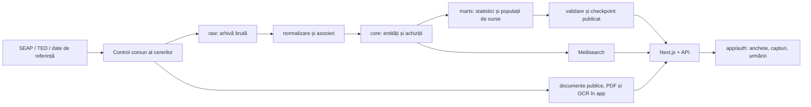

# Arhitectură și harta codului

## Stack și pachete

Versiunile efective se iau din `pnpm-lock.yaml`; valorile de mai jos sunt cele declarate la predare.

| Componentă | Rol |
|---|---|
| Node 22+, pnpm 9.4.0, Turborepo | Workspace TypeScript; pachete compilate în `dist` |
| `apps/web` | Next 16.2.10, React 19.2, App Router, interfață și API-uri |
| `apps/ingestion` | Colectare, normalizare, asocieri, agregări, validare, publicare, indexare |
| `packages/db` | Drizzle 0.45, postgres.js 3.4, scheme, migrații, politici comune de colectare/publicare |
| `packages/domain` | Tipuri și funcții ale domeniului |
| `packages/scraper-clients` | Clienți pentru sursele externe |
| PostgreSQL 16 | Sursa de adevăr pentru date, dovezi, autentificare și cozi |
| Meilisearch 1.16 | Index derivat pentru căutarea entităților |
| Better Auth 1.6 | Conturi create de admin, parolă și OTP obligatoriu pe email |
| PDF.js 6.3.289 | Randarea locală și sincronizată a paginii PDF |
| Playwright/Chromium, OpenSSL, Poppler, Tesseract | Preluarea documentelor și extragerea textului în worker |

Arhivarea este înaintea parsării. Transformările trebuie să se poată relua din răspunsul existent, fără o nouă colectare. O parte a istoricului normalizat a fost importată fără întreaga arhivă brută pe producție: nu presupune că orice rebuild total este posibil din producție fără inspecție.

## Scheme PostgreSQL

| Schemă | Conținut și tratament |
|---|---|
| `raw` | `raw_documents`, `ca_notice_ted`; răspunsuri brute, identitate și hash pentru deduplicare |
| `core` | Entități, ID-uri SICAP, achiziții directe, anunțuri, contracte, câștigători, TED, asocieri, flag-uri, praguri, watermark-uri, carantină |
| `marts` | Tabele statistice, profiluri, tranzacții pentru surse, Radiografie, TED, mostre de semnale |
| `reference` | CPV/sinonime, UAT, asocieri autoritate–UAT, bilanțuri MF, ONRC/reprezentanți |
| `auth` | Utilizatori, parole hash, sesiuni, verificări, material2FA — nu se distribuie |
| `app` | Dovezi/anchete/urmăriri private, rețete, control/cozi/audit; și documentele publice partajate |
| `drizzle` | Istoric migrații — trebuie păstrat cu snapshot-ul |
| `graphile_worker` | Infrastructură istorică de joburi; nu este coada de producție curentă pentru recuperare |
| `repair_20260927` | Copie tehnică temporară a arhivei TED; exclusă din transferul către coleg |

Nu clasifica întreaga schemă `app` drept publică și nici întreaga schemă drept dispensabilă: PDF-urile sunt în `app.document_blobs`, iar proveniența analitică în `app.monitoring_refreshes`.

Extensii necesare: `pg_trgm`, `unaccent`, `fuzzystrmatch`, plus `plpgsql`. Dump-ul logic păstrează definițiile lor. Nu se copiază volumul fizic PostgreSQL între arhitecturi Apple Silicon/Intel/Linux.

**Planuri personalizate în tranzacțiile cu parametri (24 octombrie 2026).** postgres.js pregătește fiecare interogare (`createDb`), iar de la a 6-a execuție a aceleiași instrucțiuni pe o conexiune din pool PostgreSQL poate trece la un plan generic, ales fără valorile parametrilor. Pe marts-urile naționale planul generic a fost de până la zece ori mai lent: sursele clasamentului național implicit, ~2 s la execuțiile 1–5, apoi 19,3 s și 15,7 s pe aceeași conexiune (local, `ask-perf --warm-runs=7`). În producție pool-ul web trăiește mult, deci întrebările populare ajung acolo. De aceea fiecare tranzacție a motorului Întreabă (`runSpec`, `runRows` în `lib/ask/compile.ts`) începe cu `set local plan_cache_mode = force_custom_plan` (`FORCE_CUSTOM_PLANS`, `lib/plan-cache.ts`), ca vocabularul interpretorului (`lib/intent/server.ts`), iar `withMonitoringSnapshot` (`packages/db/src/monitoring.ts`) o pune imediat după `BEGIN`. Snapshot-ul acoperă comparațiile (`lib/peers*.ts`), legăturile (`lib/connections.ts`), sursele lor, capturile și urmăririle; acolo comparația unei firme mari trecea de la 2,5 s la 3–5 s (o dată 17,6 s), iar legăturile ei de la 1,7 s la 2,6 s. Setarea e `local`: ține până la sfârșitul tranzacției și nu schimbă rolul, baza sau celelalte conexiuni. Costul obișnuit e o planificare la fiecare execuție (milisecunde; o comparație mică: ~120 → ~130 ms), dar nu orice instrucțiune e mai rapidă pe planul personalizat: din cele 84 ale celor 28 de cazuri grele, două erau mai rapide pe cel generic. Numărătoarea separată a clasamentului paginat (`count(distinct supplier_id)` pe 20,7 mil. de rânduri) mergea pe planul generic în paralel, 4,8 s, iar pe cel personalizat serial, 8,1 s. De aceea totalul unui clasament paginat vine acum din fereastra `count(*) over ()` a clasamentului însuși (selecția se citește o singură dată; doar o pagină de după ultima mai numără separat): clasamentul național „toate rezultatele” a coborât la 2,5–2,9 s la toate cele 8 rulări calde, de la 5,2–9 s înainte de setare și 7,7–9,7 s cu setarea și numărătoarea separată (local, aceeași conexiune, același răspuns). Rândurile CSV naționale sunt 0,66 s pe planul generic față de 1,04 s, dar în modul automat aceeași cale a ajuns la limita de 20 s la a 6-a rulare, deci setarea rămâne și acolo. Nu s-a pus peste tot: `ground()` rulează pe pool, în afara tranzacției, și rămâne la aceiași timpi sub planuri generice; pagina de domenii e chiar puțin mai rapidă cu planul generic (1,5 s față de 1,7 s); sursele unui semnal și ale Radiografiei deschid un pool nou la fiecare cerere, deci nu ajung la a 6-a execuție. Numărul de semnale al unei entități (`readEntitySignalCounts`) trece de la ~50 la ~150 ms pe planul generic și a rămas neschimbat. Verificarea: `scripts/ask-perf.ts` cu `--warm-runs=8` (rulările calde 5–8 sunt execuțiile 6–9 pe aceeași conexiune; implicitul de 3 nu ajunge acolo) și cu `?plan_cache_mode=force_generic_plan` în `--db` (setarea locală bate setarea sesiunii). O cale nouă care rulează pe marts interogări cu parametri pe un pool de lungă durată măsoară cele două regimuri și, dacă planul generic e mai lent, pune aceeași instrucțiune prima în tranzacția ei; o instrucțiune care rămâne mai rapidă pe planul generic se rescrie, ca numărătoarea de mai sus.

## Identități și precizie — capcane reale

- CUI-ul fiscal și ID-ul de participant SICAP sunt identificatori diferiți, chiar
  când ambele sunt numere valide. Prefixul autorității în arhiva DA 2020 este CUI;
  vechea interpretare ca SICAP a produs fragmentări și atribuiri către instituții
  greșite. [Audit și reparație documentată](../implementation/entity-identity-repair.md).
- `core.entity_redirects` păstrează legături verificate vechi→canonice, fără lanțuri
  sau cicluri. Rândurile entităților vechi rămân pentru referințe; întrebările vii
  rezolvă ID-urile canonice, capturile înghețate nu sunt rescrise. Numele identic nu
  justifică unirea unor CUI-uri diferite. Migrarea 0046 creează mecanismul, nu execută
  automat reparația datelor istorice.
- `core.contracts.id` este ID intern; `ca_notice_contract_id` este identitatea externă folosită de pagina contractului. `marts.contract_transactions.contract_id` este **intern**.
- Amprenta unei identități aprobate (`snapshot_hash`, `readContractIdentityMembers`) citește exact `core.contracts`, `core.awards`, `core.contract_winners` și `core.entities`. Triggerele din migrația 0083 schimbă `marts.contract_identity_source_state` la fiecare tranzacție care scrie în ele, iar o rulare de procesare își refolosește amprentele cât timp starea e aceeași (`SnapshotHashCache`). Validarea finală nu folosește memoria: recalculează amprentele membrilor și ale publicațiilor excluse temporar și compară cu ele fiecare amprentă din memorie. Dacă amprenta începe să citească alt tabel, acesta primește același trigger și intră în `CONTRACT_IDENTITY_HASH_SOURCES`. Altfel porțile dinaintea validării ar putea folosi amprente vechi, iar abia validarea finală ar opri publicarea.
- Bridge: `apps/web/app/contracte/i/[cid]/route.ts`; răspunsul are Location relativ. În drawer se păstrează tabul original.
- ID-urile `core.flags` și `marts.lot_patterns` se pot regenera. O captură durabilă leagă un descriptor și hash/versiune, nu doar un număr reutilizabil.
- Totalurile contractelor atribuite unui consorțiu pot reprezenta alocări estimate egal între membri când nu există valori individuale. Nu dubla suma însumând contractul integral pentru fiecare câștigător.
- Cantitățile, monedele, intervalele și plafoanele TED nu devin automat valori RON scalare. Proveniența câmpului și tipul sumei sunt păstrate.
- Modurile `profiles` și `transactions` au populații diferite. Pentru linkuri vechi se conservă semantica istorică.
- Un nume afișat lângă un ID nu schimbă identitatea întrebării. Rezolvarea tardivă a etichetei nu trebuie să marcheze un formular ca modificat.
- Comparațiile și dovezile leagă și checkpoint-ul datelor; compararea a două momente diferite fără indicare explicită este greșită.

## Harta principalelor module

Toate căile sunt relative la rădăcină.

| Subiect | Unde începi |
|---|---|
| Layout, fonturi, teme | `apps/web/app/layout.tsx`, `globals.css`, `approved.css`, `lib/site.ts` |
| Întrebări | `apps/web/lib/ask/spec.ts`, `compile.ts`, `predicates.ts`, `authority-kind.ts`, `filters/`, `answer-core.ts`, `population.ts`, `resolved-spec.ts`, `source-spec.ts`, `evidence.ts`, `permalink.ts` |
| Drawer și surse | `apps/web/app/intreaba/EvidenceDrawer.tsx`; `lib/source-evidence.ts`, `signal-evidence.ts`, `radiografie-evidence.ts` |
| Dovezi imuabile | `lib/evidence-capture-input.ts`, `evidence-captures.ts`, `evidence-captures-shared.ts`, `evidence-bundle.ts`, `evidence-zip.ts` |
| Anchete și permisiuni | `lib/investigation-access.ts`, `investigation-workspace.ts`, `workspace-api.ts`; `app/anchete/` |
| Rețete | `lib/recipes.ts`, `app/api/recipes/`, `app/intreaba/RecipeShelf.tsx` |
| Urmăriri | `lib/monitoring*.ts`, `app/urmariri/`, `app/api/urmariri/`, `scripts/monitoring-worker.ts` |
| Digest email | `lib/monitoring-digests.ts`, `scripts/monitoring-digests.ts` |
| Legături | `lib/connections*.ts`, `connection-evidence*.ts`, `app/entitati/[id]/legaturi/` |
| Comparații | `lib/peers*.ts`, `peer-population.ts`, `app/api/peers/`, `app/entitati/[id]/comparatii/` |
| Populație RPL2021 | `apps/web/lib/reference/population-rpl2021.json`; `packages/db/scripts/parse-population-rpl2021.py` |
| Fișiere | `apps/web/lib/documents/{store,seap,worker,process,rate-limit,shared}.ts`; `apps/web/scripts/documents/worker.ts` |
| Admin | `app/admin/layout.tsx`, `AdminNavigation.tsx`, `CollectionDashboard.tsx`, `RecoveryOverview.tsx`, `DocumentQueue.tsx`; `lib/admin/` |
| Estimare recuperare | `lib/admin/recovery-status.ts`, `recovery-forecast.ts` și testele lor |
| Autentificare | `apps/web/lib/auth.ts`, `mail.ts`, `scripts/seed-admin.ts`; `packages/db/src/schema/auth.ts` |
| Colectare durabilă | `apps/ingestion/src/scripts/collection.ts`, `src/collection/` |
| Poarta comună SEAP | `packages/db/src/collection.ts`, `collection-policy.ts`, `collection-quiet-window.ts`, `collection-retry.ts`, `collection-diagnostics.ts` |
| Publicare și validare | `apps/ingestion/src/monitoring/{refresh,pipeline,validate,coverage,cli}.ts`; `packages/db/src/processing.ts` |
| Parsare/asociere TED | `apps/ingestion/src/normalize/{ted,ted-fforms,ted-load,ted-replay,reconcile,ted-mart}.ts` |
| Flux de colectare TED (oprit până la `ted-enable`): pachetul zilnic OJ S, verificat cu căutarea TED | `apps/ingestion/src/collection/{ted,ted-activation,advance}.ts`, `src/scrape/ted/{collection-client,package}.ts`; ținte în `packages/db/src/collection-policy.ts` |
| Index de căutare | `apps/ingestion/src/search/index-entities.ts`, `src/scripts/index-search.ts`; `apps/web/lib/search.ts` |
| Deploy și scheduler | `infra/prod/deploy.sh`, `process-nightly.sh`, Dockerfiles, compose; `.github/workflows/ci.yml` |
| Migrații | `packages/db/migrations/`, `src/schema/`, `scripts/deploy-migrate.mjs`, `migration-history.mjs` |

Pentru o cale redenumită folosește `rg --files`, nu presupune că această hartă înlocuiește codul.

## Capturi și exporturi

Captura se reconstruiește pe server din identitatea selecției; un browser nu poate inventa totalul, lista de membri sau sursele. Copiere SQL-to-SQL într-un snapshot repeatable-read, valori zecimale exacte, versiuni imuabile și acces verificat din nou la publicare. Selecțiile nominale foarte mari au limite explicite; nu se trunchiază în tăcere. Exportul live CSV și captura integrală au mecanisme/limite distincte.

ZIP64 permite pachete mari cu CSV/NDJSON, metodologie, istoric și manifest SHA-256. Nu afirmăm că un ZIP conține toate binarele externe dacă oferă doar referințele lor.

## Documente — mecanismul real

Pentru familiile suportate se rezolvă anunțul prin identitate și autoritate, apoi se citește lista. Nu orice familie de anunțuri are încă implementată preluarea. Pilotul verificat folosește SCN/type 17, de exemplu `https://www.e-licitatie.ro/pub/notices/simplified-notice/v2/view/100231768`. URL-ul de fișier nu este identitate durabilă.

Worker-ul folosește o sesiune Chromium nouă, metadata proaspete, POST de verificare urmat de GET în aceeași sesiune, cu Referer-ul familiei corecte. Un GET izolat cu hash vechi poate eșua deși browserul utilizatorului descarcă fișierul. Nu copia Cookie/Authorization/chei din DevTools în cod sau documente. Doar cererile allowlistate ies din browser; resursele și redirecturile nepermise sunt blocate.

Actualizare 11 octombrie: vechile limite de 50 MiB/150 pagini au fost înlocuite cu transport/stocare în bucăți și procesare OCR reluabilă. PDF/CMS, Word/Excel, ZIP/RAR/7z sunt tratate de toolchain; multipart rămâne deschis. Originalele și PDF-urile derivate sunt separate, cu SHA-256. Supervisor-ul exclusiv permite până la 10 lane-uri de rețea și 4 de procesare; nu mai este un singur job global. [Mecanism și limite actuale](20261011/operations.md), [formate](../implementation/document-formats-20261011.md).

## Căutarea `/cauta` — două cereri

Actualizare 22 octombrie 2026. Pagina face două cereri pentru aceeași selecție (subiect, loc, perioadă, tip, potrivire):

- `/api/topic-search` — titluri (`marts.topic_acquisitions`), instituții și firme, locul ales, data indexului și acoperirea titlurilor. Nu atinge documentele; răspunde de regulă sub o secundă.
- `/api/topic-search/documents` — pasajele din documentele pregătite și acoperirea lor („X din Y fișiere”). Pagina o cere în paralel, o afișează separat („Căutăm în documente…”) și nu blochează restul. O eroare rămâne în secțiunea Documente, cu „Reîncearcă documentele”. Schimbarea tabului sau a paginii de achiziții nu o repetă (`documentScope` în `lib/topic-search/shared.ts`).

Textul paginilor este indexat în `app.document_page_search` (`to_tsvector('simple', unaccent(text))`, GIN), aceeași expresie ca la titluri. `unaccent()` nu este IMMUTABLE, deci nu poate susține o coloană generată sau un index pe expresie; vectorul este scris de un trigger pe `app.document_pages` (migrația 0079). Astfel sunt indexate și paginile scrise de un worker vechi sau de orice alt scriitor; o pagină peste limita tsvector (1 MB de lexeme) rămâne citibilă, dar nu apare în căutare. Ștergerea paginii șterge și vectorul (cascadă).

Legătura document → procedură rămâne cea de dinainte: anunțul documentului → `core.notices` → `procedureId` din payload-ul brut **și** același cumpărător → contractul din `topic_acquisitions` care respectă filtrele. Niciodată după titlu sau nume de fișier. Se calculează o singură dată pe cerere și pe anunț (nu de trei ori și nu pe fiecare fișier), într-o singură interogare. Nu este materializată: un document procesat acum este căutabil imediat, fără să aștepte procesarea de noapte. Dacă numărul de anunțuri cu documente crește mult, materializarea legăturii în build-ul nocturn rămâne opțiunea următoare, cu prețul acestei întârzieri.

Pe pagină, o căutare nouă nu mai arată rezultatele căutării anterioare: zona păstrează înălțimea cu rânduri-schelet până sosesc rezultatele selecției curente. La schimbarea doar a tabului sau a paginii, numerele din taburi rămân, pentru că aparțin aceleiași selecții. În „Unde cauți?”, după ce modifici textul, prima potrivire este evidențiată și Enter o alege; numele locului deja aplicat nu contează ca text scris (multe localități au același nume în județe diferite), iar un Enter apăsat înainte de sosirea sugestiilor nu alege singur când primele potriviri au același nume.

### Căutarea de pe prima pagină și „Am înțeles” (22 octombrie 2026)

Caseta de căutare (prima pagină și dialogul din antet, `app/DiscoverySearch.tsx`) cere în paralel, cu un singur debounce și cu anularea cererilor vechi: `/api/intent` (interpretorul cu reguli), `/api/suggest` (subiecte CPV și sinonime, localități, persoane; pentru textul întreg și separat pentru ultimul cuvânt, ca „iluminat buz” să propună Buzău; o localitate apare doar dacă numele ei începe cu cuvântul scris) și `/api/search` (instituții și firme din Meilisearch). Gruparea și ordinea sunt în `lib/search-suggestions.ts` (pur, testat): „Cel mai probabil cauți” (propoziția interpretorului, neschimbată, doar la încredere mare/medie și doar dacă lectura explică toate cuvintele; o lectură ambiguă apare ca alegere, nu ca răspuns), Subiecte, Locuri (cu celelalte cuvinte: „iluminat · Județul Buzău” → `/cauta?q=iluminat&place=county:buzau`), Instituții, Firme, Persoane (doar când textul pare un nume), apoi „Caută „…” în titluri și documente” (`literal=1`, fără interpretare). Un subiect găsit doar pe un fragment de cuvânt din catalog („construct” → „Construcţie de canale”) e o lectură slabă: firmele vin primele. Dacă `/api/intent` cade, celelalte grupuri rămân. Enter fără un rând ales cu săgețile deschide `/cauta?q=…` (decizia proprietarului 2); trecerea mouse-ului peste un rând nu schimbă ținta lui Enter.

`/cauta` cere întâi `GET /api/topic-search/interpretation` (aceiași parametri; interpretorul rulează pe server, cache 10 minute pe data calendaristică din București, limită 3 s cu oprirea căutărilor rămase) și abia apoi titlurile și documentele, cu selecția aplicată (`lib/topic-search/interpretation.ts`, `words.ts`). Locul și perioada numite în cuvinte devin filtre doar dacă lectura e curată: URL-ul nu are deja filtrul, interpretorul a ales un singur loc, nu a citit o firmă, o instituție sau o persoană, nu au rămas cuvinte neexplicate, iar restul cuvintelor este exact subiectul recunoscut (plus cuvinte de legătură și de întrebare). Atunci titlurile se caută doar după cuvintele subiectului: „iluminat buzau” → „iluminat” în Județul Buzău; „medicamentele buzau” → „medicamente” (forma de bază a sinonimului). Altfel cuvintele se caută exact cum au fost scrise: „drumuri si poduri buzau” (interpretorul citea Comuna Poduri și lăsa „buzau” neexplicat; „și” între două cuvinte înseamnă două subiecte), „apa nova bucuresti” (rămâne căutarea firmei), „spitalul judetean buzau”, „piata romana bucuresti”, „primaria buzau”. O localitate ambiguă nu se aplică: variantele apar ca butoane. Sectoarele Bucureștiului nu au filtru în titluri: nu se aplică, pagina spune asta și trimite la Întreabă sau la tot Bucureștiul. Perioadele deschise devin interval („după 2020” → 2021 până în anul curent; „până în 2018” → 2000–2018). Dacă interpretarea eșuează sau întârzie, se caută cuvintele scrise.

Rezultatul apare ca „Am înțeles”, cu cipuri: Subiect (alt subiect sau „caută exact ce ai scris”), Loc (×, orașul în loc de județ, tot județul), Perioada (×) și „Cine cumpără” (de exemplu școlile; titlurile nu se pot filtra după tipul instituției, deci cipul spune „doar în Pe scurt”, iar cuvântul nu mai e cerut în titluri: „laptopuri scoala” caută „laptopuri”). Modificarea unui filtru transformă locul/perioada din cuvinte în filtre explicite; o căutare nouă scrisă în casetă e citită din nou (locul luat din cuvintele vechi nu se păstrează).

„Pe scurt” apare doar pentru un subiect dintr-o lectură curată și conține exact ce arată cipurile (locul, perioada și tipul instituției; dacă interpretorul a citit un loc care nu se poate aplica, nu apare deloc). Rulează prin `/api/ask` două specificații construite de interpretor (`specFor`): totalul (`stat`, „în N înregistrări”, ca în Întreabă) și primii trei câștigători (`table`, `topN: 3`; cu cipuri, propozițiile nu se repetă: cifra, apoi „Cine câștigă cel mai mult:”; la o întrebare întreagă apar propozițiile exacte), toate clasele CPV numărate (din același `ground` ca motorul) și limitele pe care Întreabă le arată pentru aceleași specificații (contractele peste 1 mld. lei separate, achizițiile directe peste 2 mil. lei excluse, doar oferte acceptate, localitatea = primăria). Se calculează în paralel cu titlurile. O localitate înseamnă în Ask primăria (`uatScopeCaveat`), iar în titluri instituțiile asociate localității; propoziția spune care e cazul. Potrivirea puternică de nume („Cauți această instituție?”) rămâne sus când nu e subiect și coboară sub titluri când e. Cu 0 titluri, pagina propune: tot județul, toată țara, toți anii, întrebarea în Întreabă (doar dacă propoziția e cea arătată), documentele și subiecte apropiate.

**Întrebarea întâi (23 octombrie 2026).** Când cuvintele sunt o întrebare întreagă citită curat (`isCleanQuestion`: cuvânt de întrebare „cine”/„cât”…, specificație construită, încredere „high”, niciun cuvânt neexplicat, nicio alegere de făcut între localități, firme sau persoane) și nu s-a aplicat un subiect la titluri, interpretarea are `question`. Atunci `/cauta` arată sus „Am înțeles: <propoziția interpretorului>” și, pentru „cine câștigă” și „cât”, același „Pe scurt” (total + primii trei) construit din citirea interpretorului, cu locul ei (de ex. „cine ia banii oradea” = primăria Municipiului Oradea), plus „Vezi răspunsul complet” (`/intreaba?q=…`) și „Caută exact ce ai scris” (`literal=1`). Pentru alte întrebări („cum au evoluat…”) apar doar propoziția și cele două butoane. Cuvintele, căutate ca atare, vin dedesubt; dacă nu găsesc nimic (titluri, nume, documente), se strâng într-un rând („Pentru cuvintele exacte „…” nu am găsit titluri sau nume. Arată”). O întrebare cu un cuvânt neînțeles („cat a costat podu oradea”) sau cu o alegere nu primește răspuns ghicit. „primaria ploiesti” rămâne căutare de nume (fără cuvânt de întrebare).

**Niciodată „0 lei” ca răspuns.** Când totalul din „Pe scurt” are 0 înregistrări, în locul cifrei apare „Niciun contract încadrat la „X” la <cumpărătorii din propoziție>.”, un (?) lângă „Domenii incluse” („Numărăm după încadrarea oficială (CPV), nu după titlu.”) și, dacă există, „N titluri conțin „X”: vezi achizițiile” (deschide fila Achiziții), plus, când e numit un cumpărător (localitate, județ, instituție), „Vezi la ce domenii sunt încadrate achizițiile făcute de …” (aceiași cumpărători, fără subiect, ca `breakdown` în Întreabă: acolo apar, de exemplu, parcurile încadrate la spații verzi). Un total cu înregistrări dar fără valoare arată numărul de înregistrări, nu „0 lei”. „Pe scurt” are și „Vezi toate cele N înregistrări” (`/intreaba?spec=<total>&drill=1`, deschide lista din spatele sumei), iar lista de titluri spune unitatea când numerele diferă: „816 după domeniu în „Pe scurt” · 16 cu „X” în titlu (?)”; explicația de sub (?) adaugă „nu doar școlile” când cipul „Cine cumpără” restrânge doar „Pe scurt”. Când „Am înțeles” e afișat (cipuri sau întrebare), rândul de stare dispare vizual la orice lățime și rămâne pentru cititoarele de ecran; pagina nu mai are subtitlu. Pe telefon, după o căutare, titlul paginii devine cuvintele căutate, iar titlurile achizițiilor se taie la 3 rânduri, ca suma și „instituție → firmă” să se vadă.

**„Subiect apropiat”** (`lib/topic-search/related.ts`) pornește doar de la primul cuvânt de cel puțin 4 litere care nu e de întrebare sau de legătură (cine, cât, ia, bani, firme, strada, primăria…) și păstrează doar numele în care un cuvânt începe cu cel scris și îl acoperă cel puțin pe jumătate. Fără potrivire nu apare nimic („cine” nu mai aduce „Porcine”, „eco gardn” nu mai aduce „Orez decorticat”).

**„Unde cauți?”** (`/api/topic-search/places`, `lib/topic-search/places.ts`) potrivește în memorie catalogul `reference.uat` (circa 3.200 de rânduri, încărcat o dată pe oră) și cele 42 de județe, fără diacritice și fără cuvântul de tip („MUNICIPIUL”, „ORAȘ”): întâi potrivirea exactă, apoi începutul numelui, un cuvânt din nume, oriunde în nume, localitățile județului numit; o greșeală de o literă („oradia” → Municipiul Oradea, „bucurseti” → București județ și municipiu) apare doar când nu există nimic mai bun, cu mesajul „Nu am găsit exact „…”. Poate cauți:”. Enter apăsat înainte de listă alege singur doar o potrivire clară: niciodată o greșeală ghicită și niciodată între două locuri la egalitate (două „Sălcioara”, județul și municipiul Brașov); atunci lista rămâne deschisă.

**Vocabular (migrația 0080).** `reference.cpv_synonym` vine din `packages/db/seeds/cpv-synonyms.sql` (rulat manual, truncate + insert). Migrația `0080_cpv_synonym_beginner_terms` adaugă 84 de rânduri (insert … on conflict do nothing, nimic șters), iar seed-ul are același bloc, deci un re-seed reproduce starea. Exemple: „iluminat public”, „iluminat festiv”, „crăciun”, „sărbători”, „gropi”, „trotuare”, „deszăpezire”, „rechizite”, „laptop”, „tablete”, „transport elevi”, „renovare”, „reabilitare” (clădiri, izolare termică **și** drumuri, 4523314x), „termoizolare”, „parcuri”, „spații verzi”, „locuri de joacă”, „publicitate”, „evenimente”, „festival”, „artificii”, „cărți”, „manuale”, „imprimante”, „camere video”; „apă” primește distribuția de apă și conductele; „reabilitare drumuri” păstrează toată clasa 45233, „alimentare cu apa” păstrează și 41000000.

**„Iluminat” include semnalizarea rutieră (decizia proprietarului: codurile largi rămân, dar oamenii văd asta).** După 0081, „iluminat” și „iluminat public” = iluminat exterior (31527200), iluminat stradal (34993000, 34928500), instalare (45316000) și întreținere (50232000); lămpile în general (31500000) nu mai fac parte din „iluminat” (au termenul „becuri”). Clasele 45316000 și 50232000 sunt definite în CPV ca „iluminare **și semnalizare**” și „iluminare publică **și semafoare**”. Pe datele locale (contracte sub 1 mld. lei și achiziții directe de cel mult 2 mil. lei), semnalizarea (453162x, 502322x) face circa 8% din valoarea acestor clase (circa 7% înainte de 0081, cu lămpi cu tot). Ponderea variază mult după loc (de la 0,1% în Constanța și Harghita la peste 30% în Gorj și Brașov, măsurat pe definiția din 0080), așa că nota arătată oamenilor nu dă o cifră care poate fi falsă pentru locul ales: „Include și semnalizarea rutieră (semafoare, balizaj), clasificată în aceleași coduri CPV cu iluminatul public. La nivel național e circa 8% din valoare, dar în unele județe mult mai mult.”

**Revizuirea vocabularului (migrația 0081, octombrie 2026).** Fiecare termen a fost verificat pe toate subcodurile CPV pe care le prinde, cu valoarea lor pe datele locale: IN = ce înțelege un începător, OUT = altceva, AMB = parțial sau ambiguu (regulile de judecată sunt în auditul de lucru, nu în cod). Schimbări: excluderi unde părintele mare e corect (medicamente/doctorii fără reactivi 33696 și articole din cauciuc 33682/33683; aparatură/echipamente medicale fără consumabile 3314 și articole din hârtie/îmbrăcăminte 33198/33199; licențe/software fără servere și sisteme 488 și sonorizare 48952; autoturisme/mașini fără ambulanțe, vehicule de salvare, de deținuți și microbuze; uniforme și îmbrăcăminte fără echipamentele de protecție 1814, îmbrăcăminte și fără încălțăminte, genți și bijuterii; gunoi/salubrizare fără deșeuri periculoase și medicale 9052, nămol și halde de cărbune; cărbune fără combustibilii pe bază de lemn; mobilier urban fără materialele de semnalizare); restrângeri (proiectare, arhitectură, școală 45214100+45214200, becuri, lapte 15510000+03333000 cu termen nou „lactate” pentru 15500000, parcuri, reabilitare drumuri 45233139/45233140/45233223/45233251 în loc de toată clasa 45233, fructe și legume separate, rechizite, festival, iluminat festiv, transport elevi fără microbuze, măști pe codurile de măști); coduri lipsă adăugate (hârtie, mănuși, pubele, dezinfectant, gaz, reparații drumuri/gropi, fotovoltaice, evenimente, cartușe/toner, autobuze 34120000, canalizare, alimentare cu apă fără 45232100, deszăpezire, asfalt 44113600, autoutilitare 34144700, consultanță, reparații + 45453000); termeni scoși: „lucrari” (46% din toată valoarea), „programe” (ambiguu, „software” rămâne), „mese” (ambiguu cu mobilierul; „catering” rămâne). „mașini” rămâne autoturisme, cu notă. Note scurte doar unde rămâne o ambiguitate (iluminat, echipamente medicale, măști, mașini, școală, mobilier urban, reabilitare, transport elevi, crăciun/sărbători, brichete/peleți, reparații). Rezultat pe auditul refăcut: OUT devine 0 la toți termenii schimbați, în afara semnalizării din iluminat (circa 8%, decizie asumată și notată) și a măștilor (regulile auditului marchează orice cod ca OUT; măștile chirurgicale nu au cod CPV propriu, iar nota spune asta). 290 de rânduri după 0081, dintre care 50 de excluderi; migrația șterge doar perechi (term, prefix) exacte de includere, e idempotentă, iar seed-ul are starea finală.

**Notele sinonimelor ajung la oameni.** Orice `note` nevidă a unui rând din `cpv_synonym` folosit pentru un subiect este arătată: `ground()` o întoarce în `cpv.notes`, motorul Ask o adaugă la limitele răspunsului („Despre „iluminat”: …”), iar `/cauta` o afișează sub cipul de subiect și în „Pe scurt”. Nota se scrie deci ca o frază pentru cititor. Notele rândurilor noi din 0080 sunt goale, cu excepția celor de mai sus; cele 13 note vechi erau etichete interne ale rândurilor („apa captata si epurata”, „lemn de foc”) și ar fi apărut ca explicații înșelătoare: 0080 le golește doar pe acestea, cu valorile exacte (o notă schimbată între timp rămâne), iar seed-ul le are goale. Pe datele locale, „iluminat” în județul Buzău trece de la 6,9 mil. lei (1.852 înregistrări, doar lămpi) la 114,4 mil. lei (2.553). Nu am adăugat „lucrări de instalații electrice” (45310000): titlurile de iluminat sunt des clasificate acolo, dar clasa e prea largă; titlurile le găsesc oricum.

**Motorul (`lib/ask/ground.ts`).** Un termen care are rânduri proprii în `cpv_synonym` înseamnă exact acele rânduri (toate). Înainte, motorul lua cele mai lungi 4 rânduri care conțin termenul sau sunt conținute în el, ca șir de litere: „apa” aducea și „aparatura medicala” (33100000) și apa minerală, iar un termen cu multe rânduri putea fi tăiat de termeni mai lungi. Un text fără rânduri proprii trece prin `pickContainedSynonyms`: termenii conținuți în text ca cuvinte întregi, eventual flexionate („drumurile”, dar „gaz” nu e în „gazon”), fără cei aflați deja într-un termen mai lung ales; altfel cei mai scurți termeni care încep cu textul („ilum” → „iluminat”). Fiecare termen ales intră cu toate rândurile lui („iluminat stradal” primește toate cele 5 clase ale lui „iluminat”). Apoi trigramele din catalog. **Excluderi (migrația 0081):** un rând cu `exclude = true` scoate un sub-arbore din termen („medicamente” = 336… fără 33696, reactivii de laborator). Excluderea contează doar în interiorul unui sub-arbore inclus și nu scoate ce include alt termen din același text („medicamente reactivi”). `ground()` întoarce `cpv.excludePrefixes` și `excludedNames`; motorul adaugă `and not (cpv_code like …)` la statistici, tabele, rânduri-sursă și CSV (`runSpec`, `runRows`), în SQL-ul afișat, o limită „Din „…” nu sunt numărate: …” și o etichetă „fără N subclase”; `/cauta` scrie „Domenii incluse …; fără: …”; urmăririle notează excluderile fixate la activare. O urmărire activată înainte de 0081 își păstrează gruparea veche (fără excluderi). Cheia rămâne (term, cpv_prefix): același prefix nu poate fi și inclus, și exclus pentru un termen. `exclude` se citește prin `to_jsonb`, ca o bază încă fără 0081 să răspundă. Răspunsurile salvate cu `cpvTerm: "apa"` se schimbă în consecință (corecție). Cuvinte care rămân greșit înțelese și nu se repară prin sinonime (sunt cuvinte de loc sau de instituție, de reparat în interpretor): „strada” → Iluminat stradal, „primărie/primării” → Siliconi primari, „direcția” → coloane de direcție, „lucrări” (după 0081 nu mai e sinonim: ar fi însemnat 46% din toată valoarea).

**Cuvinte retrase (`lib/ask/retired-terms.ts`).** „lucrari”, „mese” și „programe” au fost sinonime până la 0081, deci linkuri salvate și text liber le pot conține. Pentru ele (și pentru orice cuvânt adăugat în listă) `ground()` nu caută sinonime sau trigrame (altfel „mese” ar fi devenit mobilier și „lucrari” cinci subclase de construcții la întâmplare): întoarce `cpv.retired`, iar motorul răspunde cu mesajul și variantele („lucrări de construcții”, „clădiri”, „drumuri”, „reparații”, „renovare”; „catering” sau „mobilier: mese”; „software” sau „programe de formare”). Se recunosc și formele flexionate din listă („mesele”, „lucrărilor”, „programele”), niciodată alte cuvinte („meserii”, „mesaje”). Un text întreg primește variantele doar dacă în afară de cuvântul retras are numai cuvinte de legătură („lucrari de”, „mese si”); „lucrari de pavare”, „programe de formare” sau „mese si scaune” se interpretează normal. Interpretorul nu alege nici el: `subjectChoices` dă `spec` null, problema și câte o alternativă de tip `subject` pentru fiecare variantă; Întreabă, căutarea de pe prima pagină și `/cauta` le arată ca alegeri.

**Vocabular după testul cu primii vizitatori (migrația 0082, 23 octombrie 2026).** „parcuri” primește din nou toată clasa 77310000 (amenajarea și întreținerea spațiilor verzi), în locul copiilor 77311000 și 77313000: primăriile trec întreținerea parcurilor mai ales acolo (Timișoara 211,2 mil. lei, Brașov 193,1 mil. lei răspundeau 0 lei). Nota rândului spune că include toate spațiile verzi, nu doar parcurile. Pe datele locale „parcuri” trece de la 1.821,5 la 15.730,5 mil. lei, din care 13.759,9 mil. sunt chiar codul 77310000. „pod” (cuvântul exact) = lucrări de poduri 45221000, ca „poduri”, nu produsul din catalog „Pod” 44212100 (4,4 mil. lei); 45221 = 8.455,8 mil. lei, din care circa 10% ambiguu (clasa-părinte „poduri și tuneluri”, podețe, subtraversări) și 1,7% tuneluri și lucrări subterane. „lucrari de drumuri” și „lucrari drumuri” = toată familia 45233 (145.054,0 mil. lei), ca „drumuri”, nu doar frunza 45233140 „Lucrări de drumuri” (47.484,0 mil. lei). 292 de rânduri, 50 de excluderi, 19 note; aceleași reguli de scriere ca la 0081, seed-ul are starea finală.

**Interpretorul (`lib/intent/rules.ts`), aceeași zi.** Un sinonim curatoriat larg bate o etichetă de catalog mai îngustă pentru aceleași cuvinte, și lângă un cuvânt generic („lucrări de canalizare” → „canalizare”); la egalitate, sugestiile pun sinonimul înaintea etichetei („pod” înaintea „Pod”). Mai multe subiecte recunoscute („parcuri și spații verzi”) se adună: `cpvTerm` le leagă cu „ + ”, `ground()` le împământează pe fiecare și scrie reuniunea în condiția unică a motorului (`unionCpvParts`: o excludere pe care alt subiect o numără dispare, una care conține o clasă inclusă de alt subiect e decupată în jurul ei; un test exhaustiv verifică egalitatea cu „SAU” între condițiile fiecărui subiect), fiecare înregistrare o singură dată; nota și propoziția numesc toate subiectele. Un cod CPV de 8 cifre (cu sau fără „-cifră”) e domeniul lui; „RO” + cifre, „cui …”, „cif …” caută firma sau instituția cu acel cod fiscal. Jargon SEAP: „ofertă unică” (și variantele) se citește (nu devine subiect), dar din F1b nu mai e filtru: înseamnă contractele din proceduri, cu nota „Numărul de oferte îl știm doar pentru o parte din înregistrările contractelor…” (paragraful F1b-polish); tipurile de procedură („licitație deschisă”, „procedură simplificată”, „negociere fără publicare”…) înseamnă contracte din proceduri, cu nota că tipul procedurii nu se poate filtra încă, iar calificativul apare la „Nu am înțeles” (nu mai devine „Cuțite de deschis scrisori”). Numele de instituții: cuvintele pe care registrul le omite des („urgență”, „clinic”) se reîncearcă fără ele, cu notă („spitalul judetean de urgenta satu mare” → SPITALUL JUDETEAN SATU MARE); numele se oprește înaintea lui „din județul X”, ca locul să rămână loc; variantele pentru un nume parțial se caută în locul recunoscut. `choicesPartial.hint` spune cum se restrânge lista: localitatea pentru instituții și firme, anul nașterii doar pentru persoane. O greșeală de o literă într-un loc precedat de un marcaj („primăria oradia”, „din oradia”) se citește de la 6 litere (înainte de la 7); fără marcaj, locul trebuie scris exact. O listă scurtă de denumiri englezești pentru subiecte frecvente („street lighting”, „road works”, „parks”, „medicines”…) duce la termenul românesc curatoriat, iar lectura spune „Am citit „street lighting” ca „iluminat public””. „Administratorul la/firmei X” citește firma X și spune că administratorii sunt pe pagina ei, la „Conducere”; un nume imediat după cuvânt rămâne o persoană. Doar „lucrări”/„servicii” cedează unui sinonim larg; „echipamente”, „materiale” schimbă subiectul în bunuri, deci eticheta din catalog rămâne.

**Primării numite cum vorbesc oamenii (23 octombrie 2026).** „primăria Cluj” citea doar județul (nicio localitate nu se numește „Cluj”) și răspundea, cu încredere „mare”, pentru toate instituțiile din județul Cluj. Acum, după „primăria”, „consiliul local”, „municipiul”, „orașul”, „comuna”, „localitatea”, cuvintele scrise se caută și ca început de nume: o singură localitate care începe cu ele e aleasă și lectura spune „Am înțeles „cluj” ca Municipiul Cluj-Napoca.” (Alba → Alba Iulia), cu tot județul ca alternativă. Când mai multe se potrivesc, sau când un nume exact mic ar ascunde un oraș mai mare care începe cu el („Piatra”: comuna din Teleorman, dar și Piatra-Neamț; „Baia” și Baia Mare), omul alege; numele exact câștigă doar dacă e cel mai populat („primăria Buzău”, „primăria Sântana”). „primăria <județ>” („primăria Dolj”) nu mai trece pe tăcute la tot județul: se propun municipiile județului (sau orașele, unde nu există municipii) și tot județul, cu nota „Dolj este un județ, nu o localitate.” O primărie nerecunoscută scade încrederea (nu mai e „mare”). „abonate”, „de casă”, „mereu aceleași”, „cel mai des”, „câștigă mereu” ordonează firmele după numărul de achiziții (`measure: count`); propoziția rămâne neutră.

**Comparația a două entități (24 octombrie 2026).** Nu se mai alege între „achizițiile din selecție” și „profilurile istorice de risc”. `runSpec` (`case "compare"` în `lib/ask/compile.ts`) calculează totul pe selecție, cu aceleași filtre pentru ambele: totalul și înregistrările pe canal (proceduri și achiziții directe), câte contracte au avut o singură ofertă din cele cu număr de oferte cunoscut (numărul e publicat doar pentru o parte, mai ales din TED, deci niciodată „din toate”), contrapărțile distincte, valoarea pe ani (anii parțiali hașurați, ca la evoluție), grupele CPV de 5 cifre cu cota din valoarea entității (primele 4, apoi un rând „Restul · N domenii” care include și valoarea fără cod CPV, ca fiecare panou să însumeze 100%; „Vezi toate domeniile” arată pe loc până la 30, `COMPARE_DOMAINS`), contrapărțile comune (cel mult 30, după valoarea însumată; fără comune, primele 4 ale fiecăreia) și, la firme, contractele publice câștigate împreună (cheia paginii `/contracte/` este `core.contracts.ca_notice_contract_id`, nu `contract_id` din marts). Lângă ele, fiecare card arată profilul de risc istoric din `marts.entity_flags` (CRI, semnale), etichetat „Tot istoricul de achiziții directe; nu urmează filtrele”; valoarea din profil nu se mai afișează, ca să existe un singur total. Firmele au și angajații și cifra de afaceri din bilanț, instituțiile lei pe locuitor. Linkurile vechi cu `comparisonMode: "profiles"` rulează la fel (`isHistoricalProfile` nu mai include comparația). Constructorul spune „Compară X cu Y” și nu mai oferă „Mai multe filtre” pentru comparație, decât dacă linkul are deja un prag sau o selecție precisă, ca să poată fi scoase. Producția nu avea nicio urmărire activă la schimbare, deci forma nouă a răspunsului nu produce alerte false. Interfața: `app/intreaba/CompareBlock.tsx` și `compare.css`.

**Reparații de onestitate în Întreabă (etapa R0 a filtrelor pe întrebare, 24 octombrie 2026, ramura `feat/ask-filters-registry`).** Fără chei noi și fără cifre schimbate. (1) Profilurile istorice (`distribution`, `scatter`, „Cine conduce?” pe indice) sunt doar achiziții directe acceptate, pozitive, de cel mult 2 mil. lei (`apps/ingestion/src/flags/marts.ts`, sursele din `runRows`). Bannerul fals „inclusiv oferte neacceptate” devine „Profil istoric: achiziții directe acceptate; valori înregistrate, nu plăți.”, iar nota din panoul de surse „Doar achiziții directe acceptate, ca profilul.”, cu reconcilierea păstrată (`app/intreaba/ProfileNotes.tsx`). (2) Pastilele (`lib/ask/pills.ts`): „pe domenii” în loc de „pe ce s-au dus banii”, „risc și valoare” în loc de „risc vs volum (outlieri)”; pe profiluri, „profil istoric: achiziții directe acceptate, toată arhiva” în loc de „toate sursele…”; pastila măsurii spune ce arată răspunsul (motorul ține cont de `measure` doar la `table`, `stat`, `timeseries` și `map`, iar pe locuitor doar la clasament). (3) `transitionQuestion` restaurează linkurile și urmează fiecare editare. Valorile implicite (axa `rankBy`, `topN`, `measure`, dimensiunea profilurilor) se aplică doar la schimbarea tipului de întrebare; pe același tip, un spec acceptat de `validateSpec` rămâne neschimbat, deci un link vechi nu mai apare „modificat” și rulează cum a fost cerut. Un „Cine conduce?” fără `rankBy` este indicele de risc (`leaderAxis`, ca în motor) și rămâne așa și după o editare; o întrebare nouă primește `rankBy` explicit. Rămân pe orice editare doar reparațiile pe ciorne pe care motorul le-ar refuza („un singur ofertant” → contracte; pe locuitor pe un clasament de firme sau județe). (4) Nota de județ (`countyCaveat`, `countyIsFirmSeat` în `lib/ask/population.ts`) spune „sediul firmei (din adresă, cod NUTS sau ONRC)” pe profilurile de firme, unde `efWhere` filtrează `entity_flags.county` al firmei; nota din fereastra „Unde?” a constructorului la fel. (5) Fluxul și rețeaua fără rânduri spun „„X” nu are înregistrări în selecția aleasă.”, pe orice sursă. (6) Harta (`app/intreaba/MapBlock.tsx`) numără „înregistrări” în tooltip (`countWords`) și ia culorile, conturul și județele fără date din tokenurile temei (`--map-0…4`, `--surface`, `--sunk`), deci are contrast și în tema întunecată. Teste: `question-ui.test.ts`, `pills.test.ts`, `caveat-wording.test.ts`, `ProfileNotes.test.ts`, `MapBlock.test.ts`. După revizia etapei: un clasament fără `topN` (complet, pe pagini) are pastila „toți furnizorii”, „toate autoritățile” sau „toate județele”, nu „top 10”; măsura `count` are pastila „numărul de înregistrări” (cuvântul trusei); nota „Pe locuitor” și citirea populațiilor apar doar la clasament (altundeva răspunsul e în lei, ca pastila); harta pe număr spune numărul o singură dată, în cuvinte; bannerul profilului și linia de nepotrivire din panoul de surse folosesc `--amber-ink` (#6e5427 în tema deschisă, 6,2:1; `--amber` era 3,7:1), iar (?)-ul bannerului are 44 px sub 600 px; reconcilierea numără cu `countWords`; în fereastra „Unde?” motivul e „Indicele de risc compară profiluri între ele…”, valabil și pe profilurile de firme; în tema întunecată, rândul ales sau atins dintr-o fereastră a constructorului are `--accent-soft` (fundalul deschis scris direct făcea textul ilizibil, 1,06:1).

**Întâi citește, apoi scrie (etapa F0a a filtrelor pe întrebare, 24 octombrie 2026, ramura `feat/ask-filters-registry`).** `validateSpec` are doi pași: `parseSpec` (forma: liste albe, tipuri, limite) și `runnableError` (ce poate răspunde versiunea: entitatea centrală, clasamentele degenerate, `unsupportedPopulationView`); rezultatul pentru specurile de azi e identic. `parseSpec` citește deja forma tuturor cheilor pe care le vor scrie etapele următoare (`READ_AHEAD_KEYS`, cu etapa fiecăreia): opțiunile de bloc `trend`, `timeseries`, `network`, `sankey`, `scatter` (inclusiv `scatter.rankBy`, pentru că `rankBy` de sus vine din „Cine conduce?” pe linkurile vechi ale norului și e ignorat), `peers` (pe distribuție, nor, „Cine conduce?”), filtrele `purchaseKind`, `procedure`, `purchaseValueMin/Max`, `firmSeat`, `seatCounty`, `sharedPartners`, `newSince`/`newScope`, `mainClient`, `dominantSupplier` și valoarea `authorityKind: "local_admin"` (codul care clasifică după nume o vede prin `namedKind`). Opțiunile altui bloc se scot la parsare (nu pot schimba răspunsul); o cheie necunoscută rămâne eroare. Ce aplică motorul e `IMPLEMENTED_KEYS` (vocabularul de azi); o etapă își adaugă cheile acolo în livrarea care le implementează. Refuzul stă în `runSpec` și `runRows`, înaintea oricărei interogări, deci acoperă toate căile, inclusiv specurile stocate și nevalidate ale urmăririlor; rutele (`/api/ask`, `/api/ask/rows`, CSV-ul, și cu selecțiile de relație sau de comparație), restaurarea linkului în `AskPanel`, întrebările salvate, `/urmariri/noua`, crearea și rularea urmăririlor (`monitoringNewerError`) și capturile (la creare și în `processCapture`) refuză mai devreme, cu mesajul lor („Legătura vine dintr-o versiune mai nouă a site-ului. Reîncarcă pagina.” pe pagini, 422 pe API; „Întrebarea vine dintr-o versiune mai nouă a site-ului.” la urmăriri și capturi). `options.members` al unei urmăriri (membrii fixați ai unei grupe, F2) e citit ca formă (`monitoringMembers`, cel mult 5.000) și refuzat la fel. Lista locală (`readLocalQuestionStore`) sare elementele pe care nu le poate citi, le păstrează la rescriere și spune câte sunt, separat: cele scrise de o versiune mai nouă (o cheie necunoscută aici sau citită dinainte; „Reîncarcă pagina.”) și cele care nu pot fi citite (deteriorate sau refuzate de regulile de azi, fără „Reîncarcă”). O întrebare salvată cu o cheie citită dinainte rămâne în listă, fără săgeată și `aria-disabled`; nu se poate deschide aici. Opțiunile cu nume din `Object.prototype` („toString”, „__proto__”) sunt „Câmp necunoscut”, nu o eroare de server (`Object.hasOwn` în `parseSpec`). Regula de rollback e în `05-operations.md`. Teste: `read-ahead.test.ts`, `app/api/ask/newer-version.test.ts`, `newer-version.test.ts`, `local-questions.test.ts`, plus câte un caz în `monitoring.integration.test.ts` și `evidence-captures.integration.test.ts`.

**Linkurile vechi și răspunsurile lor „de aur” (etapa F0 a filtrelor pe întrebare, înaintea refactorizării, 24 octombrie 2026).** Paginile care deschid o întrebare în „Întreabă” își construiesc specul în `lib/ask/site-links.ts`, ca funcții pure (prima pagină, harta, ghidul, pagina entității și graficul lunar, partenerii, contractul, domeniile, dosarul, radiografia, capturile de entitate și de persoană); celelalte constructoare comune (`connectionPairSpec`, `connectionEvidenceSpec`, `peerSourceSpec`, `peerEvidenceSpec`, `domainSourceQuery`, `countyBreakdownSpec`, `source-spec.ts`) au rămas unde erau. Mutarea păstrează ordinea cheilor, deci aceiași octeți în fiecare permalink. `lib/ask/fixtures/site-links-inventory.ts` listează fiecare fișier care construiește, predă sau retrimite un link (producător, link derivat în „Întreabă”, releu, text pentru interpretor, constructor gol, definiție), cu numărul de potriviri; `lib/ask/site-links.test.ts` caută în `app/`, `components/` și `lib/` și pică la un link nou neinventariat sau la un producător fără intrare în corpus. Corpusul (`lib/ask/fixtures/legacy-corpus.ts`, 233 de intrări pe fixture) are catalogul celor 13 întrebări, linkurile din restul site-ului, formele salvate (spec rezolvat, doar nume, județ scris mic, întrebare locală, urmărire cu selecție și filtre de surse, `comparisonMode`), formele vechi și refuzurile de azi (prag, populație, angajați, un singur ofertant, profiluri, localitate, chei necunoscute sau mai noi, cuvinte retrase) și combinațiile cu filtrele de azi pe fiecare întrebare; identitățile sunt parametri. `lib/ask/golden-legacy.integration.test.ts` trece fiecare intrare prin `/api/ask`, `/api/ask/rows` (pagina 0) și `/api/ask/rows/csv`, pe un fixture sintetic (`fixtures/golden-fixture.ts`, date inventate, într-o copie de schemă a tabelelor citite de motor, cu rollback; helperul este `lib/ask/test-fixture.ts`), și compară răspunsul, sursele și CSV-ul (sha256, antetele) cu `lib/ask/fixtures/golden-legacy.json`; verifică și că totalul răspunsului = sursele = CSV-ul acolo unde răspunsul își numără înregistrările. O etapă care schimbă un răspuns intenționat regenerează fișierul (`GOLDEN_UPDATE=1`) și explică diferența prin versiunea de răspuns; o diferență neexplicată nu se regenerează. Fără bază de test, `site-links.test.ts` verifică măcar că refuzurile corpusului (400, 422) au rămas aceleași. Pe copia locală, `apps/web/scripts/ask-golden.ts` rulează același corpus read-only, cu identități ale copiei, și scrie rezultatele în afara repository-ului (`--compare` listează intrările schimbate).

**Registrul de filtre (etapa F0, 24 octombrie 2026).** `lib/ask/filters/` (TypeScript pur, fără React și fără SQL) descrie fiecare cheie a unei întrebări. `registry.ts` (`SPEC_PATH_OWNERS`) dă fiecărei căi din `AskSpec` exact un proprietar `FilterDef`, inclusiv cheilor citite dinainte la F0a; compilatorul pică la o cale nouă fără proprietar. Un `FilterDef` (`defs/*.ts`, câte un fișier pe familie) are cuvintele de azi ale constructorului (eticheta din „Adaugă o condiție”, titlul și nota ferestrei), controlul, scrierea cu efectele ei (alt județ scoate localitatea, alt canal scoate „un singur ofertant”), valorile pe care le oferă fereastra, unde aplică motorul cheia și la ce nivel (`engine`, pe forma răspunsului: blocul, cu „Cine conduce?” despărțit în valoare și indice) și ce face cu totalul (`scope`). `today.ts` fixează starea de azi: `TODAY_SCOPE` (toate condițiile motorului sunt selecție, nicio cheie de grup; o schimbare cere versiunea de răspuns în `SCOPE_CHANGES`), `TODAY_REFUSALS` (ce oferă constructorul și refuză apoi) și `TODAY_IGNORED_OFFERS` (cipul de canal pe profiluri). `blocks.ts` (`BLOCK_FILTERS`) spunea pentru fiecare dintre cele 13 întrebări ce oferă azi constructorul și unde: frazele propoziției, cipurile de sub ea, lista „Adaugă o condiție”, „Mai multe filtre” și rândul de prezentare (din F1b, descrierea asta e `today-blocks.ts`, `TODAY_BLOCK_FILTERS`, iar `BLOCK_FILTERS` are ofertele F1b, paragraful „Ce oferă fiecare întrebare”). Rândurile de condiții, banda și meniul rândului sunt goale azi. `context.ts` dă ce știu ferestrele în afara specului (forma răspunsului, rolul, entitățile numite, localitatea, anul presetărilor). Din F1b (partea F1b-builder-a) constructorul randează din registru (paragraful „Constructorul din registru și banda”); descrierea constructorului de azi (`today-blocks.ts`, `today.test.ts` cu hash-ul pe `QuestionBuilder.tsx`) a plecat odată cu el, iar `today.ts` păstrează doar datele (`TODAY_SCOPE`, `SCOPE_CHANGES`, `TODAY_REFUSALS`) pe care `registry.test.ts` le verifică. Plimbarea descrisă mai jos a fost a constructorului F0. Testul pornește de la cele 13 întrebări din catalog (26 de variante) și de la întrebările corpusului de linkuri vechi care rulează. Încearcă fiecare alegere oferită și fiecare pereche de alegeri (peste 140.000), le aplică așa cum o face constructorul (scrierea, apoi `transitionQuestion`) și cere ca un refuz (`questionErrors`: `validateSpec` și regula localității) să apară exact unde îl declară `TODAY_REFUSALS`, cu mesajul lui. Cele 13 refuzuri de motor declarate sunt ce elimină F1b; `availability()` le întoarce cu starea `refused`. Ele sunt: pragul de înregistrări pe trend și pe profiluri; selecția precisă și contractele pe profiluri; trecerea „Cine conduce?” pe indice cu condiții de tranzacție, cu o entitate numită, cu tipul sau localitatea cumpărătorului; firmele pe profiluri cu tipul instituției; clasamentul pe județe cu un județ ales; clasamentul cu o instituție și o firmă numite. Cheile citite dinainte nu sunt oferite nicăieri și nu sunt aplicate de motor. Azi niciun link din restul site-ului nu poartă o condiție aplicată pe care întrebarea lui să nu o ofere; de la F1b, lista lor (`unofferedPaths`) e ce etichetează `legacyConditions`.

**Predicatele comune (etapa F0, 24 octombrie 2026).** Condițiile unei întrebări se scriu într-un singur loc, `lib/ask/predicates.ts`. `predicateContext` adună ce rezolvă `runSpec` înaintea primei interogări: prefixele CPV și excluderile lor, județul canonic, tipul instituției, id-urile entităților și ale UAT-ului, firmele administratorului, angajații, perioada (limitată la arhivă de apelant), plafonul DA (`plafondFor`) și comparația. Fiecare funcție e un nivel din registru (`engine`): `rowPredicates` scrie condițiile pe înregistrare (`row` și `entityAttr`), într-o ordine fixă; `groupPredicates` scrie pragul de înregistrări (`group`: numărat pe entitate peste aceleași rânduri; registrul îl trece la acest nivel); `profilePredicates` scrie populația profilurilor (`marts.entity_flags`); `displayPredicates` scrie textul SQL „avansat”. `trendYearsPredicate` (cei doi ani ai trendului) și `perCapitaPredicate` (administrațiile eligibile pe locuitor) au tot câte un singur autor. Răspunsul (`runSpec`, prin `whereFrag` și `efWhere`), sursele, CSV-ul și capturile (`runRows`) și `buildDisplaySql` le folosesc pe toate. În `runRows` rămân doar condițiile proprii surselor: focalul relației, câștigătorul pe valoare, selecția și filtrele sertarului, condițiile de formă (entitate sau județ cunoscut, CPV pentru felii). Tipul instituției are un singur modul, `lib/ask/authority-kind.ts` (`KIND_PATTERNS`), folosit și de comparații (`lib/peers-legacy.ts`). Modulul păstrează cele două reguli de azi. În Întreabă, un nume e de orice tip al cărui tipar îl prinde (`authorityKindCond`). În grupurile de comparație contează doar tipul unic (`authorityPeerKind` în JS, `authorityKindExpression` în SQL): un nume care se potrivește la două tipuri nu are tip. Pe copia locală cele două reguli dau aceleași cifre (19.529 de instituții, niciun nume cu două tipuri, JS = SQL); D1 schimbă doar acest modul. Refactorizarea nu schimbă nicio cifră. SQL-ul răspunsurilor e identic octet cu octet pe tot corpusul de linkuri vechi (5.307 instrucțiuni înregistrate înainte și după). La surse și CSV se schimbă doar forma, nu rândurile: plafonul DA pe canalul „achiziții directe” e scris ca în răspuns (`closing_value <= 2000000`, nu forma ramurii din uniune), anii trendului vin din aceeași funcție ca în răspuns, iar focalul relației stă după celelalte condiții. O „Selecție precisă” făcută doar din liste incluse de instituții și firme (captura unei entități, perechile unei relații, cumpărătorii aleși) se scrie `authority_id = any(…)`, fără `coalesce`, ca indexurile pe id să o servească: o listă inclusă nu stă niciodată sub o negație, deci un id lipsă scoate rândul ca și `false`. Amestecată cu o condiție pe care niciun index nu o servește (CPV, județ, date, valoare) sau cu o excludere, selecția își păstrează forma și planurile de dinainte. Pe copia locală, exportul CSV din sertarul capturii de entitate trece de la depășirea limitei de 20 s la 0,3 s, cu aceleași rânduri. Teste: `predicates.test.ts` (o cheie pe care registrul o declară aplicată la un nivel schimbă doar condițiile funcției acelui nivel și SQL-ul afișat, pe întrebările din catalog și pe corpus; ordinea condițiilor), `authority-kind.test.ts`, `authority-kind.integration.test.ts` (aceleași tipuri în JS și în SQL) și corpusul „de aur”.

**O singură descriere a condițiilor (etapa F0, 24 octombrie 2026).** Cuvintele fiecărei condiții stau într-un singur loc, `lib/ask/filters/describe.ts`. `describeConditions(spec, labels)` dă, pentru fiecare cheie a motorului de azi, cuvintele fiecărui loc care o arată: cipul din constructor (și rândul de sub „Mai multe filtre” închis), pastilele „Am înțeles” (`pills.ts` păstrează doar forma răspunsului: blocul, lungimea listei, axa, măsura), rezumatul unei întrebări salvate (`savedQuestionSummary`), rândurile și chitanța unei urmăriri (`app/urmariri/ScopeConditions.tsx`), caveat-ul răspunsului (`runSpec`) și nota surselor (`runRows`). Mai dă coada titlului (G7) și linia de total (G8), pe care le va desena F1b. `labels` aduce ce știe apelantul: grounding-ul (numele rezolvate, CPV-urile potrivite), numele unui cod CPV din constructor, numele id-urilor unei populații și pagina care și-a legat selecția. Coada titlului (`filters/words.ts` `titleTail`) era aceeași în `describeQuestion`, în propoziția interpretorului și în `describeConditions`; din F1b titlul e propoziția plus condițiile de sub ea (`filters/title.ts`), iar `titleTail` a rămas doar a interpretorului. Cuvintele de azi rămân, loc cu loc. S-a schimbat doar ce fixează planul. (1) Numeralele trec prin `countWords` (G10): „1 condiție în 1 grup”, „top 25 de furnizori”, „cel mult 49 de angajați”, „cel puțin 1 angajat”, „Minimum 20 de înregistrări”, „din 200.000 de înregistrări” (mesajul exportului CSV). (2) Selecțiile produse de alte pagini au eticheta lor (`filters/origin.ts`): captura unei entități e „Activitatea entității: … (ca instituție sau ca firmă)”, perechile unei relații „Selecția relației: 2 firme” (sau instituții, sau perechi), grupul unei comparații „Grupul de comparație: Comuna X și 29 de alți membri · CPV 45” (numărați ca pe pagina comparației: entitatea analizată și ceilalți). Ultima apare doar când pagina care leagă grupul o cere (`peerEvidenceOptions`, `DrillOpts.origin`), numai pentru sursele întregului grup: specul grupului are doar diviziunea CPV, ca o selecție precisă de un cod, iar sursele unui singur membru sunt înregistrările acelui membru (selecție precisă, fără eticheta grupului). Numele entității vine de la apelant (`labels.entities`): captura unei entități îl dă pastilelor, caveat-urilor și notelor (`buildPills`, `runSpec`, `DrillOpts.entities`); un link deschis direct arată „entitatea #id”. Captura unei persoane nu are populație și se citește ca fraza „firmele conduse azi de …” (din F1b, cu „azi”, ca în trusă). (3) O excludere cu nume (o listă `not_in` sub „ȘI”, `splitExcluded`) se citește „Fără X” în chitanța urmăririi, în coada titlului („…, în 2025, fără SYSTRA?”) și în linia de total; pastila, caveat-ul și nota descriu în continuare toată selecția precisă. Populația primei pagini (achizițiile directe de cel mult 2 mil. lei) e chiar plafonul: nu are cip și nu se rescrie. `legacyConditions(spec)` (`filters/legacy-conditions.ts`) listează ce poartă un link și planul nu mai oferă: pragul, selecția precisă, „un singur ofertant”, angajații în afara benzilor, orice condiție pe care întrebarea nu o oferă, plus ce refuză motorul, cu motivul. Fiecare are cuvintele, originea („Din link” sau eticheta paginii) și starea. Nimic nu le desenează încă (F1b). Teste: `filters/describe.test.ts` compară fiecare ieșire cu gramatica pe care o înlocuiește (`fixtures/grammars-before-describe.ts`), pe tot corpusul, și verifică G10; `filters/legacy-conditions.test.ts` fixează condițiile vechi ale corpusului. Fișierul „de aur” se schimbă doar în pastile, caveat-uri și note, în 16 intrări.

**Propoziția fiecărei întrebări (etapa F1b, 24 octombrie 2026).** `lib/ask/filters/sentence.ts` scrie propoziția celor 13 întrebări ca jetoane: text, frază editabilă (`slot`: filtrul a cărui fereastră o deschide, ce alte filtre scrie aceeași fereastră, numele rostit „Perioada: 2025” și titlul ferestrei după R10) și frază fixă (componenta 1b, text cu (?) propriu). Doar cu cheile de azi: o cheie citită dinainte nu are frază până la etapa ei. `sentenceTokens(spec)` dă propoziția, `presentationTokens(spec)` rândul de prezentare (clasament și trend), `sentenceText` textul (titlul răspunsului înaintea cozii, R11), `saidFilters` filtrele pe care propoziția le spune, iar `sentenceSlots` frazele în forma `Slot` a `BLOCK_FILTERS`. Regulile: subiectul e prima frază la clasament („Ce [firme]”, „În ce [județe]”), trend, nor („Ce [instituții publice] din [toată țara]”) și „Cine conduce?” („Care [firmă]”), unde axa e verbul („[câștigă cel mai mult]”, „[are cel mai ridicat indice de risc]”); „din [loc]” e mereu locul instituției, iar pe profilurile de firme județul e sediul, „cu sediul [în județul Cluj]” (cheia `county`, ca azi, până la F4); angajații și administratorul sunt fraze de selecție lipite de firmele clasate („Ce [firme] [cu 1–9 angajați] conduse azi de [X] câștigă…”) sau „de la [firme cu 1–9 angajați]” (decizia §9 F1, fără rând de grup); filele „De la cine?” se exclud (o firmă, altfel persoana, altfel mărimea); un clasament de firme își numește cumpărătorul, unul de instituții firma; la consiliile județene, „din toată țara” e frază fixă pe nor. Ce poartă un spec și propoziția nu spune (selecția precisă, pragul, „un singur ofertant”, a doua parte numită, condițiile de tranzacție pe profiluri, angajații pe evoluție, hartă și ce se cumpără, tipurile care așteaptă D1 pe nor și la „Cine conduce?”: `KINDS_AFTER_D1`) rămâne condiție sub propoziție, cu cuvintele lui `legacyConditions`. Cuvintele sunt cele comune din `filters/words.ts` (substantivul canalului `STREAM_WORDS`, perioada `periodPhrase` cu lunile scurte, „primăria [Cluj-Napoca]” prin `localityName`, „firmele conduse azi de …”, angajații) și din `question-ui.ts` (`KIND_WORDS`, `KIND_ONE`); `describeConditions` folosește aceleași pentru „Din link” și linia de total. `BLOCK_FILTERS` o citește (paragraful următor), constructorul o desenează, iar titlul răspunsului e chiar ea, cu coada (`lib/ask/filters/title.ts`, paragraful „Constructorul din registru și banda”). Teste: `filters/sentence.test.ts` (stările din finaluri pe fiecare întrebare, propozițiile fixate ale linkurilor vechi și ale paginilor site-ului, subiectul primul, R9, G10, cuvintele retrase și aceleași cuvinte ca `describeConditions`).

**Ce oferă fiecare întrebare, schimbarea ei și linkurile (etapa F1b, 24 octombrie 2026).** `BLOCK_FILTERS` (`lib/ask/filters/blocks.ts`) are acum ofertele F1b, doar cu cheile de azi; constructorul randează din ele (paragraful următor); descrierea constructorului F0 (`today-blocks.ts`, `today.test.ts`) a plecat. Pe locuri: P1 e propoziția (`sentence.ts`, o frază pe fereastră); P2 sunt fragmentele pe care propoziția nu le arată încă, cu numele din trusă („Ce s-a cumpărat”, „Cine a cumpărat”, „De la cine”, „Ce fel de achiziții”, „Sediul firmei” la firmele de pe indice, „Unde” la trendul instituțiilor, „Angajați” și „Administrator” la firmele clasate), în ordinea propoziției, cel mult patru, și doar cât niciun filtru al lor nu e setat; P3b sunt partenerii rețelei și ai fluxului („Furnizorii: Angajați · Administrator” cu o instituție în centru, la flux doar „Angajați”, „Clienții: Județul instituției · Tipul instituției” cu o firmă), selecție, deci cu linia de total; niciun rând de grup (P3a) în F1b; P5 rândul de prezentare (clasament, trend); P6 cheile din bandă (canalul la ce se cumpără, comparație, rețea și flux; lentila hărții, `measure`); P9 „⋯ › Selecție avansată” (varianta A din plan §1.1): selecția precisă pe întrebările de tranzacții în afară de comparație, cu câmpurile pe care propoziția nu le poate spune (`advancedFields`, paragraful „Celelalte șase întrebări”), și pragul de înregistrări doar pe rolul clasat (clasamentul firmelor sau al instituțiilor, „Cine conduce?” pe valoare). Nu mai e oferit nimic generic: nici „Adaugă o condiție”, nici „Mai multe filtre”, nici „un singur ofertant”, nici canalul pe profiluri (linia de profil îl spune). Ferestrele compuse sunt în `pickers.ts`: entitatea centrală, subiectul („Ce clasăm?”, „Cine?”, „Cine concurează?”: firme, instituții cu tipul lor, județe), cumpărătorul (toate instituțiile, un tip, o instituție sau o primărie, una singură) și „De la cine?” (filele se exclud); angajații se aleg pe benzile trusei. `choiceState` dezactivează, cu motivul, doar subiectul care ar face un clasament de un rând („Scoate județul ca să clasezi județele.”, „Scoate instituția aleasă ca să clasezi instituțiile.”, „Scoate firma aleasă ca să clasezi firmele.”) și ascunde tipurile care așteaptă D1 (`KINDS_AFTER_D1`). Un interval de angajați din afara benzilor nu mai e frază: rămâne cipul linkului (trusa §5.5). `transition.ts` e drumul unei editări: `chooseValue` (o alegere într-o fereastră), `chooseQuestion` (altă întrebare din catalog), `restoreParked` (un cip pus deoparte). Fiecare condiție rămâne (întrebarea nouă o arată, sau e cipul unui link pe care motorul îl aplică și acolo), pleacă cu o notă în „Ce se schimbă odată cu întrebarea” („Am scos „în 2025”: nu se aplică la această întrebare.”, „…: nu se potrivește cu alegerea nouă.”) sau, la schimbarea axei lui „Cine conduce?”, așteaptă în rândul pus deoparte (`parked.ts`: „Nu se aplică indicelui: ↺ „medicamente” · ↺ 2025”, „Nu se aplică valorii” pentru sediul firmei), care nu intră niciodată în spec. Revenirea pe axa veche sau atingerea unui cip readuce tot rândul; o întrebare nouă le readuce pe cele pe care le aplică. Județul care își schimbă sensul (locul instituției ↔ sediul firmei) e pus deoparte pe axă, păstrat cu notă la schimbarea subiectului sau a entității centrale. Pe nor, „Consilii județene” scoate județul, cu notă. Linkurile: `restore.ts` `restoreLink(raw)` dă eroarea de formă („Legătura conține o întrebare invalidă…”) sau mesajul F0a pentru o cheie mai nouă, altfel ciorna cu cipurile ei; rulează doar ce rulează și azi `/api/ask`. Un cip refuzat spune motivul motorului, iar `withoutLinkConditions` („Scoate condițiile din link” sau ×) scoate doar cheile lui. `legacyConditions` listează ce nu arată întrebarea (propoziția, rândurile, banda, P9), plus ce refuză motorul, plus selecțiile altor pagini cu eticheta lor; `advancedConditions` dă cipurile „Selecție avansată: …” ale P9. Linia de total (`describeConditions(spec).totalLine`) urmează propoziția nouă: ce schimbă totalul în afara propoziției de bază (rândul P3b, un cip) și frazele lipite de firmele clasate (angajații, administratorul, sediul). Constructorul, banda și titlul răspunsului le folosesc din partea F1b-builder-a (paragraful următor). Teste: `registry.test.ts` (matricea pe perechi: fiecare rând al fiecărei ferestre de pe cele 26 de variante ale catalogului și încă unul din fiecare rezultat, plus un rând de pe fiecare întrebare a corpusului, aplicate prin `chooseValue`; peste 18.000 de alegeri și 103.000 de perechi; niciuna refuzată de `validateSpec` sau de regula localității, nicio condiție ascunsă, nicio scoatere fără notă; fiecare refuz din `TODAY_REFUSALS` are verificarea reparației lui), `transition.test.ts`, `restore.test.ts`, `legacy-conditions.test.ts`.

**Constructorul din registru și banda (etapa F1b, partea F1b-builder-a, 25 octombrie 2026).** `app/intreaba/QuestionBuilder.tsx` rămâne orchestratorul (ciorna, întrebarea aplicată, rularea, salvarea, catalogul), dar desenul vine din registru prin trusă. `app/intreaba/builder/view.ts` (`builderView`, pur) mapează pe props-urile trusei: propoziția (`sentenceTokens` → `<Sentence>`), linia de profil, rândurile partenerilor (P3b, `<ConditionRow>` + `<Chip>`), invitațiile (`<Invitations>`), cipurile de sub propoziție (`<UnderChips>`: „Selecție avansată: …” din `advancedConditions`, „Fără X” din excluderi, strânse de la trei, „Din link: …” și selecțiile altor pagini din `legacyConditions`), rândul pus deoparte (`<ParkedRow>`, mereu montat pentru `aria-live`), rândul de prezentare (P5) și „⋯ › Selecție avansată” (P9, `RowMenu` + fereastra cu `PopulationEditor` și pragul rolului clasat). Fiecare control deschide o fereastră cu cheia ei („s:” frază, „p:” prezentare, „i:” invitație, „r:” cip de rând, „x:” excluderi strânse, „advanced”). `builder/window-model.ts` (pur) spune ce control are fiecare fereastră (`windowKind`: subiect, entitate centrală, cumpărător, „De la cine?”, perioadă, domeniu, loc, localitate, benzi de angajați, persoană, a doua entitate, listă) și rândurile listelor cu alegerea pe care o scriu (`choicesOf`) și starea lor (`choiceState`: ascuns nu se desenează, dezactivat își păstrează motivul); `builder/BuilderWindow.tsx` le desenează în `Popover` (lângă frază pe desktop, foaie de jos sub 600 px), iar căutările cer `/api/suggest` și `/api/search` ca înainte; perioada cere o dată `/api/data-coverage` pentru „2026 · până la 25 sept.” și „Toți anii · apr. 2018 – 25 sept. 2026”. Orice alegere trece prin `transition.ts` (`chooseValue`, `chooseQuestion` din catalog, `restoreParked`), deci notele „Ce se schimbă odată cu întrebarea” și rândul pus deoparte vin de acolo. Nu mai există „Adaugă o condiție”, „Mai multe filtre” sau editorul de sub propoziție. Un link se deschide prin `restoreLink`: forma greșită sau o cheie mai nouă dau mesajul de azi; altfel constructorul se deschide cu cipurile lui și rulează doar ce rulează `/api/ask` (`link`, întrebarea exact cum a venit); un cip refuzat spune motivul motorului, „Vezi răspunsul” așteaptă, iar „Scoate condițiile din link” scoate doar cheile refuzate. **Titlul (G7)** e `questionTitle(spec)` din `lib/ask/filters/title.ts`: textul propoziției și, înaintea semnului final, coada (`describeConditions(spec).tail`: excluderile, apoi ce aplică motorul și propoziția nu spune: cipurile unui link, selecția altei pagini, rândul partenerilor, „Selecție avansată”). Același titlu e al răspunsului, al panoului de surse, al salvatelor (`savedQuestionSummary` s-a mutat tot acolo), al urmăririlor (titlul implicit, `ScopeSummary`) și al numelui CSV; `describeQuestion` și gramatica lui (`moneyTitle`) au plecat din `question-ui.ts`. **Banda (P6) și întrebarea aplicată.** `AskPanel` ține `appliedSpec`: specul rezolvat al răspunsului, apoi ce a schimbat banda. Sursele, Trimite, Urmărește, capturile, ambele exporturi și „Salvează” din răspuns îl citesc. Banda desenează cheile din `BLOCK_FILTERS.strip`: canalul „Toate · Directe · Proceduri” (ce se cumpără, comparație, rețea, flux) e o interogare nouă cu doar canalul schimbat; lentila hărții („Harta arată: Valoare · Înregistrări”) comută pe datele aduse, fără cerere, cu pastilele și SQL-ul afișat din `variants` (calculate pe server de `/api/ask` pentru hartă, `buildPills` și `displaySqlByMeasure` din `runSpec`); „Vizual | Tabel” e ultimul. Constructorul primește schimbarea prin `stripPatch = { seq, path, value }` (`builder/view.ts` `patchDraft`): o scrie în întrebarea lui aplicată și în ciornă, fără remontare, deci editările nesalvate ale ciornei rămân. Banda nu se ascunde cât e deschis constructorul (fraza canalului din propoziție îi e oglinda declarată); fără ea, ce se cumpără n-ar avea unde alege canalul. **Firul de la ce se cumpără** stă în URL (`fir`: rădăcina și pașii, `app/intreaba/answer-state.ts`): o felie deschisă dintr-un răspuns îl duce mai departe, banda îl arată ca `Crumbs` („Domenii: toate › …”), fiecare treaptă înapoi e un link; orice altă rulare îl șterge (nu și o schimbare de canal din bandă). CSV-ul rezultatului afișat îl numește; captura nu (serverul o construiește din spec, al cărui domeniu e ultima treaptă a firului, și păstrează din instantaneul clientului doar `evidenceOptions`). **Cele două „Salvează”:** cel din constructor salvează ciorna și, când ea diferă de răspuns, spune „Salvează · neaplicată” cu (?) „Salvezi întrebarea din propoziție, nu răspunsul afișat.”; cel din răspuns salvează `appliedSpec` (pe dispozitiv fără cont, în cont altfel). **„Rezultatul afișat · CSV”** (`app/intreaba/answer-csv.ts`, `answerCsv`) are aceleași rânduri și coloane, plus starea benzii ca coloane pe fiecare rând și în numele fișierului: `canal` (toate, directe, proceduri), `harta_arata` (valoare, inregistrari), `fir`. **Linia de total (G8)** apare sub răspuns când `describeConditions(appliedSpec).totalWords` nu e gol („Total: X lei · N înregistrări · firme cu 1–9 angajați · valoare înregistrată, nu plăți (?)”; la clasament înlocuiește linia lui de total; unde răspunsul nu e o sumă, „Selecția · …”). Teste: `builder/view.test.ts` (cele șapte întrebări ale părții, ferestrele, cipurile, excluderile, rândurile, P9, `patchDraft`), `QuestionBuilder.test.ts` (markup-ul constructorului, linkul refuzat, cele două „Salvează”), `answer-state.test.ts` (banda, `variants`, firul, CSV-ul), `answer-title.test.ts` (titlurile). Fișierul „de aur” are în plus doar `variants` pe intrările hărții.

**Celelalte șase întrebări și „Selecție avansată” (etapa F1b, partea F1b-builder-b, 25 octombrie 2026).** Rețeaua, fluxul, verificarea, distribuția, norul și „Cine conduce?” trec prin același desen (`builderView`), cu ce le e propriu. **Relațiile:** rândul partenerilor (P3b) e „Furnizorii: Angajați · Administrator” la rețea, doar „Angajați” la flux (finalul fluxului lasă persoana rețelei și verificării; un link al fluxului cu administrator rămâne cipul „Din link”), „Clienții: Județul instituției · Tipul instituției” cu o firmă în centru; cipul activ al județului spune „Județul Ilfov”. Coada titlului și linia de total spun al cui e cipul (`describe.ts` `partnerWords`, kit G8): „doar furnizorii cu 1–9 angajați”, „doar furnizorii conduși azi de X”, „doar clienții din județul Ilfov”, „doar spitalele din județul Ilfov” (tipul cu județul, o frază). Canalul stă în bandă. **Verificarea:** perechea e întrebarea, deci fiecare frază caută o singură instituție sau firmă, fără rândul „Orice firmă” care ar goli-o (`Slot.required`, `pickers.ts` `valuesOf`; fereastra e căutarea entității). **Profilurile** au linia de profil sub propoziție (componenta 18); bannerul răspunsului („Profil istoric: … nu plăți”, `ProfileNotice`) rămâne doar unde răspunsul arată lei (norul, „Cine conduce?” pe indice), nu și la distribuție, unde linia și pastila spun același lucru. Un link refuzat pe un profil spune motivul scurt pe cip și deasupra butonului „Scoate condițiile din link” (`legacy-conditions.ts` `PROFILE_REFUSAL`, câmpul `why`; mesajul motorului rămâne în `reason`). **Distribuția:** „Față de cine?” (`Picker` `peers`, `window-model.ts` `windowKind` → `peers`, `BuilderWindow` `PeersWindow`) alege grupul cu cheile de azi: tipul (instituții, cu „Toate instituțiile publice” primul) și județul (la firme, sediul: „Oriunde” primul); bifele F6a (populație apropiată, activitate) nu sunt încă. **Norul:** fereastra „Cine?” pune instituțiile întâi („Toate instituțiile publice” cu „inclusiv companii de stat și utilități”, tipurile, rândul neselectabil „Alte instituții”), apoi „Firme”; „Primării de oraș și municipiu” lipsește până la D1; „Consilii județene” face din „din toată țara” fraza fixă și scoate județul cu notă; la firme fraza e „cu sediul [în …]” (cheia `county` până la F4). **„Cine conduce?”:** subiectul la singular („Firmă”, „Orice instituție publică”, „Primărie de comună”…; spitalele și primăriile de oraș așteaptă D1), axa „Ce cauți?” cu rândul care spune ce se schimbă și (?) „Un semnal statistic, nu o dovadă.”; schimbarea axei pune deoparte perioada, domeniul și cumpărătorul („Nu se aplică indicelui: ↺ …”), iar un cip le readuce. Instituțiile concurează într-un județ, nu într-o localitate (fraza locului nu caută primării). **Grupul de un singur membru:** un consiliu județean într-un județ (`source-spec.ts` `leaderAlone`) nu primește coroană: răspunsul spune „În județul Cluj e un singur consiliu județean.”, cu numele și două răspunsuri înrudite („Unde se situează față de celelalte ›”: distribuția față de consiliile județene; „Cât cumpără ›”: totalul aceleiași selecții cu consiliul numit), construite de `leaderAloneSpecs` și intrate în corpus (`site:leader-alone-peers`, `site:leader-alone-total`) și în inventarul linkurilor. **Listele de tipuri** se încheie cu rândul neselectabil „Alte instituții” (kit §4; `KitRestRow.after` îl pune sub ultimul tip). **„⋯ › Selecție avansată”** (P9, varianta A): editorul de selecție precisă (`PopulationEditor`, `fields`) oferă doar câmpurile din `BLOCK_FILTERS.advancedFields`: date exacte, valoarea pe câștigător (cota pe înregistrare), liste de instituții și de firme (incluse sau excluse), mai multe județe și codurile CPV doar excluse (un domeniu e al propoziției); entitatea din centrul unei relații și perechea verificării nu au listă (ar filtra chiar entitatea, tot sau nimic), nici județele cumpărătorilor în jurul unei instituții din centru. O selecție precisă pe care fereastra nu o poate arăta (de exemplu coduri CPV incluse) e cipul „Din link”, nu „Selecție avansată” (`blocks.ts` `populationFits`, citit de `visibleFilters`); o condiție veche pe alt câmp rămâne vizibilă în editor, ca să poată fi scoasă. Pragul de înregistrări rămâne doar pe rolul clasat. **Domeniile** din fereastra „Ce s-a cumpărat?” și din titlu se scriu cu ș și ț (`readableCpvName`); titlul răspunsului numește un cod CPV ca propoziția (`app/intreaba/cpv-name.ts`, `/api/cpv/label`). Teste: `builder/view-six.test.ts`, `filters/advanced.test.ts`, `PopulationEditor.test.ts`, `source-spec.test.ts`, pinurile actualizate din `describe.test.ts`, `legacy-conditions.test.ts` și `sentence.test.ts`. Fișierul „de aur” are în plus doar cele două intrări noi ale corpusului.

**Numeralele, vocabularul trusei, contrastul și țintele (etapa F1b, partea F1b-polish, 25 octombrie 2026).** **G10:** orice număr cu substantiv din `app/intreaba`, `lib/ask`, `lib/intent` și `app/urmariri` trece prin `countWords` (`lib/ask/answer-text.ts`; `recordsWords` în `answer/KitLink.tsx` pentru înregistrări): blocurile răspunsului, sertarul de înregistrări, ferestrele constructorului (locuitori, firmele unei persoane), notele interpretorului, mesajele motorului (identitățile UAT, firmele unei persoane, limita capturii) și urmăririle. `lib/ask/numerals-source.test.ts` citește sursele și pică la un număr scris de mână lângă substantivul lui, cu sau fără „de”; ieșirile `describeConditions`, pastilele, titlurile și mesajul CSV rămân verificate pe corpus (`filters/describe.test.ts`). **Vocabularul (trusa §4, G3):** pastilele (`pills.ts`, `describe.ts`): „toți anii”, „toate achizițiile: directe și din proceduri”, „doar contractele din proceduri”, „doar achizițiile directe”, „doar {tip}” cu numele ferestrelor, „conduse azi de”, „o singură ofertă”, „valoarea înregistrată”, „valoarea pe locuitor”, „toate instituțiile publice”; chitanța urmăririi: „Ce fel de achiziții”, „Tipul instituției”; caveat-urile motorului și comentariile SQL afișate (`authority-kind.ts` `KIND_LABEL`, `predicates.ts`) spun la fel; firmele care câștigă împreună sunt „în asociere” (termenul `in-asociere` din `lib/glossary.ts`; `consortiu` rămâne al restului site-ului); „Prima dată” are termenul `prima-data` pentru (?)-ul din F2/F5. `describe.test.ts` mapează fiecare cuvânt vechi pe cel nou, loc cu loc (`kit*`), iar `lib/ask/vocabulary-source.test.ts` ține cuvintele retrase de trusă afară din surse (fără comentarii; `lib/ask/intent.ts` și promptul modelului citesc cuvintele omului, nu le scriu). Fișierul „de aur” s-a regenerat: se schimbă doar pastile, caveat-uri și comentarii SQL, nicio cifră. **„Un singur ofertant” (plan §2.7, §9 F1):** interpretorul (`lib/intent/to-spec.ts`) nu mai scrie `filters.singleBidder`; sintagma păstrează canalul contractelor (sau achizițiile directe numite) și adaugă `SINGLE_OFFER_NOTE` (numărul de oferte e cunoscut pentru 1,85% din înregistrările contractelor din 2024–2026, local); `scope-check.ts` cere „o singură ofertă” când un spec are cheia. Motorul o aplică în continuare pentru linkurile vechi. **Contrast și ținte (trusa §8, §9, G4, G5):** măsurate cu Playwright pe cele 13 întrebări (constructor, o fereastră, răspuns, sertarul de înregistrări) la 1280, 390, 360 și 320 px, în ambele teme: separatorii liniei de total și ai liniei de profil și (?)-ul răspunsului trec de 3:1, textul mic de pe fondurile calde și verzi (riscul comparației, insignele „Cine conduce?”, rezumatul și notele sertarului) de 4,5:1 (`--ink2`, `--amber-ink`); sub 600 px, uneltele, dezvăluirile, legăturile spre înregistrări, legăturile din tabele, legende, rânduri și carduri și toate controalele sertarului au 44 × 44 px (`explore-compact.css`, `evidence-drawer.css`), iar (?)-ul păstrează 44 px cu margine negativă. O legătură din interiorul unei propoziții rămâne text (WCAG 2.5.8 inline); barele și punctele graficelor au un echivalent de 44 px: legenda defalcării, tabelul anilor și lista nouă „Intervalele indicelui, ca listă” a distribuției. `app/intreaba/answer-a11y.test.ts` fixează regulile și lista.

**Verificarea în browser a celor 13 întrebări (etapa F1b, partea F1b-tests, 25 octombrie 2026).** Cele 13 întrebări, în patru stări fiecare (implicita catalogului, una plină, un link vechi cu prag sau selecție, o selecție venită din altă pagină unde există), la 320, 360, 390 și 1280 px, în ambele teme, pe un preview separat (`03-development.md`). Ce a găsit și ce s-a schimbat: (1) o frază lipită de semnul de după ea (`Sentence.tsx`, `.fk-nowrap`) moștenea `white-space: nowrap`, deci un nume lung nu se rupea: „SELGROS CASH&CARRY SRL” trecea cu 45 px de marginea unui ecran de 320 px, iar un domeniu CPV lung („lucrări de construcții de conducte, …”) cu 760–1.330 px, și la 1280 px; pagina îl tăia (`html, body { overflow-x: clip }`). Acum fraza se rupe înăuntrul ei și lasă loc semnului (`.fk-nowrap>.fk-phrase`, `filters-kit.css`). (2) Cipul „Selecție avansată: …” se desena ca deschizător (▾) și nu deschidea nimic; acum deschide fereastra „Selecție avansată” (`builder/view.ts` înregistrează fereastra cipurilor `a:`, `windowKind` o recunoaște). (3) Un link vechi pe care constructorul îl repară și nu îl rulează (clasamentul firmelor pe locuitor) își pierdea nota; `AskPanel` dă notele lui `restoreLink` constructorului (`initialNotes`), deci „Ce se schimbă odată cu întrebarea” spune de ce așteaptă. (4) Numele din catalogul CPV (scris cu ş/ţ) apăreau așa în pastile, în caveat-uri, în felii (ce se cumpără) și în categoriile fluxului: `ground.ts` le scrie acum cu ș/ț (`catalogName`, prin `readableCpvName`), iar `BreakdownBlock` și `SankeyBlock` la fel la afișare; datele răspunsului, CSV-ul și urmăririle păstrează textul catalogului, fișierul „de aur” e neschimbat. Titlurile înregistrărilor și numele entităților rămân cum vin din sursă (ŞIRKETI e turcă). (5) Graficul anilor („Cum evoluează…”, 20 de bare pe „toți anii”) avea etichetele de valoare suprapuse la orice lățime și pe prima și ultima bară trecând de marginea telefonului: după finalul timeseries §231, valorile stau pe vârf, ultima și prima bară (nu lângă vârf), pe telefon doar pe vârf, iar anii se răresc pe telefon (al vârfului, apoi din doi în doi sau din cinci în cinci de la ultimul, `app/intreaba/series-labels.ts`); eticheta nedesenată rămâne transparentă pe rândul ei, deci barele au aceeași bază și cititorul de ecran o citește; toate valorile sunt în „Tabel”. (6) Numele lungi din schimbarea între doi ani (trend) erau tăiate cu „…” împreună cu butonul „Înregistrările celor doi ani →” al rândului; acum se rup pe rânduri. (7) Controalele editorului din „Selecție avansată” aveau 40–42 px pe telefon; acum 44 px (`question-builder.css`). Restul a trecut: nicio depășire orizontală, nimic tăiat, ținte de 44 px sub 600 px (în afara marcajelor de grafic cu echivalent, F1b-polish), fiecare (?) se deschide la atingere și la Enter în ecran, fiecare fereastră a propoziției, a invitațiilor și a rândurilor stă în ecran (foaie de jos sub 600 px) și Escape întoarce focusul pe frază, drumurile de tastatură (radiogroup, combobox, meniul „⋯”, foaia, catalogul, rândul pus deoparte), toate linkurile corpusului „de aur” se deschid în constructor cu cipurile pe care le dă registrul, iar fluxurile care scriu (salvarea în cont, urmărirea, captura, cele două CSV, „Salvează · neaplicată”) duc exact întrebarea aplicată și starea benzii.

**Specul ca o singură valoare, linkurile derivate și versiunile răspunsului (etapa F0, 24 octombrie 2026).** `QuestionSpec` (`lib/ask/question-ui.ts`) e tipul constructorului și are și opțiunile de bloc citite dinainte (`trend`, `timeseries`, `network`, `sankey`, `scatter`, `peers`). Orice `AskSpec` e un `QuestionSpec`, pentru că `AskFilters` e un tip, nu o interfață. De aceea `AskPanel` nu mai are conversii `as unknown as`, iar `BuilderSpec` s-a retras odată cu `app/intreaba/Builder.tsx`, constructorul vechi, care nu mai era folosit. Registrul folosește același tip (`FilterSpec = QuestionSpec`). `cloneQuestion` copiază la orice adâncime, deci o editare a ciornei nu atinge întrebarea aplicată. `questionKey` sortează cheile obiectelor la orice adâncime, iar listele își păstrează ordinea; cheia se compară, nu se stochează. La schimbarea întrebării, `transitionQuestion` scoate opțiunile întrebării vechi, cum le scoate și `parseSpec`. Validarea are cei doi pași din F0a (`parseSpec`, apoi `runnableError`). `FilterDef.validate` nu e încă chemat: `spec.ts` nu poate importa registrul, ale cărui definiții citesc `spec.ts`. Testul registrului pică dacă o definiție declară o regulă înainte ca etapa ei să mute compunerea lui `validateSpec` într-un modul de deasupra amândurora. `retarget(spec, block)` (`lib/ask/filters/retarget.ts`) e singurul drum pentru un link derivat „›”. Păstrează condițiile întrebării și scoate opțiunile altui bloc, plus grupul de comparație acolo unde nu se aplică. Aplică `onTransition` din registru (niciunul azi; „pus deoparte” devine scos, pentru că un link nu are ciornă). Păstrează măsura acolo unde ținta o aplică (definiția `measure` din registru); în rest pune valoarea în lei. Ordinea cheilor rămâne, deci permalinkul are aceiași octeți. Trec prin el felia cu un nivel CPV mai jos (`breakdownDeeperSpec` din `source-spec.ts`, folosit de `blocks.tsx`), sursele unui rând de clasament (`entitySourceSpec`) și clasamentul intern al lui „Cine conduce?” pe valoare (`compile.ts`). Linkurile „→” spre înregistrări păstrează specul răspunsului. O rețetă urmărită se compară după `parseSpec` (`questionKey(parseSpec(rețeta))`, `lib/monitoring.ts`), deci rămâne urmăribilă și o rețetă salvată cu opțiunile altei întrebări. **Versiunile răspunsului** stau în `lib/ask/answer-core.ts`. `ANSWER_VERSIONS` are versiunea unui bloc (de exemplu `trend-2` la F2). `KEY_VERSIONS` are versiunea unei chei, cu căile care o aduc, blocurile, o regulă îngustă și eticheta (de exemplu `kind-2` la D1, `table:employees-2` la F3). Niciuna nu e schimbată în F0. `answerVersion(spec)` = `{ question: "<bloc>-n", conditions: { <id>: "<id>-n" } }`, doar pentru cheile prezente. Regula de citire: un id fără versiune e `<id>-1`. O urmărire stochează versiunea în `methodology.answer` doar când nu e prima (`isFirstAnswerVersion`): până la prima versiune mărită, metodologia stocată e cea de dinainte de F0, deci un revert sub F0 nu dă alerte false (`05-operations.md`). `evaluateMonitoringWatch` compară în TypeScript, ca JSON-ul stocat (`canonicalJson`, egal cu `is distinct from` pe jsonb): `result_changed` pe `answerCore(block, data)` de ambele părți (azi tot răspunsul; F2 îl restrânge la grupa aleasă) și `methodology_changed` pe metodologii cu versiunile citite și aliniate (`comparableMethodologies`, `lib/monitoring-shared.ts`). „Recalculat” cere acum ca alerta de metodologie să nu ajungă la această urmărire (metodologie schimbată și cerută în preferințe). Efectul: o livrare care schimbă un bloc sau o cheie dă o singură alertă de metodologie, doar urmăririlor acelui bloc sau celor care au cheia, și niciun „recalculat” în plus; o urmărire care nu cere alerte de metodologie primește în schimb „recalculat”, dacă rezultatul s-a schimbat. O verificare stocată înainte de F0 se citește ca versiunea 1, deci nu dă alertă. `app/urmariri/ResultComparison.tsx` arată aceleași nuclee și metodologii aliniate („Versiunea răspunsului”, „Calculul întrebării”, „Condiții cu versiune proprie”). O captură de întrebare are `answerVersion` în `result.json`. Copia în anchetă a unei actualizări urmărite are `answerVersions` (`original`, `previous`, `current`). O cheie care trece de la rânduri la grup (`SCOPE_CHANGES`, `filters/today.ts`) trebuie să numească o versiune pe care `ANSWER_VERSIONS` sau `KEY_VERSIONS` o acoperă (`answer-core.test.ts`). SQL-ul nu s-a schimbat: cele 5.307 instrucțiuni ale corpusului „de aur” sunt identice, iar fișierul „de aur” e neregenerat. Teste: `filters/retarget.test.ts` (corpusul spre fiecare dintre cele 13 blocuri, linkurile derivate de azi și o căutare în cod după alte specuri construite prin spread cu alt bloc), `answer-core.test.ts`, `question-ui.test.ts` (copia și cheia la orice adâncime), `ResultComparison.test.ts` și, pe `seap_test_*`, `monitoring.integration.test.ts` (o verificare de dinainte de versiuni, o versiune nouă de trend, o versiune nouă de cheie, versiunea în copia din anchetă, rețeta cu opțiunile altei întrebări) și `evidence-captures.integration.test.ts`.

## Migrații și restaurare

Schema curentă include obiecte `auth`, `app`, `reference` bootstrapate istoric și apoi reflectate în snapshot-uri Drizzle. Migrarea de la o bază complet goală **nu este procedura verificată de onboarding**. Folosește dump-ul care include structura și istoricul exact; nu sintetiza manual baseline-uri.

Cele 8 indexuri acoperitoare județ/CPV ale `marts.da_transactions`/`contract_transactions` au `INCLUDE`, pe care Drizzle nu-l poate declara. Nu sunt în schema Drizzle, ci în migrația 0084 și în `TRANSACTION_MART_INDEXES`, iar build-ul le recreează dacă lipsesc ([operare](05-operations.md#procesarepublicare)). `drizzle-kit generate` nu le vede, deci nu le șterge. `push` le-ar șterge. Indexurile-geamăn `da_tx_supplier_cover_idx`/`da_tx_authority_cover_idx` (`TRANSACTION_MART_BUILD_INDEXES`), rollup-urile `agg_entity_year`, `agg_pair_year`, `agg_cpv_year` și fișa județului `agg_map_county_top` nu sunt în nicio migrație: le face build-ul DA la fiecare rulare, ca pe `agg_*`. Doar coloana generată `entity_flags.log_total_ron` (0085) e în schema Drizzle. Tot acolo sunt coloanele firmelor din 0086 (`entity_profile.registered_year`, `seat_county`, `seat_source`, `entity_flags.main_cpv_div`). Cele 20 de coloane de sediu ale `agg_map_county` (`AGG_MAP_COUNTY_SEAT_COLUMNS`, `packages/db/src/firm-seat.ts`) nu sunt: le face build-ul, ca tabelul.

**Rollup-urile Întreabă (24 octombrie 2026, legate de motor la îmbinarea cu registrul).** `apps/web/lib/ask/rollups.ts` răspunde din rollup-urile nocturne (`packages/db/src/ask-rollups.ts`, [operare](05-operations.md#procesarepublicare)) la întrebările care azi grupează cele 20 mil. de rânduri: trendurile, clasamentele cu tip, angajați, excluderi sau prag de înregistrări, clasamentul național paginat, defalcările, totalurile, anii și județele acestor selecții. `planRollup` primește condițiile întrebării cu numele câmpurilor din `PredicateCtx` (`lib/ask/predicates.ts` din etapa registrului) și alege tabelul sau spune de ce nu se poate: lunile, CPV cu o condiție sau un clasament de entitate, ofertantul unic, o entitate, localitate sau un administrator numit (indexurile lor răspund deja), alte condiții de populație decât excluderea instituțiilor sau firmelor. Orice altă cheie a contextului care ține o condiție (un filtru adăugat mai târziu) trimite întrebarea pe interogarea live: planificatorul nu lasă nicio condiție pe dinafară fără să știe de ea. Tipul instituției vine din `authority-kind.ts`, același modul ca filtrul live. Pentru fiecare tip de răspuns există o funcție care întoarce rândurile interogării live pe care o înlocuiește, cu aceeași ordine și cu aceleași tipuri; doar trendul și defalcarea primesc un criteriu de departajare (id-ul, codul), unde interogarea live nu are niciunul. Din interogările comparației, canalele, anii și domeniile rămân cum sunt (le servesc indexurile-geamăn), contractele comune citesc doar contractele, iar trei primesc o formă nouă (`compareParties`, `compareTopPartners`, `compareSharedPartners`: fără numele în grupare, fără `count(distinct)`). Densitatea norului citește `log_total_ron`. Tipul instituției se aplică pe numele din `entity_profile`, iar numele partenerilor se atașează după agregare. Asta e exact pentru că în marts un id are un singur nume, egal cu `entity_profile.name_display`: verificat local pe 182.687 de id-uri, 0 diferențe. Pragul de înregistrări pe firme, pe toți anii și ambele canale, citește `entity_profile.n_das + n_contracts` (egal cu numărul live la toți cei 163.158 de furnizori). Totalurile și perioada sertarului de surse, fără condiții de entitate și fără filtre locale, vin din `agg_cpv_year` (`rollupSourceTotals`), iar fișa județului de pe hărțile nefiltrate din `agg_map_county_top` (`mapCountyTop`). Rollup-urile se reconstruiesc în tranzacția care încarcă `da_transactions`, deci se potrivesc mereu cu ea. `contract_transactions` se încarcă însă mai devreme, în etapa `marts`. Până la următoarea etapă `transactions`, rollup-urile (ca și `agg_*`) păstrează contractele build-ului precedent. Într-o rulare nocturnă site-ul e închis între cele două etape; după o reconstruire manuală doar a etapei `marts` sau după o etapă `transactions` căzută, decalajul ține până la următoarea etapă `transactions`. Sondele `rollupsReady` și `martColumns` țin rezultatul pe proces, nu pe conexiune: postgres.js face un obiect nou pentru fiecare tranzacție. Paritatea cu `runSpec` și `runRows` e testată în `rollups.integration.test.ts` (34 de cazuri, 6 sertare de surse și sursele a 3 praguri de înregistrări, prin `rollupMinimumCond`, plus comparația și norul), iar pe datele locale, pe 27 de cazuri lente.

Legarea: `runSpec` și `runRows` cer `rollupPlanFor` (`compile.ts`) cu pool-ul, înainte de tranzacție: `rollupsReady`, apoi `planRollup(predicateContext(…), nevoia blocului)`. Fără tabele sau cu un motiv, întrebarea rulează interogarea live de până acum. Căile `agg_*` de azi (`unfiltered`, `bare`), lei pe locuitor și profilurile istorice nu trec prin rollup-uri. `runSpec` le citește la total, ani, hartă, clasamente (firme, instituții, județe), trend și defalcare; `runRows` ia din ele lista pragului de înregistrări și, fără filtre locale și fără selecție în sertar, totalurile surselor la total, hartă, ani, defalcare și clasamentul județelor. Cele trei interogări noi ale comparației și densitatea norului (`scatterDensity`, cu `martColumns().logTotal`) rulează mereu, cu sau fără rollup-uri: dau aceleași rânduri ca formele vechi, păstrate ca referință în test. Trendul și defalcarea live au primit aceeași departajare ca rollup-urile (id-ul sau județul, codul), deci o egalitate exactă iese la fel pe ambele căi. Un test cu tabelele de tranzacții golite după build arată că toate cele 34 de cazuri vin din rollup-uri.

Perioada pe o selecție ancorată pe id (o instituție sau o firmă numită, comparația, o localitate, firmele unei persoane) se scrie și ca interval pe coloană (`d.finalization_date >= 'AAAA[-LL]'` și `< ` anul sau luna următoare), lângă `substr()`, ca indexurile `(authority_id|supplier_id, finalization_date)` să limiteze citirea: comparația pe un an a două firme mari citea toate cele 927 k intrări ca să păstreze 105 k. Pe șirurile coloanei (`AAAA-LL-ZZ[ HH24:MI]`) cele două condiții aleg aceleași rânduri, iar `substr()` decide orice altă formă; pe celelalte selecții intervalul lipsește, fiindcă niciun index nu începe cu data.

`0005` are un checksum istoric compatibil tratat explicit după verificarea structurii `national_stats`. Nu rescrie istoria migrațiilor ca să elimini avertismentul. Migrațiile noi trebuie să păstreze compatibilitatea cu worker-ul încă pornit pe vechea versiune. Proiecțiile `SELECT *` în prepared statements au produs deja un incident la adăugarea coloanelor; folosește coloane explicite în controlul de lungă durată.

## Registrul semnalelor și Radiografie

Cele 13 tipuri de întrebări nu sunt același lucru cu cele 13 familii de semnale. Registrul de calcul este `apps/ingestion/src/flags/methodology.ts` (versiune declarată `rf-2026.6` la consolidarea din 11 octombrie); prezentarea web este în `apps/web/lib/flags.ts`. Schimbarea unei reguli necesită metodologie/versionare, surse, teste și validarea consecințelor asupra checkpoint-urilor, nu doar schimbarea unui label.

| Cod | Denumire în interfață |
|---|---|
| `da_split` | Fracționare sub prag |
| `da_concentration` | Concentrare pe un furnizor |
| `da_dependence` | Dependență de o autoritate |
| `da_rapid` | Finalizare fulger |
| `da_round` | Valoare aproape de prag |
| `da_year_end` | Vârf de final de an |
| `award_no_competition` | Negociere fără publicare prealabilă |
| `award_single_bid` | O singură ofertă raportată în TED |
| `award_concentration` | Concentrare pe un câștigător |
| `award_dependence` | Furnizor captiv unei autorități |
| `fin_tiny_staff` | Firmă minusculă, bani publici mari |
| `fin_public_reliance` | Dependență de bani publici |
| `net_shared_admin` | Firme surori la aceeași autoritate |

Definițiile, ferestrele temporale, clasificarea după tip/data de referință și excluderile sunt în cod/teste; nu aplica automat pragul actual întregului istoric. Valoarea estimată, valoarea de închidere, plafoanele și plățile au semantici diferite. „O singură ofertă” necesită un număr raportat și asociere confirmată; egalitatea prețului minim/maxim sau numărul membrilor unui consorțiu nu demonstrează acest lucru.

Radiografie este un pipeline distinct (`apps/ingestion/src/flags/radiografie.ts`, cititor `apps/web/lib/radiografie.ts`): concentrare, dependență, fracționare și tipare între loturi/parteneri (`rotatie`, `impartire`, `maturare`, `consortiu`). Fiecare observație trebuie să ducă la grupul exact de înregistrări. Radiografie se actualizează zilnic; faptul că flag-urile/CRI sunt săptămânale nu înseamnă că toate observațiile analitice sunt săptămânale.
