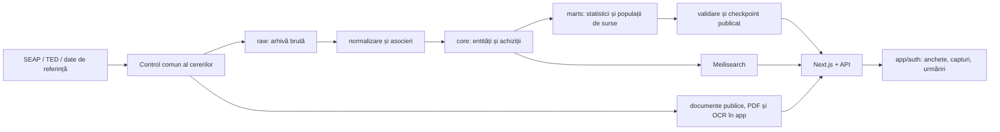

# Arhitectură și harta codului

## Stack și pachete

Versiunile efective se iau din `pnpm-lock.yaml`; valorile de mai jos sunt cele declarate la predare.

| Componentă | Rol |
|---|---|
| Node 22+, pnpm 9.4.0, Turborepo | Workspace TypeScript; pachete compilate în `dist` |
| `apps/web` | Next 16.2.10, React 19.2, App Router, interfață și API-uri |
| `apps/ingestion` | Colectare, normalizare, asocieri, agregări, validare, publicare, indexare |
| `packages/db` | Drizzle 0.45, postgres.js 3.4, scheme, migrații, politici comune de colectare/publicare |
| `packages/domain` | Tipuri și funcții ale domeniului |
| `packages/scraper-clients` | Clienți pentru sursele externe |
| PostgreSQL 16 | Sursa de adevăr pentru date, dovezi, autentificare și cozi |
| Meilisearch 1.16 | Index derivat pentru căutarea entităților |
| Better Auth 1.6 | Conturi create de admin, parolă și OTP obligatoriu pe email |
| PDF.js 6.3.289 | Randarea locală și sincronizată a paginii PDF |
| Playwright/Chromium, OpenSSL, Poppler, Tesseract | Preluarea documentelor și extragerea textului în worker |

Arhivarea este înaintea parsării. Transformările trebuie să se poată relua din răspunsul existent, fără o nouă colectare. O parte a istoricului normalizat a fost importată fără întreaga arhivă brută pe producție: nu presupune că orice rebuild total este posibil din producție fără inspecție.

## Scheme PostgreSQL

| Schemă | Conținut și tratament |
|---|---|
| `raw` | `raw_documents`, `ca_notice_ted`; răspunsuri brute, identitate și hash pentru deduplicare |
| `core` | Entități, ID-uri SICAP, achiziții directe, anunțuri, contracte, câștigători, TED, asocieri, flag-uri, praguri, watermark-uri, carantină |
| `marts` | Tabele statistice, profiluri, tranzacții pentru surse, Radiografie, TED, mostre de semnale |
| `reference` | CPV/sinonime, UAT, asocieri autoritate–UAT, bilanțuri MF, ONRC/reprezentanți |
| `auth` | Utilizatori, parole hash, sesiuni, verificări, material2FA — nu se distribuie |
| `app` | Dovezi/anchete/urmăriri private, rețete, control/cozi/audit; și documentele publice partajate |
| `drizzle` | Istoric migrații — trebuie păstrat cu snapshot-ul |
| `graphile_worker` | Infrastructură istorică de joburi; nu este coada de producție curentă pentru recuperare |
| `repair_20260927` | Copie tehnică temporară a arhivei TED; exclusă din transferul către coleg |

Nu clasifica întreaga schemă `app` drept publică și nici întreaga schemă drept dispensabilă: PDF-urile sunt în `app.document_blobs`, iar proveniența analitică în `app.monitoring_refreshes`.

Extensii necesare: `pg_trgm`, `unaccent`, `fuzzystrmatch`, plus `plpgsql`. Dump-ul logic păstrează definițiile lor. Nu se copiază volumul fizic PostgreSQL între arhitecturi Apple Silicon/Intel/Linux.

**Planuri personalizate în tranzacțiile cu parametri (24 octombrie 2026).** postgres.js pregătește fiecare interogare (`createDb`), iar de la a 6-a execuție a aceleiași instrucțiuni pe o conexiune din pool PostgreSQL poate trece la un plan generic, ales fără valorile parametrilor. Pe marts-urile naționale planul generic a fost de până la zece ori mai lent: sursele clasamentului național implicit, ~2 s la execuțiile 1–5, apoi 19,3 s și 15,7 s pe aceeași conexiune (local, `ask-perf --warm-runs=7`). În producție pool-ul web trăiește mult, deci întrebările populare ajung acolo. De aceea fiecare tranzacție a motorului Întreabă (`runSpec`, `runRows` în `lib/ask/compile.ts`) începe cu `set local plan_cache_mode = force_custom_plan` (`FORCE_CUSTOM_PLANS`, `lib/plan-cache.ts`), ca vocabularul interpretorului (`lib/intent/server.ts`), iar `withMonitoringSnapshot` (`packages/db/src/monitoring.ts`) o pune imediat după `BEGIN`. Snapshot-ul acoperă comparațiile (`lib/peers*.ts`), legăturile (`lib/connections.ts`), sursele lor, capturile și urmăririle; acolo comparația unei firme mari trecea de la 2,5 s la 3–5 s (o dată 17,6 s), iar legăturile ei de la 1,7 s la 2,6 s. Setarea e `local`: ține până la sfârșitul tranzacției și nu schimbă rolul, baza sau celelalte conexiuni. Costul obișnuit e o planificare la fiecare execuție (milisecunde; o comparație mică: ~120 → ~130 ms), dar nu orice instrucțiune e mai rapidă pe planul personalizat: din cele 84 ale celor 28 de cazuri grele, două erau mai rapide pe cel generic. Numărătoarea separată a clasamentului paginat (`count(distinct supplier_id)` pe 20,7 mil. de rânduri) mergea pe planul generic în paralel, 4,8 s, iar pe cel personalizat serial, 8,1 s. De aceea totalul unui clasament paginat vine acum din fereastra `count(*) over ()` a clasamentului însuși (selecția se citește o singură dată; doar o pagină de după ultima mai numără separat): clasamentul național „toate rezultatele” a coborât la 2,5–2,9 s la toate cele 8 rulări calde, de la 5,2–9 s înainte de setare și 7,7–9,7 s cu setarea și numărătoarea separată (local, aceeași conexiune, același răspuns). Rândurile CSV naționale sunt 0,66 s pe planul generic față de 1,04 s, dar în modul automat aceeași cale a ajuns la limita de 20 s la a 6-a rulare, deci setarea rămâne și acolo. Nu s-a pus peste tot: `ground()` rulează pe pool, în afara tranzacției, și rămâne la aceiași timpi sub planuri generice; pagina de domenii e chiar puțin mai rapidă cu planul generic (1,5 s față de 1,7 s); sursele unui semnal și ale Radiografiei deschid un pool nou la fiecare cerere, deci nu ajung la a 6-a execuție. Numărul de semnale al unei entități (`readEntitySignalCounts`) trece de la ~50 la ~150 ms pe planul generic și a rămas neschimbat. Verificarea: `scripts/ask-perf.ts` cu `--warm-runs=8` (rulările calde 5–8 sunt execuțiile 6–9 pe aceeași conexiune; implicitul de 3 nu ajunge acolo) și cu `?plan_cache_mode=force_generic_plan` în `--db` (setarea locală bate setarea sesiunii). O cale nouă care rulează pe marts interogări cu parametri pe un pool de lungă durată măsoară cele două regimuri și, dacă planul generic e mai lent, pune aceeași instrucțiune prima în tranzacția ei; o instrucțiune care rămâne mai rapidă pe planul generic se rescrie, ca numărătoarea de mai sus.

## Identități și precizie — capcane reale

- CUI-ul fiscal și ID-ul de participant SICAP sunt identificatori diferiți, chiar
  când ambele sunt numere valide. Prefixul autorității în arhiva DA 2020 este CUI;
  vechea interpretare ca SICAP a produs fragmentări și atribuiri către instituții
  greșite. [Audit și reparație documentată](../implementation/entity-identity-repair.md).
- `core.entity_redirects` păstrează legături verificate vechi→canonice, fără lanțuri
  sau cicluri. Rândurile entităților vechi rămân pentru referințe; întrebările vii
  rezolvă ID-urile canonice, capturile înghețate nu sunt rescrise. Numele identic nu
  justifică unirea unor CUI-uri diferite. Migrarea 0046 creează mecanismul, nu execută
  automat reparația datelor istorice.
- `core.contracts.id` este ID intern; `ca_notice_contract_id` este identitatea externă folosită de pagina contractului. `marts.contract_transactions.contract_id` este **intern**.
- Amprenta unei identități aprobate (`snapshot_hash`, `readContractIdentityMembers`) citește exact `core.contracts`, `core.awards`, `core.contract_winners` și `core.entities`. Triggerele din migrația 0083 schimbă `marts.contract_identity_source_state` la fiecare tranzacție care scrie în ele, iar o rulare de procesare își refolosește amprentele cât timp starea e aceeași (`SnapshotHashCache`). Validarea finală nu folosește memoria: recalculează amprentele membrilor și ale publicațiilor excluse temporar și compară cu ele fiecare amprentă din memorie. Dacă amprenta începe să citească alt tabel, acesta primește același trigger și intră în `CONTRACT_IDENTITY_HASH_SOURCES`. Altfel porțile dinaintea validării ar putea folosi amprente vechi, iar abia validarea finală ar opri publicarea.
- Bridge: `apps/web/app/contracte/i/[cid]/route.ts`; răspunsul are Location relativ. În drawer se păstrează tabul original.
- ID-urile `core.flags` și `marts.lot_patterns` se pot regenera. O captură durabilă leagă un descriptor și hash/versiune, nu doar un număr reutilizabil.
- Totalurile contractelor atribuite unui consorțiu pot reprezenta alocări estimate egal între membri când nu există valori individuale. Nu dubla suma însumând contractul integral pentru fiecare câștigător.
- Cantitățile, monedele, intervalele și plafoanele TED nu devin automat valori RON scalare. Proveniența câmpului și tipul sumei sunt păstrate.
- Modurile `profiles` și `transactions` au populații diferite. Pentru linkuri vechi se conservă semantica istorică.
- Un nume afișat lângă un ID nu schimbă identitatea întrebării. Rezolvarea tardivă a etichetei nu trebuie să marcheze un formular ca modificat.
- Comparațiile și dovezile leagă și checkpoint-ul datelor; compararea a două momente diferite fără indicare explicită este greșită.

## Harta principalelor module

Toate căile sunt relative la rădăcină.

| Subiect | Unde începi |
|---|---|
| Layout, fonturi, teme | `apps/web/app/layout.tsx`, `globals.css`, `approved.css`, `lib/site.ts` |
| Întrebări | `apps/web/lib/ask/spec.ts`, `compile.ts`, `predicates.ts`, `authority-kind.ts`, `peer-groups.ts`, `peer-groups-shared.ts`, `distribution.ts`, `fact-check.ts`, `fact-check-shared.ts`, `person-firms.ts`, `filters/`, `answer-core.ts`, `population.ts`, `resolved-spec.ts`, `source-spec.ts`, `evidence.ts`, `permalink.ts` |
| Drawer și surse | `apps/web/app/intreaba/EvidenceDrawer.tsx`; `lib/source-evidence.ts`, `signal-evidence.ts`, `radiografie-evidence.ts` |
| Dovezi imuabile | `lib/evidence-capture-input.ts`, `evidence-captures.ts`, `evidence-captures-shared.ts`, `evidence-bundle.ts`, `evidence-zip.ts` |
| Anchete și permisiuni | `lib/investigation-access.ts`, `investigation-workspace.ts`, `workspace-api.ts`; `app/anchete/` |
| Rețete | `lib/recipes.ts`, `app/api/recipes/`, `app/intreaba/RecipeShelf.tsx` |
| Urmăriri | `lib/monitoring*.ts`, `app/urmariri/`, `app/api/urmariri/`, `scripts/monitoring-worker.ts` |
| Digest email | `lib/monitoring-digests.ts`, `scripts/monitoring-digests.ts` |
| Legături | `lib/connections*.ts`, `connection-evidence*.ts`, `app/entitati/[id]/legaturi/` |
| Comparații | `lib/peers*.ts`, `peer-population.ts`, `app/api/peers/`, `app/entitati/[id]/comparatii/` |
| Populație RPL2021 | `apps/web/lib/reference/population-rpl2021.json`; `packages/db/scripts/parse-population-rpl2021.py` |
| Fișiere | `apps/web/lib/documents/{store,seap,worker,process,rate-limit,shared}.ts`; `apps/web/scripts/documents/worker.ts` |
| Admin | `app/admin/layout.tsx`, `AdminNavigation.tsx`, `CollectionDashboard.tsx`, `RecoveryOverview.tsx`, `DocumentQueue.tsx`; `lib/admin/` |
| Estimare recuperare | `lib/admin/recovery-status.ts`, `recovery-forecast.ts` și testele lor |
| Autentificare | `apps/web/lib/auth.ts`, `mail.ts`, `scripts/seed-admin.ts`; `packages/db/src/schema/auth.ts` |
| Colectare durabilă | `apps/ingestion/src/scripts/collection.ts`, `src/collection/` |
| Poarta comună SEAP | `packages/db/src/collection.ts`, `collection-policy.ts`, `collection-quiet-window.ts`, `collection-retry.ts`, `collection-diagnostics.ts` |
| Publicare și validare | `apps/ingestion/src/monitoring/{refresh,pipeline,validate,coverage,cli}.ts`; `packages/db/src/processing.ts` |
| Marts nocturne ale Întreabă (rollup-uri, indexuri de build, sediul) | `packages/db/src/ask-rollups.ts`, `transaction-mart-indexes.ts`, `firm-seat.ts`; `apps/ingestion/src/normalize/{transaction-marts,agg-map-county,firm-registry,marts}.ts`; sondele în `apps/web/lib/ask/{rollups,series-rollups,map-facts,mart-columns}.ts` ([inventar](#obiectele-nocturne-ale-întreabă)) |
| Parsare/asociere TED | `apps/ingestion/src/normalize/{ted,ted-fforms,ted-load,ted-replay,reconcile,ted-mart}.ts` |
| Flux de colectare TED (oprit până la `ted-enable`): pachetul zilnic OJ S, verificat cu căutarea TED | `apps/ingestion/src/collection/{ted,ted-activation,advance}.ts`, `src/scrape/ted/{collection-client,package}.ts`; ținte în `packages/db/src/collection-policy.ts` |
| Index de căutare | `apps/ingestion/src/search/index-entities.ts`, `src/scripts/index-search.ts`; `apps/web/lib/search.ts` |
| Deploy și scheduler | `infra/prod/deploy.sh`, `process-nightly.sh`, Dockerfiles, compose; `.github/workflows/ci.yml` |
| Migrații | `packages/db/migrations/`, `src/schema/`, `scripts/deploy-migrate.mjs`, `migration-history.mjs` |

Pentru o cale redenumită folosește `rg --files`, nu presupune că această hartă înlocuiește codul.

## Capturi și exporturi

Captura se reconstruiește pe server din identitatea selecției; un browser nu poate inventa totalul, lista de membri sau sursele. Copiere SQL-to-SQL într-un snapshot repeatable-read, valori zecimale exacte, versiuni imuabile și acces verificat din nou la publicare. Selecțiile nominale foarte mari au limite explicite; nu se trunchiază în tăcere. Exportul live CSV și captura integrală au mecanisme/limite distincte.

ZIP64 permite pachete mari cu CSV/NDJSON, metodologie, istoric și manifest SHA-256. Nu afirmăm că un ZIP conține toate binarele externe dacă oferă doar referințele lor.

## Documente — mecanismul real

Pentru familiile suportate se rezolvă anunțul prin identitate și autoritate, apoi se citește lista. Nu orice familie de anunțuri are încă implementată preluarea. Pilotul verificat folosește SCN/type 17, de exemplu `https://www.e-licitatie.ro/pub/notices/simplified-notice/v2/view/100231768`. URL-ul de fișier nu este identitate durabilă.

Worker-ul folosește o sesiune Chromium nouă, metadata proaspete, POST de verificare urmat de GET în aceeași sesiune, cu Referer-ul familiei corecte. Un GET izolat cu hash vechi poate eșua deși browserul utilizatorului descarcă fișierul. Nu copia Cookie/Authorization/chei din DevTools în cod sau documente. Doar cererile allowlistate ies din browser; resursele și redirecturile nepermise sunt blocate.

Actualizare 11 octombrie: vechile limite de 50 MiB/150 pagini au fost înlocuite cu transport/stocare în bucăți și procesare OCR reluabilă. PDF/CMS, Word/Excel, ZIP/RAR/7z sunt tratate de toolchain; multipart rămâne deschis. Originalele și PDF-urile derivate sunt separate, cu SHA-256. Supervisor-ul exclusiv permite până la 10 lane-uri de rețea și 4 de procesare; nu mai este un singur job global. [Mecanism și limite actuale](20261011/operations.md), [formate](../implementation/document-formats-20261011.md).

## Căutarea `/cauta` — două cereri

Actualizare 22 octombrie 2026. Pagina face două cereri pentru aceeași selecție (subiect, loc, perioadă, tip, potrivire):

- `/api/topic-search` — titluri (`marts.topic_acquisitions`), instituții și firme, locul ales, data indexului și acoperirea titlurilor. Nu atinge documentele; răspunde de regulă sub o secundă.
- `/api/topic-search/documents` — pasajele din documentele pregătite și acoperirea lor („X din Y fișiere”). Pagina o cere în paralel, o afișează separat („Căutăm în documente…”) și nu blochează restul. O eroare rămâne în secțiunea Documente, cu „Reîncearcă documentele”. Schimbarea tabului sau a paginii de achiziții nu o repetă (`documentScope` în `lib/topic-search/shared.ts`).

Textul paginilor este indexat în `app.document_page_search` (`to_tsvector('simple', unaccent(text))`, GIN), aceeași expresie ca la titluri. `unaccent()` nu este IMMUTABLE, deci nu poate susține o coloană generată sau un index pe expresie; vectorul este scris de un trigger pe `app.document_pages` (migrația 0079). Astfel sunt indexate și paginile scrise de un worker vechi sau de orice alt scriitor; o pagină peste limita tsvector (1 MB de lexeme) rămâne citibilă, dar nu apare în căutare. Ștergerea paginii șterge și vectorul (cascadă).

Legătura document → procedură rămâne cea de dinainte: anunțul documentului → `core.notices` → `procedureId` din payload-ul brut **și** același cumpărător → contractul din `topic_acquisitions` care respectă filtrele. Niciodată după titlu sau nume de fișier. Se calculează o singură dată pe cerere și pe anunț (nu de trei ori și nu pe fiecare fișier), într-o singură interogare. Nu este materializată: un document procesat acum este căutabil imediat, fără să aștepte procesarea de noapte. Dacă numărul de anunțuri cu documente crește mult, materializarea legăturii în build-ul nocturn rămâne opțiunea următoare, cu prețul acestei întârzieri.

Pe pagină, o căutare nouă nu mai arată rezultatele căutării anterioare: zona păstrează înălțimea cu rânduri-schelet până sosesc rezultatele selecției curente. La schimbarea doar a tabului sau a paginii, numerele din taburi rămân, pentru că aparțin aceleiași selecții. În „Unde cauți?”, după ce modifici textul, prima potrivire este evidențiată și Enter o alege; numele locului deja aplicat nu contează ca text scris (multe localități au același nume în județe diferite), iar un Enter apăsat înainte de sosirea sugestiilor nu alege singur când primele potriviri au același nume.

### Căutarea de pe prima pagină și „Am înțeles” (22 octombrie 2026)

Caseta de căutare (prima pagină și dialogul din antet, `app/DiscoverySearch.tsx`) cere în paralel, cu un singur debounce și cu anularea cererilor vechi: `/api/intent` (interpretorul cu reguli), `/api/suggest` (subiecte CPV și sinonime, localități, persoane; pentru textul întreg și separat pentru ultimul cuvânt, ca „iluminat buz” să propună Buzău; o localitate apare doar dacă numele ei începe cu cuvântul scris) și `/api/search` (instituții și firme din Meilisearch). Gruparea și ordinea sunt în `lib/search-suggestions.ts` (pur, testat): „Cel mai probabil cauți” (propoziția interpretorului, neschimbată, doar la încredere mare/medie și doar dacă lectura explică toate cuvintele; o lectură ambiguă apare ca alegere, nu ca răspuns), Subiecte, Locuri (cu celelalte cuvinte: „iluminat · Județul Buzău” → `/cauta?q=iluminat&place=county:buzau`), Instituții, Firme, Persoane (doar când textul pare un nume), apoi „Caută „…” în titluri și documente” (`literal=1`, fără interpretare). Un subiect găsit doar pe un fragment de cuvânt din catalog („construct” → „Construcţie de canale”) e o lectură slabă: firmele vin primele. Dacă `/api/intent` cade, celelalte grupuri rămân. Enter fără un rând ales cu săgețile deschide `/cauta?q=…` (decizia proprietarului 2); trecerea mouse-ului peste un rând nu schimbă ținta lui Enter.

`/cauta` cere întâi `GET /api/topic-search/interpretation` (aceiași parametri; interpretorul rulează pe server, cache 10 minute pe data calendaristică din București, limită 3 s cu oprirea căutărilor rămase) și abia apoi titlurile și documentele, cu selecția aplicată (`lib/topic-search/interpretation.ts`, `words.ts`). Locul și perioada numite în cuvinte devin filtre doar dacă lectura e curată: URL-ul nu are deja filtrul, interpretorul a ales un singur loc, nu a citit o firmă, o instituție sau o persoană, nu au rămas cuvinte neexplicate, iar restul cuvintelor este exact subiectul recunoscut (plus cuvinte de legătură și de întrebare). Atunci titlurile se caută doar după cuvintele subiectului: „iluminat buzau” → „iluminat” în Județul Buzău; „medicamentele buzau” → „medicamente” (forma de bază a sinonimului). Altfel cuvintele se caută exact cum au fost scrise: „drumuri si poduri buzau” (interpretorul citea Comuna Poduri și lăsa „buzau” neexplicat; „și” între două cuvinte înseamnă două subiecte), „apa nova bucuresti” (rămâne căutarea firmei), „spitalul judetean buzau”, „piata romana bucuresti”, „primaria buzau”. O localitate ambiguă nu se aplică: variantele apar ca butoane. Sectoarele Bucureștiului nu au filtru în titluri: nu se aplică, pagina spune asta și trimite la Întreabă sau la tot Bucureștiul. Perioadele deschise devin interval („după 2020” → 2021 până în anul curent; „până în 2018” → 2000–2018). Dacă interpretarea eșuează sau întârzie, se caută cuvintele scrise.

Rezultatul apare ca „Am înțeles”, cu cipuri: Subiect (alt subiect sau „caută exact ce ai scris”), Loc (×, orașul în loc de județ, tot județul), Perioada (×) și „Cine cumpără” (de exemplu școlile; titlurile nu se pot filtra după tipul instituției, deci cipul spune „doar în Pe scurt”, iar cuvântul nu mai e cerut în titluri: „laptopuri scoala” caută „laptopuri”). Modificarea unui filtru transformă locul/perioada din cuvinte în filtre explicite; o căutare nouă scrisă în casetă e citită din nou (locul luat din cuvintele vechi nu se păstrează).

„Pe scurt” apare doar pentru un subiect dintr-o lectură curată și conține exact ce arată cipurile (locul, perioada și tipul instituției; dacă interpretorul a citit un loc care nu se poate aplica, nu apare deloc). Rulează prin `/api/ask` două specificații construite de interpretor (`specFor`): totalul (`stat`, „în N înregistrări”, ca în Întreabă) și primii trei câștigători (`table`, `topN: 3`; cu cipuri, propozițiile nu se repetă: cifra, apoi „Cine câștigă cel mai mult:”; la o întrebare întreagă apar propozițiile exacte), toate clasele CPV numărate (din același `ground` ca motorul) și limitele pe care Întreabă le arată pentru aceleași specificații (contractele peste 1 mld. lei separate, achizițiile directe peste 2 mil. lei excluse, doar oferte acceptate, localitatea = primăria). Se calculează în paralel cu titlurile. O localitate înseamnă în Ask primăria (`uatScopeCaveat`), iar în titluri instituțiile asociate localității; propoziția spune care e cazul. Potrivirea puternică de nume („Cauți această instituție?”) rămâne sus când nu e subiect și coboară sub titluri când e. Cu 0 titluri, pagina propune: tot județul, toată țara, toți anii, întrebarea în Întreabă (doar dacă propoziția e cea arătată), documentele și subiecte apropiate.

**Întrebarea întâi (23 octombrie 2026).** Când cuvintele sunt o întrebare întreagă citită curat (`isCleanQuestion`: cuvânt de întrebare „cine”/„cât”…, specificație construită, încredere „high”, niciun cuvânt neexplicat, nicio alegere de făcut între localități, firme sau persoane) și nu s-a aplicat un subiect la titluri, interpretarea are `question`. Atunci `/cauta` arată sus „Am înțeles: <propoziția interpretorului>” și, pentru „cine câștigă” și „cât”, același „Pe scurt” (total + primii trei) construit din citirea interpretorului, cu locul ei (de ex. „cine ia banii oradea” = primăria Municipiului Oradea), plus „Vezi răspunsul complet” (`/intreaba?q=…`) și „Caută exact ce ai scris” (`literal=1`). Pentru alte întrebări („cum au evoluat…”) apar doar propoziția și cele două butoane. Cuvintele, căutate ca atare, vin dedesubt; dacă nu găsesc nimic (titluri, nume, documente), se strâng într-un rând („Pentru cuvintele exacte „…” nu am găsit titluri sau nume. Arată”). O întrebare cu un cuvânt neînțeles („cat a costat podu oradea”) sau cu o alegere nu primește răspuns ghicit. „primaria ploiesti” rămâne căutare de nume (fără cuvânt de întrebare).

**Niciodată „0 lei” ca răspuns.** Când totalul din „Pe scurt” are 0 înregistrări, în locul cifrei apare „Niciun contract încadrat la „X” la <cumpărătorii din propoziție>.”, un (?) lângă „Domenii incluse” („Numărăm după încadrarea oficială (CPV), nu după titlu.”) și, dacă există, „N titluri conțin „X”: vezi achizițiile” (deschide fila Achiziții), plus, când e numit un cumpărător (localitate, județ, instituție), „Vezi la ce domenii sunt încadrate achizițiile făcute de …” (aceiași cumpărători, fără subiect, ca `breakdown` în Întreabă: acolo apar, de exemplu, parcurile încadrate la spații verzi). Un total cu înregistrări dar fără valoare arată numărul de înregistrări, nu „0 lei”. „Pe scurt” are și „Vezi toate cele N înregistrări” (`/intreaba?spec=<total>&drill=1`, deschide lista din spatele sumei), iar lista de titluri spune unitatea când numerele diferă: „816 după domeniu în „Pe scurt” · 16 cu „X” în titlu (?)”; explicația de sub (?) adaugă „nu doar școlile” când cipul „Cine cumpără” restrânge doar „Pe scurt”. Când „Am înțeles” e afișat (cipuri sau întrebare), rândul de stare dispare vizual la orice lățime și rămâne pentru cititoarele de ecran; pagina nu mai are subtitlu. Pe telefon, după o căutare, titlul paginii devine cuvintele căutate, iar titlurile achizițiilor se taie la 3 rânduri, ca suma și „instituție → firmă” să se vadă.

**„Subiect apropiat”** (`lib/topic-search/related.ts`) pornește doar de la primul cuvânt de cel puțin 4 litere care nu e de întrebare sau de legătură (cine, cât, ia, bani, firme, strada, primăria…) și păstrează doar numele în care un cuvânt începe cu cel scris și îl acoperă cel puțin pe jumătate. Fără potrivire nu apare nimic („cine” nu mai aduce „Porcine”, „eco gardn” nu mai aduce „Orez decorticat”).

**„Unde cauți?”** (`/api/topic-search/places`, `lib/topic-search/places.ts`) potrivește în memorie catalogul `reference.uat` (circa 3.200 de rânduri, încărcat o dată pe oră) și cele 42 de județe, fără diacritice și fără cuvântul de tip („MUNICIPIUL”, „ORAȘ”): întâi potrivirea exactă, apoi începutul numelui, un cuvânt din nume, oriunde în nume, localitățile județului numit; o greșeală de o literă („oradia” → Municipiul Oradea, „bucurseti” → București județ și municipiu) apare doar când nu există nimic mai bun, cu mesajul „Nu am găsit exact „…”. Poate cauți:”. Enter apăsat înainte de listă alege singur doar o potrivire clară: niciodată o greșeală ghicită și niciodată între două locuri la egalitate (două „Sălcioara”, județul și municipiul Brașov); atunci lista rămâne deschisă.

**Vocabular (migrația 0080).** `reference.cpv_synonym` vine din `packages/db/seeds/cpv-synonyms.sql` (rulat manual, truncate + insert). Migrația `0080_cpv_synonym_beginner_terms` adaugă 84 de rânduri (insert … on conflict do nothing, nimic șters), iar seed-ul are același bloc, deci un re-seed reproduce starea. Exemple: „iluminat public”, „iluminat festiv”, „crăciun”, „sărbători”, „gropi”, „trotuare”, „deszăpezire”, „rechizite”, „laptop”, „tablete”, „transport elevi”, „renovare”, „reabilitare” (clădiri, izolare termică **și** drumuri, 4523314x), „termoizolare”, „parcuri”, „spații verzi”, „locuri de joacă”, „publicitate”, „evenimente”, „festival”, „artificii”, „cărți”, „manuale”, „imprimante”, „camere video”; „apă” primește distribuția de apă și conductele; „reabilitare drumuri” păstrează toată clasa 45233, „alimentare cu apa” păstrează și 41000000.

**„Iluminat” include semnalizarea rutieră (decizia proprietarului: codurile largi rămân, dar oamenii văd asta).** După 0081, „iluminat” și „iluminat public” = iluminat exterior (31527200), iluminat stradal (34993000, 34928500), instalare (45316000) și întreținere (50232000); lămpile în general (31500000) nu mai fac parte din „iluminat” (au termenul „becuri”). Clasele 45316000 și 50232000 sunt definite în CPV ca „iluminare **și semnalizare**” și „iluminare publică **și semafoare**”. Pe datele locale (contracte sub 1 mld. lei și achiziții directe de cel mult 2 mil. lei), semnalizarea (453162x, 502322x) face circa 8% din valoarea acestor clase (circa 7% înainte de 0081, cu lămpi cu tot). Ponderea variază mult după loc (de la 0,1% în Constanța și Harghita la peste 30% în Gorj și Brașov, măsurat pe definiția din 0080), așa că nota arătată oamenilor nu dă o cifră care poate fi falsă pentru locul ales: „Include și semnalizarea rutieră (semafoare, balizaj), clasificată în aceleași coduri CPV cu iluminatul public. La nivel național e circa 8% din valoare, dar în unele județe mult mai mult.”

**Revizuirea vocabularului (migrația 0081, octombrie 2026).** Fiecare termen a fost verificat pe toate subcodurile CPV pe care le prinde, cu valoarea lor pe datele locale: IN = ce înțelege un începător, OUT = altceva, AMB = parțial sau ambiguu (regulile de judecată sunt în auditul de lucru, nu în cod). Schimbări: excluderi unde părintele mare e corect (medicamente/doctorii fără reactivi 33696 și articole din cauciuc 33682/33683; aparatură/echipamente medicale fără consumabile 3314 și articole din hârtie/îmbrăcăminte 33198/33199; licențe/software fără servere și sisteme 488 și sonorizare 48952; autoturisme/mașini fără ambulanțe, vehicule de salvare, de deținuți și microbuze; uniforme și îmbrăcăminte fără echipamentele de protecție 1814, îmbrăcăminte și fără încălțăminte, genți și bijuterii; gunoi/salubrizare fără deșeuri periculoase și medicale 9052, nămol și halde de cărbune; cărbune fără combustibilii pe bază de lemn; mobilier urban fără materialele de semnalizare); restrângeri (proiectare, arhitectură, școală 45214100+45214200, becuri, lapte 15510000+03333000 cu termen nou „lactate” pentru 15500000, parcuri, reabilitare drumuri 45233139/45233140/45233223/45233251 în loc de toată clasa 45233, fructe și legume separate, rechizite, festival, iluminat festiv, transport elevi fără microbuze, măști pe codurile de măști); coduri lipsă adăugate (hârtie, mănuși, pubele, dezinfectant, gaz, reparații drumuri/gropi, fotovoltaice, evenimente, cartușe/toner, autobuze 34120000, canalizare, alimentare cu apă fără 45232100, deszăpezire, asfalt 44113600, autoutilitare 34144700, consultanță, reparații + 45453000); termeni scoși: „lucrari” (46% din toată valoarea), „programe” (ambiguu, „software” rămâne), „mese” (ambiguu cu mobilierul; „catering” rămâne). „mașini” rămâne autoturisme, cu notă. Note scurte doar unde rămâne o ambiguitate (iluminat, echipamente medicale, măști, mașini, școală, mobilier urban, reabilitare, transport elevi, crăciun/sărbători, brichete/peleți, reparații). Rezultat pe auditul refăcut: OUT devine 0 la toți termenii schimbați, în afara semnalizării din iluminat (circa 8%, decizie asumată și notată) și a măștilor (regulile auditului marchează orice cod ca OUT; măștile chirurgicale nu au cod CPV propriu, iar nota spune asta). 290 de rânduri după 0081, dintre care 50 de excluderi; migrația șterge doar perechi (term, prefix) exacte de includere, e idempotentă, iar seed-ul are starea finală.

**Notele sinonimelor ajung la oameni.** Orice `note` nevidă a unui rând din `cpv_synonym` folosit pentru un subiect este arătată: `ground()` o întoarce în `cpv.notes`, motorul Ask o adaugă la limitele răspunsului („Despre „iluminat”: …”), iar `/cauta` o afișează sub cipul de subiect și în „Pe scurt”. Nota se scrie deci ca o frază pentru cititor. Notele rândurilor noi din 0080 sunt goale, cu excepția celor de mai sus; cele 13 note vechi erau etichete interne ale rândurilor („apa captata si epurata”, „lemn de foc”) și ar fi apărut ca explicații înșelătoare: 0080 le golește doar pe acestea, cu valorile exacte (o notă schimbată între timp rămâne), iar seed-ul le are goale. Pe datele locale, „iluminat” în județul Buzău trece de la 6,9 mil. lei (1.852 înregistrări, doar lămpi) la 114,4 mil. lei (2.553). Nu am adăugat „lucrări de instalații electrice” (45310000): titlurile de iluminat sunt des clasificate acolo, dar clasa e prea largă; titlurile le găsesc oricum.

**Motorul (`lib/ask/ground.ts`).** Un termen care are rânduri proprii în `cpv_synonym` înseamnă exact acele rânduri (toate). Înainte, motorul lua cele mai lungi 4 rânduri care conțin termenul sau sunt conținute în el, ca șir de litere: „apa” aducea și „aparatura medicala” (33100000) și apa minerală, iar un termen cu multe rânduri putea fi tăiat de termeni mai lungi. Un text fără rânduri proprii trece prin `pickContainedSynonyms`: termenii conținuți în text ca cuvinte întregi, eventual flexionate („drumurile”, dar „gaz” nu e în „gazon”), fără cei aflați deja într-un termen mai lung ales; altfel cei mai scurți termeni care încep cu textul („ilum” → „iluminat”). Fiecare termen ales intră cu toate rândurile lui („iluminat stradal” primește toate cele 5 clase ale lui „iluminat”). Apoi trigramele din catalog. **Excluderi (migrația 0081):** un rând cu `exclude = true` scoate un sub-arbore din termen („medicamente” = 336… fără 33696, reactivii de laborator). Excluderea contează doar în interiorul unui sub-arbore inclus și nu scoate ce include alt termen din același text („medicamente reactivi”). `ground()` întoarce `cpv.excludePrefixes` și `excludedNames`; motorul adaugă `and not (cpv_code like …)` la statistici, tabele, rânduri-sursă și CSV (`runSpec`, `runRows`), în SQL-ul afișat, o limită „Din „…” nu sunt numărate: …” și o etichetă „fără N subclase”; `/cauta` scrie „Domenii incluse …; fără: …”; urmăririle notează excluderile fixate la activare. O urmărire activată înainte de 0081 își păstrează gruparea veche (fără excluderi). Cheia rămâne (term, cpv_prefix): același prefix nu poate fi și inclus, și exclus pentru un termen. `exclude` se citește prin `to_jsonb`, ca o bază încă fără 0081 să răspundă. Răspunsurile salvate cu `cpvTerm: "apa"` se schimbă în consecință (corecție). Cuvinte care rămân greșit înțelese și nu se repară prin sinonime (sunt cuvinte de loc sau de instituție, de reparat în interpretor): „strada” → Iluminat stradal, „primărie/primării” → Siliconi primari, „direcția” → coloane de direcție, „lucrări” (după 0081 nu mai e sinonim: ar fi însemnat 46% din toată valoarea).

**Cuvinte retrase (`lib/ask/retired-terms.ts`).** „lucrari”, „mese” și „programe” au fost sinonime până la 0081, deci linkuri salvate și text liber le pot conține. Pentru ele (și pentru orice cuvânt adăugat în listă) `ground()` nu caută sinonime sau trigrame (altfel „mese” ar fi devenit mobilier și „lucrari” cinci subclase de construcții la întâmplare): întoarce `cpv.retired`, iar motorul răspunde cu mesajul și variantele („lucrări de construcții”, „clădiri”, „drumuri”, „reparații”, „renovare”; „catering” sau „mobilier: mese”; „software” sau „programe de formare”). Se recunosc și formele flexionate din listă („mesele”, „lucrărilor”, „programele”), niciodată alte cuvinte („meserii”, „mesaje”). Un text întreg primește variantele doar dacă în afară de cuvântul retras are numai cuvinte de legătură („lucrari de”, „mese si”); „lucrari de pavare”, „programe de formare” sau „mese si scaune” se interpretează normal. Interpretorul nu alege nici el: `subjectChoices` dă `spec` null, problema și câte o alternativă de tip `subject` pentru fiecare variantă; Întreabă, căutarea de pe prima pagină și `/cauta` le arată ca alegeri.

**Vocabular după testul cu primii vizitatori (migrația 0082, 23 octombrie 2026).** „parcuri” primește din nou toată clasa 77310000 (amenajarea și întreținerea spațiilor verzi), în locul copiilor 77311000 și 77313000: primăriile trec întreținerea parcurilor mai ales acolo (Timișoara 211,2 mil. lei, Brașov 193,1 mil. lei răspundeau 0 lei). Nota rândului spune că include toate spațiile verzi, nu doar parcurile. Pe datele locale „parcuri” trece de la 1.821,5 la 15.730,5 mil. lei, din care 13.759,9 mil. sunt chiar codul 77310000. „pod” (cuvântul exact) = lucrări de poduri 45221000, ca „poduri”, nu produsul din catalog „Pod” 44212100 (4,4 mil. lei); 45221 = 8.455,8 mil. lei, din care circa 10% ambiguu (clasa-părinte „poduri și tuneluri”, podețe, subtraversări) și 1,7% tuneluri și lucrări subterane. „lucrari de drumuri” și „lucrari drumuri” = toată familia 45233 (145.054,0 mil. lei), ca „drumuri”, nu doar frunza 45233140 „Lucrări de drumuri” (47.484,0 mil. lei). 292 de rânduri, 50 de excluderi, 19 note; aceleași reguli de scriere ca la 0081, seed-ul are starea finală.

**Interpretorul (`lib/intent/rules.ts`), aceeași zi.** Un sinonim curatoriat larg bate o etichetă de catalog mai îngustă pentru aceleași cuvinte, și lângă un cuvânt generic („lucrări de canalizare” → „canalizare”); la egalitate, sugestiile pun sinonimul înaintea etichetei („pod” înaintea „Pod”). Mai multe subiecte recunoscute („parcuri și spații verzi”) se adună: `cpvTerm` le leagă cu „ + ”, `ground()` le împământează pe fiecare și scrie reuniunea în condiția unică a motorului (`unionCpvParts`: o excludere pe care alt subiect o numără dispare, una care conține o clasă inclusă de alt subiect e decupată în jurul ei; un test exhaustiv verifică egalitatea cu „SAU” între condițiile fiecărui subiect), fiecare înregistrare o singură dată; nota și propoziția numesc toate subiectele. Un cod CPV de 8 cifre (cu sau fără „-cifră”) e domeniul lui; „RO” + cifre, „cui …”, „cif …” caută firma sau instituția cu acel cod fiscal. Jargon SEAP: „ofertă unică” (și variantele) se citește (nu devine subiect), dar din F1b nu mai e filtru: înseamnă contractele din proceduri, cu nota „Numărul de oferte îl știm doar pentru o parte din înregistrările contractelor…” (paragraful F1b-polish); tipurile de procedură („licitație deschisă”, „procedură simplificată”, „negociere fără publicare”…) înseamnă contracte din proceduri, cu nota că tipul procedurii nu se poate filtra încă, iar calificativul apare la „Nu am înțeles” (nu mai devine „Cuțite de deschis scrisori”). Numele de instituții: cuvintele pe care registrul le omite des („urgență”, „clinic”) se reîncearcă fără ele, cu notă („spitalul judetean de urgenta satu mare” → SPITALUL JUDETEAN SATU MARE); numele se oprește înaintea lui „din județul X”, ca locul să rămână loc; variantele pentru un nume parțial se caută în locul recunoscut. `choicesPartial.hint` spune cum se restrânge lista: localitatea pentru instituții și firme, anul nașterii doar pentru persoane. O greșeală de o literă într-un loc precedat de un marcaj („primăria oradia”, „din oradia”) se citește de la 6 litere (înainte de la 7); fără marcaj, locul trebuie scris exact. O listă scurtă de denumiri englezești pentru subiecte frecvente („street lighting”, „road works”, „parks”, „medicines”…) duce la termenul românesc curatoriat, iar lectura spune „Am citit „street lighting” ca „iluminat public””. „Administratorul la/firmei X” citește firma X și spune că administratorii sunt pe pagina ei, la „Conducere”; un nume imediat după cuvânt rămâne o persoană. Doar „lucrări”/„servicii” cedează unui sinonim larg; „echipamente”, „materiale” schimbă subiectul în bunuri, deci eticheta din catalog rămâne.

**Primării numite cum vorbesc oamenii (23 octombrie 2026).** „primăria Cluj” citea doar județul (nicio localitate nu se numește „Cluj”) și răspundea, cu încredere „mare”, pentru toate instituțiile din județul Cluj. Acum, după „primăria”, „consiliul local”, „municipiul”, „orașul”, „comuna”, „localitatea”, cuvintele scrise se caută și ca început de nume: o singură localitate care începe cu ele e aleasă și lectura spune „Am înțeles „cluj” ca Municipiul Cluj-Napoca.” (Alba → Alba Iulia), cu tot județul ca alternativă. Când mai multe se potrivesc, sau când un nume exact mic ar ascunde un oraș mai mare care începe cu el („Piatra”: comuna din Teleorman, dar și Piatra-Neamț; „Baia” și Baia Mare), omul alege; numele exact câștigă doar dacă e cel mai populat („primăria Buzău”, „primăria Sântana”). „primăria <județ>” („primăria Dolj”) nu mai trece pe tăcute la tot județul: se propun municipiile județului (sau orașele, unde nu există municipii) și tot județul, cu nota „Dolj este un județ, nu o localitate.” O primărie nerecunoscută scade încrederea (nu mai e „mare”). „abonate”, „de casă”, „mereu aceleași”, „cel mai des”, „câștigă mereu” ordonează firmele după numărul de achiziții (`measure: count`); propoziția rămâne neutră.

**Comparația a două entități (24 octombrie 2026).** Nu se mai alege între „achizițiile din selecție” și „profilurile istorice de risc”. `runSpec` (`case "compare"` în `lib/ask/compile.ts`) calculează totul pe selecție, cu aceleași filtre pentru ambele: totalul și înregistrările pe canal (proceduri și achiziții directe), câte contracte au avut o singură ofertă din cele cu număr de oferte cunoscut (numărul e publicat doar pentru o parte, mai ales din TED, deci niciodată „din toate”), contrapărțile distincte, valoarea pe ani (anii parțiali hașurați, ca la evoluție), grupele CPV de 5 cifre cu cota din valoarea entității (primele 4, apoi un rând „Restul · N domenii” care include și valoarea fără cod CPV, ca fiecare panou să însumeze 100%; „Vezi toate domeniile” arată pe loc până la 30, `COMPARE_DOMAINS`), contrapărțile comune (cel mult 30, după valoarea însumată; fără comune, primele 4 ale fiecăreia) și, la firme, contractele publice câștigate împreună (cheia paginii `/contracte/` este `core.contracts.ca_notice_contract_id`, nu `contract_id` din marts). Lângă ele, fiecare card arată profilul de risc istoric din `marts.entity_flags` (CRI, semnale), etichetat „Tot istoricul de achiziții directe; nu urmează filtrele”; valoarea din profil nu se mai afișează, ca să existe un singur total. Firmele au și angajații și cifra de afaceri din bilanț, instituțiile lei pe locuitor. Linkurile vechi cu `comparisonMode: "profiles"` rulează la fel (`isHistoricalProfile` nu mai include comparația). Constructorul spune „Compară X cu Y” și nu mai oferă „Mai multe filtre” pentru comparație, decât dacă linkul are deja un prag sau o selecție precisă, ca să poată fi scoase. Producția nu avea nicio urmărire activă la schimbare, deci forma nouă a răspunsului nu produce alerte false. Interfața: `app/intreaba/CompareBlock.tsx` și `compare.css`.

**Reparații de onestitate în Întreabă (etapa R0 a filtrelor pe întrebare, 24 octombrie 2026, ramura `feat/ask-filters-registry`).** Fără chei noi și fără cifre schimbate. (1) Profilurile istorice (`distribution`, `scatter`, „Cine conduce?” pe indice) sunt doar achiziții directe acceptate, pozitive, de cel mult 2 mil. lei (`apps/ingestion/src/flags/marts.ts`, sursele din `runRows`). Bannerul fals „inclusiv oferte neacceptate” devine „Profil istoric: achiziții directe acceptate; valori înregistrate, nu plăți.”, iar nota din panoul de surse „Doar achiziții directe acceptate, ca profilul.”, cu reconcilierea păstrată (`app/intreaba/ProfileNotes.tsx`). (2) Pastilele (`lib/ask/pills.ts`): „pe domenii” în loc de „pe ce s-au dus banii”, „risc și valoare” în loc de „risc vs volum (outlieri)”; pe profiluri, „profil istoric: achiziții directe acceptate, toată arhiva” în loc de „toate sursele…”; pastila măsurii spune ce arată răspunsul (motorul ține cont de `measure` doar la `table`, `stat`, `timeseries` și `map`, iar pe locuitor doar la clasament). (3) `transitionQuestion` restaurează linkurile și urmează fiecare editare. Valorile implicite (axa `rankBy`, `topN`, `measure`, dimensiunea profilurilor) se aplică doar la schimbarea tipului de întrebare; pe același tip, un spec acceptat de `validateSpec` rămâne neschimbat, deci un link vechi nu mai apare „modificat” și rulează cum a fost cerut. Un „Cine conduce?” fără `rankBy` este indicele de risc (`leaderAxis`, ca în motor) și rămâne așa și după o editare; o întrebare nouă primește `rankBy` explicit. Rămân pe orice editare doar reparațiile pe ciorne pe care motorul le-ar refuza („un singur ofertant” → contracte; pe locuitor pe un clasament de firme sau județe). (4) Nota de județ (`countyCaveat`, `countyIsFirmSeat` în `lib/ask/population.ts`) spune „sediul firmei (din adresă, cod NUTS sau ONRC)” pe profilurile de firme, unde `efWhere` filtrează `entity_flags.county` al firmei; nota din fereastra „Unde?” a constructorului la fel. (5) Fluxul și rețeaua fără rânduri spun „„X” nu are înregistrări în selecția aleasă.”, pe orice sursă. (6) Harta (`app/intreaba/MapBlock.tsx`) numără „înregistrări” în tooltip (`countWords`) și ia culorile, conturul și județele fără date din tokenurile temei (`--map-0…4`, `--surface`, `--sunk`), deci are contrast și în tema întunecată. Teste: `question-ui.test.ts`, `pills.test.ts`, `caveat-wording.test.ts`, `ProfileNotes.test.ts`, `MapBlock.test.ts`. După revizia etapei: un clasament fără `topN` (complet, pe pagini) are pastila „toți furnizorii”, „toate autoritățile” sau „toate județele”, nu „top 10”; măsura `count` are pastila „numărul de înregistrări” (cuvântul trusei); nota „Pe locuitor” și citirea populațiilor apar doar la clasament (altundeva răspunsul e în lei, ca pastila); harta pe număr spune numărul o singură dată, în cuvinte; bannerul profilului și linia de nepotrivire din panoul de surse folosesc `--amber-ink` (#6e5427 în tema deschisă, 6,2:1; `--amber` era 3,7:1), iar (?)-ul bannerului are 44 px sub 600 px; reconcilierea numără cu `countWords`; în fereastra „Unde?” motivul e „Indicele de risc compară profiluri între ele…”, valabil și pe profilurile de firme; în tema întunecată, rândul ales sau atins dintr-o fereastră a constructorului are `--accent-soft` (fundalul deschis scris direct făcea textul ilizibil, 1,06:1).

**Întâi citește, apoi scrie (etapa F0a a filtrelor pe întrebare, 24 octombrie 2026, ramura `feat/ask-filters-registry`).** `validateSpec` are doi pași: `parseSpec` (forma: liste albe, tipuri, limite) și `runnableError` (ce poate răspunde versiunea: entitatea centrală, clasamentele degenerate, `unsupportedPopulationView`); rezultatul pentru specurile de azi e identic. `parseSpec` citește deja forma tuturor cheilor pe care le vor scrie etapele următoare (`READ_AHEAD_KEYS`, cu etapa fiecăreia): opțiunile de bloc `trend`, `timeseries`, `network`, `sankey`, `scatter` (inclusiv `scatter.rankBy`, pentru că `rankBy` de sus vine din „Cine conduce?” pe linkurile vechi ale norului și e ignorat), `peers` (pe distribuție, nor, „Cine conduce?”), filtrele `purchaseKind`, `procedure`, `purchaseValueMin/Max`, `firmSeat`, `seatCounty`, `sharedPartners`, `newSince`/`newScope`, `mainClient`, `dominantSupplier` și valoarea `authorityKind: "local_admin"` (codul care clasifică după nume o vede prin `namedKind`). Opțiunile altui bloc se scot la parsare (nu pot schimba răspunsul); o cheie necunoscută rămâne eroare. Ce aplică motorul e `IMPLEMENTED_KEYS` (vocabularul de azi); o etapă își adaugă cheile acolo în livrarea care le implementează. Refuzul stă în `runSpec` și `runRows`, înaintea oricărei interogări, deci acoperă toate căile, inclusiv specurile stocate și nevalidate ale urmăririlor; rutele (`/api/ask`, `/api/ask/rows`, CSV-ul, și cu selecțiile de relație sau de comparație), restaurarea linkului în `AskPanel`, întrebările salvate, `/urmariri/noua`, crearea și rularea urmăririlor (`monitoringNewerError`) și capturile (la creare și în `processCapture`) refuză mai devreme, cu mesajul lor („Legătura vine dintr-o versiune mai nouă a site-ului. Reîncarcă pagina.” pe pagini, 422 pe API; „Întrebarea vine dintr-o versiune mai nouă a site-ului.” la urmăriri și capturi). `options.members` al unei urmăriri (membrii fixați ai unei grupe, F2) e citit ca formă (`monitoringMembers`, cel mult 5.000) și refuzat la fel; de la F2, grupa unui trend (`trend-group`) se aplică (vezi „Urmărirea unei grupe a trendului” mai jos), iar cea a unei rețele rămâne refuzată până la F4. Lista locală (`readLocalQuestionStore`) sare elementele pe care nu le poate citi, le păstrează la rescriere și spune câte sunt, separat: cele scrise de o versiune mai nouă (o cheie necunoscută aici sau citită dinainte; „Reîncarcă pagina.”) și cele care nu pot fi citite (deteriorate sau refuzate de regulile de azi, fără „Reîncarcă”). O întrebare salvată cu o cheie citită dinainte rămâne în listă, fără săgeată și `aria-disabled`; nu se poate deschide aici. Opțiunile cu nume din `Object.prototype` („toString”, „__proto__”) sunt „Câmp necunoscut”, nu o eroare de server (`Object.hasOwn` în `parseSpec`). Regula de rollback e în `05-operations.md`. Teste: `read-ahead.test.ts`, `app/api/ask/newer-version.test.ts`, `newer-version.test.ts`, `local-questions.test.ts`, plus câte un caz în `monitoring.integration.test.ts` și `evidence-captures.integration.test.ts`.

**Linkurile vechi și răspunsurile lor „de aur” (etapa F0 a filtrelor pe întrebare, înaintea refactorizării, 24 octombrie 2026).** Paginile care deschid o întrebare în „Întreabă” își construiesc specul în `lib/ask/site-links.ts`, ca funcții pure (prima pagină, harta, ghidul, pagina entității și graficul lunar, partenerii, contractul, domeniile, dosarul, radiografia, capturile de entitate și de persoană); celelalte constructoare comune (`connectionPairSpec`, `connectionEvidenceSpec`, `peerSourceSpec`, `peerEvidenceSpec`, `domainSourceQuery`, `countyBreakdownSpec`, `source-spec.ts`) au rămas unde erau. Mutarea păstrează ordinea cheilor, deci aceiași octeți în fiecare permalink. `lib/ask/fixtures/site-links-inventory.ts` listează fiecare fișier care construiește, predă sau retrimite un link (producător, link derivat în „Întreabă”, releu, text pentru interpretor, constructor gol, definiție), cu numărul de potriviri; `lib/ask/site-links.test.ts` caută în `app/`, `components/` și `lib/` și pică la un link nou neinventariat sau la un producător fără intrare în corpus. Corpusul (`lib/ask/fixtures/legacy-corpus.ts`, 251 de intrări pe fixture din 26 octombrie 2026) are catalogul celor 13 întrebări, linkurile din restul site-ului, formele salvate (spec rezolvat, doar nume, județ scris mic, întrebare locală, urmărire cu selecție și filtre de surse, `comparisonMode`), formele vechi și refuzurile de azi (prag, populație, angajați, un singur ofertant, profiluri, localitate, chei necunoscute sau mai noi, cuvinte retrase) și combinațiile cu filtrele de azi pe fiecare întrebare, plus trendurile cu cheia pe care o scrie constructorul de la F2 (`builderTrend`, intrările `combo:trend:keyed-*`: grupa, ordinea procentuală, „Prima dată”, lunile automate, alese și neconfirmate) și selecția comună a etapei F3 (intrările `combo:*:f3-*`: tipul, procedura, mărimea, tipul cu un domeniu); identitățile sunt parametri. `lib/ask/golden-legacy.integration.test.ts` trece fiecare intrare prin `/api/ask`, `/api/ask/rows` (pagina 0) și `/api/ask/rows/csv`, pe un fixture sintetic (`fixtures/golden-fixture.ts`, date inventate, într-o copie de schemă a tabelelor citite de motor, cu rollback; helperul este `lib/ask/test-fixture.ts`), și compară răspunsul, sursele și CSV-ul (sha256, antetele) cu `lib/ask/fixtures/golden-legacy.json`; verifică și că totalul răspunsului = sursele = CSV-ul acolo unde răspunsul își numără înregistrările. O etapă care schimbă un răspuns intenționat regenerează fișierul (`GOLDEN_UPDATE=1`) și explică diferența prin versiunea de răspuns; o diferență neexplicată nu se regenerează. Fără bază de test, `site-links.test.ts` verifică măcar că refuzurile corpusului (400, 422) au rămas aceleași. Pe copia locală, `apps/web/scripts/ask-golden.ts` rulează același corpus read-only, cu identități ale copiei, și scrie rezultatele în afara repository-ului (`--compare` listează intrările schimbate).

**Registrul de filtre (etapa F0, 24 octombrie 2026).** `lib/ask/filters/` (TypeScript pur, fără React și fără SQL) descrie fiecare cheie a unei întrebări. `registry.ts` (`SPEC_PATH_OWNERS`) dă fiecărei căi din `AskSpec` exact un proprietar `FilterDef`, inclusiv cheilor citite dinainte la F0a; compilatorul pică la o cale nouă fără proprietar. Un `FilterDef` (`defs/*.ts`, câte un fișier pe familie) are cuvintele de azi ale constructorului (eticheta din „Adaugă o condiție”, titlul și nota ferestrei), controlul, scrierea cu efectele ei (alt județ scoate localitatea, alt canal scoate „un singur ofertant”), valorile pe care le oferă fereastra, unde aplică motorul cheia și la ce nivel (`engine`, pe forma răspunsului: blocul, cu „Cine conduce?” despărțit în valoare și indice) și ce face cu totalul (`scope`). `today.ts` fixează starea de azi: `TODAY_SCOPE` (toate condițiile motorului sunt selecție, nicio cheie de grup; o schimbare cere versiunea de răspuns în `SCOPE_CHANGES`), `TODAY_REFUSALS` (ce oferă constructorul și refuză apoi) și `TODAY_IGNORED_OFFERS` (cipul de canal pe profiluri). `blocks.ts` (`BLOCK_FILTERS`) spunea pentru fiecare dintre cele 13 întrebări ce oferă azi constructorul și unde: frazele propoziției, cipurile de sub ea, lista „Adaugă o condiție”, „Mai multe filtre” și rândul de prezentare (din F1b, descrierea asta e `today-blocks.ts`, `TODAY_BLOCK_FILTERS`, iar `BLOCK_FILTERS` are ofertele F1b, paragraful „Ce oferă fiecare întrebare”). Rândurile de condiții, banda și meniul rândului sunt goale azi. `context.ts` dă ce știu ferestrele în afara specului (forma răspunsului, rolul, entitățile numite, localitatea, anul presetărilor). Din F1b (partea F1b-builder-a) constructorul randează din registru (paragraful „Constructorul din registru și banda”); descrierea constructorului de azi (`today-blocks.ts`, `today.test.ts` cu hash-ul pe `QuestionBuilder.tsx`) a plecat odată cu el, iar `today.ts` păstrează doar datele (`TODAY_SCOPE`, `SCOPE_CHANGES`, `TODAY_REFUSALS`) pe care `registry.test.ts` le verifică. Plimbarea descrisă mai jos a fost a constructorului F0. Testul pornește de la cele 13 întrebări din catalog (26 de variante) și de la întrebările corpusului de linkuri vechi care rulează. Încearcă fiecare alegere oferită și fiecare pereche de alegeri (peste 140.000), le aplică așa cum o face constructorul (scrierea, apoi `transitionQuestion`) și cere ca un refuz (`questionErrors`: `validateSpec` și regula localității) să apară exact unde îl declară `TODAY_REFUSALS`, cu mesajul lui. Cele 13 refuzuri de motor declarate sunt ce elimină F1b; `availability()` le întoarce cu starea `refused`. Ele sunt: pragul de înregistrări pe trend și pe profiluri; selecția precisă și contractele pe profiluri; trecerea „Cine conduce?” pe indice cu condiții de tranzacție, cu o entitate numită, cu tipul sau localitatea cumpărătorului; firmele pe profiluri cu tipul instituției; clasamentul pe județe cu un județ ales; clasamentul cu o instituție și o firmă numite. Cheile citite dinainte nu sunt oferite nicăieri și nu sunt aplicate de motor. Azi niciun link din restul site-ului nu poartă o condiție aplicată pe care întrebarea lui să nu o ofere; de la F1b, lista lor (`unofferedPaths`) e ce etichetează `legacyConditions`.

**Predicatele comune (etapa F0, 24 octombrie 2026).** Condițiile unei întrebări se scriu într-un singur loc, `lib/ask/predicates.ts`. `predicateContext` adună ce rezolvă `runSpec` înaintea primei interogări: prefixele CPV și excluderile lor, județul canonic, tipul instituției, id-urile entităților și ale UAT-ului, firmele administratorului, angajații, perioada (limitată la arhivă de apelant), plafonul DA (`plafondFor`) și comparația. Fiecare funcție e un nivel din registru (`engine`): `rowPredicates` scrie condițiile pe înregistrare (`row` și `entityAttr`), într-o ordine fixă; `groupPredicates` scrie pragul de înregistrări (`group`: numărat pe entitate peste aceleași rânduri; registrul îl trece la acest nivel); `profilePredicates` scrie populația profilurilor (`marts.entity_flags`); `displayPredicates` scrie textul SQL „avansat”. `trendYearsPredicate` (cei doi ani ai trendului) și `perCapitaPredicate` (administrațiile eligibile pe locuitor) au tot câte un singur autor. Răspunsul (`runSpec`, prin `whereFrag` și `efWhere`), sursele, CSV-ul și capturile (`runRows`) și `buildDisplaySql` le folosesc pe toate. În `runRows` rămân doar condițiile proprii surselor: focalul relației, câștigătorul pe valoare, selecția și filtrele sertarului, condițiile de formă (entitate sau județ cunoscut, CPV pentru felii). Tipul instituției are un singur modul, `lib/ask/authority-kind.ts`, folosit și de comparații (`lib/peers-legacy.ts`, `lib/peers.ts`); de la D1 (mai jos) e o listă de id-uri, cu aceeași regulă peste tot. Refactorizarea nu schimbă nicio cifră. SQL-ul răspunsurilor e identic octet cu octet pe tot corpusul de linkuri vechi (5.307 instrucțiuni înregistrate înainte și după). La surse și CSV se schimbă doar forma, nu rândurile: plafonul DA pe canalul „achiziții directe” e scris ca în răspuns (`closing_value <= 2000000`, nu forma ramurii din uniune), anii trendului vin din aceeași funcție ca în răspuns, iar focalul relației stă după celelalte condiții. O „Selecție precisă” făcută doar din liste incluse de instituții și firme (captura unei entități, perechile unei relații, cumpărătorii aleși) se scrie `authority_id = any(…)`, fără `coalesce`, ca indexurile pe id să o servească: o listă inclusă nu stă niciodată sub o negație, deci un id lipsă scoate rândul ca și `false`. Amestecată cu o condiție pe care niciun index nu o servește (CPV, județ, date, valoare) sau cu o excludere, selecția își păstrează forma și planurile de dinainte. Pe copia locală, exportul CSV din sertarul capturii de entitate trece de la depășirea limitei de 20 s la 0,3 s, cu aceleași rânduri. Teste: `predicates.test.ts` (o cheie pe care registrul o declară aplicată la un nivel schimbă doar condițiile funcției acelui nivel și SQL-ul afișat, pe întrebările din catalog și pe corpus; ordinea condițiilor), `authority-kind.test.ts`, `authority-kind.integration.test.ts` (aceleași tipuri în JS și în SQL) și corpusul „de aur”.

**O singură descriere a condițiilor (etapa F0, 24 octombrie 2026).** Cuvintele fiecărei condiții stau într-un singur loc, `lib/ask/filters/describe.ts`. `describeConditions(spec, labels)` dă, pentru fiecare cheie a motorului de azi, cuvintele fiecărui loc care o arată: cipul din constructor (și rândul de sub „Mai multe filtre” închis), pastilele „Am înțeles” (`pills.ts` păstrează doar forma răspunsului: blocul, lungimea listei, axa, măsura), rezumatul unei întrebări salvate (`savedQuestionSummary`), rândurile și chitanța unei urmăriri (`app/urmariri/ScopeConditions.tsx`), caveat-ul răspunsului (`runSpec`) și nota surselor (`runRows`). Mai dă coada titlului (G7) și linia de total (G8), pe care le va desena F1b. `labels` aduce ce știe apelantul: grounding-ul (numele rezolvate, CPV-urile potrivite), numele unui cod CPV din constructor, numele id-urilor unei populații și pagina care și-a legat selecția. Coada titlului (`filters/words.ts` `titleTail`) era aceeași în `describeQuestion`, în propoziția interpretorului și în `describeConditions`; din F1b titlul e propoziția plus condițiile de sub ea (`filters/title.ts`), iar `titleTail` a rămas doar a interpretorului. Cuvintele de azi rămân, loc cu loc. S-a schimbat doar ce fixează planul. (1) Numeralele trec prin `countWords` (G10): „1 condiție în 1 grup”, „top 25 de furnizori”, „cel mult 49 de angajați”, „cel puțin 1 angajat”, „Minimum 20 de înregistrări”, „din 200.000 de înregistrări” (mesajul exportului CSV). (2) Selecțiile produse de alte pagini au eticheta lor (`filters/origin.ts`): captura unei entități e „Activitatea entității: … (ca instituție sau ca firmă)”, perechile unei relații „Selecția relației: 2 firme” (sau instituții, sau perechi), grupul unei comparații „Grupul de comparație: Comuna X și 29 de alți membri · CPV 45” (numărați ca pe pagina comparației: entitatea analizată și ceilalți). Ultima apare doar când pagina care leagă grupul o cere (`peerEvidenceOptions`, `DrillOpts.origin`), numai pentru sursele întregului grup: specul grupului are doar diviziunea CPV, ca o selecție precisă de un cod, iar sursele unui singur membru sunt înregistrările acelui membru (selecție precisă, fără eticheta grupului). Numele entității vine de la apelant (`labels.entities`): captura unei entități îl dă pastilelor, caveat-urilor și notelor (`buildPills`, `runSpec`, `DrillOpts.entities`); un link deschis direct arată „entitatea #id”. Captura unei persoane nu are populație și se citește ca fraza „firmele conduse azi de …” (din F1b, cu „azi”, ca în trusă). (3) O excludere cu nume (o listă `not_in` sub „ȘI”, `splitExcluded`) se citește „Fără X” în chitanța urmăririi, în coada titlului („…, în 2025, fără SYSTRA?”) și în linia de total; pastila, caveat-ul și nota descriu în continuare toată selecția precisă. Populația primei pagini (achizițiile directe de cel mult 2 mil. lei) e chiar plafonul: nu are cip și nu se rescrie. `legacyConditions(spec)` (`filters/legacy-conditions.ts`) listează ce poartă un link și planul nu mai oferă: pragul, selecția precisă, „un singur ofertant”, angajații în afara benzilor, orice condiție pe care întrebarea nu o oferă, plus ce refuză motorul, cu motivul. Fiecare are cuvintele, originea („Din link” sau eticheta paginii) și starea. Nimic nu le desenează încă (F1b). Teste: `filters/describe.test.ts` compară fiecare ieșire cu gramatica pe care o înlocuiește (`fixtures/grammars-before-describe.ts`), pe tot corpusul, și verifică G10; `filters/legacy-conditions.test.ts` fixează condițiile vechi ale corpusului. Fișierul „de aur” se schimbă doar în pastile, caveat-uri și note, în 16 intrări.

**Propoziția fiecărei întrebări (etapa F1b, 24 octombrie 2026).** `lib/ask/filters/sentence.ts` scrie propoziția celor 13 întrebări ca jetoane: text, frază editabilă (`slot`: filtrul a cărui fereastră o deschide, ce alte filtre scrie aceeași fereastră, numele rostit „Perioada: 2025” și titlul ferestrei după R10) și frază fixă (componenta 1b, text cu (?) propriu). Doar cu cheile de azi: o cheie citită dinainte nu are frază până la etapa ei. `sentenceTokens(spec)` dă propoziția, `presentationTokens(spec)` rândul de prezentare (clasament și trend), `sentenceText` textul (titlul răspunsului înaintea cozii, R11), `saidFilters` filtrele pe care propoziția le spune, iar `sentenceSlots` frazele în forma `Slot` a `BLOCK_FILTERS`. Regulile: subiectul e prima frază la clasament („Ce [firme]”, „În ce [județe]”), trend, nor („Ce [instituții publice] din [toată țara]”) și „Cine conduce?” („Care [firmă]”), unde axa e verbul („[câștigă cel mai mult]”, „[are cel mai ridicat indice de risc]”); „din [loc]” e mereu locul instituției, iar pe profilurile de firme județul e sediul, „cu sediul [în județul Cluj]” (cheia `county`, ca azi, până la F4); angajații și administratorul sunt fraze de selecție lipite de firmele clasate („Ce [firme] [cu 1–9 angajați] conduse azi de [X] câștigă…”) sau „de la [firme cu 1–9 angajați]” (decizia §9 F1, fără rând de grup); filele „De la cine?” se exclud (o firmă, altfel persoana, altfel mărimea); un clasament de firme își numește cumpărătorul, unul de instituții firma; la consiliile județene, „din toată țara” e frază fixă pe nor. Ce poartă un spec și propoziția nu spune (selecția precisă, pragul, „un singur ofertant”, a doua parte numită, condițiile de tranzacție pe profiluri, angajații pe evoluție, hartă și ce se cumpără) rămâne condiție sub propoziție, cu cuvintele lui `legacyConditions`. Cuvintele sunt cele comune din `filters/words.ts` (substantivul canalului `STREAM_WORDS`, perioada `periodPhrase` cu lunile scurte, „primăria [Cluj-Napoca]” prin `localityName`, „firmele conduse azi de …”, angajații) și din `question-ui.ts` (`KIND_WORDS`, `KIND_ONE`); `describeConditions` folosește aceleași pentru „Din link” și linia de total. `BLOCK_FILTERS` o citește (paragraful următor), constructorul o desenează, iar titlul răspunsului e chiar ea, cu coada (`lib/ask/filters/title.ts`, paragraful „Constructorul din registru și banda”). Teste: `filters/sentence.test.ts` (stările din finaluri pe fiecare întrebare, propozițiile fixate ale linkurilor vechi și ale paginilor site-ului, subiectul primul, R9, G10, cuvintele retrase și aceleași cuvinte ca `describeConditions`).

**Ce oferă fiecare întrebare, schimbarea ei și linkurile (etapa F1b, 24 octombrie 2026).** `BLOCK_FILTERS` (`lib/ask/filters/blocks.ts`) are acum ofertele F1b, doar cu cheile de azi; constructorul randează din ele (paragraful următor); descrierea constructorului F0 (`today-blocks.ts`, `today.test.ts`) a plecat. Pe locuri: P1 e propoziția (`sentence.ts`, o frază pe fereastră); P2 sunt fragmentele pe care propoziția nu le arată încă, cu numele din trusă („Ce s-a cumpărat”, „Cine a cumpărat”, „De la cine”, „Ce fel de achiziții”, „Sediul firmei” la firmele de pe indice, „Unde” la trendul instituțiilor, „Angajați” și „Administrator” la firmele clasate), în ordinea propoziției, cel mult patru, și doar cât niciun filtru al lor nu e setat; P3b sunt partenerii rețelei și ai fluxului („Furnizorii: Angajați · Administrator” cu o instituție în centru, la flux doar „Angajați”, „Clienții: Județul instituției · Tipul instituției” cu o firmă), selecție, deci cu linia de total; niciun rând de grup (P3a) în F1b; P5 rândul de prezentare (clasament, trend); P6 cheile din bandă (canalul la ce se cumpără, comparație, rețea și flux; lentila hărții, `measure`); P9 „⋯ › Selecție avansată” (varianta A din plan §1.1): selecția precisă pe întrebările de tranzacții în afară de comparație, cu câmpurile pe care propoziția nu le poate spune (`advancedFields`, paragraful „Celelalte șase întrebări”), și pragul de înregistrări doar pe rolul clasat (clasamentul firmelor sau al instituțiilor, „Cine conduce?” pe valoare). Nu mai e oferit nimic generic: nici „Adaugă o condiție”, nici „Mai multe filtre”, nici „un singur ofertant”, nici canalul pe profiluri (linia de profil îl spune). Ferestrele compuse sunt în `pickers.ts`: entitatea centrală, subiectul („Ce clasăm?”, „Cine?”, „Cine concurează?”: firme, instituții cu tipul lor, județe), cumpărătorul (toate instituțiile, un tip, o instituție sau o primărie, una singură) și „De la cine?” (filele se exclud); angajații se aleg pe benzile trusei. `choiceState` dezactivează, cu motivul, doar subiectul care ar face un clasament de un rând („Scoate județul ca să clasezi județele.”, „Scoate instituția aleasă ca să clasezi instituțiile.”, „Scoate firma aleasă ca să clasezi firmele.”) și ar ascunde un tip care așteaptă o clasificare (`KINDS_AFTER_D1`, gol de la D1). Un interval de angajați din afara benzilor nu mai e frază: rămâne cipul linkului (trusa §5.5). `transition.ts` e drumul unei editări: `chooseValue` (o alegere într-o fereastră), `chooseQuestion` (altă întrebare din catalog), `restoreParked` (un cip pus deoparte). Fiecare condiție rămâne (întrebarea nouă o arată, sau e cipul unui link pe care motorul îl aplică și acolo), pleacă cu o notă în „Ce se schimbă odată cu întrebarea” („Am scos „în 2025”: nu se aplică la această întrebare.”, „…: nu se potrivește cu alegerea nouă.”) sau, la schimbarea axei lui „Cine conduce?”, așteaptă în rândul pus deoparte (`parked.ts`: „Nu se aplică indicelui: ↺ „medicamente” · ↺ 2025”, „Nu se aplică valorii” pentru sediul firmei), care nu intră niciodată în spec. Revenirea pe axa veche sau atingerea unui cip readuce tot rândul; o întrebare nouă le readuce pe cele pe care le aplică. Județul care își schimbă sensul (locul instituției ↔ sediul firmei) e pus deoparte pe axă, păstrat cu notă la schimbarea subiectului sau a entității centrale. Pe nor, „Consilii județene” scoate județul, cu notă. Linkurile: `restore.ts` `restoreLink(raw)` dă eroarea de formă („Legătura conține o întrebare invalidă…”) sau mesajul F0a pentru o cheie mai nouă, altfel ciorna cu cipurile ei; rulează doar ce rulează și azi `/api/ask`. Un cip refuzat spune motivul motorului, iar `withoutLinkConditions` („Scoate condițiile din link” sau ×) scoate doar cheile lui. `legacyConditions` listează ce nu arată întrebarea (propoziția, rândurile, banda, P9), plus ce refuză motorul, plus selecțiile altor pagini cu eticheta lor; `advancedConditions` dă cipurile „Selecție avansată: …” ale P9. Linia de total (`describeConditions(spec).totalLine`) urmează propoziția nouă: ce schimbă totalul în afara propoziției de bază (rândul P3b, un cip) și frazele lipite de firmele clasate (angajații, administratorul, sediul). Constructorul, banda și titlul răspunsului le folosesc din partea F1b-builder-a (paragraful următor). Teste: `registry.test.ts` (matricea pe perechi: fiecare rând al fiecărei ferestre de pe cele 26 de variante ale catalogului și încă unul din fiecare rezultat, plus un rând de pe fiecare întrebare a corpusului, aplicate prin `chooseValue`; peste 18.000 de alegeri și 103.000 de perechi; niciuna refuzată de `validateSpec` sau de regula localității, nicio condiție ascunsă, nicio scoatere fără notă; fiecare refuz din `TODAY_REFUSALS` are verificarea reparației lui), `transition.test.ts`, `restore.test.ts`, `legacy-conditions.test.ts`.

**Constructorul din registru și banda (etapa F1b, partea F1b-builder-a, 25 octombrie 2026).** `app/intreaba/QuestionBuilder.tsx` rămâne orchestratorul (ciorna, întrebarea aplicată, rularea, salvarea, catalogul), dar desenul vine din registru prin trusă. `app/intreaba/builder/view.ts` (`builderView`, pur) mapează pe props-urile trusei: propoziția (`sentenceTokens` → `<Sentence>`), linia de profil, rândurile partenerilor (P3b, `<ConditionRow>` + `<Chip>`), invitațiile (`<Invitations>`), cipurile de sub propoziție (`<UnderChips>`: „Selecție avansată: …” din `advancedConditions`, „Fără X” din excluderi, strânse de la trei, „Din link: …” și selecțiile altor pagini din `legacyConditions`), rândul pus deoparte (`<ParkedRow>`, mereu montat pentru `aria-live`), rândul de prezentare (P5) și „⋯ › Selecție avansată” (P9, `RowMenu` + fereastra cu `PopulationEditor` și pragul rolului clasat). Fiecare control deschide o fereastră cu cheia ei („s:” frază, „p:” prezentare, „i:” invitație, „r:” cip de rând, „x:” excluderi strânse, „advanced”). `builder/window-model.ts` (pur) spune ce control are fiecare fereastră (`windowKind`: subiect, entitate centrală, cumpărător, „De la cine?”, perioadă, domeniu, loc, localitate, benzi de angajați, persoană, a doua entitate, listă) și rândurile listelor cu alegerea pe care o scriu (`choicesOf`) și starea lor (`choiceState`: ascuns nu se desenează, dezactivat își păstrează motivul); `builder/BuilderWindow.tsx` le desenează în `Popover` (lângă frază pe desktop, foaie de jos sub 600 px), iar căutările cer `/api/suggest` și `/api/search` ca înainte; perioada cere o dată `/api/data-coverage` pentru „2026 · până la 25 sept.” și „Toți anii · apr. 2018 – 25 sept. 2026”. Orice alegere trece prin `transition.ts` (`chooseValue`, `chooseQuestion` din catalog, `restoreParked`), deci notele „Ce se schimbă odată cu întrebarea” și rândul pus deoparte vin de acolo. Nu mai există „Adaugă o condiție”, „Mai multe filtre” sau editorul de sub propoziție. Un link se deschide prin `restoreLink`: forma greșită sau o cheie mai nouă dau mesajul de azi; altfel constructorul se deschide cu cipurile lui și rulează doar ce rulează `/api/ask` (`link`, întrebarea exact cum a venit); un cip refuzat spune motivul motorului, „Vezi răspunsul” așteaptă, iar „Scoate condițiile din link” scoate doar cheile refuzate. **Titlul (G7)** e `questionTitle(spec)` din `lib/ask/filters/title.ts`: textul propoziției și, înaintea semnului final, coada (`describeConditions(spec).tail`: excluderile, apoi ce aplică motorul și propoziția nu spune: cipurile unui link, selecția altei pagini, rândul partenerilor, „Selecție avansată”). Același titlu e al răspunsului, al panoului de surse, al salvatelor (`savedQuestionSummary` s-a mutat tot acolo), al urmăririlor (titlul implicit, `ScopeSummary`) și al numelui CSV; `describeQuestion` și gramatica lui (`moneyTitle`) au plecat din `question-ui.ts`. **Banda (P6) și întrebarea aplicată.** `AskPanel` ține `appliedSpec`: specul rezolvat al răspunsului, apoi ce a schimbat banda. Sursele, Trimite, Urmărește, capturile, ambele exporturi și „Salvează” din răspuns îl citesc. Banda desenează cheile din `BLOCK_FILTERS.strip`: canalul „Toate · Directe · Proceduri” (ce se cumpără, comparație, rețea, flux) e o interogare nouă cu doar canalul schimbat; lentila hărții („Harta arată: Valoare · Înregistrări”) comută pe datele aduse, fără cerere, cu pastilele și SQL-ul afișat din `variants` (calculate pe server de `/api/ask` pentru hartă, `buildPills` și `displaySqlByMeasure` din `runSpec`); „Vizual | Tabel” e ultimul. Constructorul primește schimbarea prin `stripPatch = { seq, path, value }` (`builder/view.ts` `patchDraft`): o scrie în întrebarea lui aplicată și în ciornă, fără remontare, deci editările nesalvate ale ciornei rămân. Banda nu se ascunde cât e deschis constructorul (fraza canalului din propoziție îi e oglinda declarată); fără ea, ce se cumpără n-ar avea unde alege canalul. **Firul de la ce se cumpără** stă în URL (`fir`: rădăcina și pașii, `app/intreaba/answer-state.ts`): o felie deschisă dintr-un răspuns îl duce mai departe, banda îl arată ca `Crumbs` („Domenii: toate › …”), fiecare treaptă înapoi e un link; orice altă rulare îl șterge (nu și o schimbare de canal din bandă). CSV-ul rezultatului afișat îl numește; captura nu (serverul o construiește din spec, al cărui domeniu e ultima treaptă a firului, și păstrează din instantaneul clientului doar `evidenceOptions`). **Cele două „Salvează”:** cel din constructor salvează ciorna și, când ea diferă de răspuns, spune „Salvează · neaplicată” cu (?) „Salvezi întrebarea din propoziție, nu răspunsul afișat.”; cel din răspuns salvează `appliedSpec` (pe dispozitiv fără cont, în cont altfel). **„Rezultatul afișat · CSV”** (`app/intreaba/answer-csv.ts`, `answerCsv`) are aceleași rânduri și coloane, plus starea benzii ca coloane pe fiecare rând și în numele fișierului: `canal` (toate, directe, proceduri), `harta_arata` (valoare, inregistrari), `fir`. **Linia de total (G8)** apare sub răspuns când `describeConditions(appliedSpec).totalWords` nu e gol („Total: X lei · N înregistrări · firme cu 1–9 angajați · valoare înregistrată, nu plăți (?)”; la clasament înlocuiește linia lui de total; unde răspunsul nu e o sumă, „Selecția · …”). Teste: `builder/view.test.ts` (cele șapte întrebări ale părții, ferestrele, cipurile, excluderile, rândurile, P9, `patchDraft`), `QuestionBuilder.test.ts` (markup-ul constructorului, linkul refuzat, cele două „Salvează”), `answer-state.test.ts` (banda, `variants`, firul, CSV-ul), `answer-title.test.ts` (titlurile). Fișierul „de aur” are în plus doar `variants` pe intrările hărții.

**Celelalte șase întrebări și „Selecție avansată” (etapa F1b, partea F1b-builder-b, 25 octombrie 2026).** Rețeaua, fluxul, verificarea, distribuția, norul și „Cine conduce?” trec prin același desen (`builderView`), cu ce le e propriu. **Relațiile:** rândul partenerilor (P3b) e „Furnizorii: Angajați · Administrator” la rețea, doar „Angajați” la flux (finalul fluxului lasă persoana rețelei și verificării; un link al fluxului cu administrator rămâne cipul „Din link”), „Clienții: Județul instituției · Tipul instituției” cu o firmă în centru; cipul activ al județului spune „Județul Ilfov”. Coada titlului și linia de total spun al cui e cipul (`describe.ts` `partnerWords`, kit G8): „doar furnizorii cu 1–9 angajați”, „doar furnizorii conduși azi de X”, „doar clienții din județul Ilfov”, „doar spitalele din județul Ilfov” (tipul cu județul, o frază). Canalul stă în bandă. **Verificarea:** perechea e întrebarea, deci fiecare frază caută o singură instituție sau firmă, fără rândul „Orice firmă” care ar goli-o (`Slot.required`, `pickers.ts` `valuesOf`; fereastra e căutarea entității). **Profilurile** au linia de profil sub propoziție (componenta 18); bannerul răspunsului („Profil istoric: … nu plăți”, `ProfileNotice`) rămâne doar unde răspunsul arată lei (norul, „Cine conduce?” pe indice), nu și la distribuție, unde linia și pastila spun același lucru. Un link refuzat pe un profil spune motivul scurt pe cip și deasupra butonului „Scoate condițiile din link” (`legacy-conditions.ts` `PROFILE_REFUSAL`, câmpul `why`; mesajul motorului rămâne în `reason`). **Distribuția:** „Față de cine?” (`Picker` `peers`, `window-model.ts` `windowKind` → `peers`, `BuilderWindow` `PeersWindow`) alege grupul cu cheile de azi: tipul (instituții, cu „Toate instituțiile publice” primul) și județul (la firme, sediul: „Oriunde” primul); bifele F6a (populație apropiată, activitate) nu sunt încă. **Norul:** fereastra „Cine?” pune instituțiile întâi („Toate instituțiile publice” cu „inclusiv companii de stat și utilități”, tipurile, rândul neselectabil „Alte instituții”), apoi „Firme”; „Consilii județene” face din „din toată țara” fraza fixă și scoate județul cu notă; la firme fraza e „cu sediul [în …]” (cheia `county` până la F4). **„Cine conduce?”:** subiectul la singular („Firmă”, „Orice instituție publică”, „Primărie de comună”, „Primărie de oraș sau municipiu”, „Consiliu județean”, „Spital”, „Școală”), axa „Ce cauți?” cu rândul care spune ce se schimbă și (?) „Un semnal statistic, nu o dovadă.”; schimbarea axei pune deoparte perioada, domeniul și cumpărătorul („Nu se aplică indicelui: ↺ …”), iar un cip le readuce. Instituțiile concurează într-un județ, nu într-o localitate (fraza locului nu caută primării). **Grupul de un singur membru:** un consiliu județean într-un județ (`source-spec.ts` `leaderAlone`) nu primește coroană: răspunsul spune „În județul Cluj e un singur consiliu județean.”, cu numele și două răspunsuri înrudite („Unde se situează față de celelalte ›”: distribuția față de consiliile județene; „Cât cumpără ›”: totalul aceleiași selecții cu consiliul numit), construite de `leaderAloneSpecs` și intrate în corpus (`site:leader-alone-peers`, `site:leader-alone-total`) și în inventarul linkurilor. **Listele de tipuri** se încheie cu rândul neselectabil „Alte instituții” (kit §4; `KitRestRow.after` îl pune sub ultimul tip). **„⋯ › Selecție avansată”** (P9, varianta A): editorul de selecție precisă (`PopulationEditor`, `fields`) oferă doar câmpurile din `BLOCK_FILTERS.advancedFields`: date exacte, valoarea pe câștigător (cota pe înregistrare), liste de instituții și de firme (incluse sau excluse), mai multe județe și codurile CPV doar excluse (un domeniu e al propoziției); entitatea din centrul unei relații și perechea verificării nu au listă (ar filtra chiar entitatea, tot sau nimic), nici județele cumpărătorilor în jurul unei instituții din centru. O selecție precisă pe care fereastra nu o poate arăta (de exemplu coduri CPV incluse) e cipul „Din link”, nu „Selecție avansată” (`blocks.ts` `populationFits`, citit de `visibleFilters`); o condiție veche pe alt câmp rămâne vizibilă în editor, ca să poată fi scoasă. Pragul de înregistrări rămâne doar pe rolul clasat. **Domeniile** din fereastra „Ce s-a cumpărat?” și din titlu se scriu cu ș și ț (`readableCpvName`); titlul răspunsului numește un cod CPV ca propoziția (`app/intreaba/cpv-name.ts`, `/api/cpv/label`). Teste: `builder/view-six.test.ts`, `filters/advanced.test.ts`, `PopulationEditor.test.ts`, `source-spec.test.ts`, pinurile actualizate din `describe.test.ts`, `legacy-conditions.test.ts` și `sentence.test.ts`. Fișierul „de aur” are în plus doar cele două intrări noi ale corpusului.

**Numeralele, vocabularul trusei, contrastul și țintele (etapa F1b, partea F1b-polish, 25 octombrie 2026).** **G10:** orice număr cu substantiv din `app/intreaba`, `lib/ask`, `lib/intent` și `app/urmariri` trece prin `countWords` (`lib/ask/answer-text.ts`; `recordsWords` în `answer/KitLink.tsx` pentru înregistrări): blocurile răspunsului, sertarul de înregistrări, ferestrele constructorului (locuitori, firmele unei persoane), notele interpretorului, mesajele motorului (identitățile UAT, firmele unei persoane, limita capturii) și urmăririle. `lib/ask/numerals-source.test.ts` citește sursele și pică la un număr scris de mână lângă substantivul lui, cu sau fără „de”; ieșirile `describeConditions`, pastilele, titlurile și mesajul CSV rămân verificate pe corpus (`filters/describe.test.ts`). **Vocabularul (trusa §4, G3):** pastilele (`pills.ts`, `describe.ts`): „toți anii”, „toate achizițiile: directe și din proceduri”, „doar contractele din proceduri”, „doar achizițiile directe”, „doar {tip}” cu numele ferestrelor, „conduse azi de”, „o singură ofertă”, „valoarea înregistrată”, „valoarea pe locuitor”, „toate instituțiile publice”; chitanța urmăririi: „Ce fel de achiziții”, „Tipul instituției”; caveat-urile motorului și comentariile SQL afișate (`authority-kind.ts` `KIND_LABEL`, `predicates.ts`) spun la fel; firmele care câștigă împreună sunt „în asociere” (termenul `in-asociere` din `lib/glossary.ts`; `consortiu` rămâne al restului site-ului); „Prima dată” are termenul `prima-data` pentru (?)-ul din F2/F5. `describe.test.ts` mapează fiecare cuvânt vechi pe cel nou, loc cu loc (`kit*`), iar `lib/ask/vocabulary-source.test.ts` ține cuvintele retrase de trusă afară din surse (fără comentarii; `lib/ask/intent.ts` și promptul modelului citesc cuvintele omului, nu le scriu). Fișierul „de aur” s-a regenerat: se schimbă doar pastile, caveat-uri și comentarii SQL, nicio cifră. **„Un singur ofertant” (plan §2.7, §9 F1):** interpretorul (`lib/intent/to-spec.ts`) nu mai scrie `filters.singleBidder`; sintagma păstrează canalul contractelor (sau achizițiile directe numite) și adaugă `SINGLE_OFFER_NOTE` (numărul de oferte e cunoscut pentru 1,85% din înregistrările contractelor din 2024–2026, local); `scope-check.ts` cere „o singură ofertă” când un spec are cheia. Motorul o aplică în continuare pentru linkurile vechi. **Contrast și ținte (trusa §8, §9, G4, G5):** măsurate cu Playwright pe cele 13 întrebări (constructor, o fereastră, răspuns, sertarul de înregistrări) la 1280, 390, 360 și 320 px, în ambele teme: separatorii liniei de total și ai liniei de profil și (?)-ul răspunsului trec de 3:1, textul mic de pe fondurile calde și verzi (riscul comparației, insignele „Cine conduce?”, rezumatul și notele sertarului) de 4,5:1 (`--ink2`, `--amber-ink`); sub 600 px, uneltele, dezvăluirile, legăturile spre înregistrări, legăturile din tabele, legende, rânduri și carduri și toate controalele sertarului au 44 × 44 px (`explore-compact.css`, `evidence-drawer.css`), iar (?)-ul păstrează 44 px cu margine negativă. O legătură din interiorul unei propoziții rămâne text (WCAG 2.5.8 inline); barele și punctele graficelor au un echivalent de 44 px: legenda defalcării, tabelul anilor și lista nouă „Intervalele indicelui, ca listă” a distribuției. `app/intreaba/answer-a11y.test.ts` fixează regulile și lista.

**Verificarea în browser a celor 13 întrebări (etapa F1b, partea F1b-tests, 25 octombrie 2026).** Cele 13 întrebări, în patru stări fiecare (implicita catalogului, una plină, un link vechi cu prag sau selecție, o selecție venită din altă pagină unde există), la 320, 360, 390 și 1280 px, în ambele teme, pe un preview separat (`03-development.md`). Ce a găsit și ce s-a schimbat: (1) o frază lipită de semnul de după ea (`Sentence.tsx`, `.fk-nowrap`) moștenea `white-space: nowrap`, deci un nume lung nu se rupea: „SELGROS CASH&CARRY SRL” trecea cu 45 px de marginea unui ecran de 320 px, iar un domeniu CPV lung („lucrări de construcții de conducte, …”) cu 760–1.330 px, și la 1280 px; pagina îl tăia (`html, body { overflow-x: clip }`). Acum fraza se rupe înăuntrul ei și lasă loc semnului (`.fk-nowrap>.fk-phrase`, `filters-kit.css`). (2) Cipul „Selecție avansată: …” se desena ca deschizător (▾) și nu deschidea nimic; acum deschide fereastra „Selecție avansată” (`builder/view.ts` înregistrează fereastra cipurilor `a:`, `windowKind` o recunoaște). (3) Un link vechi pe care constructorul îl repară și nu îl rulează (clasamentul firmelor pe locuitor) își pierdea nota; `AskPanel` dă notele lui `restoreLink` constructorului (`initialNotes`), deci „Ce se schimbă odată cu întrebarea” spune de ce așteaptă. (4) Numele din catalogul CPV (scris cu ş/ţ) apăreau așa în pastile, în caveat-uri, în felii (ce se cumpără) și în categoriile fluxului: `ground.ts` le scrie acum cu ș/ț (`catalogName`, prin `readableCpvName`), iar `BreakdownBlock` și `SankeyBlock` la fel la afișare; datele răspunsului, CSV-ul și urmăririle păstrează textul catalogului, fișierul „de aur” e neschimbat. Titlurile înregistrărilor și numele entităților rămân cum vin din sursă (ŞIRKETI e turcă). (5) Graficul anilor („Cum evoluează…”, 20 de bare pe „toți anii”) avea etichetele de valoare suprapuse la orice lățime și pe prima și ultima bară trecând de marginea telefonului: după finalul timeseries §231, valorile stau pe vârf, ultima și prima bară (nu lângă vârf), pe telefon doar pe vârf, iar anii se răresc pe telefon (al vârfului, apoi din doi în doi sau din cinci în cinci de la ultimul, `app/intreaba/series-labels.ts`); eticheta nedesenată rămâne transparentă pe rândul ei, deci barele au aceeași bază și cititorul de ecran o citește; toate valorile sunt în „Tabel”. (6) Numele lungi din schimbarea între doi ani (trend) erau tăiate cu „…” împreună cu butonul „Înregistrările celor doi ani →” al rândului; acum se rup pe rânduri. (7) Controalele editorului din „Selecție avansată” aveau 40–42 px pe telefon; acum 44 px (`question-builder.css`). Restul a trecut: nicio depășire orizontală, nimic tăiat, ținte de 44 px sub 600 px (în afara marcajelor de grafic cu echivalent, F1b-polish), fiecare (?) se deschide la atingere și la Enter în ecran, fiecare fereastră a propoziției, a invitațiilor și a rândurilor stă în ecran (foaie de jos sub 600 px) și Escape întoarce focusul pe frază, drumurile de tastatură (radiogroup, combobox, meniul „⋯”, foaia, catalogul, rândul pus deoparte), toate linkurile corpusului „de aur” se deschid în constructor cu cipurile pe care le dă registrul, iar fluxurile care scriu (salvarea în cont, urmărirea, captura, cele două CSV, „Salvează · neaplicată”) duc exact întrebarea aplicată și starea benzii.

**Ce a reparat revizia etapei F1b (25 octombrie 2026).** Deciziile sunt liniile `F1b-r-*` din jurnalul etapei. *Cuvinte:* trendul fără ani spune „între primul an și ultimul an” (motorul compară primul și ultimul an al arhivei); restul unei selecții precise se numește prin cele una-două condiții ale sale („valoarea pe câștigător ≥ 100.000 lei”, „doar județele Cluj, Buzău”), altfel „selecție avansată, N condiții” (`preciseWords`, `filters/describe.ts`), iar cipul e „Selecție avansată: N condiții”; pastilele și caveat-urile păstrează „Selecție precisă…”. Titlul unui clasament spune ordinea când nu e valoarea („…, după valoarea pe locuitor”, `filters/title.ts`), pentru că urmăririle, salvatele, CSV-ul și capturile citesc doar titlul. Plafonul de 2 mil. lei al achizițiilor directe de pe pagina principală nu mai apare în linia de total. Interpretorul („Am înțeles așa:”) spune „firmele conduse azi de X” și tipurile ca în constructor; `lib/ask/vocabulary-source.test.ts` pică la „conduse de” fără „azi”, iar `numerals-source.test.ts` citește și `lib/monitoring*.ts`. Nota „o singură ofertă” dă ambele cote (18–26% în 2019–2023, ~2% din 2024). Prima pastilă a „Cine conduce?” e „locul 1” (fișierul „de aur” regenerat: doar pastilele și eroarea „conduse azi de”). *Constructor:* tipurile care așteaptă D1 (`KINDS_AFTER_D1`) privesc doar subiectul profilurilor (`kindAfterD1`, `filters/sentence.ts`): pe „Cine conduce?” · Firme · valoare cumpărătorul păstrează spitalele și primăriile; nota unei condiții scoase la schimbarea întrebării spune „nu se poate alege aici încă” când motorul o aplică acolo (`filters/transition.ts`). Cipul tautologiei unui link vechi („Din link: PORR” pe Firme · valoare) spune de ce răspunsul e chiar firma și are „Cât câștigă PORR ›” (`retarget` → stat, `legacy-conditions.ts` `tautology`). Fraza fixă „din toată țara” are (?)-ul ei; ferestrele cu căutare încep cu alegerea curentă bifată (`currentRow`, `builder/window-model.ts`); ferestrele sediului se încheie cu „Sediu necunoscut”; preseturile perioadei socotesc complet un an cu date până la 31 decembrie; „Când?” la evoluție are „Toți anii · Ultimii 5 ani compleți · Ultimii 3 ani compleți · Alege anii…”, de la 2018. Meniul „⋯” își ia lățimea de la buton și se deschide deasupra când nu are loc (`answer/RowMenu.tsx` măsoară); o fereastră înaltă se deschide lângă frază, nu peste ea (`popoverPlacement`, `builder/keyboard.ts`); scurtăturile folosesc jetoanele de contrast ale trusei; fundalul foii de jos întunecă pagina și în tema închisă (`--fk-scrim`). (?)-ul „Din link” e neutru față de vechime. *Răspuns:* banda nu mai lasă „Toate” sau „Directe” pe un link vechi cu „o singură ofertă” (`streamOptions`, `answer-state.ts`), iar constructorul primește canalul rezolvat de motor. Graficul anilor are axa continuă de la 2018, anii mai vechi într-un rând de subsol cu înregistrările lor (`seriesAxis`, `series-labels.ts`; doar afișare: totalul rămâne bare + rând), ’18 pe telefon, note de un rând cu (?) și „valoare înregistrată, nu plăți”; un singur an e o cifră, cu „Toți anii ›”. Harta deschide fișa județului (componenta 19) la atingere, clic sau Enter, cu valoarea, înregistrările, cota și „Vezi cele N de înregistrări →”; legenda are (?). Un răspuns gol (`answer-empty.ts`, G2) spune „Nicio înregistrare pentru această întrebare.” și oferă cel mult trei relaxări cu numele primului rând al ferestrei, întâi cipurile de sub propoziție, apoi frazele de la coadă; constructorul ia întrebarea mai largă, apoi o rulează. Sub un profil de risc nu mai e linie de total, iar rândurile de firme ale trendului nu mai poartă județul cumpărătorilor. Captura nu păstrează firul de la „Ce cumpără”: serverul o construiește din spec. *Viteză:* SQL-ul nu s-a schimbat; `scripts/ask-perf-cases.ts` măsoară acum comutatorul din bandă (`strip:*`) și clasamentele naționale cu domeniu; comparația pe „Directe” (~1,55 s) și clasamentele cu „medicamente” la `random_page_cost=1.1` (2,3–2,6 s) sunt cazuri pentru etapa de marts. Amânate cu decizie: „Unde e o firmă?” (F5), redenumirea `.fk-` → `.qb-` și curățarea CSS-ului vechi (F2), linkul „Cât câștigă X ›” la schimbarea subiectului (F2), propoziția interpretorului din `sentenceText` (F2).

**Resturile F1b (25 octombrie 2026, ramura `feat/ask-par-trendblock`, local).** *Tautologia la schimbarea subiectului* (final entity_card §4): pe „Cine conduce?” la valoare, trecerea Instituții → Firme scoate firma numită în „De la cine”, iar Firme → Instituții instituția numită cumpărător, fiindcă ar fi chiar răspunsul. Nota spune de ce, cu motivul cipului („Am scos „firma „PORR””: cu o singură firmă aleasă, răspunsul e chiar ea.”), și are sub ea „Cât câștigă PORR ›” („Cât cumpără X ›” la instituție): totalul entității în aceeași selecție, prin `retarget` → stat, ca cipul unui link vechi. `tautology` (`legacy-conditions.ts`) e sursa ambelor; `Transition.links` leagă linkul de textul notei, iar constructorul îl desenează sub notă. Lentila (valoare ↔ indice) pune entitatea deoparte, fără notă și fără link. *(?)-ul unei selecții precise dintr-un link vechi* („Din link: selecție avansată, 4 condiții”) nu mai arată id-uri: fiecare condiție e în cuvintele cipului (`populationDetail`, `describe.ts`), cu paranteze doar când sunt mai multe grupuri. Instituțiile și firmele fără etichete sunt numărate („doar 1 instituție”) până când constructorul le află numele: `useEntityNames` cere `GET /api/entity-names?ids=…` (`lib/entity-names.ts`: cel mult 20 de id-uri, pe cheia primară din `core.entities`, un id redirecționat cu numele entității canonice) după ce constructorul e desenat, deci răspunsul nu așteaptă. Se cer doar id-urile pe care un cip le-ar numi (liste de una sau două, `unnamedEntityIds`). Aceleași nume ajung în (?)-ul unei selecții venite din altă pagină și în cipul „Activitatea entității”. Nota, pastilele și sursele răspunsului (`describePopulation`) rămân neschimbate.

**D1 în constructor (merge, 25 octombrie 2026).** Cu tipul instituției din registre (paragraful D1 de mai jos), `KINDS_AFTER_D1` e gol: norul oferă și „Primării de oraș și municipiu”, iar „Cine conduce?” spune „Care [spital] din [județul Cluj]…” și „Care [primărie de oraș sau municipiu]…”, în propoziție, nu ca cip „Din link: doar spitale”. (?)-ul tipului din ferestre (`builder/window-model.ts` `windowTip`) e textul glosarului `tip-institutie` (pe nor cu fraza despre „Alte instituții”; la distribuție după „Profilurile cu cel puțin 10 achiziții directe.”), fără „după denumire”. Un link deschis în constructor primește și notele versiunii cheilor (`keyVersionNotes`, `lib/ask/answer-core.ts`): `restoreLink` și sămânța `QuestionBuilder` le adaugă la „Ce se schimbă”, deci un link vechi cu comune, orașe sau spitale spune „Tipul instituției a fost corectat…”. Fișierul „de aur” s-a schimbat doar în comentariul tipului din SQL-ul afișat („-- doar spitale: 2 instituții (după nume, cu institutele clinice)”).

**Specul ca o singură valoare, linkurile derivate și versiunile răspunsului (etapa F0, 24 octombrie 2026).** `QuestionSpec` (`lib/ask/question-ui.ts`) e tipul constructorului și are și opțiunile de bloc citite dinainte (`trend`, `timeseries`, `network`, `sankey`, `scatter`, `peers`). Orice `AskSpec` e un `QuestionSpec`, pentru că `AskFilters` e un tip, nu o interfață. De aceea `AskPanel` nu mai are conversii `as unknown as`, iar `BuilderSpec` s-a retras odată cu `app/intreaba/Builder.tsx`, constructorul vechi, care nu mai era folosit. Registrul folosește același tip (`FilterSpec = QuestionSpec`). `cloneQuestion` copiază la orice adâncime, deci o editare a ciornei nu atinge întrebarea aplicată. `questionKey` sortează cheile obiectelor la orice adâncime, iar listele își păstrează ordinea; cheia se compară, nu se stochează. La schimbarea întrebării, `transitionQuestion` scoate opțiunile întrebării vechi, cum le scoate și `parseSpec`. Validarea are cei doi pași din F0a (`parseSpec`, apoi `runnableError`). `FilterDef.validate` nu e încă chemat: `spec.ts` nu poate importa registrul, ale cărui definiții citesc `spec.ts`. Testul registrului pică dacă o definiție declară o regulă înainte ca etapa ei să mute compunerea lui `validateSpec` într-un modul de deasupra amândurora. `retarget(spec, block)` (`lib/ask/filters/retarget.ts`) e singurul drum pentru un link derivat „›”. Păstrează condițiile întrebării și scoate opțiunile altui bloc, plus grupul de comparație acolo unde nu se aplică. Aplică `onTransition` din registru (niciunul azi; „pus deoparte” devine scos, pentru că un link nu are ciornă). Păstrează măsura acolo unde ținta o aplică (definiția `measure` din registru); în rest pune valoarea în lei. Ordinea cheilor rămâne, deci permalinkul are aceiași octeți. Trec prin el felia cu un nivel CPV mai jos (`breakdownDeeperSpec` din `source-spec.ts`, folosit de `blocks.tsx`), sursele unui rând de clasament (`entitySourceSpec`) și clasamentul intern al lui „Cine conduce?” pe valoare (`compile.ts`). Linkurile „→” spre înregistrări păstrează specul răspunsului. O rețetă urmărită se compară după `parseSpec` (`questionKey(parseSpec(rețeta))`, `lib/monitoring.ts`), deci rămâne urmăribilă și o rețetă salvată cu opțiunile altei întrebări. **Versiunile răspunsului** stau în `lib/ask/answer-core.ts`. `ANSWER_VERSIONS` are versiunea unui bloc (de exemplu `trend-2` la F2). `KEY_VERSIONS` are versiunea unei chei, cu căile care o aduc, blocurile, o regulă îngustă și eticheta (de exemplu `kind-2` la D1, `table:employees-2` la F3). Niciuna nu e schimbată în F0. `answerVersion(spec)` = `{ question: "<bloc>-n", conditions: { <id>: "<id>-n" } }`, doar pentru cheile prezente. Regula de citire: un id fără versiune e `<id>-1`. O urmărire stochează versiunea în `methodology.answer` doar când nu e prima (`isFirstAnswerVersion`): până la prima versiune mărită, metodologia stocată e cea de dinainte de F0, deci un revert sub F0 nu dă alerte false (`05-operations.md`). `evaluateMonitoringWatch` compară în TypeScript, ca JSON-ul stocat (`canonicalJson`, egal cu `is distinct from` pe jsonb): `result_changed` pe `answerCore(block, data)` de ambele părți (azi tot răspunsul; F2 îl restrânge la grupa aleasă) și `methodology_changed` pe metodologii cu versiunile citite și aliniate (`comparableMethodologies`, `lib/monitoring-shared.ts`). „Recalculat” cere acum ca alerta de metodologie să nu ajungă la această urmărire (metodologie schimbată și cerută în preferințe). Efectul: o livrare care schimbă un bloc sau o cheie dă o singură alertă de metodologie, doar urmăririlor acelui bloc sau celor care au cheia, și niciun „recalculat” în plus; o urmărire care nu cere alerte de metodologie primește în schimb „recalculat”, dacă rezultatul s-a schimbat. O verificare stocată înainte de F0 se citește ca versiunea 1, deci nu dă alertă. `app/urmariri/ResultComparison.tsx` arată aceleași nuclee și metodologii aliniate („Versiunea răspunsului”, „Calculul întrebării”, „Condiții cu versiune proprie”). O captură de întrebare are `answerVersion` în `result.json`. Copia în anchetă a unei actualizări urmărite are `answerVersions` (`original`, `previous`, `current`). O cheie care trece de la rânduri la grup (`SCOPE_CHANGES`, `filters/today.ts`) trebuie să numească o versiune pe care `ANSWER_VERSIONS` sau `KEY_VERSIONS` o acoperă (`answer-core.test.ts`). SQL-ul nu s-a schimbat: cele 5.307 instrucțiuni ale corpusului „de aur” sunt identice, iar fișierul „de aur” e neregenerat. Teste: `filters/retarget.test.ts` (corpusul spre fiecare dintre cele 13 blocuri, linkurile derivate de azi și o căutare în cod după alte specuri construite prin spread cu alt bloc), `answer-core.test.ts`, `question-ui.test.ts` (copia și cheia la orice adâncime), `ResultComparison.test.ts` și, pe `seap_test_*`, `monitoring.integration.test.ts` (o verificare de dinainte de versiuni, o versiune nouă de trend, o versiune nouă de cheie, versiunea în copia din anchetă, rețeta cu opțiunile altei întrebări) și `evidence-captures.integration.test.ts`.

**Tipul instituției (etapa D1, 25 octombrie 2026, ramura `feat/ask-par-d1`, doar local).** O singură clasificare, `lib/ask/authority-kind.ts`, pentru răspunsuri, surse, CSV, capturi, profiluri, rollup-uri și comparații: același id are același tip în `runSpec`/`runRows`, pe `/api/peers` (cohorta după activitate din `lib/peers-legacy.ts`) și în `lib/peers.ts` (`authority-kind.integration.test.ts`).
- **Primăriile** (`comuna`, `oras_municipiu`) vin din registrul localităților: `reference.authority_uat` → `reference.uat.tip` (3 = comună; 1, 2, 4, 9 = municipiu, oraș, București), cu regula F15 a filtrului de localitate (`localAdministrationName` în `peer-population.ts`): codul contează doar în județul instituției, pentru un CUI valid (filtrul de localitate citește doar CUI-uri valide) și pentru un nume cu formă de administrație locală. Fără cod pozitiv, potrivirea strictă nume + județ a populației (un singur candidat, CUI valid), încercată o dată și fără numele județului lipit la sfârșit („Primaria Ghimpati Giurgiu”: joinul populației taie doar „județul/jud. X”; local 3 comune, 149,1 mil. lei, altfel numărate la orașe). Cele șase primării de sector (decizia F05, `sectorTownHallUnit`) sunt primării de oraș și municipiu. Un cod care nu se confirmă nu se folosește: decide numele.
- **Restul**, și o primărie pe care registrul nu o plasează, după nume strict: tiparele de dinainte, cu „Primăria comunei …” și „UAT / Unitatea administrativ-teritorială a comunei …” la comune. Spitalele includ institutele clinice („Institutul …” cu o specialitate clinică, fără medicină legală și cercetare; lista din `final/entity_card.md` §3.1, 21 de institute local). Consiliile județene și școlile rămân după nume.
- **Un nume care se potrivește la două tipuri nu are tip**, peste tot (înainte, în Întreabă, conta la ambele).
- **Calcul:** universul sunt autoritățile din `marts.entity_profile` (orice cumpărător cu înregistrări). `readAuthorityKinds` le clasifică o dată pe construirea marts, în fiecare proces (cheia e `oid.relfilenode` al `entity_profile`, care se schimbă la `truncate`, plus 10 minute): ~150 ms local, apoi ~1 ms. Condiția e `authority_id = any(ids)` pe rânduri (`d.authority_id`), pe profiluri (`ef.entity_id`) și pe rollup-uri; sursele agregate nu mai citesc numele (`txAggFragment` subțire). `predicateContext` refuză un tip fără lista lui (`kindIds`), ca o condiție să nu dispară. Testele care scriu profiluri în aceeași construire cheamă `forgetAuthorityKinds()`. Lista de id-uri e o selecție ancorată (`idAnchored`), deci perioada se scrie și ca interval pe coloană. Viteză locală, la cald: cazurile pe rollup-uri rămân la 60–210 ms; pe căile vii, spitalele ian.–iun. 2025 1,78 s → 0,14 s, ce cumpără comunele în 2025 1,81 s → 0,11 s, norul orașelor 165 → 5 ms, sursele clasamentului spitalelor 2,71 s → 0,63 s (`ask-perf`, cazurile `national:*`/`sources:*` cu spitale, comune, orașe). **Sursele unui tip pe un an trecut** mergeau înapoi pe cheia primară și filtrau rând cu rând milioanele de înregistrări mai noi: comunele 2019 17 s (des peste limita de 20 s), școlile 2021 7,3 s, orașele 2019 3,9 s, spitalele 2019 3,8 s, ce cumpără școlile în 2021 7,6 s, harta spitalelor 2019 6,3 s (măsurat la vârful D1, `fb1fdbc`). Acum un tip intră pe calea `annualScan` din `runRows` (cheile `ref_id + 0`, deci indexurile `(authority_id, finalization_date)` mărginite de perioadă, apoi rândurile întregi doar pentru pagină), pentru un an sau pentru un interval care se termină cu cel puțin doi ani înaintea ultimului an din arhivă: comunele 2019 0,39 s, 2022 0,42 s, orașele 2019 0,10 s, școlile 2021 0,63 s, spitalele 2019 0,49 s, comunele 2025 0,40 s, școlile 2025 0,57–0,63 s, comunele 2018–2019 0,51–0,61 s, spitalele 2018–2020 1,07–1,20 s (15,3 s), CSV-ul comunelor 2019 1,2 s. Un interval mai lung care se termină anul trecut rămâne pe cheie, unde întâlnește întâi înregistrările cele mai noi (școlile 2022–2025: 2,3 s pe cheie, 10 s pe index). Sursele unui trend cu tip au acum și intervalul celor doi ani pe coloană (`trendYearsPredicate` primește contextul; aceleași rânduri): comunele 2018 față de 2019, 9,6–24 s → 0,49 s; fără interval, planificatorul alegea citirea secvențială a tabelului (5–13 s, ce văzuse D1). JIT e oprit în tranzacția surselor cu tip: cele 2.878–6.303 de id-uri din `= any()` trec costul estimat peste pragurile JIT, iar compilarea costa 0,4–0,6 s la cald și secunde pe o conexiune nouă (comunele 2019: 0,84 s cu JIT, 0,39 s fără). Un tip pe un singur canal („achiziții directe” sau contracte) ia aceeași cale, doar pe fluxul lui: achizițiile directe ale comunelor 2019 12,2 s → 0,25 s. Rândurile, totalurile și amprentele CSV sunt identice în toate cazurile măsurate. Rămân peste 2 s, pe aceeași capcană a cheii și în afara D1: selecțiile naționale foarte largi pe mai mulți ani (școlile 2018–2024, 3,3 mil. de înregistrări: 5,7 s; spitalele 2018–2024: 5,3 s), un singur canal fără tip pe un an trecut (toate achizițiile directe din 2019: 13,5 s; pe calea anuală 2,1–3,9 s, nemutat aici, pentru că anul trecut stă aproape de capul cheii: 2025, 0,76 s) și selecțiile de județ fără tip pe un an trecut (Cluj 2019, 10,4 s la recenzie). Măsurat local, la cald, `random_page_cost` 1,1 (cum îl pune `runRows`), sub încărcarea S2 (load 4–20; cazurile ieșite din tipar reluate). Procesarea de noapte nu se schimbă.
- **Versiuni:** `kind-2` în `KEY_VERSIONS` (`answer-core.ts`), doar pe tipurile corectate (comune, orașe și municipii, spitale; `local_admin`, F5, e refuzat înainte de rulare). Școlile și consiliile județene nu primesc versiunea: local au aceleași instituții (0 intrate, 0 ieșite) și aceleași înregistrări (4.095.844 și 113.592, tiparele de nume ale bazei pe `authority_name` față de listele D1, 0 diferențe). La prima verificare după publicare, o singură alertă de metodologie, doar pe urmăririle cu un tip corectat, cu nota din `KEY_VERSION_NOTES` („Tipul instituției a fost corectat (primăriile din registrul localităților, spitalele cu institutele clinice).”) în „Ce s-a schimbat în metodologie”. O verificare cu metodologia schimbată are în listă eticheta „Metodologie modificată” înaintea mutărilor de înregistrări (`monitoringRunTag`, `lib/monitoring-shared.ts`) și nota „Metodologia s-a schimbat la această verificare: o parte din diferențe pot veni din noul calcul, nu din date noi.” (înregistrările unui institut clinic intră atunci în „spitale” ca „intrate în selecție”). O urmărire fără tip nu primește nimic; verificarea următoare nu mai dă alertă; nu apare un „recalculat” în plus. Rezumatul zilnic prin e-mail spune la o asemenea verificare „Metodologie modificată, vezi ce s-a schimbat”, nu „N înregistrări de verificat” (`monitoring-digests.ts` citește `monitoring_runs.methodology_changed`). `keyVersionNotes(spec)` (`answer-core.ts`) dă aceeași notă pentru „Ce se schimbă” la restaurarea unui link, a unei rețete salvate sau a unei întrebări locale cu un tip corectat (plan §2.6); un link nu are versiune, deci orice spec restaurat cu cheia primește nota. Constructorul S2 o afișează la îmbinare. `monitoring-kind.integration.test.ts` rulează livrarea dinainte (tiparele de nume ale bazei `2853759`, fără `kind-2`, prin `vi.mock` pe `authority-kind.ts`), apoi D1, apoi o verificare obișnuită.
- **Comparații:** metoda după activitate trece de la `peers-1` la `peers-2` (`lib/peers-legacy.ts`), cu textul „Tipul instituției este cel din Întreabă: primăriile după registrul localităților, spitalele împreună cu institutele clinice, celelalte după nume. Instituțiile fără tip sau cu un nume care se potrivește la două tipuri sunt excluse.” în locul lui „Tipul instituției este estimat din nume…”; exportul anchetei scrie „Versiunea comparației: peers-2.” (`lib/evidence-bundle.ts`). Metoda după populație și grupul ales manual erau deja `peers-2` și nu depind de tip: membrii lor rămân aceiași, doar tipul afișat al instituției analizate se poate schimba. De aceea `POPULATION_VERSION` (versiunea catalogului RPL 2021) **nu crește**, deși planul o cerea: ar da 409 „Sursa populației s-a schimbat” fiecărei comparații după populație fixate, fără ca membrii ei să se schimbe, și n-ar opri nimic pe metoda după activitate, care nu o verifică. Capturile de grup sunt apărate de amprenta grupului (`peerCaptureFingerprint`: cohorta și membrii): o captură pusă în coadă înainte de D1 sau o recaptură a ei, pe același checkpoint, e refuzată („Membrii sau datele comparației s-au schimbat. Reia comparația; nu am salvat un alt grup în locul lui.”), iar o captură nouă păstrează `peers-2` și textul tipului. Rămâne o fereastră: un link de comparație fixat (`checkpointId`) deschis între publicare și următoarea reîmprospătare arată grupul corectat, cu `peers-2`; la checkpoint-ul următor primește oricum 409 „Datele s-au schimbat”. Pagina de comparații spune „Tipul instituției” cu (?) din glosar (`tip-institutie`, același text ca trusa, G9), și „Nu putem stabili tipul acestei instituții (?)” fără tip; sub 600 px fiecare (?) al paginii are 44 px. Regula completă e pe `/metodologie#tip-institutie`.
- **Pe copia locală** (19.529 de profiluri de autoritate): comune 2.762 → 2.881 (78 de „Primăria …” trec de la orașe la comune, dintre care 3 cu numele județului la sfârșit, 43 de primării neprinse de niciun tipar intră, 2 „Comuna …” sunt orașe), orașe și municipii 397 → 331 (intră cele 6 sectoare, 4 UAT-uri de oraș și cele 2), spitale 330 → 351 (cele 21 de institute clinice, 32,06 mld. lei pe toată perioada); consiliile județene (38) și școlile (6.303) rămân. Valoare 2025: în Cluj cel mai mare spital devine Institutul Oncologic „I. Chiricuță” (979,5 mil.), în București Institutul Clinic Fundeni (2.020,3 mil.); național rămân SCJU Craiova și Comuna Moșnița Nouă, iar la orașe și municipii primul devine Sectorul 3 (3.017,6 mil., înainte Municipiul Brașov). Pe județ, comunele cresc în 37 de județe (cel mai mult Brăila 24 → 38 și Ilfov 25 → 32, unde cele 7 primării care intră au 0,99 mld. lei) și scad doar în Constanța (Băneasa e oraș), orașele și municipiile scad în 31 (Prahova 21 → 14) și cresc în București (sectoarele) și Constanța, iar spitalele se schimbă doar în București (33 → 45), Cluj (13 → 17), Iași (15 → 18), Mureș și Timiș (+1). Două spitale clinice rămân fără tip, pentru că lista finalului nu le prinde: I.N.B.I. „Prof. Dr. Matei Balș” (2,01 mld. lei pe toată perioada) și Institutul de Fonoaudiologie și Chirurgie Funcțională ORL (183,8 mil.). Consiliile județene după nume rămân ca azi: „U.A.T. JUDETUL HUNEDOARA” (2,78 mld.) și „UAT JUDETUL ALBA” (1,40 mld.) nu au tip (F5/D2).
**Trendul cu lentilele lui (etapa F2, partea „spec”, 25 octombrie 2026, ramura `feat/ask-par-trend`, local).** Cheile `trend.change`, `trend.months`, `trend.order`, `trend.minBase`, `trend.firstOnly` au trecut din `READ_AHEAD_KEYS` în `IMPLEMENTED_KEYS`; urmărirea unei grupe (`options.members`) vine cu partea „urmăriri” de mai jos, iar grupa unei rețele rămâne citită dinainte. Fără cheia `trend`, răspunsul, sursele, CSV-ul și SQL-ul afișat sunt cele de azi (corpusul „de aur” e neschimbat; singura intrare modificată e proba „cheie mai nouă”, mutată pe `timeseries.grain`). Regulile stau în `spec.ts` (`TREND_RULES`, rulate de `runnableError`, aceleași funcții în `FilterDef.validate`): ordonarea doar la creșteri, pragul „cel puțin … lei” doar la ordonarea în procente (implicit 1 mil. lei, `DEFAULT_TREND_MIN_BASE`), „Prima dată” doar la cele noi și nu la județe; lunile vechi `monthFrom/monthTo` rămân refuzate la trend. Grupa e un `HAVING` pe rezultatul grupat pe entitate sau județ (`trendGroupSql`, `lib/ask/predicates.ts`): creșteri vA > 0 și vB > vA (după vB − vA sau vB / vA de la prag), noi vA = 0 și vB > 0 (după vB), scăderi vB > 0 și vB < vA (după vA − vB), nu mai apar vA > 0 și vB = 0 (după vA), toate (după |vB − vA|, ca azi); „Prima dată” cere `entity_profile.first_activity` în anul B. Aceeași funcție scrie listele partiției (live sau peste un rollup, vezi paragraful următor) și membrii grupei pentru surse (aceeași instrucțiune a partiției, vezi „Sursele unei grupe” mai jos): sursele unei grupe sunt înregistrările din cei doi ani ale tuturor membrilor ei, citiți peste selecția răspunsului, nu peste selecția sertarului; „Înregistrări →” pe un rând verifică doar acel id. `lib/ask/months-window.ts` (client și server) are anii impliciți ai unei întrebări noi (`defaultTrendYears`: B = cel mai recent an pe care fiecare canal al sursei îl are complet, după „complet până la” sau, fără el, după arhiva care a trecut de 31.12.B; A = B − 1, cel mai devreme 2019; motorul nu-i aplică niciodată unui spec fără ani), perechea de ani venită din altă întrebare (`trendYearsFrom`) și fereastra de luni (`sameMonthsWindow`). `months: "auto"` rămâne `auto` în spec, deci în URL, ciornă, salvate și urmăriri; la fiecare rulare devine ani întregi cât timp anul B e complet pe toate canalele, altfel ianuarie → ultima lună întreagă înaintea celei mai timpurii zile „complet până la”, iar fără acea zi pe un an în curs întrebarea cere luni alese explicit (niciodată un an parțial față de unul întreg). Răspunsul întoarce fereastra executată (`executed: { months, mode, checkpoint }` lângă `data`; de la `trend-2`, `data.months` și `data.change` sunt mereu în răspuns). Sertarul și CSV-ul trimit lunile executate ca `months` în corpul cererii, nu în `scope` (pe care îl păstrează linkurile, capturile și urmăririle); `runRows` le compară cu fereastra rezolvată acum și răspunde 409 „Datele s-au actualizat; reîncarcă răspunsul.”, fără nicio interogare a înregistrărilor; un apelant fără ele primește fereastra de acum. Sursa unică a acoperirii este `coveragePeriods` (`compile.ts`): păstrează acum și „complet până la” al achizițiilor directe, citește checkpoint-ul (ultima reîmprospătare `ready` din `app.monitoring_refreshes`) și își cheie cache-ul de proces pe el; `/api/data-coverage` expune aceleași perioade (`periods`) pentru constructor. Registrul are definițiile celor cinci chei (`filters/defs/trend.ts`, `since: "F2"`: nu au scop „de azi” în `TODAY_SCOPE`), fără locuri în `BLOCK_FILTERS` (le pune constructorul F1b/F2), și cuvintele lor în `describeConditions` („Creșteri”, „Noi față de 2024”, „Nu mai apar în 2025”, „Aceleași luni: ian.–mai”, „Prima dată în 2025”). Lunile schimbă ambele totaluri (selecție, intră în linia de total); grupa, pragul și „Prima dată” restrâng lista (grup), ordonarea e afișare. Un trend pe luni al unui rol, cu condiții doar pe acel rol (județul cumpărătorului, tipul instituției, angajații, excluderile), fără CPV și fără prag, se citește din `marts.agg_entity_month` (sursa `entityMonth` din `planRollup`, cu `months`), odată ce build-ul l-a făcut (`monthRollupReady`); celelalte ferestre de luni (județe, perechi, CPV) rulează live.

**Partiția trendului și `trend-2` (etapa F2, partea „motor”, 25 octombrie 2026, ramura `feat/ask-par-trend`, local).** Răspunsul unui trend e acum partiția selecției: fiecare entitate (sau județ) din cei doi ani e o creștere, una nouă, o scădere, una care nu mai apare sau egală. `lib/ask/trend-partition.ts` (`trendPartition`) grupează o singură dată (`with k as materialized`: interogarea live pe uniunea slim sau, prin `rollupTrendGrouped`, oricare rollup din `planRollup`, inclusiv `agg_entity_month` pe aceleași luni) și scoate din aceeași instrucțiune primii N din fiecare listă (Toate, Creșteri, Noi, „Prima dată”, Scăderi, Nu mai apar; condițiile și ordinea vin din `trendGroupSql`, ca la surse, cu id-ul sau județul la egalitate) și compoziția (număr și sumele celor doi ani pe grupă, plus cele egale; cu ordonarea în procente și creșterile de la prag, `eligible`). Grupele adună totalul selecției. Răspunsul (`BlockData` trend) are `rowsTrend` = lista aleasă (`list`: schimbarea sau `first`; fără opțiuni de trend, toate schimbările, ca înainte), `groups`, `composition`, `noun` (firme, furnizori la o instituție sau localitate aleasă, instituții, clienți la o firmă aleasă, județe), `change` și `months` mereu, iar pe entități `rowFacts`: pentru fiecare id afișat în oricare listă (≤ 6 × N), în selecția și lunile răspunsului, anul care face schimbarea (B la creștere sau nouă, A la scădere sau dispariție), cea mai mare înregistrare a lui și canalul ei, partea din contracte cu mai mulți câștigători (`n_winners > 1`, deci citită din marts, nu din uniunea slim), principalul partener, prima și ultima înregistrare din `entity_profile`, `core.entities.cui_valid` și țara la firmele străine. Faptele se citesc mereu live, pe indexurile de id, și după un răspuns din rollup-uri. Profilul rândului (`trendProfiles`) se citește pe id din `entity_profile` și din `core.entities`, deci starea CUI e a identității chiar înainte ca o etapă marts să-i scrie profilul; un județ de sediu păstrat ca „NA” sau „Necunoscut” e necunoscut (null). `trendRowLabels` le transformă în etichetele finalului (cel mult trei: fără CUI valid, doar la `cui_valid = false`, nu la o stare necunoscută, prima dată în B / activă din …, activă în … la cele care nu mai apar, o înregistrare ≥ 50% din schimbare, în asociere ≥ 50% din anul ei). Numele și județul rândului vin din `entity_profile` (județul entității, ca pe clasamente, nu cel alfabetic al cumpărătorilor, `max(d.county)`); numele sunt aceleași ca în marts (0 diferențe), județele se schimbă. **`ANSWER_VERSIONS.trend = "trend-2"`** (`answer-core.ts`) acoperă tot lotul: partiția, județul rândului și nota pentru 2018 (la contracte „2018 e incomplet: contractele din 2018 sunt jumătate din cele din 2019.”; la „Toate”, lângă nota lui `partialYears` care spune deja că achizițiile directe încep pe 02.04.2018, doar „Și contractele din 2018 sunt jumătate din cele din 2019.”; la achiziții directe doar nota lui `partialYears`). La publicare, fiecare urmărire de trend care primește alertele de metodologie are o singură alertă „metodologie” și niciun „recalculat”; una care cere „recalculat” fără „metodologie” primește „Rezultate recalculate” (decizia S1fix-recalculated: un rezultat schimbat nu rămâne nespus). `answerCore("trend")` compară doar grupa aleasă: rândurile, anii, schimbarea, lunile și totalurile propriei liste (plus `eligible`); celelalte grupe, substantivul și faptele de rând nu dau `result_changed`. Un răspuns stocat înainte de `trend-2` se compară întreg. Corpusul „de aur” s-a regenerat: se schimbă doar cele 12 intrări de trend (câmpurile noi, județul rândului, o linie în SQL-ul afișat); sursele și CSV-ul sunt identice, pe fixture și pe copia locală (16 intrări de trend). Pe copia locală, partiția firmelor 2024 → 2025 din `agg_entity_year` e identică cu cea live: creșteri 28.715, noi 17.633, scăderi 31.681, nu mai apar 18.262, egale 779 (97.070); cea pe ian.–mai 2025 → 2026 din `agg_entity_month` (construit în `marts_par` pentru măsurare) e identică cu cea live: 17.728 / 13.482 / 22.128 / 17.055 / 744. Viteza (ask-perf, cald, load 2–15): firmele naționale 0,52–0,69 s (un singur grup, înainte: 0,19–0,23 s; diferența e partiția, ~0,2 s, și faptele, 0,1–0,2 s), instituțiile 0,19 s, județele 0,05 s, ian.–mai din `agg_entity_month` ~0,7–0,9 s (live, până la primul build: 2,7–4,9 s), CPV național live (rollup-urile nu au CPV × entitate) 2,2–4,6 s, din care partiția adaugă sub 10 ms. Teste: `trend-partition.test.ts` (lista, substantivul, anul schimbării, etichetele), `trend-engine.test.ts` (o instrucțiune, ordinea fiecărei liste, maparea, județele, nota pentru 2018), `answer-core.test.ts` (versiunea, nucleul) și, pe `seap_test_*`, `rollups.integration.test.ts` (partiția adună totalul pe toate cazurile de trend, fiecare listă conține doar grupa ei, listele nu depind de grupa aleasă, rollup = live = marts golite, faptele pe firmele fixture-ului), `monitoring.integration.test.ts` (trecerea de la `trend-1` la `trend-2`) și `golden-legacy.integration.test.ts`.

**Grupul distribuției și `distribution-2` (etapa F6a, ramura `feat/ask-par-f6a`, unită în `feat/ask-filters-registry`, local).** `AskSpec.peers` (`similar`, `activity`; `domain` citit dinainte, faza 2) și cheia existentă `filters.county` aleg grupul. `lib/ask/peer-groups.ts` citește faptele entității: rândul ei din `marts.entity_flags` (`readPeerFocal`), indexul strict de populație al comparațiilor (`readPeerPopulations`: `uniquePopulationMappings` pe nivelurile `local` și `county`, `sectorTownHallPopulations`, o dată pe build și proces, 10 minute) și tipul D1 (`readAuthorityKinds`). „Același tip” e lista de id-uri a regulii (banda ½–2× a populației, consiliile, sectoarele, spitalele sau școlile), „activitate apropiată” e `ef.n_das between ⌈n/2⌉ and 2n`; județul și un tip vechi din link rămân în `profilePredicates`. Județul entității (faptul pe care îl numește „Același județ”), condițiile de județ ale ferestrei și ale membrilor unei bare și județul din listă vin din aceeași coloană ca filtrul lui `profilePredicates` (`profileCounty` / `profileCountyCond` din `predicates.ts`), deci bifa numește județul pe care răspunsul îl filtrează. Județul unei firme e sediul ei (F4, owner-seat-switch), tot acolo, o dată: `profileCounty(sql, role, seat)` și `profileCountyCond(sql, county, role, seat)` citesc `entity_profile.seat_county` (semi-join pe cheia primară, ca filtrul F4 al `profilePredicates`) când coloana e umplută (`seatFilled` din `peer-groups.ts`, adică `martColumns().seat`), altfel `entity_flags.county`; instituțiile rămân pe `county`. Norul și „Cine conduce?” pe indice (`compile.ts`) folosesc același ajutor (`peer-groups.test.ts` le leagă, cu și fără coloana sediului). `lib/ask/distribution.ts` scoate răspunsul într-o singură instrucțiune cu `FILTER` peste `entity_flags` (grupul fără entitate și țara: histograma pe `n_flags`, fiecare criteriu `flags ? cod`), plus lista membrilor până la 50; `runRows` aplică aceleași condiții (fără entitate) și `EvidenceScope.criteria` (`ef.n_flags = k`); bara unui link vechi (`riskBucket`, fără bife) își păstrează populația, cu entitatea. Peste 50 de membri, o bară a graficului deschide membrii ei: `GET /api/ask/peers/members` (`peerMembers`: aceleași condiții plus `ef.n_flags = k`, după achizițiile directe, câte 10, cu `count(*) over ()`), apoi înregistrările lor (`EvidenceScope.criteria`). `GET /api/ask/peers` (`peerDialog`) dă fereastrei rândurile și mărimea fiecărei combinații de bife (cel mult 2³, o instrucțiune cu `FILTER`, 8–31 ms la cald local); `lib/ask/peer-groups-shared.ts` (client și server) are cuvintele grupului, regula „→ N” / „în locul …”, bifa implicită și ce urmează altei entități. În cuvinte (`lib/intent/server.ts` `withPeerGroup`), județul entității numit („din județul lui”, „din județul Buzău”) sau scris de interpretor e bifa „același județ”; un alt județ sau un substantiv pe care regula nu-l acoperă („față de spitalele”) nu primește bifa implicită. Pastila spune regula folosită („populație apropiată” sau „același tip”) și „populație RPL 2021” când grupul merge după populație (`describeConditions` cu `peerGroup` din răspuns). Răspunsurile se versionează `distribution-2`; `answerCore("distribution")` compară bifele, membrii, poziția, histograma și criteriile la membri, nu cuvintele, faptele sau reperele țării. Corpusul „de aur” s-a regenerat: se schimbă doar cele 10 intrări ale distribuției (răspunsul nou; sursele unui grup fără entitate; prima pastilă, „criterii de risc față de grup” în locul lui „poziție în distribuția de risc”). Viteza pe copia locală (cald, sub load 6–15): răspunsul 15–100 ms (DEDEMAN în Bacău 96 ms), fereastra 8–31 ms, sursele grupului unei comune (2.034 de primării, o bară) 0,37 s. Teste: `peer-groups.test.ts`, `answer-core.test.ts`, `sentence.test.ts`, `registry.test.ts`, `lib/intent/distribution-lens.test.ts` și, pe `seap_test_*`, `distribution.integration.test.ts` și `golden-legacy.integration.test.ts`.

**„Cine conduce?” și `entity_card-2` (etapa F6c, ramura `feat/ask-par-f6c`, unită în `feat/ask-filters-registry` la S6, local).** Nicio migrare, niciun pas de marts, nicio cheie nouă (`seatCounty`, `purchaseKind` ș.a. sunt cele din F3 și F4). *Forma.* `BlockData` `entity_card` păstrează `card` (locul 1, ca înainte) și adaugă `podium` (`lib/ask/entity-card-shared.ts`: locurile 1–3, totalul față de care se socotește „% din total”, totalul selecției alături sub un cip CÂȘTIGĂTORII) sau `ties` (nivelul maxim, semnalele lui, câte profiluri îl au, mărimea grupului, nivelul următor, primele 50 după valoare). O captură înghețată sau o rulare de urmărire de dinainte are doar `card`, iar `EntityCardAnswer` o desenează ca fișa veche. *Valoarea.* `runSpec` rulează clasamentul `table` oprit la locul 3 (`topN: 3`, aceleași căi: rollup, calea rapidă pe atribute, „Scoate din calcul”) și își ia totalul din rezultatul lui (`totals`; `group` sub un cip CÂȘTIGĂTORII, `table:employees-2`). Calea rapidă națională (`agg_top_entities`) nu dă total: `nationalTotals` citește `agg_national` (`v_plaf`, `n_plaf`, ambele canale, plafoanele aplicate) și numărul firmelor sau instituțiilor cu valoare din `entity_profile` (`total_ron_split > 0`, 141 ms pe ambele roluri), doar pe o selecție fără nicio condiție (`bareNational`); fără rollup, fără total și răspunsul nu spune procente. *Faptele locurilor* (partea `podium` din `POST /api/ask/facets`, corp `{ spec, part: "podium", ids }`, `podiumFacts` în `lib/ask/answer-facts.ts`): pe locul fiecărei entități, valoarea din contracte cu mai mulți câștigători (`n_winners > 1`, cotele egale), cea mai mare înregistrare și canalul, plus bilanțul (angajații și anul) și prima activitate din `entity_profile`; aceleași predicate ca răspunsul, fără banda de angajați (locul o trece deja), prin indexurile de id; cerute după ce podiumul e desenat (`useAnswerFact`, „…” până atunci), cu cache pe întrebare, checkpoint și construirea marts, deci nu întârzie răspunsul (150–250 ms la cald, ~1,4 s la rece pe ALLIANCE, FARMEXIM și ERBAȘU). *Indicele.* `tiesOf` (`lib/ask/entity-card.ts`) face o singură interogare peste `marts.entity_flags` cu `profilePredicates`: nivelul maxim al `cri`, câte profiluri îl au, nivelul de sub el și câte îl au, primele 50 de la nivel după valoare, apoi id (21–75 ms local; 417 ms la prima rulare pe firme). `card` e primul din listă, același ca înainte (indice, apoi valoare, apoi id). *Mărimea pe profiluri.* `profilePredicates` adaugă `employeesCond` pe `ef.entity_id` la firme (profilurile firmelor al căror ultim bilanț e în bandă); `unsupportedPopulationView` o lasă doar pe `entity_card` cu `dim: supplier`, iar norul și distribuția o refuză ca înainte (F6b); `FILTERS.employees.engine["entity_card:risk"]` e `profile`, iar rândul CÂȘTIGĂTORII al indicelui e o selecție (nu un grup: indicele nu are un total în lei). Fereastra „Câți angajați au firmele?” numără profilurile fiecărei benzi (`profileCounts`, partea `employees`, unitatea `profiles`). *Sursele.* Pe indice, `runRows` ia ca populație toți cei de la nivelul maxim (primii 50 după valoare, ca lista), fără un `entityIds`, iar „⋯ › Vezi înregistrările” al unui rând îl restrânge la profilul lui (un profil de sub nivel dă zero); pe valoare sunt ale locului 1, iar rândurile locurilor 2 și 3 le deschid pe ale lor (revizia F6c, mai jos). Sursele profilului unei cohorte mici de firme (grupul de pe indice, un `scope.entityIds`) cer și coloana goală `da.supplier_entity_id in (…)` pe lângă `nullif(supplier_entity_id, authority_entity_id)`, pe care indexul nu o folosește (sursele celor șase firme de la vârf: 11,2 s → 52 ms; ale firmei din Cluj: 10,0 s → 0,36 s; pe tot norul sau pe tot grupul distribuției încetinea, deci acolo nu se adaugă). `EntityCardAnswer` (nou, `app/intreaba/EntityCardAnswer.tsx`, `entity-card-answer.ts` pentru cuvinte și taguri, `entity-card.css`) desenează cu componentele trusei (`AnswerRow`, `TotalLine`, `RowMenu`, `FactTag`); `answer-csv.ts` exportă aceleași rânduri (`loc,nume,judet,valoare_lei,procent_din_total,inregistrari` și restul, sau `nume,judet,valoare_lei,achizitii,cri,semnale,flags` pentru tot grupul). *Versiunea.* `ANSWER_VERSIONS.entity_card = "entity_card-2"` (o singură alertă; cheile lui `table:employees` și `kind`, `seat` rămân ale lor), iar `answerCore("entity_card", …)` compară locurile (id, valoare, înregistrări) și totalul, sau nivelul, semnalele și profilurile de la el, nu numele, județele, numărul de profiluri din grup și nivelul următor. *Interpretorul.* `lib/intent/rules.ts`: „cel/cea mai (mare | riscant…) + firmă | instituție | spital | client”, cu substantivul luat ca indiciu și adjectivul lăsat cuvintelor care citesc semnalele; `to-spec.ts`: „firmă din X” / „firmă cu sediul în X” → `seatCounty`, mărimea firmelor rămâne la „Cine conduce?” pe indice. *Glosar.* `indice-egalitate`, `ordinea-valorii`, `diferenta-locul-doi`, `cumparator-societate`. *Teste.* Unitare: forma și cuvintele (`entity-card-shared`, `entity-card-answer`), markup-ul (`EntityCardAnswer.test.ts`), versiunea și miezul (`answer-core.test.ts`), tranzițiile, registrul, lentilele (`leader-lens.test.ts`); integrare pe un fixture cu rollback (`entity-card.integration.test.ts`: podiumul = primele 3 ale clasamentului, totalul pe cele trei căi, faptele, egalitatea față de `entity_flags`, mărimea și sediul pe profiluri, spitalele din D1, sursele = profilurile de la nivel, ce schimbă o urmărire); corpusul de aur are podiumul și grupul. *Rămas.* „Firme noi” (F5: `registered_year`, `newSince`/`newScope`; loc rezervat în `blocks.ts`, `winners`), „Arată și nivelul următor” (cere o cheie de nivel), „Pe harta riscului ›” cu mărimea firmelor (norul o refuză până la F6b).

**Ce a reparat revizia F6c (29 octombrie 2026, `feat/ask-par-f6c`, local).** *Sursele locurilor 2 și 3.* `runRows` pe „Cine conduce?” după valoare recalculează podiumul (`podiumPlaceIds`) și primește un `scope.entityIds` doar dintre locurile lui: fără scope sursele sunt ale locului 1 (ca înainte), cu locul 2 sau 3 sunt ale acelui loc (înainte, `d.supplier_id = <locul 1>` și scope-ul se contraziceau și sertarul era gol), un id din afara podiumului e refuzat. *Faptele locurilor* numără pragul de înregistrări (`groupPredicates`) pe aceleași rânduri ca `whereFrag` al clasamentului, deci cea mai mare înregistrare și partea în asociere sunt ale înregistrărilor clasate; `PodiumResult.balanceYear` (cel mai nou an de bilanț din `entity_profile`, 18 ms la cald) e anul față de care un bilanț e vechi (chihlimbar), nu ceasul. *Banda CÂȘTIGĂTORII.* „Cum am calculat” spune că „% din categorie” e din valoarea firmelor din categorie; CSV-ul are `procent_din_categorie` și un rând „toată selecția”; urmărirea numește totalul „Totalul categoriei” (cheia de nucleu `categoryTotals`). *Tagul „1 contract: 100%”* apare și la un loc cu o singură înregistrare (final §3.9, ENERGOMONTAJ). *Indicele nu le deosebește* are (?)-ul `indice-egalitate`, iar lista e legată de titlu prin `aria-describedby` (id per răspuns, `useId`). *Fără semnale în grup:* răspunsul spune că sursele sunt primele profiluri după valoare, iar sertarul o notează. *Răspunsul gol* nu mai oferă „Vezi înregistrările sursă” în antet. *Viteza.* Semi-joinul pe `da.supplier_entity_id` al surselor de profil se adaugă doar pe o cohortă mică de firme (grupul de pe indice, cel mult 50, sau un `scope.entityIds`), nu pe nor sau pe grupul distribuției, unde dubla durata (`combo:scatter:f4-seat-county`, `combo:distribution:supplier-county`); acolo SQL-ul e iar cel de dinainte de F6c.

**A doua revizie F6c (30 octombrie 2026, `feat/ask-par-f6c`, local).** *Totalul național* al podiumului (`nationalTotals`, `lib/ask/entity-card.ts`) e păstrat în proces pe build: cheia e baza și fișierele (`pg_relation_filenode`) lui `agg_national` și `entity_profile`, cel mult 10 minute, deci `count(*)` pe profiluri (~15 ms) se plătește o dată pe build; `catalog:entity_card` revine la 3 ms la cald (baza merge4: 4 ms, înainte de reparație 18–19 ms). *Podiumul păstrat pentru surse.* Răspunsul „Cine conduce?” după valoare păstrează locurile podiumului pe build (aceeași ștampilă ca grupurile tendinței, `trendCacheStamp`, cheie: întrebarea canonică și ancorarea ei, 200 de intrări, 10 minute), iar `runRows` le citește de acolo în loc să refacă clasamentul; la o ratare îl reface, ca înainte, și tot serverul hotărăște ce id-uri sunt pe podium. `sources:leader-podium-firm-1` scade la cald de la 2,3–2,4 s la 0,8–1,4 s (sub încărcarea lui S5), iar sursele lui `legacy:minimum-leader-value` nu mai depășesc limita de 20 s. *„În asociere”* e doar tag de firmă: o instituție nu are o cotă într-un contract cu mai mulți câștigători (planul P8 îi dă în schimb „cel mai mare furnizor”, neconstruit aici).

**Verificarea și `fact_check-2` (etapa F6a, ramura `feat/ask-par-f6a`, unită în `feat/ask-filters-registry`, local).** `lib/ask/fact-check.ts` (`factCheckData`) răspunde din câteva instrucțiuni pe indexurile de id ale perechii, în tranzacția read-only a `runSpec`. (1) Rândurile întregii relații din cele două marts, într-o uniune cu coloanele listei (`n_winners`, `contract_value_full`, `procedure_type`, `tenders_received`, `is_single_bidder`), grupate pe canal, an și diviziune, cu selecția marcată (`sel`: canalul, `rowPredicates` și pragul de înregistrări, ca `whereFrag`); profilul și banda „În toată relația” vin din aceeași citire. (2) Achizițiile directe ale perechii pe care plafonul le lasă afară: `rowPredicates(ctx, { values: false })` (opțiune nouă, fără `closing_value > 0` și fără plafon) și `not (closing_value > 0 and closing_value <= 2 mil.)`. (3) Contractele perechii din `core.contracts ⨝ core.awards ⨝ core.contract_winners`, sub numele coloanelor martului (CPV-ul atribuirii, județul instituției, data de la `CONTRACT_DATE_FLOOR`), cu categoria din `@seap/db`: `contractKind` (`framework`, `review`), `canonicalContract`, `contractTemporarilyExcluded`, valoarea peste `CONTRACT_VALUE_CAP_RON` și contractul fără valoare pozitivă în lei (`no_ron_value`: o sumă veche în EUR/USD nu se convertește, deci martul nu are rândul; `contractOriginalCurrency` dă moneda). Un acord-cadru fără valoare în lei rămâne acord-cadru, cu „plafon necunoscut” (`frameworks.unknown`). Fără aceste două categorii, 5.055 de perechi locale (2.581 cu contracte, 2.474 doar cu acorduri-cadru) primeau un „Nu” fals. Un contract pe care martul îl are deja nu se listează a doua oară (și la identitatea nesigură); pe un build dinaintea `contractReportable`, plafoanele din sume se numără ca `frameworks.inSums`. Citirea din `core` are fiecare coloană pe care o condiție a `rowPredicates` o citește pe `d`, ca uniunea martului (și `contract_value_full`, valoarea întregului contract, pentru mărimea achiziției din F3); banda „În toată relația” vine din `pairOnly`, scris câmp cu câmp, fără `...ctx`, ca o condiție nouă din `PredicateCtx` să nu compileze până nu e golită acolo (la unire: tipul, procedura, mărimea, lunile evoluției din F3, sediul și clienții comuni din F4). `fact-check.integration.test.ts` dă o valoare fiecărei condiții a contextului (tot câmp cu câmp) și cere ca banda să rămână toată perechea. (4) Cele mai mari 5 și cea mai recentă, cu `nid` și `contractKind`. (5) Ponderea, cu aceleași condiții fără cealaltă parte (`ofSupplier`, `ofAuthority`; locul = partenerii cu mai mult + 1). (6) La „Nu” în arhivă, partenerii fiecărei părți și gemenii (`core.entities.name_normalized` egal, cu înregistrări cu cealaltă parte). `lib/ask/fact-check-shared.ts` (client și server) are forma răspunsului (`FactCheckData` cu `version: 2`, `state`, `reason`, profilul; câmpurile vechi rămân) și cuvintele. `factVerdict` dă `yes` pentru înregistrări sau rânduri în afara sumelor, `framework` pentru doar plafoane, altfel `no`. `factConditions` desparte condițiile din registru: `legacy` sunt exact cipurile lui `legacyConditions` (un link vechi sau selecția altei pagini), `own` restul celor pe care motorul le aplică verificării (Când, Ce, Cum, „Selecție avansată”); `factRestricted`, `factLegacy` și „Nicio înregistrare …” le citesc, deci o cheie pe care o etapă o oferă verificării în `BLOCK_FILTERS` e a întrebării fără altă schimbare. Sumele se rotunjesc la ban. `EvidenceScope.consortium` (`n_winners > 1`) și `singleBid` (contract, procedură deschisă sau restrânsă, `is_single_bidder`) se aplică în `runRows`, deci și în CSV și în capturi; uniunea surselor are acum și `procedure_type`. Sertarul se poate deschide pe un canal (`AnswerEvidence.open(…, { filters })`, aceleași `EvidenceOpenOpts` ca filtrul unei bare din F3). `ANSWER_VERSIONS.fact_check = "fact_check-2"`; `answerCore("fact_check")` păstrează verdictul, perechea, numărul și valoarea, cele fără dată, canalele, plafoanele și numărul rândurilor excluse. „De la cine?” la verificare găsește persoanele cu `/api/suggest` (ca fereastra administratorului), iar firmele lor cu `POST /api/ask/person-firms` (`lib/ask/person-firms.ts`: `reference.company_reps` cu `onrcIdentityBirthDate` și `repRoleLinksFirms`, CUI coroborat, profil de furnizor, cel mult 50; POST, ca numele și data nașterii să nu ajungă în jurnalele de acces). Corpusul „de aur” (fixture) s-a regenerat: se schimbă doar cele 6 intrări ale verificării (răspunsul, pastilele, SQL-ul afișat); sursele și CSV-ul sunt identice. Viteza pe copia locală (ask-perf, cald, load 3–13): răspunsul 12–84 ms (ponderea printre cei 10.575 de clienți DEDEMAN 78 ms, Cluj-Napoca × SELGROS 84 ms), sursele unei linii 5 ms, CSV-ul unei perechi 4 ms, firmele unei persoane 8–60 ms. Procesarea de noapte nu se schimbă: nicio migrare, niciun mart. Teste: `fact-check-shared.test.ts`, `FactCheckAnswer.test.ts`, `answer-core.test.ts`, `evidence.test.ts`, `describe.test.ts` și, pe `seap_test_*`, `fact-check.integration.test.ts` (profilul adună verdictul; răspuns = surse = CSV, și pe an, asociere, o ofertă, domeniu; cele trei verdicte; „Nu” cu relația și cu pragul vechi; gemenii și partenerii; persoana fără mandatele de insolvență) și `golden-legacy.integration.test.ts`.

**Norul de risc și `scatter-2` (etapa F6b, ramura `feat/ask-par-f6b`, unită în `feat/ask-filters-registry` la S6, local).** `AskSpec.scatter` are `flag` (unul din cele șase semnale ale profilului, `SCATTER_RULES.flag`: concentrarea e a instituțiilor, dependența a firmelor; trecerea pe alt rol o scoate cu notă) și `rankBy` (`risk` | `value`; `transitionQuestion` îl scrie explicit la o întrebare nouă, iar cheia de sus `rankBy` rămâne acceptată și ignorată pe nor, F0a-scatter-rankBy). Codurile profilului stau în `packages/db/src/profile-flags.ts` (`PROFILE_FLAG_CODES`, `PROFILE_FLAGS_APPLICABLE`, folosite de construirea `entity_flags`; web-ul le ține egale printr-un test). `lib/ask/scatter.ts` (`scatterAnswer`) citește `marts.entity_flags` o dată pentru grup (numărul, cei cu 20 de achiziții, câți au fiecare semnal, percentila 90, extinderea logaritmică), apoi punctele (toate până la `SCATTER_POINTS_MAX` = 2.000, cu semnalele ca biți ai `scatterFlagsOf(rol)`, altfel celulele `bands` pe număr de semnale și `flagged` pentru semnalul ales) și lista (`scatterOrder`: `cri desc, total_ron desc, entity_id`, sau valoarea; `hasFlag` = `ef.flags ? cod`), iar pentru cei 50 anii și ponderile din `marts.flag_instances` (`instanceFacts`) și tipul instituției (`readAuthorityKinds`) sau angajații din `entity_profile`. Un grup de sub 10 profiluri (`group.small`) nu are nor, iar lista lui coboară la 10 achiziții; când întrebarea are un loc (județ, sediu, localitate), `ScatterData.wider` numără același grup fără loc (`ScatterInput.wider`, tipul rămas), pentru „Toate spitalele din țară · 329 ›”. Norul desenat punct cu punct dă și județul fiecărui punct (`ScatterCloudPoint.county`), iar ecranul calculează locul unui punct din afara celor 50 cu aceeași ordine (`pointPlace`, `scatter-answer.ts`; testul de integrare îl compară cu lista serverului). O captură (`evidence-captures.ts queryCapture`) îngheață lista cu `scatterWithFacts`: înregistrările din spatele fiecărui semnal și ponderile ratelor, pe care ecranul le cere după răspuns (`part=profile`); definiția grupului e în versiunea răspunsului (`kind-2`, `seat-2`) și în spec. Faptele cerute după răspuns stau într-un singur depozit pe întrebare (`scatter-answer.ts`: `fetchScatterFacts`, `keptScatterFacts`), din care citește și CSV-ul; `AskPanel` le completează pentru toate cele 50 de rânduri înainte de export (`ensureScatterFacts`). Un semnal ales cu 0 profiluri în grup e scos pe client (`ScatterAnswer`, cu nota), ca o schimbare a benzii. Răspunsul e `{ block: "scatter", scatter: ScatterData }` (`scatter-shared.ts`, `version: 2`); `{ block: "scatter", points, density }` e răspunsul de dinainte, pe care `answerCore` îl compară întreg. `answerCore("scatter")` compară versiunea, rolul, ordinea, semnalul, grupul, numărătorile și lista (id, valoare, achiziții, număr de semnale și codurile lor), nu punctele, linia de 10%, numele, județul, anii sau ponderile. `ANSWER_VERSIONS.scatter = "scatter-2"`. `scatter-records.ts` e o singură definiție a înregistrărilor din spatele unui semnal, peste `marts.da_transactions` (`flaggedRecordKeys`, cu `flaggedRecordIds` peste ea): rândurile cu `da_flags` (fracționare, rapidă, prag), cele din decembrie ale anilor din `flag_instances.period` (decembrie), cele cu partenerul principal după valoare (concentrare, dependență; `partner + 0` ascunde indexul partenerului, altfel planificatorul citește cei 26.000 de rânduri ai furnizorului pentru fiecare instituție). **Revizia de verificare F6b:** definiția dă cheile cu valoarea și data (`ref_id`, `closing_value`, `finalization_date`), citite doar din index: rândurile marcate din `da_tx_flagged_idx` (index parțial al build-ului, `cardinality(da_flags) > 0`, pe care interogarea îl repetă cuvânt cu cuvânt), decembrie pe intervalul lunii fiecărui an marcat în indexul acoperitor al instituției, partenerul principal din indexul acoperitor al părții. Fără căutare, `runRows` numără totalurile și alege cheile primei pagini din ele (`flagKeyed`, sortare după valoare, dată sau referință) și citește rânduri întregi doar pentru pagină; o căutare sau o sortare după nume trec pe rândurile întregi, ca înainte. Înainte, sursele naționale ale unui semnal citeau martul de două ori și depășeau limita de 20 s a sertarului (fracționare la instituții, rapidă la firme: HTTP 500). Pe o copie a celor trei marts cu indexul: fracționare 0,23 s la cald, rapidă la firme 1,04 s, decembrie 0,11 s, concentrare 0,16 s (înainte 1,35 s la cald, 3,27 s; precalculul partenerului principal amânat în revizie nu mai e necesar). Aceleași rânduri, valori și ordine: paritate SQL pe copia locală (283.466, 581.687, 123.087 de rânduri, 0 diferențe) și `scatter.integration.test.ts` (chei față de rânduri întregi, în trei ordini și două pagini; planul folosește indexul). `EvidenceScope.flag` (`runRows`) alege profilurile care au semnalul (`ef.flags ? cod`, pentru că marcajul de pe un rând există și la cine nu atinge pragurile regulii) și citește doar rândurile lui; semnalul ales în întrebare e implicit. `builtFlagTotals` verifică totalul sertarului față de ce a scris construirea (`core.flags` ⨝ `core.direct_acquisitions`: număr și valoare la rapidă, prag și fracționare, cu `source_ids`; valoarea la decembrie) pentru cel mult `RECONCILE_MAX` = 200 de profiluri; altfel, sau la concentrare și dependență, `profileReconciled` e `null` și nu apare nicio notă. `POST /api/ask/facets` primește două părți noi: `locate` pe un nor (`scatterLocate`: numele din grup, locul în lista benzii sau motivul, `LocateMatch.profile`) și `profile` (`scatterProfileFacts`, cel mult 50 de id-uri: semnalele cu anii sau ponderea și înregistrările din spatele lor, citite din achizițiile profilului după ce răspunsul e desenat, deci răspunsul nu așteaptă achizițiile celor mai mari firme). `facetSpec` numără ferestrele norului fără `scatter`. Interfața: `ScatterAnswer.tsx` (banda `AnswerStrip` pe rânduri, `Segmented` și `Pills`, graficul SVG în pixeli reali, `Locate`, `DetailCard`, lista cu `ListFoot`), `scatter-answer.ts` (geometrie, cuvinte, CSV), `scatter.css`. O schimbare a benzii e o interogare scurtă (`STRIP_QUERY_KEYS` are `scatter`, `appliedAfterStrip` și `patchDraft` scriu doar acea cheie prin `withScatterChoice`), cu butoanele mutate pe loc. Pastila numără grupul („82 de primării de comună”, `buildPills` cu `scatterGroup`), apoi semnalul și ordinea; titlul și linia de total rămân propoziția. Cuvintele „fracționare”, „vârf în decembrie”, „dependent de un client”… sunt indicii ale întrebării despre semnale și lentile ale norului (`lens-phrases.ts`), „cele mai mari valori” ordonează lista. Cipul P4 oglindă „Semnal: … ×” de sub propoziție nu e construit: constructorul nu are fereastră pentru el, iar banda de lângă răspuns e singurul control. Verificat pe copia locală (rf-2026.6 pentru decembrie: anul 2018 e încă în `flag_instances`; după reconstruire, anii se opresc la 2019–2025).

**Unirea pistelor cu S5 (etapa S6, partea „S6-merge-tracks”, 31 octombrie 2026, `feat/ask-filters-registry`, local).** Două commituri de unire (`--no-ff`: F6c, apoi F6b) și reparațiile după ele; deciziile sunt liniile `S6M-*` din jurnal. *Fațetele:* `POST /api/ask/facets` are toate părțile (`winners`, `rows`, `map` ale S5, `podium` al F6c, `profile` al F6b); `answerCore` ține ambele versiuni noi (`entity_card-2`, `scatter-2`) lângă harta S5. *CÂȘTIGĂTORII* (`filters/blocks.ts winners`): pe `entity_card:risk` rândul e o selecție a profilurilor (F6c), pe `entity_card:value` începe cu `newSince` (F5) și numără ca pe clasament (`winnersCounts` primește „Cine conduce?” pe valoare); `podiumFacts` citește, cu cipul, anul ONRC și prima înregistrare cu cumpărătorul (`rankedFacts`), iar `newFirmTag` (`winner-words.ts`) e același tag pe podium și pe rândurile clasamentului. *„În asociere” pe clasament:* `rankedFacts` adună, pentru firmele afișate, valoarea din contractele selecției cu `n_winners > 1` (`jointOf`, pe `factsSource` al contractelor, cu `rowPredicates`), iar `rowFactsWanted` cere faptele pe orice clasament de firme cu contracte. *Textul „Cum am calculat”:* lista S5 (`listWords`) se termină tot cu `RANKED_BAND_TOTALS`, pe care podiumul îl înlocuiește cu numitorul categoriei. *Sertarul:* căutarea cu numele întâi a S5 și totalurile cohortelor din rollup stau lângă cheile semnalului (`flagKeyed`); o cohortă cu semnal nu ia niciodată totalurile rulate ale istoricului (`profileRolled` sare peste `flag`), iar `flagSourcesWait` refuză cu motiv o cohortă de peste 2,5 mil. de achiziții cât lipsește `da_tx_flagged_idx` (`flaggedIndexReady`). `builtFlagTotals` pe firme scrie `supplier_entity_id in (…) and supplier_entity_id is distinct from authority_entity_id`, ca indexul furnizorului să răspundă (aceleași rânduri ca `nullif(…) in (…)`). *Județele:* `lib/counties.ts` (`countyName`, `countyKnown`) e singura hartă de afișare; `countyDisplay` (resolved-spec, peer-groups-shared) și `countyOfFolded` o citesc. Se aplică la afișare și în CSV-ul răspunsului, nu în date, chei, scope-uri sau CSV-ul înregistrărilor. *Linkurile:* `restoreLink` cu `labels.grounding` scoate tipul pe care domeniul nu-l are, cu nota motorului (`kindLeftOutNote`).

**Sursele unei grupe a trendului (etapa F2, partea „surse”, 25 octombrie 2026, ramura `feat/ask-par-trend`, local).** Sertarul unei grupe (Creșteri, Noi, „Prima dată”, Scăderi, Nu mai apar, creșterile în procente de la prag) nu mai grupează selecția din nou și nu mai numără rândurile membrilor ei. Instrucțiunea partiției (`trendPartition`) dă, pe lângă liste și compoziție, membrii fiecărei grupe (id-urile în ordine sau numele județelor, un singur text) și, pe fiecare grupă și canal, înregistrările, valoarea exactă și prima și ultima zi. Pentru asta intrarea grupată are coloane pe canal (`trendChannelColumns`: live pe uniunea slim, sau din rollup). `lib/ask/group-ids.ts` le păstrează în procesul web, limitat după numărul de id-uri (1 mil., în tablouri tipizate; o partiție națională are ~108 mii) și 10 minute. Cheia: condițiile selecției (`PredicateCtx`, fără limitele perioadei), cei doi ani, lunile executate, rolul sau județele și marcajul construirii marts. Marcajul sunt nodurile de fișier ale `da_transactions`, `contract_transactions` și `entity_profile`, pe care orice reconstruire le schimbă (`TRUNCATE`), deci un build nou nu servește niciodată id-uri vechi peste rânduri noi, oricare ar fi ordinea publicării checkpoint-ului. Răspunsul umple intrarea, sertarul o citește. Totalurile (număr, valoare, perioadă, pe stare: achiziția directă e „Oferta acceptata”, contractul nu are stare) vin din ea fără nicio interogare, și cu filtrul de canal sau de stare al sertarului; doar o căutare sau altă selecție le numără din nou. Fără intrare (alt proces, intrare scoasă, build nou), sertarul rulează aceeași instrucțiune, fără liste, în tranzacția lui, și o păstrează. Pagina citește rândurile membrilor pe indexul de id și pe intervalul celor doi ani (`finalization_date`), pe fiecare canal în ordinea sertarului, apoi aceeași ordine peste ambele, în orice sortare: `annualScan` extins la grupe. Pentru o grupă de cel mult 250.000 de înregistrări (`GROUP_ID_INDEX_RECORDS`), planificatorul ar alege altfel o scanare a întregului mart, pentru că socotește fiecare membru ca o entitate medie (firmele noi din 2025: 3,9 s în loc de 0,26 s), sau ar merge înapoi pe cheia primară prin anii mai noi. De aceea tranzacția oprește `enable_seqscan` până după pagină, iar ordinea după referință ascunde cheia (`+ 0`). Căutările de titlu ale paginii își păstrează indexurile. O grupă mai mare (creșterile naționale, 2,45 mil. de înregistrări) păstrează planurile planificatorului: înregistrările ei noi vin primele pe cheia primară. „Înregistrări →” pe un rând verifică doar id-urile rândului: în intrare, dacă există; altfel cu condițiile răspunsului, restrânse la acele id-uri și la intervalul celor doi ani pe index. Pe un trend al județelor, rândul e județul trimis de sertar (`scope.county` sau `scope.counties`): apartenența lui la grupă, din intrare sau din gruparea doar a acelui județ. Sertarul unui rând nu are antetul grupei (`group`) și nici nota „Sursele grupului …”. Pe județe, membrii sunt nume (`d.county = any(…)`), iar `EvidenceScope` primește `counties` (1–42), o selecție de mai multe județe în cuvintele sertarului (`lower(unaccent(county)) = any(…)`). Rezultatul sertarului unei grupe are `group`: partea, numărul de membri și selecția din care face parte (înregistrările și valoarea ambilor ani), ca antetul să le spună pe amândouă; desenul antetului vine cu ecranul trendului. **Rollup-urile păstrează prima și ultima zi** (`d0`, `d1` = `left(finalization_date, 10)`, ordinea octeților) pe `agg_pair_year`, `agg_entity_month` și `agg_entity_year`; `agg_cpv_year` avea deja data întreagă. Pe copia locală, zilele construite în `marts_par` sunt egale cu min/max-ul live pe fiecare entitate, an și canal (883.296 de grupuri) și pe fiecare pereche (4.966.873), 0 diferențe în ambele sensuri. Costul și sonda (`rollupDaysReady`) sunt în `05-operations.md`. Până la primul build cu ele, sertarul unei grupe servite de rollup-uri numără totalurile din rânduri: aceleași cifre, mai lent la grupele mari. Paritatea, pe `seap_test_*` (`rollups.integration.test.ts`): pe fiecare grupă, pe rollup-uri cu și fără zile, sertarul cu membrii păstrați de răspuns, cel care regrupează și înregistrările acelorași membri listate fără grupă dau același sertar și același CSV, iar pe o grupă de firme, una de instituții (rollup-ul de perechi) și una de județe, aceleași rânduri în toate cele 14 ordini. Subtotalul grupei din răspuns (număr de membri, valoarea celor doi ani) = suma surselor, iar `group.selection` = sertarul selecției întregi. Cu rândurile tranzacțiilor șterse, totalurile ies la fel din grupare, iar lista e goală. Corpusul „de aur” (fixture) și cele 16 intrări de trend ale celui privat (copia locală) sunt identice cu T2. Viteza, pe copia locală (load 4–8, cu rollup-urile cu zile din `marts_par`): firmele noi din 2025, național (17.633 de firme, 56.530 de înregistrări), 0,79–0,82 s la cald, 1,0–1,6 s la prima deschidere după răspuns, pagina a doua 0,78 s, la rece (nimic păstrat) 1,6–4,0 s (înainte: 6,2 s); creșterile naționale 1,0–1,2 s la cald, 5,9 s la rece; „Înregistrări →” pe SELGROS 0,19–0,22 s (înainte: 0,57 s); ian.–mai 2025 → 2026 0,9–1,1 s (înainte: 3,6 s); județele în scădere 0,9–1,2 s; CSV-ul firmelor noi 1,3 s la cald. Fără zile, ca acum în marts locale, firmele noi rămân 1,1–1,4 s, iar creșterile 2,2–4,2 s, până la build. Partiția răspunsului costă ~0,1–0,2 s în plus (0,39–0,45 → 0,52–0,67 s; un trend național răspunde în 0,75–1,0 s la cald). Teste: `group-ids.test.ts` (partea, păstrarea limitată după id-uri și vârstă, cheia, apartenența, totalurile din grupare), `trend-engine.test.ts` (fără intrare, cu membrii răspunsului, un build nou, alt prag, fără zile, o grupă mare, rândul, județele), `evidence.test.ts` (`counties`), `rollups.integration.test.ts`, `ask-rollups.integration.test.ts` (ingestie: zilele = min/max-ul rândurilor).

**Urmărirea unei grupe a trendului și interpretorul (etapa F2, partea „urmăriri și intenție”, 25 octombrie 2026, ramura `feat/ask-par-trend`, local).** O urmărire pe un trend care listează o grupă (Creșteri, Noi, „Prima dată”, Scăderi, Nu mai apar; `watchedTrendGroup` în `lib/monitoring-input.ts`) fixează membrii grupei la activare, în `options.members = { kind: "trend-group", role, group, ids, frozenAt }`, separat de `scope` (plan §2.8). `createMonitoringWatch` îi ia din partiția răspunsului (`runSpec` cu `freezeGroup`, `EngineResult.groupMembers`), în aceeași tranzacție cu reperul; peste 5.000 (`MONITORING_MEMBERS_MAX`) refuză cu „Grupa are 17.633 de firme; restrânge perioada sau locul.”; id-urile trimise de un apelant trebuie să fie exact grupa de acum (altfel 409 „Grupa s-a schimbat de la răspunsul afișat…”), iar un rând (`scope.entityIds` pe rolul grupei) păstrează doar acel rând. La fiecare verificare, `resolveWatchMembers` (`lib/monitoring-identity.ts`) citește membrii **în afara legăturilor stricte** (`monitoredEntityIds` nu îi conține, deci o fuziune printre mii de membri nu oprește urmărirea): un membru redirecționat se urmează prin `core.entity_redirects` sub id-ul canonic, unul care nu mai există iese din calcul, ambele ca notă. `runSpec` cu `fixedMembers` calculează răspunsul pe membri: îi grupează live pe indexul lor de id și pe intervalul celor doi ani (`trendGroupedInput` cu `members`, niciodată peste rollup-uri) și îi listează pe toți în ordinea grupei, fie că valorile lor îi mai țin în grupă, fie că nu (`trendMembersFigures`; la procente, un membru fără valoare în anul A trece la coadă); `composition[list]` = toți membrii identificați acum, cu sumele lor; `data.members = { list, frozen, frozenAt }` e același la fiecare verificare. Partiția vie rulează fără liste și dă doar numărul grupei, pentru notă (`EngineResult.movement`). `runRows` cu `fixedMembers` listează înregistrările din cei doi ani ale membrilor, pe indexul de id (sequential scans oprite, ca la grupele mici), cu nota „Sursele grupei fixate „Noi față de 2024”: … fixate la 24.10.2026…”. Deci o firmă care intră sau iese din grupa vie fără să-și schimbe înregistrările nu dă nici `result_changed`, nici `left_selection`: nota spune „3 firme au intrat în grupă, 1 a ieșit. Urmărim în continuare cele 412 firme fixate la 24.10.2026; mișcarea grupei nu produce alerte.” Înregistrările proprii ale unui membru alertează ca la orice selecție. `monitoringHasLocalSelection` nu ia în seamă `members` (răspunsul e calculat pe ei, deci schimbarea lui rămâne alertă). Pe orice urmărire de trend, o fereastră `auto` mutată de date intră în note: „Fereastra comparată: ian.–mai → ian.–iun.” Grupa unei rețele (`network-group`, F4) rămâne citită dinainte și refuzată ca „mai nouă” (`IMPLEMENTED_MEMBER_KINDS`, `READ_AHEAD_KEYS["options.members=network-group"]`); o grupă de trend pe o întrebare care nu o listează e refuzată („Grupa urmărită nu corespunde întrebării.”). În `/urmariri`: rândul „Grupa: Noi față de 2024 · 412 firme fixate la 24.10.2026” (grupa cu anul ei, `trendGroupLabel`, și în notele sertarului și ale urmăririi), „Variația totalului grupei” (și în dosar), etichetele câmpurilor `trend-2` în „Ce s-a schimbat”, iar `rowFacts` și `noun` sunt ignorate acolo. **Interpretorul** (`lib/intent`): `lens-phrases.ts` are lentilele pe bloc (doar ale trendului în F2: „au crescut / creștere / cresc” → `up`, „au scăzut / scădere / scad” → `down`, „firme / furnizori / instituții / clienți noi”, „au apărut” (nu „cel mai des”: acela e numărul de înregistrări), „au intrat” → `new`, „prima dată” → `firstOnly`, „nu mai apar / câștigă / cumpără”, „au dispărut”, „au ieșit” (nu „din tipar”, „câștigătoare”, „pe primul loc”, „la …”: acelea sunt câștigătorii) → `gone`, „procentual”, „în procente”, „de câte ori” → `order: percent`, „aceleași luni” → `months: auto`); sintagme, nu cuvinte („la noi în județ” și „nu mai mult de” nu sunt grupe). `rules.ts` le citește după cue-uri (`Cursor.over`, peste cuvintele libere sau deja citite ca cue ori modificator), deci „au crescut” rămâne cue-ul trendului, iar cuvintele lor libere nu mai devin subiect, nume sau rest neînțeles. Cue-ul trendului primește verbele de mișcare („au apărut”, „nu mai câștigă”, „cresc”, „au ieșit din piață”…), nu „au ieșit” singur („Ce firme au ieșit câștigătoare în 2025?” rămâne clasamentul câștigătorilor); „în 2025 față de 2024” e o perioadă de doi ani (regula de perioadă, iar cue-ul `compare` exclude „față de” + an), păstrată doar pe trend și pe evoluție, unde fiecare an e cifra lui; pe un total, un clasament sau altă întrebare ar aduna anii, deci rămâne anul întrebat, cu nota „Am folosit prima perioadă din întrebare; „2024” nu a fost aplicată.” (`PeriodMatch.versus`). `to-spec.ts`: trend dacă întrebarea numește rândurile (cuvintele, o lentilă ca „clienți noi” sau un cue de clasament) și fie are doi ani, fie o grupă în cuvinte; un clasament cu doi ani și o grupă („Ce firme noi apar în 2025, față de 2024?”) devine trend; „Cum au evoluat … în 2025?” rămâne evoluție. Doar pe trend: un an Y → (Y − 1, Y), cu nota „Am comparat 2025 cu anul dinainte.”; fără ani, anii impliciți ai arhivei (`defaultTrendYears` pe perioadele citite de `server.ts`), cu nota; fără perioade, interpretorul cere anii. Fiecare trend al interpretorului primește implicitele planului (§2.6): `trend: { change: "up", months: "auto" }`. Grupa vine din cuvinte când o lentilă o spune; „Toate” doar pentru o schimbare fără direcție în cuvinte („cum s-au schimbat”, „evoluția”, „tendința”) sau pentru două grupe contrare. `auto` dă ani întregi pe un an B încheiat și aceleași luni pe unul neîncheiat, cu nota „2026 nu e încă încheiat: am comparat aceleași luni din ambii ani (ian.–mai).”; fără zilele „complet până la” pe un an B neîncheiat, rularea refuză (`autoMonthsUnresolved`) în loc să compare un an parțial cu unul întreg. `applyLenses` scrie lentilele blocului ales prin `FilterDef.write` din registru (cu implicațiile lui: baza de 1 mil. lei la procente), doar pentru o cheie din `IMPLEMENTED_KEYS` aplicată de motor pe forma răspunsului, între valorile oferite de control; până când constructorul pune cheile trendului în `BLOCK_FILTERS`, nivelul de motor ține locul „oferitului”. Procentele cer creșteri, „Prima dată” cere firmele noi (scrise ele întâi, cu notă, sau refuzate cu notă), două grupe contrare nu se aplică („„au crescut” și „au scăzut” nu merg împreună…”), iar o lentilă pe care întrebarea nu o oferă lasă nota „„firme noi” nu se aplică la această întrebare; am păstrat restul.”, exceptând cuvintele care sunt deja cue sau modificator acolo („de câte ori” rămâne numărul de înregistrări în afara trendului). `sentenceFor` spune grupa și lunile („Ce firme noi apar în achizițiile din 2025, față de 2024?”, „Ce firme din 2024 nu mai apar …”, „… cea mai mare creștere în procente …”, „…, pe aceleași luni” doar când `auto` nu înseamnă ani întregi la perioadele arhivei, sau când cuvintele au cerut-o: `saysSameMonths`); propoziția „Toate” e cea de azi (titlul îl schimbă `sentence.ts` al constructorului). `scope-check.ts` verifică și grupa, procentele și lunile. Cache-ul interpretorului (`/api/intent` și `/api/topic-search/interpretation`) se cheie pe ziua din București **și** pe arhivă: checkpoint-ul și, pe fiecare canal, „complet până la” și ultima zi (`intentCacheKey`), deci un an închis de o reîmprospătare schimbă anii impliciți imediat, nu la miezul nopții. Teste: `monitoring-group.test.ts`, `newer-version.test.ts`, `lenses.test.ts` (fiecare ciocnire, regresiile, verificarea propozițiilor, cheia cache-ului) și, pe `seap_test_*`, `monitoring-trend-group.integration.test.ts` (o firmă care intră sau iese din grupa vie, înregistrările proprii ale unui membru, un membru unit și unul dispărut, limita de 5.000, id-urile trimise, „Toate” rămâne viu).

**Revizia F2 (25 octombrie 2026, ramura `feat/ask-par-trend`, local).** *Tipul instituției pe trend* e pe id-urile ei (la merge-ul cu D1, comutatorul `kindById` al pistei a plecat: orice tip e acum lista de id-uri a lui `authority-kind.ts` pe `d.authority_id`), în gruparea live, în faptele de rând, în sursele grupei și în rândul propriu; uniunea slim și indexurile de id servesc atunci fără nume și fără heap (firmele spitalelor, ian.–mai 2025 → 2026: răspuns 1,3 s, sertar 0,4–0,9 s, față de 4–12 s). *Județele pe aceleași luni* se citesc din `marts.agg_county_month` (canal, an, lună, județ, cu zilele; `planRollup` → `countyMonth`, fără condiții pe entități, CPV sau prag), grupat de build din același tabel temporar ca rollup-ul lunar al entităților; `monthRollupReady` cere ambele tabele lunare și zilele (`rollupDaysReady`), deci un tabel lunar rămas de la alt build nu e citit. *Pagina surselor unei grupe*: când indexurile acoperitoare de id includ `sicap_da_id` (`coverRefReady`), orice grupă, de orice mărime, își citește membrii pe index cu scanările secvențiale oprite, iar ramura achizițiilor directe ia întâi cheile primelor rânduri din index (`select d.ref_id … order by … limit`), apoi doar acele rânduri; contractele rămân pe indexul membrilor. Până la build-ul care face indexurile noi, o grupă de peste 250.000 de înregistrări păstrează planurile planificatorului doar pe ordinea implicită a ultimilor doi ani, iar orice altă ordine sau o pereche mai veche citește membrii pe index (creșterile 2021 → 2022, 3,6 mil. de înregistrări: 3,3–5 s la cald, în loc de expirarea instrucțiunii). *Angajații pe un trend al firmelor* sunt atributul firmei grupate, nu o selecție a înregistrărilor (plan §4.7 P3a, sub `trend-2`): `trendGrouping` grupează toate firmele selecției, iar `trendPartition` cu `attribute` păstrează banda (`keep`, aceleași liste și compoziție ca înainte), numără pe fiecare listă firmele fără bilanț (`filed`; `data.withoutFiling`, „Fără bilanț: N firme noi, nu intră”, în afara `answerCore`) și dă selecția tuturor firmelor, pe care antetul sertarului o spune (`DrillResult.group.selection`). La instituții și județe, angajații firmelor rămân o selecție a înregistrărilor (sunt cealaltă parte). Registrul declară mutarea: `employees.scope` pe trend e `group`, cu intrarea din `SCOPE_CHANGES` acoperită de `trend-2`, deci nu va cere altă versiune. *Rândul unui județ* („Înregistrări →” cu `scope.county` sau `scope.counties`) e tratat ca rândul unei entități: apartenența doar a acelui județ, fără antetul și nota grupei. *Legătura unei urmăriri* (`selectionHref`, acum în `lib/monitoring-shared.ts`) trimite în `sourceFilters` doar `search`, `state` și `stream`; membrii fixați nu intră în URL, iar rezumatul spune că legătura arată grupa de azi. Teste: `trend-engine.test.ts` (atributul, cheile din index, ordinea și anii unei grupe mari, rândul unui județ, profilurile), `rollups.test.ts` (`countyMonth`), `lenses.test.ts` (implicitele, câștigătorii, „față de”), `selection-href.test.ts`, `glossary.test.ts` și, pe `seap_test_*`, `rollups.integration.test.ts` (județele pe luni din rollup = live; angajații: aceleași liste, firmele fără bilanț, selecția tuturor firmelor, live și din rollup-uri; sertarele în 14 ordini și cu cheile din index; sonda lunară după un revert), `ask-rollups.integration.test.ts` (`agg_county_month` = gruparea live; definițiile indexurilor) și `marts.integration.test.ts` (niciun plafon de acord-cadru în `contract_transactions` sau în rollup-uri).

**A doua rundă a reviziei F2 (25 octombrie 2026, ramura `feat/ask-par-trend`, local).** *Fără JIT*: răspunsul și sursele unui trend rulează cu `set local jit = off` (`TREND_NO_JIT` în `compile.ts`). Costul estimat al unei grupări live naționale (un CPV, aceleași luni) trece pragurile JIT, iar compilarea lua 1–1,4 s din 3,3–3,6 s, mai mult decât câștiga. Măsurat cu setările producției (`work_mem` 64 MB, `random_page_cost` 1,1, `jit` pornit pe server): firmele noi la medicamente 3,6 → 2,5–2,7 s, creșterile ian.–mai 3,6 → 2,4 s (live, până la build-ul `agg_entity_month`), sursele firmelor noi 1,0 → 0,4 s, CSV-ul lor 1,6 → 1,0 s; răspunsurile din rollup-uri nu se schimbă. Celelalte blocuri păstrează setarea serverului: și ele câștigă câte ceva (CSV național 3,3 → 2,8 s, pe locuitor 1,1 → 0,85 s), dar asta e o decizie pentru tot „Întreabă”, nu pentru F2. *Faptele de rând* citesc fiecare id doar în anul schimbării lui (`factsYears`: B la creștere, nouă sau egală, A la scădere sau dispariție, singurul an pe care îl citește `factsOfRow`), grupate pe id și pe text în ordinea octeților: `catalog:trend` 98 de mii → 63 de mii de înregistrări, faptele 212 → 80 ms, răspunsul ~0,68 → 0,60–0,66 s. Răspunsurile rămân identice (corpusul „de aur” al trendului, local). *`agg_county_month`* se grupează din lunile instituțiilor din `agg_entity_month` plus lunile fără autoritate ale tabelului temporar: 2,8 s în loc de 15–17 s (procesele paralele nu citesc un tabel temporar), 0 diferențe față de gruparea live pe copia locală. *Pastilele* unui trend cu `months: "auto"` spun lunile pe care le-a numărat răspunsul (`ConditionLabels.executedMonths`, din `executed.months`, la `/api/ask` și la capturi): „aceleași luni: ian.–mai”, iar pe ani întregi nimic. Regula rămâne în rândul urmăririi și în rezumat. *În `/urmariri`*, comparația unei actualizări de trend spune „Toate” pentru grupa tuturor schimbărilor și „Număr în grupă” pentru câte firme, instituții sau județe are o grupă (nu „Număr de înregistrări”); verificat în browser pe urmăriri fictive dintr-o bază `seap_test_*`, la 375 și 1280 px, în ambele teme. Teste: `trend-engine.test.ts` (JIT, faptele pe ani, pastilele), `trend-partition.test.ts` (`factsYears`), `ResultComparison.test.ts` și, pe `seap_test_*`, `ask-rollups.integration.test.ts` (un rând fără autoritate în lunile județelor).

**Propoziția și titlul trendului (etapa S3, ecranul F2, partea „propoziția”, 25 octombrie 2026, `feat/ask-filters-registry`, local).** Propoziția trendului (`lib/ask/filters/sentence.ts`) spune felul schimbării ca frază (`trendChange`, fereastra „Ce fel de schimbare?”): „Ce [firme] au cea mai mare [creștere | scădere | schimbare] {a achizițiilor …} între [2024] și [2025]?”, „Ce [firme] [noi] apar {în achizițiile …} în [2025], față de [2024]?”, „Ce [firme] din [2024] [nu mai apar] {în achizițiile …} în [2025]?”. Instituțiile unei firme sau ale unui domeniu „cumpără” / „nu mai cumpără” („Ce [spitale] din [2024] [nu mai cumpără] de la [DR.MAX] în [2025]?”); cu locul lor, cele care nu mai apar spun „în [2025], față de [2024]”, ca „din” să rămână al locului (R9). Un link vechi fără `trend` păstrează textul de azi („schimbare”, fraza nu spune nicio cheie). „Prima dată” e frază fixă cu (?) înaintea anului B („Ce firme noi apar prima dată în 2025, față de 2024?”; se pune din banda răspunsului), iar `visibleFilters` (`registry.ts`) numără și frazele fixe. Rândul de prezentare are ordinea doar pe creșteri: „Arată [primele 10], după [diferența în lei | creșterea în procente]”, la procente cu baza: „, dintre firmele cu cel puțin [1 mil. lei] în 2024.” (baza lipsă = 1 mil. lei, cum rulează motorul, și în `describeConditions`). Titlul (`filters/title.ts`) e propoziția, apoi ordinea în procente cu baza (ca ordinea unui clasament), apoi coada; lunile intră în coadă doar unde un an e numărat în parte și se știu: alese, sau cele executate de răspuns („…, pe aceleași luni: ian.–mai?”, `ConditionWords.tail`); `auto` fără răspuns nu spune luni (rezumatul salvatei și chitanța urmăririi spun regula). Fără ani, titlul spune anii comparați de răspuns (`answerLabels`: `data.yearA/yearB` și `executed.months`, în `AskPanel`). Rezumatul salvatei nu mai repetă grupa. Interpretorul („Am înțeles așa:”, `sentenceFor` în `lib/intent/to-spec.ts`) e acum `questionTitle`, cu ce știe în plus: cuvintele cititorului pentru domeniu („pentru „iluminat””), că o întrebare despre primării numără toate instituțiile („instituțiile publice (toate, nu doar primăriile)”) și lunile în care se rezolvă `auto` din perioadele arhivei (regula, când nu se pot rezolva sau au fost cerute în cuvinte); vechea gramatică („Cine câștigă contractele … de la instituțiile din …”) și `titleTail` au plecat, iar `lib/intent/scope-check.ts` citește cuvintele constructorului (substantivul canalului în orice formă, perioada din `periodPhrase`, „nu mai cumpără”). `trendNoun` stă în `filters/defs/trend.ts` (fără SQL, folosit și de fereastra constructorului: „Firme noi”, „Clienți noi”). Teste: `filters/sentence.test.ts` (fiecare schimbare × firme/instituții/județe × „prima dată” × rândul de prezentare), `answer-title.test.ts` (lunile, procentele, anii din răspuns, linkul vechi), `lib/intent/lenses.test.ts`, `rules.test.ts` (interpretorul = titlul), `builder/view.test.ts` (fereastra schimbării).

**Trendul în constructor (etapa S3, ecranul F2, partea „constructorul”, 25 octombrie 2026, `feat/ask-filters-registry`, local).** `BLOCK_FILTERS.trend` (`lib/ask/filters/blocks.ts`) pune cheile trendului la locurile lor: felul schimbării în propoziție și în bandă (`strip: ["trendChange", "trendFirstOnly"]`, desenate de ecranul trendului din compoziția răspunsului, fără cerere; `AskPanel` nu mai desenează o bandă goală pentru ele), „Aceleași luni” sub propoziție (`under`, P4), ordinea și baza în rândul de prezentare, iar la firme rândul de grup „Câștigătorii: + Angajați” (P3a, mutarea angajaților la grup sub `trend-2`). `visibleFilters` numără și cipurile P4, deci o cheie a trendului nu mai apare „Din link”. Regulile trendului din constructor stau în `lib/ask/filters/trend-rules.ts`, fără SQL: *intrarea* (doar la schimbarea întrebării, `chooseQuestion` → `enterTrend`) scrie `{ change: "up", months: "auto" }` și anii: cei impliciți (`defaultTrendYears` pe perioadele `/api/data-coverage`, citite de constructor la montare, `builder/coverage.ts`), un an Y al altei întrebări → Y − 1 și Y, un interval → capetele lui, lunile unui an → aceleași luni în ambii ani, fiecare cu nota ei; selectorul și intrarea pornesc din 2019 (2018 iese doar din trend; un link vechi cu 2018 rămâne cum e); fără perioade și fără ani, constructorul cere în continuare doi ani. *Ieșirea* pune deoparte opțiunile alese ale trendului (rândul „Doar la schimbare: ↺ Noi față de 2024 · ↺ Ani întregi”, `Parked.lens = "trend"`, niciodată în link), care așteaptă peste alte întrebări până când trendul revine (din catalog sau atingând un cip); implicitele pleacă fără cip. *După o alegere* (`chooseValue` → `trendFollows`): județele fără firmă și fără domeniu revin de la Noi/Nu mai apar la Creșteri, cu nota „Toate județele cumpără în ambii ani.”; un an ales peste „complet până la” readuce singur „Aceleași luni” (de la ani întregi sau dintr-un link fără cheie); ordinea și baza pleacă de pe alte grupe, „Prima dată” de pe altele decât Noi, fiecare cu nota ei. *„Aceleași luni”* (`trendMonthsState`, din aceleași perioade și cu aceeași funcție ca răspunsul, `sameMonthsWindow`): cip chihlimbar „◐ Aceleași luni: ian.–mai (?) ×” pe un an incomplet (× = ani întregi), avertismentul „2026: luni neconfirmate (?)” cu „Compară pe aceleași luni…” unde un canal nu are „complet până la” (copia locală; „Vezi răspunsul” așteaptă alegerea, `BuilderView.waiting`, fiindcă rularea ar refuza `auto`), lunile alese ca cip (× = automat), comutatorul „+ Aceleași luni” după ×, nimic pe ani încheiați. Fereastra „Ce luni compari?” (`windowKind` „months”): automat (dezactivat cu motivul când lunile nu sunt confirmate), ani întregi, sau lunile alese din ianuarie până la ultima lună atinsă. Fereastra anilor se numește „Ce ani compari?” (cu (?) „Din 2019: 2018 e incomplet în date.”), iar perechea cu anul în curs spune „pe aceleași luni”. Refuzurile trendului pe cip au textul scurt (`TREND_REFUSALS` în `legacy-conditions.ts`: pragul de înregistrări, lunile unui link vechi), ca la profiluri; mesajul motorului rămâne răspunsul `/api/ask`. Interpretorul aplică o lentilă doar dacă întrebarea o oferă (`offeredFilters(spec).has(owner)` în `applyLenses`, în locul nivelului de motor). Teste: `filters/trend-rules.test.ts` (intrarea, ieșirea și revenirea, regulile după alegere, cele patru stări ale lunilor, linkurile vechi, perechile ofertelor trendului cu perioadele locale și cu „complet până la”), `registry.test.ts` (locurile trendului, rândul de grup, plimbarea R1 pe bazele noi de trend), `restore.test.ts`, `view.test.ts`, `view-six.test.ts`.

**Ecranul trendului (etapa F2, partea „TrendBlock”, 25 octombrie 2026, ramura `feat/ask-par-trendblock`, local).** `app/intreaba/TrendAnswer.tsx` desenează răspunsul cu componentele trusei (`CountGroups`, `Segmented`, rândurile `.qb-arow` — `.fk-arow` până la „Un singur prefix în constructor” de mai jos —, `RowFacts`, `EmptyState`, `TotalLine`); cuvintele lui vin din `app/intreaba/trend-answer.ts`, pur (butoanele din `composition`, partiția în orice ordonare, grupa de 0 dezactivată; antetul; rândurile listei cerute de specul aplicat, cu etichetele din `trendRowLabels`, partenerul anului care produce schimbarea, ×N de la de zece ori; starea goală a unei grupe; linia de total; „Urmărește grupa” și antetul sertarului). Faptele rândului, etichetele și specul fiecărei liste (`specTrendList`, `trendListSpec`) stau în `lib/ask/trend-shared.ts`, fără SQL, ca ecranul să nu importe motorul (`trend-partition.ts` le reexportă). Un buton al grupei schimbă doar cheia `trend` a întrebării aplicate (`appliedAfterTrendList` în `answer-state.ts`: lista răspunsului înapoi dă exact specul răspuns, creșterile își regăsesc ordinea și pragul), o scrie în URL (`history.replaceState`) și în constructor (`StripPatch` cu `path: "trend"`, `patchDraft` în `builder/view.ts`), fără cerere; pastilele și SQL-ul afișat ale fiecărei liste vin cu răspunsul (`EngineResult.displaySqlByList`, `variants.trend` în `/api/ask`, citite de `shownWords`). Sursele trimit grupa (`trend.change`, `firstOnly`) și `months` = `executed.months`; un 409 ajunge la ecran ca `SourceRequestError` (`lib/ask/source-csv.ts`, `answerOutdated`), atât din sertar cât și din „Înregistrările sursă · CSV”, iar `AskPanel.reloadOutdated` rulează din nou întrebarea aplicată (toast `DATA_RELOADED`) și redeschide sertarul cu lunile noi (`execute` cu `drill`, eticheta și `executed.months`). Sertarul unei grupe își scrie antetul din `DrillResult.group` (`trendGroupHeader`). `answerCsv` exportă lista de pe ecran (fără județ lângă o firmă) cu `grupa` și `luni` în antet și în numele fișierului. `MONITORING_MEMBERS_MAX` și textul „Grupa are N firme (cel mult 5.000); restrânge perioada sau locul.” stau în `lib/monitoring-shared.ts` (client), folosite de server la activare și de `FollowButton` (`blocked`) înainte de pagina de activare. `emptyAnswer` consideră gol un trend doar când selecția e goală (`composition.all`); o grupă goală își are starea ei. Regula S2 care rupea numele (`.cq-result .ask-trend .nm`) și CSS-ul vechi `.ask-trend` au plecat; rândurile noi sunt `.qb-trow-*` în `question-results.css` (`.fk-trow-*` înainte de redenumirea S3).

**Revizia ecranului trendului (25 octombrie 2026, aceeași ramură).** Butoanele numără partiția și la procente (`buttonTotals` = `composition[list]`, trend final §3.9 „Compoziția nu se schimbă”); `composition.eligible` rămâne al listei, al liniei de total, al restului și al urmăririi (`listTotals`, `specTrendPart`), iar `percentTerm` pune sub listă (?)-ul §3.9, cu procentul ca cifră principală (`TrendRowView.pctFirst`). Numele unei părți (`trendPartLabel` în `trend-shared.ts`: „Creșteri de la cel puțin 1 mil. lei în 2024” pentru `eligible`) e același în antetul sertarului, pe pagina de activare (`trendWatchNote`) și pe server (`watchedGroupLabel`, `groupPinnedNote`). `foreignCountry` tratează țara RO a unei identități marcate străine ca românească (eticheta „fără CUI valid”, fără țară), în ecran și în CSV; motorul trimite faptele neschimbate. Steaua anului parțial vine din `partialStars` în `trendRowView` și `trendTotal` (anii, „în B*”, numele grupei). `emptyGroupsLine` scrie grupele goale sub butoane, cu motivele în (?); `CountGroups` și `Segmented` nu s-au schimbat. `totalConditionWords` (`answer-state.ts`) dă liniei de total cuvintele condițiilor cu `executedMonths` și scoate lunile când pastila lor lipsește (ani întregi), fără să atingă `describe.ts`. `reloadOutdated` arată toast-ul doar după ce `execute` reușește, iar `retimeScopeLabel` rescrie anii etichetei unui rând în lunile răspunsului nou. În sertar, `drawerWatchBlocked` aplică limita de 5.000 și lui „Urmărește această selecție” pe înregistrările unei grupe (`DrillResult.group`). `answerCsv` folosește `leiDifference` (diferența rotunjită la ban). Sub 600 px, `.cq-answer .follow-action` are 44 px; antetul compoziției pe `--sunk` folosește `--fk-muted-strong`.

**Unirea ecranului trendului cu propoziția și constructorul (etapa S3, partea „F2-merge-fixes”, 25 octombrie 2026, `feat/ask-filters-registry`, local).** Un 409 reîncarcă răspunsul cel mult o dată pe acțiunea cititorului: `AskPanel.reloadOutdated` întoarce `false` pe răspunsul adus chiar de o reîncărcare (`reloadedFor409`, pus de `execute` cu `reloaded`), iar `sourceRefusal` (`lib/ask/source-csv.ts`) scrie atunci în sertar sau sub export `DATA_STILL_CHANGING` („Datele se actualizează chiar acum. Încearcă din nou peste câteva minute.”), fără buclă de cereri. Grupa din propoziție și butoanele răspunsului sunt un singur control: `TrendBlock` desenează butoanele și „Toate · Prima dată” doar pentru cheile din `BLOCK_FILTERS.trend.strip` (`trendChange`, `trendFirstOnly`); un buton scrie `trend` în constructor (`StripPatch`), iar titlul și propoziția spun grupa; alegerea unei grupe în fereastra „Ce fel de schimbare?”, cu restul întrebării ca cea aplicată (`trendListSwitch` în `builder/view.ts`: ordinea și pragul nu contează, lunile da), trece răspunsul pe lista pe care o are deja (`answerHoldsList`, `AskPanel.trendListFromBuilder` → `applyTrendList`), fără cerere; altfel ciorna așteaptă „Actualizează răspunsul”. „Prima dată” se alege din „Toate · Prima dată în B” de sub Noi. Un constructor strâns sub „Schimbă întrebarea” (nemontat) primește grupa în `builderInit` și `builderResolution`, ca să se deschidă pe grupa afișată. Vocabularul trendului are o singură sursă, `lib/ask/filters/defs/trend.ts`: `TREND_CHANGE_LABELS` și `TREND_LIST_LABELS` (butoanele, „Prima dată” = `TREND_FIRST_LABEL`), `trendGroupLabel`, `firstTimeWords`, `trendBaseWords`, `TREND_CHANGE_PHRASE` (propoziția și rândurile ferestrei), `TREND_ALL_CHANGES`, `TREND_EQUAL_LABEL`, `TREND_NOUN_WORDS`; numele unei părți e `trendPartLabel` / `specTrendPartLabel` (`trend-shared.ts`), același în antetul sertarului, în nota surselor (`runRows`: „Sursele grupei „Noi față de 2024 · prima dată în 2025””), pe pagina de activare, în notele urmăririi (`watchedGroupLabel`), în rândul „Grupa” al urmăririi (`ScopeConditions`) și în coloana `grupa` a CSV-ului afișat (`BandState.group`; numele fișierului păstrează forma scurtă, `TREND_LIST_CSV` = `fileSlug` al etichetei). Fereastra și pagina rezultatelor urmăririi (`ResultComparison`) citesc aceleași etichete. Un link vechi cu o selecție precisă fără etichete nu mai arată id-uri goale: `ground(sql, filters, population)` caută, în paralel cu celelalte grounding-uri, numele instituțiilor și firmelor neetichetate (`unnamedEntityIds(population, true)`, cel mult 20, `lib/entity-names.ts` pe cheia primară; câțiva ms) în `Grounding.entities`, iar `describeConditions` le folosește în nota răspunsului, în nota surselor și în pastile (`populationDetail(p, entities, true)`, cuvintele cipului, fiecare nume cunoscut; altfel numărate: „doar 3 firme”); „Activitatea entității” spune numele sau „o entitate”, nu „entitatea #id”. Rutele `/api/ask`, `/api/ask/rows` și `/api/ask/rows/csv` trimit populația; urmăririle și capturile rămân cu numărul. Sertarul „Toate” al unui trend (fără grupă, fără căutare și fără alt scop decât rolul) își ia totalurile din `sources.all` al partiției răspunsului păstrate în `group-ids.ts` (`selectionSources` în `runRows`), iar fără intrare, din aceeași grupare pe rollup-uri, păstrată pentru sertarul următor; numărarea celor doi ani rămâne doar fără rollup-uri (o grupare live ar costa cât ea) sau cu o căutare. Național 2024 → 2025: 4,6–4,8 s → 2,85 s la cald, aceeași amprentă; 2025 → 2026: 1,69 s → 3 ms. Pagina în ordinea sursei pentru o pereche care nu se termină în ultimul an rămâne ~2,9 s (citește tot indexul acoperitor al instituțiilor); cheia maximă pe canal și an, din marts, ar duce-o la sub 1 ms (PRECOMPUTE, cazurile ask-perf `sources:trend-2024-2025-all` și `-all-after-answer`). `golden-legacy.json` a fost regenerat după unire: se schimbă doar cuvintele selecției precise în nota răspunsului, nota surselor și pastila a 11 din 235 de înregistrări (numele din fixture în locul id-urilor, „doar CPV 45” în locul lui „(CPV includ 45)”); cifrele, sursele și CSV-urile sunt identice, inclusiv sertarele „Toate” ale celor 14 trenduri.

**Un singur prefix în constructor (etapa S3, partea „F2-rename-corpus”, 25 octombrie 2026, `feat/ask-filters-registry`, local).** Clasele trusei sunt acum `.qb-*`, ca restul constructorului: `.fk-*` → `.qb-*`, rădăcina `.fk` → `.qb`, `data-fk-row`/`data-fk-arow` → `data-qb-row`/`data-qb-arow`, în cele 21 de componente, în ecranul trendului (`.qb-trend*`, `.qb-trow-*`, `.qb-group*`), în `builder/filters-kit.css`, `question-builder.css`, `question-results.css`, `explore-compact.css`, `trusa/trusa.css` și în teste; deciziile mai vechi din acest document numesc încă clasele `.fk-`. Tokenurile paletei rămân `--fk-*`: `--qb-green` și celelalte `--qb-*` sunt deja ale catalogului și ale editorului de selecție (`.question-builder`, `.qp-editor`, cu altă valoare în `.qp-editor`). Regulile trusei stau tot în `builder/filters-kit.css` (nu mutate în `question-builder.css` / `question-results.css`, ca în plan §2.3), ca ordinea foilor să nu se schimbe. Regulile constructorului vechi fără niciun element au plecat: `.qb-chip*`, `.qb-add`, `.qb-phrase`, `.qb-sentence*`, `.qb-editor*`, `.qb-primary`, `.qb-option(s)`, formularele, presetările și comutatoarele vechi, suprascrierile lor din `explore-compact.css`, `.cq-more-filters`, `.cq-active-filters`, `.cq-display`, `.qb-place-*` și `.qb-group-label` (`ask-intent.css`), `.qb-fromai` (`globals.css`); rămân cele vii (navigarea, catalogul, fereastra de căutare, partea de jos F1b). Trei nume vii s-ar fi contopit cu ale trusei și s-au schimbat: butoanele de jos ale constructorului sunt `.qb-bottom-end` (era `.qb-actions`, acum clasa trusei, și a fișei), marginea lor de sus e `.qb-editor-kit > .qb-bottom`, iar „Nicio întrebare pentru …” din catalog e `.qb-catalogue-empty` (`.qb-empty` e starea goală a trusei). `filters-kit-css.test.ts` pică dacă revine o clasă `.fk-` sau dacă altă foaie desenează o clasă a trusei singură (un singur compus, cel mult sub `:root`, `.explore-compact`, `.question-builder`), forma exactă a ciocnirilor vechi `.qb-chip` și `.question-builder .qb-sentence`. Nimic nu s-a mișcat: geometria și stilurile calculate ale fiecărui element (dreptunghi la 1/100 px, culori, borduri, font, spațieri, pseudo-elemente), înainte și după, pe build-uri de producție separate, sunt identice pe cele 13 întrebări (implicita catalogului, starea plină, linkul vechi; răspunsul, constructorul, prima și ultima fereastră a propoziției, a primei invitații, meniul „⋯”), catalogul și căutarea lui goală, trendul național pe fiecare grupă și „Prima dată” și sertarele grupelor, la 390 și 1280 px, ambele teme; capturile diferă doar prin netezirea marginilor și a textului, la fel ca două capturi ale aceluiași build. Trusa (`/intreaba/trusa`) e identică pixel cu pixel, cu legendele ei (numele claselor) scrise înapoi.

**Revizia ecranului trendului după unire (etapa S3, 26 octombrie 2026, `feat/ask-filters-registry`, local).** *„Toate” și angajații*: `TrendGroupEntry.sources.all` (`lib/ask/group-ids.ts`) rămâne al partiției (firmele clasei de angajați, ca rândurile sertarului, pe care `rowPredicates` aplică clasa), iar selecția pe care o spune antetul unei grupe („… din S”, toate firmele, R-employees-group) stă separat, în `selection` (`entrySelection`); înainte „Toate” lua totalurile tuturor firmelor (Cluj 1–9 angajați: 271.764 în loc de 92.362 de înregistrări), cu pagini goale, un CSV „parțial”, o captură care nu se reconcilia și urmăriri refuzate fals. *„Toate” la rece*: fără intrarea răspunsului, numai o selecție fără restrângeri (fără tip, județ, entitate, domeniu, angajați, administrator, selecție precisă, un singur ofertant) se grupează o dată pe rollup-uri; una restrânsă numără, ca înainte de MF-all-totals (gruparea ei costa mai mult decât numărarea). *409*: `reloadsFor409` (`lib/ask/source-csv.ts`) consumă semnul reîncărcării la primul 409 refuzat, deci încercarea următoare a cititorului reîncarcă din nou (o pagină lăsată deschisă peste două publicări); redeschiderea automată a sertarului nu buclează. *Link pe luni neconfirmate*: `AskPanel` cere `readCoverage()` (`builder/coverage.ts`) în paralel cu rularea unui trend pe `months: "auto"`; dacă motorul refuză și `trendMonthsWaiting` spune că lunile nu sunt confirmate, linkul așteaptă în constructor (`execute` cu `held`), fără eroare și fără să întârzie răspunsurile bune. *Ani neconsecutivi*: `trendGap` și `TREND_NO_RECORDS` (`filters/defs/trend.ts`) dau „Fără înregistrări în A/B” lui `trendGroupLabel` (deci cipuri, pastile, total, antetul sertarului, notele surselor, urmăririle, CSV-ul), propoziției (`sentence.ts`: „[fără înregistrări] în [A] apar”, „[nu au înregistrări]”, „[nu cumpără]”), ferestrei și rândurilor („nouă”/„nu mai apare” nu se mai scriu; linia anilor arată 0); `scope-check.ts` le recunoaște. *Un singur (?) pentru „Prima dată”*: `firstTimeTip` (glosarul `trend-prima-data` + `FIRST_TIME_NARROWED` pe `trendNarrowed`), în propoziție, pe bandă (`firstTimeKitTip`) și în legenda rândurilor. *Restul*: `groupTerm` primește specul și steluțele (și (?)-ul domeniului pe Noi), `compositionHead` steluțele și lunile ambilor ani, `trendGroupHeader` substantivul selecției (`trendNoun`), butoanele spații nedespărțitoare în număr și sumă, `KitOption.swatch` pătrățelul în `OptionList`, `periodPresets` anul complet din `defaultTrendYears` când are perioadele, rândul „Grupa” (`TREND_GROUP_ROW`) o singură dată pe pagina urmăririi. `scripts/ask-perf-cases.ts` are cazuri „Toate” pentru instituții, județe, 2021 → 2022, ordinea după valoare, sursa crescător și o căutare, marcate `precompute` (sunt pe lista etapei marts).

**Selecția comună: tipul, procedura, mărimea (etapa F3, partea „F3-keys”, 26 octombrie 2026, `feat/ask-filters-registry`, local).** `filters.purchaseKind`, `filters.procedure` și `filters.purchaseValueMin/Max` au trecut din `READ_AHEAD_KEYS` în `IMPLEMENTED_KEYS`. `lib/ask/purchase.ts` (fără SQL, client și server) ține regulile și cuvintele: tipul unei diviziuni CPV (`divisionKind`: 45 lucrări, ≥ 50 servicii, < 45 și 48–49 produse; local toate codurile marts sunt într-una, 8 înregistrări DA fără cod n-au tip), combinarea cu domeniul (`kindMeetsDomain`, `kindApplies` pe prefixele împământării; `codeKinds` pentru un cod scris, cunoscut și în client), tipurile SEAP ale fiecărei proceduri (`PROCEDURE_TYPES`; „altele” = orice alt tip, inclusiv gol) și plajele mărimii (`VALUE_RANGES`, [min, max)). `predicates.ts`: `purchaseKindCond` (pe `d.cpv_code` sau pe coloana unui rollup), `procedureCond` (pe `d.procedure_type`), `purchaseValueConds` (`coalesce(d.contract_value_full, d.closing_value)`; doar `closing_value` pe canalul DA), toate în `rowPredicates` și în `displayPredicates`, deci în răspuns, surse, CSV și capturi deodată. `predicateContext` lasă tipul afară când domeniul nu are coduri de el; `runSpec`/`runRows` o spun în caveat/notă, `resolvedSpec` scoate tipul din specul întors, `describeConditions` nu-i face pastilă. Uniunea „slim” primește `contract_value_full` doar când se cere mărimea pe ambele canale (`fullValueUnion`, parametrul `full` al `txAggFragment`), ca restul agregatelor să rămână index-only; uniunea largă, sursele (`daTx`/`contractTx`) și contractele comune ale comparației au `procedure_type` și `contract_value_full`, iar uniunea faptelor trendului (`factsSource`) doar când întrebarea are procedură sau mărime. Regulile (`SELECTION_RULES` din `spec.ts`, `FilterDef.validate`): procedura cere contractele (`parseSpec` le pune când lipsește canalul, ca la „o singură ofertă”; pe DA e refuzată), o mărime peste 2 mil. lei pe DA e refuzată, un cod CPV fără coduri ale tipului e refuzat (fereastra îl arată dezactivat, cu motivul). `unsupportedPopulationView` le refuză pe profiluri. Rollup-urile: tipul e o condiție pe cod, deci totalurile, anii, harta și ce se cumpără vin din `agg_cpv_year` (`RollupFilters.purchaseKind`); un clasament cu tip (fără cod în rollup-urile pe entitate), procedura și mărimea rămân live (`planRollup` le numește motivul). Registrul: cele trei chei sunt `since: "F3"`, `row` + `selection` pe toate formele din înregistrări; tipul e fraza „de [lucrări]” / „[lucrări]” (după „cumpără”) în propozițiile care o oferă (`offersKind`: total, clasament, evoluție, hartă, ce se cumpără, trend, „Cine conduce?” pe valoare, verificare, comparație), procedura e substantivul (`offersProcedure`: total, clasament, evoluție, hartă, „Cine conduce?” pe valoare; `PROCEDURE_WORDS`), mărimea e cipul P4 (`BLOCK_FILTERS.stat/table.under`) și invitația „+ Mărimea achiziției”. Fereastra „Ce s-a cumpărat?” are segmentatul tipului (`KindSegmented`), „Ce fel de achiziții?” grupul „O procedură anume”, iar `SizeWindow` pastilele și câmpurile. `answer-state.ts streamOptions` dezactivează în bandă canalele pe care o procedură sau o mărime peste plafon nu le permit. Nicio cheie nu are versiune (`KEY_VERSIONS`): nicio urmărire nu le putea avea. **Calea rapidă pe angajați** (plan §2.5): pe clasamentul național al firmelor, toți anii, ambele canale, doar benzile de angajați (`firmSizeOnly` în `runSpec`), rândurile, ordinea și totalurile vin din `marts.entity_profile` (`total_ron_split`, `n_das + n_contracts`, `employeesBounds`): 0 diferențe față de `agg_entity_year` pe 163.158 de firme (26.10.2026); numărul de înregistrări e cel pe care îl verifică `monitoring/validate.ts` (achizițiile directe acceptate până la plafon, contractele distincte cu valoare), iar fixture-urile de test îl calculează la fel; sursele rămân semi-join-ul `employeesCond`. Interpretorul (`lib/intent/rules.ts NAMED_PROCEDURES`) scrie `procedure` pentru cele trei proceduri numite; `scope-check.ts` citește substantivul procedurii. Viteza (rpc 4, la cald, încărcare 8–17): tipul pe total/hartă/ani/ce se cumpără 35–73 ms (rollup), clasamentul firmelor la lucrări 0,9–1,3 s (pe indexurile CPV; prima rulare la rece ~10 s), procedura 62–102 ms, mărimea pe total 1,1–1,9 s și pe clasament 1,3–1,4 s (scanare a DA; clasamentul național pe mărime are 2,8–4,2 s cu `random_page_cost=1.1`, ca în producție, și e pe `PRECOMPUTE.md`), angajații pe calea rapidă 13–61 ms; sursele mărimii pe 2025 (2,4 s) și totalurile surselor unui clasament pe angajați (2,0–2,7 s) sunt în `PRECOMPUTE.md`.

**Numerele ferestrelor și „Unde e …?” (etapa F3, partea „F3-facets”, 26 octombrie 2026, `feat/ask-filters-registry`, local).** `POST /api/ask/facets` (`app/api/ask/facets/route.ts`), corp `{ spec, part, q? }`, cu părțile `channel`, `procedure`, `domain` (tipul achiziției), `size`, `kind` (tipul instituției), `county`, `seat` (sediul firmei; pe profilurile de firme, județul lor), `employees`, `years` și `locate`. POST, nu GET: o selecție precisă ajunge la 64 KB, iar cheia unei persoane nu intră în jurnalele de acces. `lib/ask/facet-parts.ts` (fără SQL, client și server) ține părțile, cheile pe care fiecare le scoate din ciornă (`facetSpec`, R5: o fereastră se numără fără cheia ei; canalul scoate și procedura, procedurile numără contractele, tipul instituției scoate și instituția și primăria doar unde cumpărătorul e o selecție, nu entitatea întrebării), rândurile de rest și cuvintele unui număr („32,0% · 88”). `lib/ask/facets.ts` numără cu condițiile răspunsului (`predicateContext`, `rowPredicates`): pe rollup-ul ales de `planRollup` când răspunde exact (`rollupRows`, exportat din `rollups.ts`; lunile unui trend din `agg_entity_month`/`agg_county_month`), altfel pe uniunea slim live (`txAggFragment`, exportat). Tipul instituției se numără pe instituție (gruparea pe `authority_id`, apoi listele din `authority-kind.ts`), angajații și sediul pe firmă (gruparea pe furnizor, apoi `entity_profile`: `seat_county` când `martColumns().seat`, altfel `county`; o firmă străină fără județ românesc e „În străinătate”), profilurile norului și ale „Cine conduce?” pe indice după `profilePredicates`. Fără nicio condiție pe înregistrări, canalele vin din `agg_national`, iar angajații și sediul din `entity_profile` (calea rapidă pe atribute). O grupare live pe instituție sau firmă a unei selecții naționale pe achizițiile directe (fără entitate numită, localitate, persoană, comparație, județ sau tip de instituție: de pildă un domeniu sau tipul achiziției, 3–5 s măsurat) nu rulează: întoarce `{ precompute }` și fereastra arată opțiunile fără numere (PRECOMPUTE.md). Răspunsul: `{ part, unit, options: [{ value, n, value_ron, share }], rest, total, checkpoint, tookMs }`; peste 8 s, `{ timeout: true }`. Protecții: un pool propriu de 3 conexiuni (`__seapFacetSql`), deci numerele nu iau conexiunile răspunsurilor; cel mult 3 cereri în lucru în proces (`inFacetSlot`; celelalte așteaptă, iar una a cărei fereastră s-a închis iese din coadă fără interogare); tranzacție read-only, planuri personalizate, `statement_timeout` 8 s; o fereastră închisă anulează interogarea (`cancel()` pe semnalul cererii), iar o numărătoare cerută deodată de mai multe ferestre (și efectele duble ale React în dezvoltare) se face o dată și se anulează doar când pleacă ultima. Limita pe client (2 cereri) nu există: aplicația nu are o identitate de încredere în spatele proxy-ului; rămâne semaforul global. Cache: 10 minute, 500 de intrări, cheia = `questionKey(ciorna fără cheia părții)` + partea + checkpoint-ul (ultimul `app.monitoring_refreshes` gata) + marcajul construirii marts (`trendCacheStamp`). `part=locate` (clasamentele de firme sau de instituții, după valoare sau înregistrări, fără valoarea pe locuitor): pe tot clasamentul național fără condiții, locul vine din `entity_profile` (profilurile mai sus, apoi id-ul; `total_ron_split` = suma rollup-urilor pe toate cele 182.687 de entități; înregistrările doar la firme, fiindcă profilul unei instituții numără un contract o dată); altfel clasamentul se grupează o dată (rollup sau live) și vectorul de ranguri (id-uri, valori, locuri, în tablouri tipizate, cel mult 1 mil. de id-uri, 10 minute) rămâne în proces fără textul căutat. Numele se caută separat în `entity_profile.name_display` (`lower(unaccent(…)) like`), cel mult 8 potriviri; un nume pe care clasamentul nu-l are vine fără loc. Desenul lui „Unde e o firmă?” în răspuns nu e al acestei părți. În constructor, `app/intreaba/builder/use-facet.ts` cere numerele la deschiderea ferestrei, cu ciorna fără cheia ei, le ține 5 minute în pagină și anulează cererea la închidere sau la o ciornă nouă; până sosesc, „…”, iar fără ele opțiunile rămân fără numere. `window-model.ts` le desenează (`countedOptions`, `countedRest`, `shareText`, `emptyReason`, `bandCount`, `countySide`, `presetCounts`): „Ce fel de achiziții?” (canalele și procedurile, ca pondere din toate achizițiile), tipurile din „Cine a cumpărat?”, din „Unde?” și din subiectul instituțiilor (instituțiile fiecărui tip, „Alte instituții”), „Unde?” și „Unde au sediul firmele?” (primul rând, fiecare județ în dreapta numelui, „Sediu necunoscut”), benzile de angajați (firmele sub fiecare bandă, „Fără bilanț”), segmentatul tipului achiziției și pastilele mărimii (ponderea), preseturile perioadei (înregistrările anilor lor; trendul nu are). O opțiune cu 0 e dezactivată, cu motivul („Nicio înregistrare în selecția de acum.”), în afara celei alese; un an gol rămâne de ales. Teste: `facets.test.ts`, `facet-counts.test.ts`, `newer-version.test.ts` (refuzul F0a și pe fațete) și `facets.integration.test.ts` (fiecare număr = răspunsul după alegere, pe fiecare parte; rollup-urile = live; tipul pe instituție = tipul pe înregistrări; nimic nu trece peste un checkpoint sau un build nou; locul = rangul din clasament, pe profiluri și pe vector, iar a doua căutare nu regrupează). Viteza (ask-perf, grupul `facets`, 31 de cazuri, local, load 8–15): la cald toate sub bară la rpc 4 (național: canale 3–40 ms, procedura 0,10–0,11 s, tipul achiziției 45–86 ms, tipul instituției 77–154 ms, județele 38–67 ms, anii 64 ms, angajații 21–150 ms, sediul 0,15–0,30 s, „Unde e …?” 30–93 ms, mărimea 1,83–1,91 s); la rpc 1,1, mărimea pe toți anii 2,15 s, pe PRECOMPUTE.md. La rece: mărimea 2,3–3,9 s, tipul pe „medicamente” din Cluj 2,4 s o dată, „Unde e o firmă?” pe lucrări 1,27 s (rpc 1,1; 17,8 s o dată la rpc 4, citirea rece a indexului CPV, ca răspunsul însuși).

**Rândurile răspunsurilor: „Câștigătorii”, „Din care”, ce se cumpără, evoluția (etapa F3, partea „F3-rows”, 26 octombrie 2026, `feat/ask-filters-registry`, local).** *Angajații pe clasamentul firmelor.* `employees.scope(form, spec)` (`FilterDef.scope` primește specul) e `group` pe trend, pe clasamentul firmelor și pe „Cine conduce?” al firmelor după valoare; `BLOCK_FILTERS.table/entity_card.rows` pune banda în rândul CÂȘTIGĂTORII (`winners` în `filters/blocks.ts`), nu în propoziție. În `runSpec`, `rankedBand` aplică banda după grupare: `wSel` (contextul fără bandă) face selecția, `rollupTable(..., { keep })` și ramurile live (`with g … sel cross join … where keep`) dau totalurile selecției (`tv/tn/te` → `totals`) și ale benzii (`gv/gn/ge` → `group`), calea rapidă pe profiluri (`firmSizeOnly`) la fel; numărul paginat e al firmelor din bandă, iar sursele rămân înregistrările benzii. „Cine conduce?” după valoare nu se schimbă (locul 1 e aceeași firmă). Versiunea: `KEY_VERSIONS["table:employees"]` = `table:employees-2` pe `table` cu `dim: "supplier"`, cu nota din `KEY_VERSION_NOTES`; `SCOPE_CHANGES` are schimbarea (și `entity_card-1`, fără versiune). *„Din care”* (stat) și *faptele barelor* (evoluție) sunt părțile `mix` și `bars` ale `POST /api/ask/facets` (`lib/ask/answer-facts.ts`, cu `prepare`, pool, sloturi, 8 s și cache-ul fațetelor; cheia include checkpoint-ul și build-ul marts): `mixFacts` grupează o singură trecere (`grouping sets` pe tip, procedură — „da” pentru directe —, plaja valorii întregi și oferte), din `agg_national_mix` când `mixWhere` răspunde, live pe o selecție ancorată (județ, tip de instituție, entitate, localitate, persoană, comparație sau doar contractele), iar pe una națională fără rollup întoarce `{ precompute: MIX_LIVE }`; `assembleMix` face filele (rândurile adună totalul; ofertele ca pondere din valoarea contractelor, `OFFERS_KNOWN_MIN` = 0,2). `barFacts` dă, pe cheia barei („2025”, „2025-03”), cea mai mare înregistrare și canalul ei (din `agg_months` sau live pe o selecție ancorată; național fără rollup `max: null`) și contractele de peste plafonul de 1 mld. lei ale perioadei barei, pe sursă (`core.contracts` + `core.awards` + `contractAboveValueCap`, ziua în Europe/Bucharest ca în marts; numărate și primele 5 după valoare; `null` unde selecția nu se poate spune pe sursă: selecție precisă, prag, o singură ofertă, mărime cu limită de sus, directe). În client, `app/intreaba/answer/use-answer-fact.ts` le cere după răspuns (`StatMix.tsx`, `SeriesAnswer.tsx`). *Rollup-urile noi* (`packages/db/src/ask-rollups.ts buildAskMixRollups`, în `buildAskRollups`, după decizia owner-D2-rollups): `marts.agg_months` (src, y, m, county, cpv2: v, n, mx) și `marts.agg_national_mix` (src, y, county, cpv2, procedure_type, size 0–3 pe `ASK_MIX_SIZE_BOUNDS` din `coalesce(contract_value_full, closing_value)`, offers = `is_single_bidder`: v, n), din aceleași rânduri ca toate agregatele (DA până la plafon, > 0; contractele cu valoare). `lib/ask/series-rollups.ts`: `mixRollupReady` (10 minute, `forgetMixRollupReady` în teste), `monthsWhere`/`mixWhere` (fail closed: orice cheie în afara celor păstrate trimite întrebarea live; `sizeRanges` doar pe limitele plajelor). *Evoluția* (`spec.timeseries`: `grain: "month"`, `split: "channel" | "domain"`, `months: "auto" | [a, b]`, trecute în `IMPLEMENTED_KEYS`; regulile `TIMESERIES_RULES` — lunile întâi, ca `settle` să scoată opțiunea, nu perioada —: lunar cere anii, cel mult 36 de luni; aceleași luni nu merg cu lunar sau cu luni în perioadă; canalele doar pe toate achizițiile; domeniile nu pe un singur domeniu). `runSpec case "timeseries"`: fără opțiuni, aceleași căi ca înainte (`agg_years`, rollup-ul, live), plus reperul anului incomplet (`seriesRef`, lunile complete din `sameMonthsWindow(..., "auto")`, doar când sunt confirmate, cel puțin 2 luni) dintr-o interogare mică pe `agg_months`; cu opțiuni, `agg_months` grupat pe an sau lună și pe `src`/`cpv2`, altfel live pe uniune; `lib/ask/series.ts assembleSeries` face punctele, părțile (diviziunile pe toată seria: cel mult 4, fiecare ≥ 5%, restul „Alte domenii”, sume zecimale exacte) și reperul. `predicates.ts seriesMonths` taie fiecare an la aceleași luni (răspuns, surse, CSV, SQL afișat); `runRows` primește lunile răspunsului (409 la date schimbate, ca trendul). Numele scurte ale diviziunilor: `lib/ask/cpv-divisions.ts`. *Ce se cumpără*: `runSpec case "breakdown"` dă și `base` (toate grupele nivelului, până la 400, cu `max/maxSrc`) și `streams` (canalele în aceeași selecție cu toate canalele: din aceeași trecere live pe stem și canal sau din `rollupBreakdown(..., "src")`; altfel o interogare pe rollup sau live); cea mai mare înregistrare vine din trecerea live sau, pe rollup, din `agg_months` la nivelul diviziunilor (sub el, fără etichetă). `answerCore` lasă afară `ref`, `base` și `streams` (o urmărire veche vede același miez). Măsura „înregistrări” e acum a ordonării legendei (`COUNT_MEASURE_BLOCKS` are `breakdown`). *Ecranul*: `SeriesAnswer.tsx` + `series-answer.ts` (bare, axa lunilor, părți, fișa barei = componenta 19 `DetailCard`, linkurile prin `retarget`), `StatMix.tsx` (filele, „Doar acestea ›” prin `runWider`), `BreakdownBlock` + `breakdown-answer.ts` (rândul tipurilor, antetele de ordonare, eticheta, „Arată toate”), `answer-state.ts` (`seriesAfterStrip`, `seriesSplitOptions`, `sameMonthsSwitch`, `channelShares`, `breakdownSuggestion`), `window-model.ts seriesMonthPresets` și „Ritmul” în `PeriodWindow`; CSV-ul (`answer-csv.ts`) are luna, părțile și grupele în ordinea legendei. Teste: `series.test.ts`, `answer-facts.test.ts`, `app/intreaba/f3-answers.test.ts`, registrul (opțiunile evoluției, regulile, matricea pe perechi), `series.integration.test.ts` (părțile adună bara, lunile adună anii, aceleași luni = trendul pe aceleași luni, fiecare rând „Din care” = răspunsul după „Doar acestea ›” = sursele lui, cea mai mare înregistrare, contractele de peste plafon pe luna din România, banda = grup, `agg_months`/`agg_national_mix` = live la leu), `rollups.integration.test.ts` (banda cu `keep`, canalele ce se cumpără), `marts.integration.test.ts` (ingestion; rollup-urile noi țin aceleași rânduri) și corpusul de aur (4 intrări noi ale evoluției, 251 → 255). Viteza (ask-perf, rpc 4, load 8–14, cald): evoluția cu opțiuni 16–65 ms (pe „medicamente” live 0,23 s), „Din care” 8–61 ms, faptele barelor 15–241 ms, ce se cumpără 49–126 ms, clasamentul benzii pe 2025 0,18 s; la rpc 1,1 aceleași sub bară (evoluția 7–618 ms, „Din care” 10–121 ms, barele 15–244 ms).

**Sediul firmei: o coloană, două chei, și trecerea pe sediu (etapa F4, partea „F4-seat”, 26 octombrie 2026, `feat/ask-filters-registry`, local).** *Date.* `marts.entity_profile.seat_county`/`seat_source` (migrația 0086, `applyFirmRegistry`), umplute local pe 26 octombrie cu pasul etapei `marts` (vezi 05-operations). `spend_by_county` se scrie acum cu `buildSpendByCounty` (`apps/ingestion/src/normalize/marts.ts`): instituțiile pe `county`, firmele pe sediu, cele străine „Străinătate” (`SEAT_ABROAD_LABEL` din `packages/db/src/firm-seat.ts`), fără sediu „Necunoscut”. `groundCounty` (`lib/ask/ground.ts`) citește doar rândurile care nu sunt de furnizor (ale instituțiilor), deci „Străinătate” nu devine un județ. *Sonda.* `martColumns` (`lib/ask/mart-columns.ts`) e citită acum la fiecare `runSpec`/`runRows`/fațetă (o dată pe proces) și verifică și existența tabelelor (`to_regclass`, în textul SQL, ca o copie de test să fie citită corect); `predicateContext` primește `seat` (obligatoriu), iar `PredicateCtx` are `firmSeat`, `seatCounty` (județul ancorat de `grounding.seatCounty`, refuzat „Nu recunosc județul …” când lipsește) și `seatColumn`. *Predicatele* (`lib/ask/predicates.ts`): `seatOf` (coloana sau, înainte de build, `county`/`is_foreign`), `firmSeatCond` (`same`/`other`: `exists` pe profilul firmei cu `seat_county = | <> d.county`, firmă română cu sediu cunoscut și cumpărător cu județ cunoscut; `abroad`: semi-join pe `seat_source = 'foreign'`), `seatCountyCond` (semi-join, ca angajații), ambele în `rowPredicates` și `displayPredicates`; `profilePredicates` aplică pe profilurile de firme `seatCounty` sau un `county` vechi pe `entity_profile.seat_county` (semi-join pe cheia primară), iar fără coloană pe `entity_flags.county`; `ownCountySql` dă județul de lângă o entitate (instituția: `county`; firma: sediul, „Străinătate”, sau `county` înainte de build), folosit de toate căile clasamentului (inclusiv `agg_top_entities`, care primește sediul din profil pentru rândurile afișate, și `rollupTable`, cu `seat` obligatoriu), de sortarea după județ, de `profileCounty` (nor, „Cine conduce?” pe indice), de cardurile comparației firmelor, de `trendProfiles(..., seat)` și de „Unde e …?”. *Rollup-uri* (`lib/ask/rollups.ts`): `RollupFilters.seat`; `planRollup` pune firma ca latură (sursa `entity` pe clasamentul firmelor, `pair` pe instituții), `rollupWhere` aplică aceleași predicate pe id-ul firmei și pe `county` al rollup-ului; `seatColumn` e în `ROLLUP_CTX_KEYS` și în cheile `MONTHS_KEYS`/`MIX_KEYS` (nu e o condiție); `rollupSourceTotals(..., "firms")` dă totalurile sertarului unui clasament de firme selectate după un atribut al firmei (sediul, angajații) din `agg_entity_year` (`d0`/`d1`), fără scanarea uniunii. *Regulile* (`spec.ts SEAT_RULES`, `FilterDef.validate`): un singur sediu (`firmSeat` exclude `seatCounty`; pe profiluri `seatCounty` exclude `county`), străinătatea nu cu angajații sau `newScope: registry`, `seatCounty` doar cu `dim: supplier` pe `table`, `trend`, `entity_card`, `scatter`; `firmSeat` e refuzat pe profiluri (`unsupportedPopulationView`). Cheile au trecut în `IMPLEMENTED_KEYS` și în `SPEC_JSON_SCHEMA`. *Registrul și constructorul*: `filters/defs/seat.ts` (`firmSeat`: `row` pe formele din înregistrări; `seatCounty`: `entityAttr` pe clasament, trend, „Cine conduce?” pe valoare, `profile` pe nor și pe indice; `write` ține un singur sediu și, pe profiluri, scoate `county`); `sentence.ts seat()` lipește fraza de subiect (clasament, „Cine conduce?” pe ambele axe, nor, cu „din [toată țara]” pe nor ca intrare a ferestrei); `blocks.ts` invită „+ Sediul firmei” pe clasamentul și pe „Cine conduce?” al firmelor; `transition.ts seatFromCounty` rescrie la prima editare un `county` vechi de pe profilurile de firme în `seatCounty` (nu la restaurare; nu pe distribuție, a cărei fereastră e a F6a), iar la schimbarea subiectului pe nor județul trece între loc și sediu, cu nota de azi; `Transition.renamed` spune ce cheie a devenit alta. Fereastra (`window-model.ts seatOptions`, `BuilderWindow.tsx SeatWindow`/`SeatSearch`, tipul `seat`): „Oriunde”, pe clasament „În județul instituției” (sau al județului ales), „În alt județ”, „În străinătate” (dezactivat lângă angajați, `choiceState`), apoi căutarea județului (`seatCounty`, județul cumpărătorului primul), restul „Sediu necunoscut”, (?) din glosar (`sediul-firmei`). Fațeta `seat` (`lib/ask/facets.ts`): pe clasamentul firmelor (`relativeSeat`) clasele înregistrărilor (`seatClasses`: firmele distincte și valoarea, din rollup sau live; național fără rollup `precompute`), altfel județele sediului (`seatOf`); pe profilurile de firme județul vine din profil. `describe.ts`: cuvintele (`doar firmele cu sediul în alt județ` pe linia de total; pastila, cipul „Din link”, rândul chitanței). *Trecerea pe sediu* (`owner-seat-switch`): nota `seatNote` (`compile.ts`) pe orice răspuns care arată județul unei firme sau are o cheie de sediu (`seat.ts firmCountyShown`; fără coloană spune că e județul din SEAP), și în notele surselor la o cheie de sediu; `KEY_VERSIONS.seat` = `seat-2` pe răspunsurile de dinainte care arătau județul unei firme (`seatSwitched`: clasament, trend, nor, „Cine conduce?” al firmelor, comparația a două firme, distribuția unei firme într-un județ), cu nota din `KEY_VERSION_NOTES`; o întrebare cu doar cheile noi nu are versiune. `trend-answer.ts`: județul revine lângă firmă (decizia TB-county-firm întoarsă), CSV-ul trendului de firme are coloana `sediu`; `entitySourceSpec` scoate `seatCounty` din totalul unei firme (firma e deja acolo). `/harta` (`app/harta/page.tsx`) spune ponderea firmelor străine și (?) sediului; `/metodologie#sediul-firmei` regula. Teste: `seat.test.ts`, `predicates.test.ts` (textele, rezerva), `sentence.test.ts`, `registry.test.ts` (regulile, alegerea dezactivată), `transition.test.ts`, `answer-core.test.ts` (`seat-2`), `seat.integration.test.ts` (răspuns = surse = CSV pe fiecare cheie, clasele adună totalul, coloana „Județ”, nor și indice pe sediu, „Cine conduce?” = primul rând al clasamentului cu același sediu, fațeta = răspunsul după alegere, rezerva fără coloană), `monitoring-seat.integration.test.ts` (o singură alertă de metodologie pe un clasament de firme, niciuna pe instituții, niciun „Rezultat recalculat”), `rollups.integration.test.ts` (7 cazuri de sediu și 3 de totaluri ale sertarului = live), `facets.integration.test.ts`, `marts.integration.test.ts` (ingestion: `spend_by_county` pe sediu) și corpusul de aur (6 intrări F4, 255 → 261; celelalte schimbă doar nota sediului și formularea notei de județ pe profilurile de firme). Viteza (ask-perf, la cald, rpc 4, load 4–13; rpc 1,1 la fel): răspunsurile cu sediu 70–324 ms, sursele firmelor cu sediul în alt județ (2025) 0,84–0,87 s (erau 3,0 s înainte de `rollupSourceTotals(..., "firms")`; sursele pe angajați 2,0 → 0,14 s), fereastra pe clasamentul național 1,1–1,6 s (2025 0,44–0,52 s), județele la „Cine conduce?” 27 ms; niciun caz vechi mai lent decât baza la încărcare mică.

**„Scoate din calcul” (etapa F4, partea „F4-exclude”, 26 octombrie 2026, `feat/ask-filters-registry`, local).** *Forma.* Nicio cheie nouă: o excludere e o listă `not_in` cu etichete pe instituție, firmă (sau CPV) într-un grup doar de excluderi, sub „ȘI” (`population`), forma pe care `splitExcluded` (`lib/ask/filters/origin.ts`) o citește „Fără X”. `lib/ask/filters/exclusions.ts` o scrie: `withExclusion` (aceeași listă a câmpului sau un grup nou; un singur grup „SAU” se citește „ȘI”), `exclusionBlocked` (motivele: 5 deja, `EXCLUDE_FULL`; selecție din altă pagină, `EXCLUDE_ORIGIN`; grupuri „SAU”, `EXCLUDE_OR`; limitele `validatePopulation`, `EXCLUDE_LIMIT`), `excludeEntity`, `withoutExclusions` (× pe cip; reexportat din `builder/view.ts`), `exclusionsAfterSubject` (schimbarea subiectului pe aceeași întrebare scoate excluderile vechiului rol, cu notă; chemată din `transition.ts chooseValue`; nu pe axa indicelui, unde `population` se pune deoparte). *Registrul.* `BlockFilters.rowMenu(spec, ctx)` și `BlockFilters.exclude(spec, ctx)` (funcții, nu liste): rândurile cu entitate ale clasamentului, „Cine conduce?” pe valoare și trendul (instituții, firme), nu județele și nu profilurile; `defs/exclude.ts` are `engine` pe toate formele din înregistrări (`row`, `since: "F4"`). *Răspunsul.* `app/intreaba/answer/row-actions.ts entityRowActions` face acțiunile „⋯” din `rowMenu`; `AnswerEvidence` (contextul răspunsului) primește `exclude`, pe care `AskPanel.excludeRow` îl implementează: specul aplicat cu excluderea, `history.pushState` înainte (plan §2.3, „Înapoi” revine prin `popstate`), răspuns nou fără derulare, focusul pe „⋯” al rândului de pe același loc (`refocusRow`). Desenat în `RankingBars` (`.cq-rank-row`: rândul rămâne butonul surselor, „⋯” alături, în `.qb` pentru resetul și inelul trusei), `EntityCardBlock` (`.ask-ecard-head`, doar pe valoare) și `TrendAnswer` (`.qb-trend-rows--menu`; pe telefon „⋯” lângă nume). *Cuvintele* (`describe.ts`): pastila „fără X”, caveat-ul și nota surselor „Scoase din calcul: firma X.” (restul unei selecții precise își păstrează „Selecție precisă aplicată: …”); o listă fără etichete rămâne selecție precisă (F0d-exclusions). *Calea rapidă* (`compile.ts rankedOut` + `rollups.ts rankedWithout`, plan §2.5): clasamentul național pe toți anii, ambele canale, cu `topN`, care scoate doar entități ale rolului clasat (`sameRoleExclusions`, cu sau fără etichete) și nimic altceva: rândurile din `agg_top_entities` fără acele id-uri; suma și numărul fiecăruia din rândul lui de acolo sau, în afara celor 2.000 precalculate, pe indexul id-ului; totalurile = `agg_national` minus acestea și minus înregistrările fără id al rolului (indexul id-ului, 0 local); entitățile = profilurile rolului cu valoare minus cele scoase cu înregistrări. Aceleași rânduri și totaluri ca gruparea live și ca `rollupTable` (`exclusions.integration.test.ts`; pe copia locală, 9 cazuri, 0 diferențe), deci nicio versiune de răspuns. „Cine conduce?” pe valoare o folosește prin clasamentul cu `topN: 1`. *Sursele.* `rollupSourceTotals(..., "firms" | "authorities")` dă totalurile sertarului unui clasament cu entități ale rolului scoase din `agg_entity_year` (rândurile rolului au toate id-ul, ca și sertarul); `runRows` cere `"authorities"` pe clasamentul instituțiilor. Viteza (ask-perf, la cald, rpc 4, load 4–9): clasamentul național fără SELGROS 379 → 18 ms, instituțiile fără Cluj-Napoca 6 ms, fără 4 firme (una mică) 19 ms, „Cine conduce?” fără primul 19 ms, 2025 fără SELGROS (rollup) 154 ms, trendul 2024 → 2025 fără SELGROS 709 ms, harta fără Cluj-Napoca 313 ms, totalul fără SELGROS 280 ms; sursele clasamentului național fără SELGROS 146 ms (fără excludere 1,97 s), CSV-ul lui 1,41 s; sursele clasamentului pe 2025 rămân peste bară cu sau fără excludere (prima pagină, scanarea anuală: 8,7 s fără, 3,8–4,6 s cu excludere; de precalculat în etapa marts). Teste: `exclusions.test.ts`, `row-actions.test.ts`, `rollups.test.ts` (`sameRoleExclusions`), `describe.test.ts`, `registry.test.ts`, `exclusions.integration.test.ts`, `rollups.integration.test.ts` (fixture-ul are acum `agg_national` și `agg_top_entities` ale build-ului) și corpusul de aur (6 intrări F4-exclude, 261 → 267; nicio înregistrare veche schimbată).

**Rețeaua și fluxul: `network-2`, `sankey-2` (etapa F4, partea „F4-network-sankey”, 26 octombrie 2026, `feat/ask-filters-registry`, local).** *Forma.* `network.partners` (`all`/`new`/`continuing`/`gone`), `network.since` (anul de referință R, scris doar pentru o grupă), `network.order` (`value`/`count`/`years`), `network.show` (10/15/25/50), `network.signals` și `sankey.shown` (6/10/15) au trecut în `IMPLEMENTED_KEYS`; `options.members=network-group` (membrii ficși ai unei grupe, pentru urmăriri) rămâne în `READ_AHEAD_KEYS`. `NETWORK_RULES.partners` (`spec.ts`, în `runnableError`) refuză o grupă cu perioadă; `runSpec` refuză un R după ultimul an complet (`networkSinceError`) și îl calculează înainte de interogare (`networkLastYear`: ultimul an complet pe toate canalele din `defaultTrendYears`, cel puțin 2021). `lib/ask/network-shared.ts` și `lib/ask/sankey-shared.ts` (fără SQL, client și server) țin constantele, tipurile (`NetworkData`, `SankeyData`), regula grupelor (`networkGroupOf`), `networkListSpec` (grupa scoate perioada și scrie R), etichetele semnalelor (locale până la `FLAG_META.label`, F6b) și nota surselor. *Motorul* e `lib/ask/relations.ts`. `relationUnion`: ambele canale cu `n_winners`, `contract_id`, `procedure_type` și `src` (DA din indexurile de acoperire, index-only; `contract_value_full` doar cu mărimea). `relationCtx`: contextul relației (populația, selecția precisă cu excluderile, condițiile partenerului; fără perioadă, domeniu, tip, procedură, mărime, o singură ofertă, canal sau prag). `partnerRows`: o singură trecere pe indexul id-ului centrului, grupată întâi pe partener, anul ca text, canal, „în asociere” și cele trei selecții (fără perioadă — a grupei; cu perioadă — a lui „Toți”; pe toate canalele — cotele benzii), apoi pe partener (primul și ultimul an, anii, valorile pe canal), cu `entity_profile` și semnalele relației (`relationSignals` pe `flag_instances`: `da_split` pe pereche, `net_shared_admin`, dependența când perechea are ≥ 85% din semnal); `set local jit = off`. `networkAnswer` face cele patru liste (totaluri și primii 50 pe fiecare ordine), faptele partenerilor ținuți și `lastNew`. `networkMembersCond` e semi-join-ul pe partenerii unei grupe sau ai „Cu semnale” pe care `runRows` îl adaugă surselor și CSV-ului (cu `networkSourcesNote`). `sankeyAnswer`: nivelul cu două cifre sub domeniu (`sankeyStem`: 2 → 4 → 6 → 8; prefixele unui termen), primii 15 parteneri × 5 domenii cu resturile `_alt`, numere, valoarea în asociere, cocâștigătorii cu instituția în centru (`jointWith`), cotele canalelor doar pe toate canalele (pe un canal, `src` constant taie cealaltă ramură a uniunii). `compile.ts relation()` dă contextul (pragul unui link vechi prin `groupPredicates`; `every` doar fără procedură sau o singură ofertă). *Versiuni.* `ANSWER_VERSIONS` are `network-2` și `sankey-2`; `answerCore` compară la rețea lista cerută, totalurile ei și primii 50 după valoare (R doar la o grupă), la flux fluxurile și totalurile, fără cotele benzii și faptele nodurilor. *Registrul și constructorul.* `filters/defs/network.ts` (`enterNetwork`: 15 la o întrebare nouă; `networkFollows`: grupa scoate perioada, cu notă), `defs/sankey.ts`; `BLOCK_FILTERS.network.rows` dă rândurile partenerilor (furnizori: sediul, angajații, administratorul, „Cu semnale”; clienți: județul, tipul, „Cu semnale”), `rowMenu` adaugă `radiography` cu instituția în centru; `sentence.ts` („din [R]”, „Arată primii [15] parteneri, după [valoare]”), `describe.ts`, `title.ts`, `transition.ts` (`{ period: "networkSince" }`). *Ecranul.* `app/intreaba/NetworkAnswer.tsx` + `network-answer.ts` (modelul și CSV-ul), `SankeyAnswer.tsx` + `sankey-answer.ts` (`sankeyView` pliază la `sankey.shown`, `flowGeometry` cu noduri de ≥ 44 px, `sankeySuggestion`, `sankeyCsvRows`), `relations.css` (sub `.qb-net`/`.qb-sankey`, ca să bată trusa); `AskPanel` are `applyNetwork`, `applyNetworkSince`, `applySankeyShown`, firul domeniilor fluxului (`threadCrumbs`, `sankeyDeeperSpec`), „Vizual · Tabel” și `flowStreamsMemo` (cotele benzii pe un canal, din ultimul răspuns pe „Toate”). `NetworkBlock`/`SankeyBlock` din `blocks.tsx` au fost scoase. *Teste:* `network-shared.test.ts`, `app/intreaba/relations-answer.test.ts`, `relations.integration.test.ts` (pe `seap_test_*`: grupele, R, semnalele, sursele = răspuns, nivelurile fluxului), corpusul de aur (11 intrări F4-network-sankey, 267 → 278; linkurile vechi: aceleași 14 noduri și fluxuri, surse și CSV; s-au schimbat pastilele și caveat-urile declarate). *Viteză* (local, la cald, setările producției: rpc 1,1, work_mem 64 MB): rețeaua 10–306 ms (SELGROS, 466 de mii de înregistrări: 274 ms; pe „Proceduri” 4 → 264 ms, pentru că grupele citesc toată relația), fluxul 8–179 ms, sursele unei grupe SELGROS 1,70 s (bara surselor 2 s), CSV-ul 0,81 s; rollup-ul perechilor care le-ar scurta e în planul etapei marts.

**Comparația (etapa F4, partea „F4-compare”, 26 octombrie 2026, `feat/ask-filters-registry`, local).** *Cheia.* `filters.sharedPartners` a trecut în `IMPLEMENTED_KEYS` (și în `SPEC_JSON_SCHEMA`); `COMPARE_RULES.sharedPartners` (`spec.ts`, în `runnableError`) o refuză în afara comparației a două firme. *Pre-pasul P* (`lib/ask/compare-prestep.ts`, `sharedPartnersPrestep`): o grupare pe firmă × instituție a selecției fără P (condițiile și pragul unui link vechi) dă id-urile instituțiilor cu înregistrări la ambele firme și, pe firmă, valoarea, înregistrările și clienții selecției întregi (`whole`). `PredicateCtx.shared` ține id-urile; `rowPredicates` adaugă `d.authority_id = any(P)`, deci răspunsul (`case "compare"`), sursele, CSV-ul și capturile (`runRows`, care recalculează P la fel și pune nota „Doar clienții comuni: N instituții…”) citesc aceleași înregistrări. Pragul unui link vechi se numără și el în P (aceeași ordine în răspuns și surse). `planRollup` refuză `shared` după nume. Ferestrele nu au numere când ciorna are cheia (`facetCounts` → `SHARED_PARTNERS_COUNTS`): fiecare opțiune ar avea alt P. *Răspunsul* (`case "compare"`, în aceeași tranzacție): `years[].count`; cu P, `whole`, `joint` (valoarea și contractele câștigate împreună, pe `contract_id` cu doi câștigători) și `shared.rows[].a/b.joint`; cu un domeniu CPV, `general` (suma pe codurile-strămoș, `generalCodes` din `compare-shared.ts`, pe selecția fără domeniu); la instituții, `seats` (sediul furnizorilor față de județul înregistrării, clasele lui `firmSeatCond`, pe `seatOf`) și `streams.contracts.distinct` (`count(distinct contract_id)`); `populationLevel` din `readPerCapitaPopulations().levels`. Nicio versiune nouă: `answerCore("compare")` scoate aceste câmpuri, iar golden-legacy are aceleași cifre (8 comparații cu câmpuri adăugate, 0 schimbate, +4 intrări `combo:compare:f4-*`, 278 → 282). *Fațetele* (`lib/ask/compare-engine.ts`, prin `POST /api/ask/facets`, cu pool-ul, semaforul, limita și memoria fațetelor): `part=pair` (`pairFacts`) — anii pe entitate fără perioadă, grupele CPV5 comune fără cele generale și ponderea codurilor generale fără domeniu, la firme tipul și județul clienților fără cheia lor — secțiunile cu aceeași ciornă într-o singură trecere cu `grouping sets`; `part=compare-peers` (`comparePeers`, ruta verifică doar forma și prima entitate) — populația RPL 2021 (`nearestPopulationMembers`), același tip și valoarea apropiată, la firme clienții comuni în diviziunea principală pe primii 50 de clienți, câte o interogare pe ramură, pe indexurile id-ului (SELGROS 0,17–0,43 s). Tipurile și regulile fără SQL (`PairResult`, `commonPeriod` la ≥ 5%, `isGeneralGroup`, `olderRecords`) sunt în `lib/ask/compare-shared.ts`; ferestrele (`app/intreaba/builder/compare-windows.ts`, `use-pair.ts`) și cardurile (`app/intreaba/compare-answer.ts`) sunt funcții pure testate. *Interpretorul*: lentila `compare` („clienții comuni”, „aceiași clienți”) în `lens-phrases.ts`; între firme județul și tipul rămân condiții pe clienți, iar o instituție nu se scrie (`to-spec.ts`). *Viteză* (ask-perf, rpc 4 / setările de producție): SELGROS–DEDEMAN cu P 1,14 / 0,80 s, Erbașu–Terra Gaz 20 / 11 ms, Cluj–Timișoara 102 / 86 ms, cu CPV 45233 759 / 692 ms, sursele unui card cu P 865 / 757 ms, `pair` 1,20 / 0,69 s pe perechea cea mai mare.

**Ce a găsit verificarea în browser a etapei S4 (partea „S4-tests”, 27 octombrie 2026, `feat/ask-filters-registry`, local).** *Ancorele (?)-urilor.* Un (?) se deschide deasupra celei mai apropiate cutii poziționate (`guide.css`, `.term-tip>.term-def`); fără una în pagină, definiția se deschidea deasupra paginii, în afara ecranului, la orice lățime. Acum sunt ancore: banda de lângă răspuns (`AnswerStrip`, `qb-tipwrap`: „Ponderile”, „Doar clienții comuni”, „Aceleași luni”, „Domenii”), rândul de sus din „Din care” (`StatMix`), la „Ce cumpără” rândul tipurilor, capul legendei și fiecare rând al legendei („O înregistrare mare”), legenda evoluției pe părți și rândurile de sus ale cardurilor comparației (`.cmp-sub`, `.cmp-big`). *Segmentatul plin dintr-o fereastră* (`.qb-seg--full`) își rupe opțiunile întregi pe al doilea rând, ca pe telefon, în loc să iasă din fereastră („Servicii sub 0,1%” la comparație, 1280 px). *Prima pagină a surselor cu mărimea achiziției într-un județ* (`runRows`, ambele canale, ordinea surselor) ascunde cheia (`(d.ref_id + 0)`, `sizeInCounty`): puține achiziții directe ale unui județ trec de 1 mil. lei, iar mersul înapoi pe cheia primară citea tot martul (Buzău 2025: 10–20 s, la limita de 20 s a rutei; Cluj 15,6 s); acum indexul județului le mărginește (0,2 s; Cluj 0,8–1,1 s). Fără județ cheia rămâne: național potrivirile vin devreme (0,25–1,2 s; ascunsă 1,2–9,4 s). *CSV-ul afișat al rețelei* are o singură coloană `grupa`, cu anul de referință („Noi din 2025”): `answerCsv` nu mai adaugă o coloană a benzii pe care rândurile o au deja (banda numește doar fișierul); în rezumatul rețelei spațiul dinaintea fiecărei părți ținute întregi („· 95,3% în asociere (?)”) stă în afara `qb-nowrap`, ca rândul să se poată rupe acolo (pe „Noi” la 390 px ieșea 56 px din ecran, cu (?)-ul de neatins). */harta*: titlul SVG al fiecărui județ e un singur text (cu mai mulți copii, React îl randa gol pe server: eroarea #418 de hidratare la fiecare încărcare); comutatorul de rol și (?)-urile notei au 44 px sub 600 px. *Urmăriri:* `monitoring-employees.integration.test.ts` verifică `table:employees-2` cum verifică `monitoring-seat` trecerea pe sediu: o singură alertă de metodologie pe un clasament de firme cu angajați, niciuna fără angajați, la „Cine conduce?” sau la instituții.

**Ce a reparat revizia etapei S4 (27 octombrie 2026, `feat/ask-filters-registry`, local).** Deciziile sunt liniile `S4r-*` din jurnalul etapei. *Viteza.* „Toți” al rețelei pe un singur canal sau cu o perioadă se calculează din înregistrările pe care le delimitează (`relations.ts` `boundedNetwork`, ca înainte de `network-2`: SELGROS pe „Proceduri” 273 → 6 ms, în 2025 350 → 40 ms) și spune `relation: "pending"`; ecranul cere relația întreagă (grupele, anii, semnalele, ponderea în ce a câștigat firma, cotele benzii) prin `POST /api/ask/facets part=network` (`lib/ask/network-facts.ts`, `runSpec` cu `networkWhole`) după ce a desenat răspunsul, iar butoanele grupelor și ordinea după ani așteaptă („…”). Rândurile și totalurile lui „Toți” sunt aceleași, deci o urmărire compară același nucleu. „Ce cumpără” la nivelul diviziunilor citește `agg_months` o singură dată pentru felii, cea mai mare înregistrare a fiecărei diviziuni și cotele canalelor (catalogul 115 → 30 ms, un canal 108–157 → 30 ms, aceleași răspunsuri); mai adânc, pe un canal, `agg_cpv_year` pe stem și canal o dată; live, pe un canal, citește doar canalul, iar banda păstrează cotele aceleiași întrebări pe toate canalele (`AskPanel` `streamsMemo`, ca la flux). Un total pe o plajă a trusei, pe o procedură sau cu o singură ofertă citește `agg_national_mix` (național, sub 10.000 lei în 2025: 1,7–2,9 s → 8 ms), la fel numerele ferestrelor „O procedură anume” și „Cât de mare…”; o mărime scrisă de mână, lunile sau o entitate rămân live. Pe un răspuns pe instituții sau firme la nivel național fără județ, tip de instituție, domeniu, entitate sau doar contractele (`filters/context.ts` `nationalEntityScan`), „Produse” și „Servicii” sunt dezactivate cu motivul și „+ Mărimea achiziției” nu e invitată (1,4–6 s live), până la rollup-urile S5; linkurile rulează în continuare. Două instituții comparate își citesc partenerii și sediul furnizorilor dintr-o singură grupare (`compareInstitutionParties`). *Corectitudine.* Fereastra sediului pe clasamentul firmelor numără „Oriunde” ca firmele clasamentului, fiecare o dată (clasele se suprapun: o firmă vinde și în județul ei, și în altul), iar restul se cheamă „Nu se poate compara”, cu (?) (cel mai des lipsește județul instituției, nu sediul); în jurul unei instituții opțiunea spune județul ei (`FacetCounts.centreCounty`). Faptele barelor evoluției (contractele peste 1 mld. lei) țin sediul câștigătorului; sursele „Altor domenii” ale evoluției păstrează înregistrările fără cod CPV. `runSpec` spune când județul firmei a fost cel din SEAP (`seatColumn: false`, coloana încă goală), iar `answerVersion(spec, ran)` nu pune atunci `seat-2`: o urmărire primește alerta de metodologie o singură dată, când sediul e citit, niciodată „Rezultat recalculat”. *Ecran.* „Doar acestea ›” scrie o intrare nouă în istoric; sertarul surselor unei benzi CÂȘTIGĂTORII, al unei grupe a rețelei sau al lui „Cu semnale” spune ambele cifre, din răspuns („Înregistrările celor 4.430 de firme din listă · 993 mil. lei din 9,8 mld. lei”, `app/intreaba/drawer-group.ts`); titlul spune „doar firmele cu 1–9 angajați” („Cine conduce?”: „dintre firmele cu …”); un domeniu al fluxului cu o singură înregistrare spune „O singură achiziție directă.” sau „Un singur contract.”; „Din care” dă fiecărui rând un ton fix, pe segment și pe o bulină (la proceduri canalele lui R7, la mărimi o rampă) și păstrează „›” vizibil; cardul comparației desenează partea cu sediul necunoscut hașurată și, fără județul instituției, spune „Județul instituției nu e cunoscut.”; etichetele graficului rețelei nu se mai suprapun; pe un ecran fără hover (telefon) nu mai apare tooltip-ul cursorului; notele evoluției au loc pentru ținte de 44 px; legenda „Ce cumpără” are eticheta „cod general”; glosarul (și /metodologie) are mărimea, procedura, tipul achiziției și benzile de angajați, citite de toate (?)-urile lor; interpretorul citește „lună de lună”. Golden: două rețele mărginite, o defalcare pe un canal fără cote și cinci domenii de flux cu canalul înregistrării unice.

**Ce a reparat verificarea etapei S4 (27 octombrie 2026, `feat/ask-filters-registry`, local).** *Sursele firmelor din străinătate.* Prima pagină a surselor cu „Unde au sediul firmele? → În străinătate” (`firmSeat=abroad`) mergea înapoi pe cheia primară a achizițiilor directe: cele 764 de firme străine au 27 de achiziții directe și 2.477 de contracte, deci pagina citea tot martul pentru cele zece rânduri (totalul național 10–24 s, des peste limita de 20 s a rutei, iar sertarul cădea; doar achizițiile directe 10 s; în Cluj peste limită). `runRows` ascunde acum cheia (`keyHidden`: `(d.ref_id + 0)`, regula mărimii într-un județ, extinsă), pe ambele canale și, de acum, și pe unul singur, iar înregistrările vin din indexul firmei: 0,15–0,18 s la cald (prima 0,25–0,64 s), aceleași rânduri, totaluri și CSV. Pe un canal, aceeași ascundere servește și mărimea într-un județ (contractele din Cluj sub 10.000 lei, 2025: 0,8 → 0,2 s). *Totalurile sertarului după un atribut al firmei.* Un total, o hartă, o evoluție sau clasamentul județelor cu sediul firmei sau cu angajații își iau totalurile sertarului din rândurile firmelor din `agg_entity_year` (`rollupSourceTotals`, ca la clasamentul firmelor), pentru că fiecare înregistrare păstrată are firma ei. Național „În alt județ”, toți anii: 2,2 → 0,18 s (evoluția 3,6 → 0,31 s); firmele cu 1–9 angajați: 2,0 → 0,14 s. Teste: `rollups.integration.test.ts` (cinci cazuri noi de sertar: total, hartă, evoluție, județe), `seat.integration.test.ts` (străinătatea pe un canal); `ask-perf` are `sources:stat-seat-abroad`, `sources:stat-seat-abroad-da`, `sources:table-suppliers-seat-abroad` și `sources:stat-seat-other`.

**Resturile etapei S4 și ale unirii F6a (etapa S5, partea „S5-S4-leftovers”, 29 octombrie 2026, `feat/ask-filters-registry`, local).** Deciziile sunt liniile `[S5 S4-leftovers]` din jurnalul etapei. *Interpretorul.* `lib/intent/lens-phrases.ts` are lentile fără bloc (`block: "*"`), aplicate de `applyLenses` pe orice întrebare care le oferă: sediul (`SEAT_LENSES`: „firme străine” → `firmSeat: abroad`, „din alte județe / din afara județului” → `other`, „firme locale / din județ” → `same`; „firme din județul Cluj” rămâne locul cumpărătorului, R9), tipul (`KIND_WORDS`: „lucrări / servicii / produse” fără alt domeniu, citite în `rules.ts subjects`; „lucrări” nu mai cere alegerea domeniului, `RETIRED_TERMS` rămâne pentru `cpvTerm` din linkuri) și mărimea (`AMOUNT_LENS`, citită în `rules.ts amounts` înaintea perioadelor și a codurilor fiscale: „peste 1 milion de lei”, „sub 10.000 lei”, „peste 1,5 milioane”, niciodată „au cheltuit / câștigă peste …”, care e totalul entității; `typed`: orice valoare pe care regula filtrului o acceptă). O lentilă neoferită, oprită de `choiceState` (produsele și serviciile pe țară, `S4r-national-kind`), de mărimea națională pe entități (`nationalEntityScan`) sau de regula filtrului (plafonul de 2 mil. al achizițiilor directe) lasă nota „„…” nu se aplică aici: <motiv>”; o întrebare doar cu mărime și loc e totalul, nu „Ce cumpără”. Două intenții noi (`types.ts`): `network` („cu cine lucrează / colaborează / nu mai lucrează”, „partenerii”, „rețeaua”), înaintea trendului și a firmelor, cu lentilele rețelei (`network.partners`, `network.order: years`, `network.signals`, coliziunea „cu semnale” din tabelul planului) și `flow` („ce cumpără X și de la cine”); primăria din centru devine instituția (`townHall`), iar mai multe identități cu același nume devin alegeri (și la semnale); fără centru, mesajul cere unul; o grupă se socotește de la anul spus sau de la ultimul an complet (`networkLastYear`), o perioadă închisă își păstrează primul an, cu notă. „Cu cine lucrează [firma]” era clasamentul clienților ei; acum e rețeaua firmei. Comparația a două firme oprește al doilea nume la un cuvânt de loc („… cu Elbi din Buzău”: județul clienților). `scope-check.ts` citește tipul, mărimea, sediul și anul de referință al unei grupe în propoziție. *„De la cine › Ce fel de firme” pe instituții și județe* (S4r-from-seat): `fromInvite(…, seat)` și fraza `fromWhom(…, { seat })` scriu și `firmSeat`; fila are benzile și cipurile sediului (`window-model.ts firmsKindSeatOptions`, „În străinătate” dezactivat lângă o bandă, cu textul `SEAT_RULES`), butonul spune ce se aplică (`firmsKindButton`), fraza e „de la [firme cu 1–9 angajați, cu sediul în alt județ]” (`seat.ts firmsKindPhrase`); `writeChoice` tratează sediul ca parte a filei (o firmă numită sau o persoană îl înlocuiesc). Trecerea firme → instituții păstrează `firmSeat`. Sertarul unui clasament de instituții selectat după sediul sau angajații firmelor își ia totalurile din rândurile `agg_pair_year` (`rollupSourceTotals(…, "authorities")` pe sursa `pair`; național „în alt județ”, toți anii: 2,5 → 0,59 s la cald). *Urmărirea unei grupe a rețelei* (`options.members` `network-group`, F4n-members-watch): `IMPLEMENTED_MEMBER_KINDS` are ambele feluri, cheia a ieșit din `READ_AHEAD_KEYS`; `watchedGroup`/`watchedNetworkGroup` (`lib/monitoring-input.ts`) dau grupa unei rețele după rolul partenerilor; la activare `runSpec(…, { freezeGroup })` întoarce partenerii grupei (`relations.ts NetworkWatch.collect`), iar la fiecare verificare `TableOpts.fixedMembers` face lista pe partenerii fixați, oriunde i-ar pune acum anii relației, cu `data.members` și `movement` (doar notă), iar `runRows` listează înregistrările lor (`DrillOpts.fixedMembers`, nota „Partenerii sunt cei fixați la activarea urmăririi”). „Urmărește grupa” apare pe grupele rețelei (`network-answer.ts networkWatch`, dezactivat pe o grupă goală sau peste 5.000), pagina de activare spune ce se fixează (`networkWatchNote`), `ScopeConditions` numește grupa cu anul. *Rețeaua.* Cu sediul „în județul instituției” sau „în alt județ”, răspunsul spune sub rezumat câte firme fără sediu cunoscut nu intră (`unknownSeatPartners`, `data.unknownSeat`, necomparat de urmăriri; +0,2 s la cald pe cel mai mare cumpărător). În constructor, alegerea unei grupe pune perioada deoparte („Doar la Toți”, `Parked.lens: "network"`), iar „Toți” sau cipul o readuc. `/metodologie#grupele-retelei` descrie grupele. *Ecran.* Titlul unei întrebări cu un cod CPV nu mai spune întâi „CPV 45”: `/api/ask` răspunde și cu `cpvName` (`lib/ask/cpv-label.ts`, aceeași căutare ca `/api/cpv/label`), păstrat de `useCpvName`. Un (?) prea aproape de marginea de sus (sau sub antetul fix) se deschide sub rândul lui (`Term tipOpensBelow`, `.term-below`). `formatShare` spune „peste 99,9%” între 99,95% și 100%. CSV-ul afișat al unui clasament de firme numește locul `sediu` și are coloana `angajati` cu banda CÂȘTIGĂTORII. Pe o firmă străină, „Același județ” e dezactivat cu „în străinătate”, nu „necunoscut” (`PeerFacts.abroad`). Teste: `lenses.test.ts`, `retired-terms.test.ts`, `rules.test.ts`, `sentence.test.ts`, `transition.test.ts`, `view.test.ts`, `registry.test.ts` (R1 cu sediul în filă), `monitoring-group.test.ts`, `newer-version.test.ts`, `ResultComparison.test.ts`, `relations-answer.test.ts`, `answer-state.test.ts`, `answer-text.test.ts`, `Term.test.ts`, `cpv-label.test.ts`, `peer-groups.test.ts`, `value-wording.test.ts`; integrare: `relations.integration.test.ts` (grupa fixată și sursele ei, firmele fără sediu), `monitoring-network-group.integration.test.ts` (nou), `monitoring.integration.test.ts`.

**Câștigătorii clasați (etapa S5, partea „F5-table”, 30 octombrie 2026, `feat/ask-filters-registry`, local).** Deciziile sunt liniile `F5t-*` din jurnalul etapei. *Chei.* `filters.newSince` + `newScope` (`buyer | archive | registry`), `mainClient`, `dominantSupplier` au ieșit din `READ_AHEAD_KEYS`; regulile în `spec.ts` `WINNERS_RULES` (sensul și anul împreună, `buyer` și `mainClient` cer un cumpărător numit — `authorityId` sau `uatSiruta` — și firme ca subiect, arhiva din 2020, niciun an după perioadă, `dominantSupplier` doar pe instituții), definițiile în `lib/ask/filters/defs/winners.ts`. Chei noi: nicio versiune de răspuns (nu existau înainte). *Motorul.* Anul propriu al firmei e o semi-joncțiune pe `entity_profile` (`newFirmCond`: `first_activity`, `registered_year`); relațiile se rezolvă o dată în liste de id-uri înaintea primei interogări (`lib/ask/winners.ts` `resolveWinners`, în tranzacția răspunsului, în `runRows` și în `prepare` al fațetelor): furnizorii noi și clientul principal dintr-o citire a înregistrărilor cumpărătorului pe toate canalele și toată arhiva (indexul pe autoritate, Cluj-Napoca 0,13 s), instituțiile cu o firmă peste jumătate din perechile selecției — `entity_top_partners` + `entity_profile` pe toată arhiva și ambele canale (0 diferențe față de `agg_pair_year` pe 19.529 de instituții, cu departajarea valoare, înregistrări, id), `agg_pair_year` pe ani, altfel înregistrările. Pe clasament, `compile.ts` le aplică după grupare (`keep`, ca banda F3): totalul rămâne al selecției, `group` e al listei; calea pe `entity_profile` (`firmSizeOnly`) servește și anul propriu pe toți anii. `rowPredicates` pune anul și lista furnizorilor, `groupPredicates`/`winnersPredicates` lista instituțiilor, deci sursele, CSV-ul și capturile sunt înregistrările listei. `planRollup` știe anul propriu (pe id-ul firmei al rollup-ului) și refuză listele. „Înmatriculate” cere coloana `registered_year` plină (`martColumns().registeredYear`, altfel eroare clară). *Fațete.* `part=winners` (numerele cipurilor, cu celelalte cipuri ale schiței aplicate fiecărei opțiuni; cheia cache-ului e schița întreagă) și `part=rows` (faptele rândurilor afișate, `rankedFacts`, cel mult 50 de id-uri), ambele leneșe; `locate` aplică anul propriu și listele. *Viteză (local, rpc 4, sub încărcare).* firme înmatriculate din 2024, național, toți anii 0,29 s; prima dată din 2025, 2025 0,18 s; instituții cu o firmă peste jumătate, 2025 1,2 s, toți anii 0,15 s; furnizorii noi / clientul principal al Clujului 0,01 s; numărul cipului pe instituții 2025 1,45 s; sursele instituțiilor 2025 3,7 s (în PRECOMPUTE.md). *Pentru pista F6c:* cheia și predicatul „Firme noi” merg pe „Cine conduce?” după valoare (clasamentul cu `topN` 1); rândul ei din constructor (`blocks.ts` `winners`) încă are doar angajații.

**Harta: lentila, `local_admin`, faptele județelor (etapa S5, partea „F5-map”, 30 octombrie 2026, `feat/ask-filters-registry`, local).** Deciziile sunt liniile `F5m-*` din jurnalul etapei. *Chei.* `filters.authorityKind=local_admin` și `map.lens` (`seat` / `share`, opțiunea nouă `map` din `BLOCK_OPTION_KEYS`) au trecut în `IMPLEMENTED_KEYS`; `MAP_RULES.localAdmin` (`lib/ask/spec.ts`) refuză tipul în afara hărții și lângă un județ, o localitate sau o instituție. `authorityKindIds` dă pentru `local_admin` id-urile listei stricte (`readPerCapitaPopulations`, care întoarce acum și `counties`, județul administrat în grafia marts, și `councils`); `PredicateCtx.kind` e `ParsedAuthorityKind`. Lentila e în `lib/ask/map-lens.ts` (`askedLens`, `withLens`, `lensTitle`), folosită de `questionTitle` (titlul urmează lentila cerută, excepția declarată de la R11) și de bandă (`appliedAfterStrip`/`patchDraft` pe calea `measure` scriu `measure` sau `map.lens`); `FilterDef` nou `mapLens` (`defs/map.ts`, afișare). *Răspunsul.* `case "map"` din `runSpec` grupează `local_admin` pe județul administrat (`localMapSql`, din `agg_map_year` sau live cu `unnest(ids, counties)`) și adaugă `data.local` (populațiile RPL 2021 pe județ din `COUNTY_POPULATION`, consiliile lipsă), în afara `answerCore`; celelalte hărți răspund ca înainte. *Faptele.* Partea `map` a `POST /api/ask/facets` (`mapFacts` în `answer-facts.ts`, SQL în `lib/ask/map-facts.ts`): o grupare a selecției pe (județ, cumpărător, clasa sediului, canal) din rollup-ul nou `marts.agg_map_year` (`mapRollupFilters`: canal, ani, județ, tipul achiziției, tipul instituției ca listă de id-uri, `local_admin`, instituții excluse) sau live pe înregistrări cu `entity_profile` (o instituție, o firmă, o persoană, un tip anume); apoi, în aceeași instrucțiune, pe județ: totalul, împărțirea pe sediu (`same`, `other` cu `bucuresti`, `foreign`, `unknown`), cel mai mare cumpărător (la egalitate id-ul mai mic) și numărul cumpărătorilor, cea mai mare înregistrare (la egalitate contractul, apoi id-ul mai mic). Cu o firmă sau o persoană, a doua grupare fără ele dă `base` („Cota firmei”). O selecție națională fără rollup se citește live doar pe indexul codului, pentru un domeniu de cel mult 150.000 de înregistrări în `agg_cpv_year` (`domainOnIndex`, cu `enable_seqscan`/`enable_indexonlyscan` oprite doar pentru acea instrucțiune); altfel `{ precompute }`. `mapRollupReady` cere `sum(n)` egal cu al `agg_cpv_year`. Sediul e față de județul înregistrării (ca `agg_map_county`), și pe harta administrațiilor locale. *Sertarul.* Un județ al hărții `local_admin` e lista id-urilor administrate acolo; orice `scope.county` se scrie și ca `d.county = '<grafia marts>'` lângă comparația pliată, ca indexurile pe județ să limiteze citirea (Cluj 2025: 10,5 s → 1,2 s). `excludeRows` (`blocks.ts`) dă `authority` pe hartă (fără firmă sau persoană), fără meniu „⋯”: butonul e în fișă. *Ecranul.* `MapBlock` colorează după lentilă (`countyMetrics`, `app/intreaba/map-answer.ts`; hașura `#ask-hatch` și `.ask-county-muted` din tokenuri), fișa (componenta 19) cu cumpărătorul, înregistrarea și rândurile sediului, „Pe țară”, notele listei stricte; `CountyValues` are coloanele fișei și se stivuiește sub 600 px; CSV-ul (`mapCsvRows`) le are pe toate. Teste: `app/intreaba/map-answer.test.ts`; paritatea rollup ↔ live, suma pe sediu, sertarul pe sediu și județele administrate în `lib/ask/map-facts.integration.test.ts`.

**Datele D2: cele 41 de consilii județene, primăria întreagă, clasamentul pe locuitor din rollup (etapa S5, partea „D2-data”, 30 octombrie 2026, `feat/ask-filters-registry`, local).** Deciziile sunt liniile `D2d-*` din jurnalul etapei. *Lista strictă* (`lib/peer-population.ts`): `governmentLevel` și `populationForMapping` recunosc și forma „Consiliul Județul X” cu eticheta direcției de achiziții a consiliului (`councilDepartment`, doar „Direcția Servicii și Achiziții Publice”, sub CUI-ul consiliului; CJ Prahova, CUI 2842889), iar `readPopulationMappingRows` citește prefixul `consiliul judetul %` și coloana `records` (are profil de autoritate). `uniquePopulationMappings` lasă o identitate fără înregistrări să nu concureze cu una care cumpără (CJ Suceava: CUI 4244512 cu toate înregistrările, CUI 6728926 fără niciuna). Local: lista are 3.018 administrații (2.971 de primării, 6 de sector, **41 de consilii județene**; în plus CJ Prahova, CJ Suceava și Primăria Pătulele). *Tipul* (`lib/ask/authority-kind.ts`): `countyCouncilKind` pune la consilii județene nivelul de județ al listei stricte înaintea regulilor de nume (38 → 41: „UAT Județul Alba”, „U.A.T. Județul Hunedoara”, CJ Prahova). *Primăria X:* `localAuthorityIdentities` (prin `localAuthorityIdsForUnit`, singura funcție) unește identitățile unei primării: codurile coroborate, potrivirile exacte nume + județ de lângă ele sau mai multe între ele și, fără județ, un cod al cărui nume nu-l mai poartă altă localitate din țară (`countylessLegacyCode`, folosit și de `townHallKind`). Local se schimbă 3 localități: Cluj-Napoca (+2165580: 2024–2025, 413 firme și 1.550.554.366 lei în loc de 393 și 1.546.336.161), Pătulele (+o identitate fără înregistrări) și Țibucani (prima identitate). `UatGrounding.joined` spune ce a adăugat unirea; `runSpec` întoarce atunci `uatJoined`. *Versiuni* (`lib/ask/answer-core.ts`): `kind-2` acoperă și consiliile județene; `uat-2` („Primăria”) doar pe răspunsurile cu `uatJoined` (o identitate adăugată cu înregistrări; Pătulele, a cărei a doua identitate nu a cumpărat, nu primește alerta; un link restaurat nu primește nota, revizia S5); `table:per-capita-2` („Lista pe locuitor”) pe clasamentele pe locuitor; harta `local_admin` e nouă (F5), fără versiune. *Primăria din căutare (revizia S5):* o primărie (sau consiliul ei local) aleasă din căutarea de instituții a ferestrei „Cine a cumpărat?” se scrie ca localitatea ei (`uatSiruta`, `uatName`), ca la căutarea de localități, deci aceleași cifre oricum ar fi aleasă (Cluj-Napoca 2024–2025: 413 firme, nu 393 ale unei singure identități); `/api/search?uat=1` spune care rezultate sunt identități ale unei primării (`lib/ask/town-hall-pick.ts`, aceeași regulă ca `localAuthorityIdentities`); linkurile vechi cu `authorityId` rămân. *Rollup:* clasamentul pe locuitor citește `agg_entity_year` când planificatorul îl răspunde acolo (`perCapitaPlanFor` în `compile.ts`: ani, canal, județ, tip, excluderi, prag pe instituții), altfel rămâne live; aceleași rânduri (paritate în `rollups.integration.test.ts`), național 3,8 → 0,16 s la cald. `agg_authority_kind` și `agg_map_county_year` nu se construiesc: întrebările cu tip și hărțile pe an sunt sub bară (0,04–0,7 s).

**Trendul cu domeniu, sertarul „Toate” și căutarea în surse (etapa S5, partea „PRE-trend”, 30 octombrie 2026, `feat/ask-filters-registry`, local).** Deciziile sunt liniile `PREt-*` din jurnalul etapei. *Domeniul pe entități:* indexul de build `da_tx_cpv_cover_idx` (`TRANSACTION_MART_BUILD_INDEXES`: `(cpv_code text_pattern_ops, finalization_date) INCLUDE (authority_id, supplier_id, closing_value, county, sicap_da_id)`) lasă interogările live cu un domeniu și o listă de entități să citească doar intervalul codului (CPV 336: 1,46 M din 19,6 M intrări): trendul „medicamente” noi 2024 → 2025 1,72 → 0,76 s, clasamentele naționale „medicamente” 1,53 / 1,32 → 0,31 s (rpc 1,1: 2,30 / 2,64 → 0,32 s). SQL-ul răspunsurilor e neschimbat, deci și răspunsurile (aceleași hash-uri). Rollup-ul entitate × CPV din plan nu s-a construit (12,3 M rânduri măsurate). *„Toate”:* `marts.agg_da_year_keys` (prima și ultima cheie DA a fiecărui an, construit cu rollup-urile) mărginește pagina implicită a sertarului (sursa, descrescător): `runRows` (`keyBounded`, `daYearKeyRange`) merge înapoi pe cheia primară de la ultima cheie a celor doi ani, în loc să citească indexul acoperitor al tuturor înregistrărilor lor; pe orice dimensiune și pereche 2,5–3,2 s → 0,10 s. Intervalul se citește la fiecare cerere în snapshot-ul paginii și se folosește doar dacă capetele tabelului sunt cele ale `da_transactions` (un tabel rămas de la alt build ar ascunde înregistrări). Ordinea inversă (cele mai vechi întâi) și ordinea după valoare rămân pe calea de dinainte (prima cheie a unui an e printre înregistrările anilor vechi). *„Caută în surse”* (`lib/ask/source-search.ts`, regula proprietarului: întâi numele): pe o selecție largă (țara, o grupă mare a trendului; nu pe un județ, domeniu, entitate, tip sau rândul unei entități, unde indexurile lor o fac deja scurtă), fiecare cuvânt al textului se caută unde îi e câmpul: numele instituțiilor și firmelor (`entity_profile`), catalogul CPV, cele 42 de județe și, pentru cuvintele care pot fi coduri, codul înregistrării pe rând; o înregistrare rămâne candidată când fiecare cuvânt e într-unul din câmpurile ei (pe indexurile id-urilor, codului și județului, mărginite de perioadă), iar condiția de azi (`strpos` pe textul împăturit al celor 7 câmpuri) se verifică doar pe candidați. Rezultatul e exact cel de azi: un cuvânt fără spațiu nu poate trece peste spațiul dintre două câmpuri; o frază peste două câmpuri („srl produse”: firma, apoi numele CPV) e găsită de cuvintele ei și păstrată de verificare. Totalurile listei vin din partiție sau din rollup (sau dintr-o numărare fără căutare), iar cele găsite se numără separat. Un cuvânt care listează peste 5.000 de nume („srl”) nu restrânge nimic; o căutare citită pe fiecare rând (un cod, un număr) își citește întâi cheile și, la cel mult 1.000 de înregistrări, totalurile și pagina le citesc doar pe ele. Național 2024 → 2025: „medicamente” 12,7 → 0,6 s, „SELGROS” 11,8 → 0,5 s, „spitalul judetean” 11,7 → 0,8 s, „Vaslui” 11,8 → 0,5 s, un cod DA 11,7 → 2,0 s, grupa „Creșteri” 6,8 → 1,1 s; rămân lente căutările făcute doar din cuvinte foarte comune („s.r.l. bucuresti”, ~12 s, ca azi) și fragmentele de numere („33600000”, 20 s → 5 s). Revizia S5: pe o listă largă (cea fără județ, domeniu, entitate sau tip), citirile căutării (cheile, numărul, pagina) au împreună 6 s (`SEARCH_BUDGET_MS`, `searchBudgetReason`); după ele sertarul spune, când niciun cuvânt nu restrânge, „„…”: cuvintele apar în prea multe nume pentru toată lista. Adaugă un cuvânt mai rar…” (`commonWordsSearch`), iar când numele restrâng, „„…”: căutarea pe toată lista a durat prea mult. Încearcă din nou sau adaugă un cuvânt mai rar.” (`slowSearch`, adevărat și pe un server încărcat), nu eroarea de 20 s. O căutare citită pe fiecare rând (un cod DA, un număr) nu are buget: timpul ei e al citirii, nu al numelor, și păstrează limita rutei (codul DA38380070 sub load 4–8 dădea „prea multe nume” la 6 s; acum răspunde, 1,99 s la cald); doar o citire sub buget întoarce mesajul, nu și cifrele listei; un text fără niciun cuvânt care să restrângă, pe peste 200.000 de înregistrări, primește mesajul fără citire. Textul stocat cu index trigram rămâne în PRECOMPUTE.md. Paritatea: `source-search.integration.test.ts` (25 de texte, înainte și după build) și 32 de cazuri pe copia locală, identice.

**Listele de surse precalculate (etapa S5, partea „PRE-sources”, 30 octombrie 2026, `feat/ask-filters-registry`, local).** Deciziile sunt liniile `PREs-*` din jurnalul etapei; sertarele dau aceleași înregistrări ca înainte (aceleași hash-uri ask-perf, `source-precompute.integration.test.ts`), doar mai repede. *Profilurile istorice* (sursele norului de risc din linkurile vechi, grupul unei distribuții pe toată țara sau pe un județ): o cohortă de cel puțin `PROFILE_ROLLUP_RECORDS` (200.000) de înregistrări își ia totalurile (număr, valoare, prima și ultima zi) din rândurile `agg_entity_year` ale entităților ei pe achiziții directe (`profileRollupTotals`), iar prima pagină după valoare (ordinea implicită) din indexul nou `da_tx_value_desc_idx` (`profileValueKeys`: cheile parcurse de la cea mai mare valoare, fiecare parte verificată în cohortă, cel mult 200.000 de chei citite, pentru o pagină sau pentru cele 100.000 de rânduri ale CSV-ului; nu pornește când lungimea așteptată, cheile cerute × toate înregistrările ÷ ale cohortei, trece de limită); rândurile paginii se citesc apoi din `core`, ca înainte. O cohortă rară, care nu-și umple pagina în parcurgere, sau altă ordine citesc `core` ca înainte. Sertarul spune într-o notă că numărul și suma vin din înregistrările grupate la ultima prelucrare; reconcilierea cu profilurile rămâne. Național: 20–30 s (500 la limita rutei) → 0,07–0,16 s, CSV-ul (primele 100.000) peste 20 s → 3,1 s; firmele cu sediul în Buzău 3,0 → 0,11 s. Totalurile sunt cele ale build-ului: pe copia locală diferă de `core` cu 22 de înregistrări a două firme comasate după ultimul build (`da_transactions` le păstrează furnizorul egal cu instituția), pe care o noapte le rescrie. *Clasamentul fără alte condiții* (canal, perioadă, județul cumpărătorului): totalurile sertarului din rândurile rolului din `agg_entity_year` (`rollupSourceTotals`, `byYearAndCounty`): național 2,26 → 0,14 s; cu „Caută în surse” 4,75 → 1,71 s. *O perioadă*: o selecție doar cu perioada, sediul sau mărimea firmelor, județul, entități scoase sau „O firmă ia peste jumătate” mărginește achizițiile directe ale paginii (sursa, descrescător) cu cheile anilor ei (`periodKeyed`, `agg_da_year_keys`): firmele din 2025 5,15 → 0,16 s, achizițiile directe din 2025 0,97 → 0,04 s, „În alt județ” 2025 2,25 → 0,09 s; instituțiile dominate de o firmă iau și scanarea anuală a contractelor (3,33 → 1,31 s; restul e lista celor 1.027 de instituții, ca în răspuns). *Mărimea*: o mărime minimă se scrie încă o dată pe cheia indexului de valoare, doar pe achizițiile directe (`- d.closing_value between -2 mil. and -min`): peste 1 mil. lei, 2025 2,4 → 0,08 s. *Un județ cu puține înregistrări* (cel mult 2.000, numărate înaintea paginii; `fewInCounty`): cheia se ascunde, ca indexurile județului să mărginească ambele canale: firmele din Tulcea care vând în Satu Mare (90) 2,42 → 0,29 s. *O entitate numită* (o firmă, o instituție, două comparate) ordonată după valoare, dată sau județ: cheile primelor achiziții directe din indexul acoperitor al id-ului, apoi doar acele rânduri (`anchoredKeys`): SELGROS cu DEDEMAN 1,56 → 0,18 s (prima 19,6 → 0,33 s). *Rețeaua*: partenerii unei grupe se citesc o dată în snapshot-ul sertarului, apoi înregistrările lor după id (`networkMembersList`; cu un prag de înregistrări rămâne semi-join-ul): „Nu mai apar” la SELGROS 1,73 → 0,18 s. *Comparația*: cele șase interogări pe înregistrările celor două entități devin două treceri (`compareRecordPass`: entitate × canal × an × grupă CPV pentru fluxuri, ani și domenii; `comparePartnerPass`: entitate × partener pentru partenerii numărați, primii patru și cei comuni), fiecare cu rândurile, ordinea și tipurile interogării de dinainte: banda „Directe” SELGROS/DEDEMAN 1,52 → 1,14 s la rpc 4 și 4 MB, 0,68 s cu setările producției (rpc 1,1, `work_mem` 64 MB); catalogul 0,88 → 0,66 s (producție 0,70 → 0,31 s). Rămân deschise, cu cifre în PRECOMPUTE.md: selecția precisă SAU cu un județ și un domeniu (4,6 s) și lista instituțiilor dominate (1,2 s, rollup-ul propus `agg_authority_top_year`).

**Răspunsurile precalculate (etapa S5, partea „PRE-answers”, 30 octombrie 2026, `feat/ask-filters-registry`, local).** Deciziile sunt liniile `PREa-*` din jurnalul etapei; răspunsurile sunt aceleași ca înainte (aceleași hash-uri ask-perf, `rollups.integration.test.ts`), doar mai repede. *Tipul și mărimea pe entitate:* `marts.agg_entity_kind_year` (rol, entitate, an, canal, județ, tipul achiziției după cod, plaja mărimii întregii achiziții; aceleași nume și zile ca `agg_entity_year`, căruia îi e egal regrupat) răspunde, prin `planRollup` (sursa `entityKind`, doar când `kindRollupReady` o găsește din același build), unui tip fără domeniu sau unei mărimi din plajele trusei, cu condiții doar pe rolul clasat, pe ani întregi și fără prag: clasamentele, trendurile, „Cine conduce?” pe valoare, totalurile selectate de un atribut al acelui rol, totalurile sertarelor lor (`rollupSourceTotals`) și numerele ferestrelor. Național: produsele 2,68 → 0,33 s, „Cine conduce?” la produse 13,4 → 0,34 s, trendul produselor 2,84 → 0,60 s, produsele în Cluj 1,47 → 0,13 s, firmele de peste 1 mil. lei 1,39–1,45 → 0,11–0,12 s. Constructorul (`kindRollupAnswers`, aceeași regulă ca planificatorul) oferă acolo „Produse”, „Servicii” și mărimea (S4r-national-kind/-size întoarse); lângă o condiție pe cealaltă parte, pe aceleași luni sau la o mărime scrisă de mână le ține dezactivate, cu motivul; interpretorul scrie tipul și mărimea după celelalte lentile, ca să le judece pe toată întrebarea. *Domeniul pe indexul codului:* o selecție națională cu un domeniu de cel mult `DOMAIN_GROUP_ROWS` (2 M) înregistrări (ferestrele pe instituții și firme, cea mai mare înregistrare a barelor) sau `DOMAIN_LIVE_ROWS` (1 M; „Din care”, faptele județelor pe hartă) se numără live pe `da_tx_cpv_cover_idx` (`domainBound`, cu `cpvCoverReady`), în loc de „de precalculat”: „medicamente” 2025 0,26–0,37 s, harta „medicamente” 2024–2025 0,53 s. Harta nu mai forțează planul pe indexul simplu al codului când indexul acoperitor există. *Comparația:* partenerii a două entități pe un canal, o perioadă și un județ se citesc din `agg_pair_year` prin indexurile lui noi pe firmă și instituție (`comparePairRows`, `pairIndexReady`): banda „Directe” SELGROS/DEDEMAN 1,21 → 0,66 s. Rămân live, cu cifre în PRECOMPUTE.md: tipul cu o condiție pe cealaltă parte sau pe aceleași luni, „Din care” și barele cu angajați sau selecție precisă, un domeniu de peste 1–2 M înregistrări.

## Migrații și restaurare

Schema curentă include obiecte `auth`, `app`, `reference` bootstrapate istoric și apoi reflectate în snapshot-uri Drizzle. Migrarea de la o bază complet goală **nu este procedura verificată de onboarding**. Folosește dump-ul care include structura și istoricul exact; nu sintetiza manual baseline-uri.

Cele 8 indexuri acoperitoare județ/CPV ale `marts.da_transactions`/`contract_transactions` au `INCLUDE`, pe care Drizzle nu-l poate declara. Nu sunt în schema Drizzle, ci în migrația 0084 și în `TRANSACTION_MART_INDEXES`, iar build-ul le recreează dacă lipsesc ([operare](05-operations.md#procesarepublicare)). `drizzle-kit generate` nu le vede, deci nu le șterge. `push` le-ar șterge. Indexurile-geamăn `da_tx_supplier_cover_idx`/`da_tx_authority_cover_idx`, indexul pe CPV `da_tx_cpv_cover_idx`, cel pe valoare `da_tx_value_desc_idx` și indexul parțial al rândurilor marcate `da_tx_flagged_idx` (F6b) (`TRANSACTION_MART_BUILD_INDEXES`), cheile anilor `agg_da_year_keys`, rollup-urile `agg_entity_year`, `agg_pair_year` (cu indexurile ei pe id), `agg_cpv_year`, `agg_entity_month`, `agg_county_month` (F2), `agg_months`, `agg_national_mix` (F3), `agg_map_year` (F5), `agg_entity_kind_year` (PRE) nu sunt în nicio migrație: le face build-ul DA la fiecare rulare, ca pe `agg_*` (inventarul de mai jos). Doar coloana generată `entity_flags.log_total_ron` (0085) e în schema Drizzle. Tot acolo sunt coloanele firmelor din 0086 (`entity_profile.registered_year`, `seat_county`, `seat_source`, `entity_flags.main_cpv_div`). Cele 20 de coloane de sediu ale `agg_map_county` (`AGG_MAP_COUNTY_SEAT_COLUMNS`, `packages/db/src/firm-seat.ts`) nu sunt: le face build-ul, ca tabelul.

**Rollup-urile Întreabă (24 octombrie 2026, legate de motor la îmbinarea cu registrul).** `apps/web/lib/ask/rollups.ts` răspunde din rollup-urile nocturne (`packages/db/src/ask-rollups.ts`, [operare](05-operations.md#procesarepublicare)) la întrebările care azi grupează cele 20 mil. de rânduri: trendurile, clasamentele cu tip, angajați, excluderi sau prag de înregistrări, clasamentul național paginat, defalcările, totalurile, anii și județele acestor selecții. `planRollup` primește condițiile întrebării cu numele câmpurilor din `PredicateCtx` (`lib/ask/predicates.ts` din etapa registrului) și alege tabelul sau spune de ce nu se poate: lunile, CPV cu o condiție sau un clasament de entitate, ofertantul unic, o entitate, localitate sau un administrator numit (indexurile lor răspund deja), alte condiții de populație decât excluderea instituțiilor sau firmelor. Orice altă cheie a contextului care ține o condiție (un filtru adăugat mai târziu) trimite întrebarea pe interogarea live: planificatorul nu lasă nicio condiție pe dinafară fără să știe de ea. Tipul instituției vine din `authority-kind.ts`, același modul ca filtrul live. Pentru fiecare tip de răspuns există o funcție care întoarce rândurile interogării live pe care o înlocuiește, cu aceeași ordine și cu aceleași tipuri; doar trendul și defalcarea primesc un criteriu de departajare (id-ul, codul), unde interogarea live nu are niciunul. Din interogările comparației, canalele, anii și domeniile rămân cum sunt (le servesc indexurile-geamăn), contractele comune citesc doar contractele, iar trei primesc o formă nouă (`compareParties`, `compareTopPartners`, `compareSharedPartners`: fără numele în grupare, fără `count(distinct)`). Densitatea norului citește `log_total_ron`. Tipul instituției se aplică pe numele din `entity_profile`, iar numele partenerilor se atașează după agregare. Asta e exact pentru că în marts un id are un singur nume, egal cu `entity_profile.name_display`: verificat local pe 182.687 de id-uri, 0 diferențe. Pragul de înregistrări pe firme, pe toți anii și ambele canale, citește `entity_profile.n_das + n_contracts` (egal cu numărul live la toți cei 163.158 de furnizori). Totalurile și perioada sertarului de surse, fără condiții de entitate și fără filtre locale, vin din `agg_cpv_year` (`rollupSourceTotals`), iar fișa județului de pe hărți din `agg_map_year` (`map-facts.ts`, `mapFactsSql`; `agg_map_county_top` nu se mai construiește de la revizia S5). Rollup-urile se reconstruiesc în tranzacția care încarcă `da_transactions`, deci se potrivesc mereu cu ea. `contract_transactions` se încarcă însă mai devreme, în etapa `marts`. Până la următoarea etapă `transactions`, rollup-urile (ca și `agg_*`) păstrează contractele build-ului precedent. Într-o rulare nocturnă site-ul e închis între cele două etape; după o reconstruire manuală doar a etapei `marts` sau după o etapă `transactions` căzută, decalajul ține până la următoarea etapă `transactions`. Sondele `rollupsReady` și `martColumns` țin rezultatul pe proces, nu pe conexiune: postgres.js face un obiect nou pentru fiecare tranzacție. Paritatea cu `runSpec` și `runRows` e testată în `rollups.integration.test.ts` (34 de cazuri, 6 sertare de surse și sursele a 3 praguri de înregistrări, prin `rollupMinimumCond`, plus comparația și norul), iar pe datele locale, pe 27 de cazuri lente.

Legarea: `runSpec` și `runRows` cer `rollupPlanFor` (`compile.ts`) cu pool-ul, înainte de tranzacție: `rollupsReady`, apoi `planRollup(predicateContext(…), nevoia blocului)`. Fără tabele sau cu un motiv, întrebarea rulează interogarea live de până acum. Căile `agg_*` de azi (`unfiltered`, `bare`), lei pe locuitor și profilurile istorice nu trec prin rollup-uri. `runSpec` le citește la total, ani, hartă, clasamente (firme, instituții, județe), trend și defalcare; `runRows` ia din ele lista pragului de înregistrări și, fără filtre locale și fără selecție în sertar, totalurile surselor la total, hartă, ani, defalcare și clasamentul județelor. Cele trei interogări noi ale comparației și densitatea norului (`scatterDensity`, cu `martColumns().logTotal`) rulează mereu, cu sau fără rollup-uri: dau aceleași rânduri ca formele vechi, păstrate ca referință în test. Trendul și defalcarea live au primit aceeași departajare ca rollup-urile (id-ul sau județul, codul), deci o egalitate exactă iese la fel pe ambele căi. Un test cu tabelele de tranzacții golite după build arată că toate cele 34 de cazuri vin din rollup-uri.

Perioada pe o selecție ancorată pe id (o instituție sau o firmă numită, comparația, o localitate, firmele unei persoane, instituțiile unui tip de la D1) se scrie și ca interval pe coloană (`d.finalization_date >= 'AAAA[-LL]'` și `< ` anul sau luna următoare), lângă `substr()`, ca indexurile `(authority_id|supplier_id, finalization_date)` să limiteze citirea: comparația pe un an a două firme mari citea toate cele 927 k intrări ca să păstreze 105 k. Pe șirurile coloanei (`AAAA-LL-ZZ[ HH24:MI]`) cele două condiții aleg aceleași rânduri, iar `substr()` decide orice altă formă; pe celelalte selecții intervalul lipsește, fiindcă niciun index nu începe cu data. Sursele unui trend pe o selecție ancorată scriu la fel intervalul dintre cei doi ani (`trendYearsPredicate` cu contextul, lângă `substr() in (A, B)`); răspunsul trendului îl cheamă fără context, deci SQL-ul lui nu se schimbă.

`0005` are un checksum istoric compatibil tratat explicit după verificarea structurii `national_stats`. Nu rescrie istoria migrațiilor ca să elimini avertismentul. Migrațiile noi trebuie să păstreze compatibilitatea cu worker-ul încă pornit pe vechea versiune. Proiecțiile `SELECT *` în prepared statements au produs deja un incident la adăugarea coloanelor; folosește coloane explicite în controlul de lungă durată.

### Obiectele nocturne ale Întreabă

Inventarul de la 30 octombrie 2026 (`feat/ask-filters-registry`, nepublicat): tot ce adaugă ramura procesării nocturne față de producție (`4e90b00`, migrații până la 0083), cu constructorul, etapa și sonda prin care webul îl ocolește cât lipsește. Fără sondă `t`, întrebarea rulează live, cu aceleași cifre. Costul fiecărui pas, runbook-ul de deploy și revenirea sunt în [operare](05-operations.md#filtrele-pe-întrebare-costul-nopții-și-runbook-ul-de-deploy-30-octombrie-2026-featask-filters-registry-nepublicat). Constructorii din `packages/db/src/ask-rollups.ts` rulează toți din `buildAskRollups`, în tranzacția etapei `transactions` (`buildTransactionMarts`, `apps/ingestion/src/normalize/transaction-marts.ts`), după încărcarea `da_transactions`. Fiecare citește aceeași populație: DA acceptate cu 0 < valoare ≤ 2 mil. lei și contracte cu valoare > 0.

| Obiect | Ce ține | Constructor | Etapa | Sonda web |
|---|---|---|---|---|
| 8 indexuri acoperitoare județ/CPV (`TRANSACTION_MART_INDEXES`) | `da_transactions`, `contract_transactions` pe județ și CPV, index-only | migrația 0084; `ensureTransactionMartIndexes` le recreează dacă lipsesc (`packages/db/src/transaction-mart-indexes.ts`) | `marts`, `transactions` | — (existau pe producție) |
| `da_tx_supplier_cover_idx`, `da_tx_authority_cover_idx` | firmă/instituție + dată, cu `sicap_da_id` | `dropTransactionMartBuildIndexes` înainte de încărcare, `createTransactionMartBuildIndexes` după (`TRANSACTION_MART_BUILD_INDEXES`) | `transactions` | `coverRefReady` |
| `da_tx_cpv_cover_idx` | codul CPV (`text_pattern_ops`) + dată | același | `transactions` | `cpvCoverReady` |
| `da_tx_value_desc_idx` | `(- closing_value), sicap_da_id` | același | `transactions` | `valueKeysReady` |
| `da_tx_flagged_idx` (F6b) | doar rândurile marcate (`cardinality(da_flags) > 0`): instituție, cu firma, cheia, valoarea, data și marcajele | același | `transactions` | `flaggedIndexReady` (fără el, sursele unui semnal pe un grup de peste 2,5 mil. de achiziții spun că așteaptă noaptea) |
| `agg_map_county` (+20 coloane de sediu) | harta nefiltrată pe județul cumpărătorului, împărțită după sediul firmei | `buildAggMapCounty` (`apps/ingestion/src/normalize/agg-map-county.ts`) | `transactions` | `martColumns().mapSeat` |
| `agg_map_county_top` (scos la revizia S5: nimic nu-l citea; fișa citește `agg_map_year`, etapa șterge tabelul rămas) | — | — | `transactions` | — |
| `ask_pair_month` (temporar, `on commit drop`) | perechile pe lună, citite o dată din uniune | `buildAskRollups` | `transactions` | — |
| `agg_pair_year` + `agg_pair_year_supplier_idx`/`_authority_idx` | instituție × firmă × an × canal × județ, `d0`/`d1` | `buildAskRollups`, `buildAskPairIndexes` | `transactions` | `rollupsReady`, `pairIndexReady` |
| `agg_entity_month`, `agg_entity_year` | o entitate pe rol, pe lună / an, cu numele și `d0`/`d1` | `buildAskRollups` (din tabelul temporar, apoi din lunar) | `transactions` | `monthRollupReady`, `rollupsReady`, `rollupDaysReady` |
| `agg_county_month` | județul cumpărătorului pe lună | `buildAskRollups` | `transactions` | `monthRollupReady` |
| `agg_cpv_year` | codul CPV complet × an × județ × canal, `d0`/`d1` | `buildAskRollups` | `transactions` | `rollupsReady` |
| `agg_months`, `agg_national_mix` | lunile pe diviziune; compoziția (procedura, mărimea, ofertele) | `buildAskMixRollups` | `transactions` | `mixRollupReady` (`lib/ask/series-rollups.ts`) |
| `agg_map_year` | instituție × clasa sediului × tipul achiziției, pe an și județ, cu maximul | `buildAskMapRollup` (citește sediul scris de etapa `marts`) | `transactions` | `mapRollupReady` (`lib/ask/map-facts.ts`, aceeași sumă ca `agg_cpv_year`) |
| `agg_da_year_keys` | prima și ultima cheie DA a fiecărui an, `odd_codes` | `buildAskYearKeys` | `transactions` | `yearKeysReady`; capetele verificate la fiecare cerere (`daYearKeyRange`, `daCodesPlain`) |
| `agg_entity_kind_year` | `agg_entity_year` cu tipul achiziției și plaja mărimii | `buildAskKindRollup` | `transactions` | `kindRollupReady` (aceeași sumă ca `agg_entity_year`) |
| VACUUM (ANALYZE) `da_transactions` | paginile „all-visible” pentru răspunsurile index-only | `runTransactionMarts`, după commit | `transactions` | — |
| `entity_profile.registered_year`, `seat_county`, `seat_source` | anul ONRC și sediul firmei | migrația 0086; `applyFirmRegistry` (`apps/ingestion/src/normalize/firm-registry.ts`) în `runMarts` | `marts` | `martColumns().seat`, `.registeredYear` |
| `spend_by_county` (rolul furnizor pe sediu) | `/harta` | `buildSpendByCounty` (`normalize/marts.ts`), după `applyFirmRegistry` | `marts` | — |
| `entity_flags.main_cpv_div` | diviziunea CPV cu cel puțin jumătate din valoarea firmei | migrația 0086; `applyMainCpvDivisions` (`apps/ingestion/src/flags/marts.ts`) | `flag-marts` (duminică) | `martColumns().mainCpvDiv` |
| `entity_flags.log_total_ron` | densitatea norului | migrația 0085 (coloană generată) | — | `martColumns().logTotal` |
| `source_search` (+ `source_search_trgm_idx` GIN trigram, `source_search_y_idx` BRIN) și `source_search_state` (S6) | textul pliat al căutării din sertare, un rând pe rândul uniunii; starea: tabelul scris și nodurile de fișier ale celor două marts citite | `buildSourceSearch` (`packages/db/src/source-search-text.ts`), din scriptul `apps/ingestion/src/scripts/source-search.ts` | după redeschidere (`process-nightly.sh`, după `finish`), în afara ferestrei 503 | `sourceSearchPresent` (10 min) + `sourceSearchFresh` la fiecare cerere (`lib/ask/source-search.ts`) |

Procesul web ține fiecare sondă 10 minute, nu pe conexiune. Deci un obiect nou e citit în cel mult 10 minute după build sau la repornire, iar unul șters sub un web care îl crede prezent dă erori până atunci. Ce lipsește intenționat: rollup-ul CPV × entitate (`PREt-cpv-index`, înlocuit de `da_tx_cpv_cover_idx`) și `agg_authority_top_year` (deschise în PRECOMPUTE).

**Textul stocat al căutării în surse (S6, 31 octombrie 2026, `feat/ask-filters-registry`, local; aprobat de proprietar pe 30 octombrie).** Condiția de azi a „Caută în surse” e `strpos(lower(unaccent(concat_ws(' ', cod, instituție, firmă, nume CPV, cod CPV, județ, cheie))), text) > 0` pe fiecare rând al selecției. Pe o listă largă (țara, o grupă mare a unui trend) S5 caută întâi numele (`searchCandidates`), dar un text pe care numele nu-l restrâng întreg (un fragment de număr, un cod, un cuvânt din prea multe nume: „s.r.l. bucuresti” citea toate înregistrările Bucureștiului) citea tot. `marts.source_search` ține acel text o dată pe rând (`src`, `ref_id`, `sid` = câștigătorul contractului, 0 la o achiziție directă, `y` = anul, `t`), scris în ordinea anilor și, în an, a codului CPV, cu un GIN `gin_trgm_ops` pe `t` și un BRIN pe `y`. Căutarea e `t like '%text%'` (`likeAnywhere`: `\`, `%`, `_` scăpate), adică exact `strpos` pe aceiași octeți, deci aceleași înregistrări. *Când:* doar pe calea „nume întâi” (aceleași selecții largi), când textul are trei litere sau cifre la rând (`storedSearchable`: altfel trigramele nu restrâng nimic) și numele nu restrâng fiecare cuvânt (`candidates.indexed && candidates.every`); o căutare pe care o restrâng numele le păstrează („medicamente” 0,6 s, față de 1,5 s pentru cheile ei). *Cum:* cheile înregistrărilor din anii selecției care au textul se citesc o dată (`storedSearchKeys`, cel mult `STORED_SEARCH_KEYS` = 200.000), apoi totalurile și pagina citesc doar ele, pe cheie (`storedKeyCond`: o achiziție directă după cheie, un contract după cheie plus condiția de azi, pentru că o cheie de contract ține toți câștigătorii). Peste 200.000 pe o listă a acelor ani, textul apare în prea multe înregistrări și sertarul o spune îndată (`broadSearch`); pe grupa unui trend sau partenerii unei rețele, semi-join-ul `storedSearchCond` rulează sub bugetul căutării (6 s). *Prospețime:* `source_search_state` numește tabelul scris (`search_rel`) și `pg_relation_filenode` al ambelor marts citite; `TRUNCATE`-ul încărcării de noapte dă fiecărui mart un nod nou, deci după fereastra 503 starea nu mai corespunde și sertarele caută din nou pe nume, până la noul build. Un cititor mai vechi decât schimbul vede starea veche, cu alt `search_rel`, și caută tot pe nume. Ambele tabele sunt `unlogged`: o cădere le golește pe amândouă (nepregătit, niciodată greșit), fără WAL. Dump-ul nopții le lasă rândurile afară (`--exclude-table-data=marts.source_search`); restaurat, tabelul e gol, cu alt nod: nepregătit până la build. Nicio migrație: `pg_trgm` există din 0002, obiectele le deține build-ul, ca rollup-urile. Paritate: `source-search.integration.test.ts` (31 de texte, înainte de build, după rollup-uri, cu textul stocat; un rând șters din tabelul stocat schimbă rezultatul, deci calea e citită, iar o stare a altei încărcări întoarce calea pe nume) și pe datele locale întregi, 22 de texte × 3 selecții, identice cu `strpos` ([operare](05-operations.md#căutarea-în-surse-pe-textul-stocat-s6)).

## Registrul semnalelor și Radiografie

Cele 13 tipuri de întrebări nu sunt același lucru cu cele 13 familii de semnale. Registrul de calcul este `apps/ingestion/src/flags/methodology.ts` (versiune declarată `rf-2026.6` la consolidarea din 11 octombrie); prezentarea web este în `apps/web/lib/flags.ts`. Schimbarea unei reguli necesită metodologie/versionare, surse, teste și validarea consecințelor asupra checkpoint-urilor, nu doar schimbarea unui label.

| Cod | Denumire în interfață |
|---|---|
| `da_split` | Fracționare sub prag |
| `da_concentration` | Concentrare pe un furnizor |
| `da_dependence` | Dependență de o autoritate |
| `da_rapid` | Finalizare fulger |
| `da_round` | Valoare aproape de prag |
| `da_year_end` | Vârf de final de an |
| `award_no_competition` | Negociere fără publicare prealabilă |
| `award_single_bid` | O singură ofertă raportată în TED |
| `award_concentration` | Concentrare pe un câștigător |
| `award_dependence` | Furnizor captiv unei autorități |
| `fin_tiny_staff` | Firmă minusculă, bani publici mari |
| `fin_public_reliance` | Dependență de bani publici |
| `net_shared_admin` | Firme surori la aceeași autoritate |

Definițiile, ferestrele temporale, clasificarea după tip/data de referință și excluderile sunt în cod/teste; nu aplica automat pragul actual întregului istoric. Valoarea estimată, valoarea de închidere, plafoanele și plățile au semantici diferite. „O singură ofertă” necesită un număr raportat și asociere confirmată; egalitatea prețului minim/maxim sau numărul membrilor unui consorțiu nu demonstrează acest lucru.

Radiografie este un pipeline distinct (`apps/ingestion/src/flags/radiografie.ts`, cititor `apps/web/lib/radiografie.ts`): concentrare, dependență, fracționare și tipare între loturi/parteneri (`rotatie`, `impartire`, `maturare`, `consortiu`). Fiecare observație trebuie să ducă la grupul exact de înregistrări. Radiografie se actualizează zilnic; faptul că flag-urile/CRI sunt săptămânale nu înseamnă că toate observațiile analitice sunt săptămânale.
